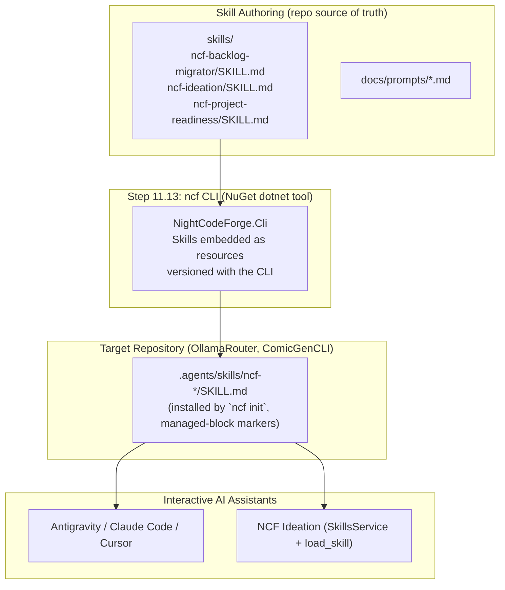

# � Step 11.12: Packaged Agent Skills for Backlog Migration & Ideation

> **Phase 11 Implementation Step (Post-MVP)**  
> *Parent Plan:* [Phase 11 Master Plan](../11_EXTEND_FEATURES.md)  
> *Target Components:* `skills/` (packaging source of truth), `src/NightCodeForge.Agents/Skills`, `src/NightCodeForge.Web/Components/Pages`, `src/NightCodeForge.Core/Services`, `docs/prompts/` | *Status:* Planned  
> *Companion Step:* [Step 11.13: `ncf` CLI — Deterministic Project Preparation & Onboarding](STEP_11_13_PROJECT_PREPAREDNESS_AND_ONBOARDING.md) (packages and installs the skills produced by this step)

---

## 1. Executive Objective

To enable rapid developer adoption of **NightCodeForge** on active, existing repositories (such as **OllamaRouter** and **ComicGenCLI**), developers must not be forced to manually copy-paste or re-author existing backlogs item by item.

This step produces **first-class, package-ready agent skills** that any interactive AI assistant (Antigravity IDE, Claude Code, Cursor, or the NCF Ideation interface) can discover and load. The skills are authored as self-contained, versioned packages so that **Step 11.13 (the `ncf` CLI, a NuGet `dotnet tool`)** can embed them as resources and install them into a target repository's `.agents/skills/` directory with a single deterministic command:

1. **Backlog Migration Skill (`ncf-backlog-migrator`):**
   - Ingests raw project artifacts—existing `ROADMAP.md`, `TODO.md`, `issues/*.md`, GitHub issue dumps, or scratch notes.
   - Deconstructs them into well-scoped, PR-sized [ForgeTask](file:///c:/Users/Julien/source/repos/jetelain/NightCodeForge/src/NightCodeForge.Core/Domain/ForgeTask.cs) proposals with structured acceptance criteria, affected files, test strategies, priority (1–5), and initial dependency linking.
   - Bulk-imports them directly into the NightCodeForge database (via Web API / `propose_tasks`) or exports them as synchronized `.nightcodeforge/tasks/*.md` markdown files.
2. **Ideation Skill (`ncf-ideation`):**
   - Guided interactive brainstorming and architectural decomposition for new features or subsystems directly within the developer's favorite chat tool.
3. **Readiness Remediation Skill (`ncf-project-readiness`):**
   - Interactive companion to the deterministic `ncf init` / `ncf audit` CLI passes (Step 11.13): interprets the green/yellow/red scorecard, walks the developer through non-deterministic remediation (failing tests, missing mocks, environment variables), and re-verifies.
4. **Ready-to-Use Prompt Templates:**
   - Self-contained, model-agnostic prompt templates any developer can paste into an LLM session to structure or migrate tasks for NCF.

> **Deferred (lower priority):** The **Web UI Bulk Import Tooling** (dashboard `/tasks/import` page) is intentionally out of scope for this step. Skills emit well-formed `.nightcodeforge/tasks/*.md` files; importing them into the database is deferred to a later step. The design is preserved in §8 as a forward reference.

---

## 2. Packaged Skills Architecture



**Key property:** the skills installed into a target repository are *identical* to the ones used inside the NCF repository itself. There is a single source of truth; the CLI is merely the distribution channel.

---

## 3. Skill Packaging Specification

### 3.1 Source of Truth Location
- Authoring root: `skills/` at the repository root (one directory per skill).
- The `ncf` CLI (Step 11.13) embeds `skills/**` as embedded resources and installs them into `.agents/skills/` of the target repository.

### 3.2 Per-Skill Layout
```
skills/
└── ncf-backlog-migrator/
    ├── SKILL.md              # frontmatter + instructions (self-contained)
    └── assets/               # optional: task markdown template, examples
        └── TASK_TEMPLATE.md
```

### 3.3 SKILL.md Frontmatter Contract
```yaml
---
name: ncf-backlog-migrator
version: 1
description: Migrates external project backlogs, roadmaps, and TODOs into cohesive, PR-sized NightCodeForge tasks with acceptance criteria, priority, and dependency links.
---
```
- **Model-agnostic:** instructions must not assume a specific model, vendor, or proprietary tool. The only allowed NCF-specific tool reference is `propose_tasks`, guarded by the instruction "when running inside NCF Ideation… otherwise emit markdown files".
- **Idempotent:** repeated loads must not duplicate state; skills must instruct agents to check existing `.nightcodeforge/tasks/` before writing.
- **Offline at load time:** skill installation must work without network access (GitHub issue dumps are pasted or pre-fetched, never pulled by the skill itself).

### 3.4 Compatibility Invariants
- Every skill must be loadable by [SkillsService](file:///c:/Users/Julien/source/repos/jetelain/NightCodeForge/src/NightCodeForge.Agents/Skills/SkillsService.cs) (valid YAML frontmatter, parseable markdown) — enforced by unit tests, per Rule 3 (Fail-Safe Loading) in the Skills README.
- Skills must not hardcode absolute paths; they reference workspace-relative locations only (`.nightcodeforge/`, `.agents/skills/`).
- Skills are versioned (`version:` in frontmatter); the CLI stamps the NCF release version into `.nightcodeforge/config.json` (`ncfVersion`) so drift between installed skills and CLI is detectable by `ncf audit` (Step 11.13).

---

## 4. Skill Specification: `ncf-backlog-migrator`

### 4.1 Core Behaviors
1. **Sizing & Granularity Principles**
   - Every NCF task represents a complete Pull Request / Merge Request that will run through deterministic builds, unit tests, agentic implementation, SAST gates, and code review.
   - **Do NOT create micro-tasks** ("Add configuration key", "Fix typo"). Group related sub-tasks into a cohesive feature task.
   - **Do NOT create multi-month epics:** break large features into logical milestones where each milestone compiles, has passing tests, and leaves the codebase healthy.
2. **Required Structure per Task**
   - **Title**: Clear, imperative statement (e.g. "Implement Ollama model health check endpoint").
   - **Priority**: 1 (Low), 2 (Normal), 3 (High), 4 (Very High), 5 (Critical/Urgent).
   - **Summary**: Concise user/system value.
   - **Sub-tasks / Implementation Checklist**: Concrete technical items to implement.
   - **Affected Files**: Expected files to create or modify.
   - **Acceptance Criteria**: Verifiable assertions (e.g. "Returns 200 OK with model latency", "Unit test passes").
   - **Dependencies (`dependsOn`)**: Explicit titles or IDs of prerequisite tasks that must land first.
3. **Output Formats**
   - Inside NCF Ideation: call the `propose_tasks` tool directly.
   - In an external IDE (Antigravity/Cursor/Claude Code): write markdown task files to `.nightcodeforge/tasks/{priority}-{slug}.md` using the bundled `assets/TASK_TEMPLATE.md`, then suggest importing via the Web UI bulk importer or the NCF Ideation interface.

### 4.2 Migration Sources
- `ROADMAP.md`, `TODO.md`, `CHANGELOG.md`
- `issues/*.md` folders, GitHub issue dumps (markdown/JSON pastes)
- Scratch notes, meeting notes, ADRs with action items

---

## 5. Skill Specification: `ncf-ideation`

### 5.1 Core Behaviors
- Inspects repository structure, existing classes, tests, and dependencies.
- Interviews the developer interactively:
  - *"What is the main user problem or capability we are targeting?"*
  - *"Are there existing classes or services that should be extended rather than rebuilt?"*
  - *"What test harness exists (unit tests, CLI invocation, integration tests)?"*
- Synthesizes findings into structured task proposals following the same required structure as §4.1, ready for `propose_tasks` or `.nightcodeforge/tasks/` export.

---

## 6. Skill Specification: `ncf-project-readiness`

### 6.1 Role
Interactive remediation companion to the deterministic `ncf init` / `ncf audit` CLI (Step 11.13). The CLI performs all *deterministic* preparation (`.gitignore`, `.editorconfig`, stack detection, format pass, skill installation, config bootstrap). This skill handles the *diagnostic* loop:

1. Reads the CLI readiness scorecard on disk (`.nightcodeforge/audit-report.md`).
2. Explains each warning/blocker in plain developer language.
3. Guides non-deterministic fixes: making tests pass on the base branch, removing hardcoded machine paths, adding Moq/NSubstitute stubs, fixing non-deterministic builds.
4. Re-runs the CLI audit and re-evaluates until the scorecard is green.

The skill must never re-implement deterministic checks in prose — it defers to the CLI output as the source of truth.

---

## 7. "Ready-to-Use" Prompt Library

For developers working in external chat interfaces without skill integration, provide pre-packaged prompts in `docs/prompts/`:

- `docs/prompts/BACKLOG_MIGRATION_PROMPT.md` — copy-pasteable prompt instructing any LLM to analyze pasted roadmap text or issue lists and output markdown compliant with the NCF task format (`assets/TASK_TEMPLATE.md`).
- `docs/prompts/TASK_DECOMPOSITION_PROMPT.md` — copy-pasteable prompt to break down a single large architectural specification into ordered, PR-sized NCF tasks with explicit dependency links.
- `docs/prompts/PROJECT_PREPAREDNESS_PROMPT.md` — moved here from Step 11.13; audit-and-prepare prompt for developers without the CLI installed.

---

## 8. Web UI Bulk Import Tooling — ⏸️ DEFERRED (later step)

> **Status: Deferred / Lower priority.** This deliverable is intentionally excluded from Step 11.12. The skills emit well-formed `.nightcodeforge/tasks/*.md` files (contract defined in `assets/TASK_TEMPLATE.md`); importing them into `ForgeTask` database records is deferred to a later step once the markdown contract is stable. The design below is preserved as a forward reference only.

### 8.1 Route & UX
- Route: `/tasks/import` (also accessible as a button in [Backlog.razor](file:///c:/Users/Julien/source/repos/jetelain/NightCodeForge/src/NightCodeForge.Web/Components/Pages/Backlog.razor)).
- Features:
  - **Scan Directory:** scans `.nightcodeforge/tasks/*.md` in the workspace repository and previews discovered tasks in a table.
  - **Paste JSON/Markdown:** paste a batch proposal JSON or markdown document.
  - **Batch Validation:** checks for title duplicates, circular dependencies, and missing prerequisites.
  - **Bulk Import Action:** instantiates [ForgeTask](file:///c:/Users/Julien/source/repos/jetelain/NightCodeForge/src/NightCodeForge.Core/Domain/ForgeTask.cs) records in `Suggested` or `Open` status, wiring [TaskDependency](file:///c:/Users/Julien/source/repos/jetelain/NightCodeForge/src/NightCodeForge.Core/Domain/TaskDependency.cs) records in a single database transaction.

---

## 9. Implementation Checklist & Deliverables

- [ ] **Skill Authoring (packaging source of truth):**
  - Create `skills/ncf-backlog-migrator/SKILL.md` + `assets/TASK_TEMPLATE.md`.
  - Create `skills/ncf-ideation/SKILL.md`.
  - Create `skills/ncf-project-readiness/SKILL.md`.
  - Unit tests validating the frontmatter contract and `SkillsService` loadability for every skill (fail-safe rule).
- [ ] **Prompt Library:**
  - Create `docs/prompts/BACKLOG_MIGRATION_PROMPT.md`, `TASK_DECOMPOSITION_PROMPT.md`, `PROJECT_PREPAREDNESS_PROMPT.md`.
- [x] **Bulk Import UI & Service — ⏸️ DEFERRED to a later step** (see §8):
  - ~~Implement `ITaskImportService` supporting markdown file batch import and JSON parsing.~~
  - ~~Build `/tasks/import` page with preview and dependency resolution.~~
- [ ] **Tests:**
  - Unit tests validating skill frontmatter contract and `SkillsService` loadability (see Skill Authoring above).
  - ~~Unit tests verifying the markdown task parser and dependency linking during bulk import~~ — deferred with §8.
  - ~~Integration test demonstrating ingestion of a sample roadmap into ForgeTask entities~~ — deferred with §8.
