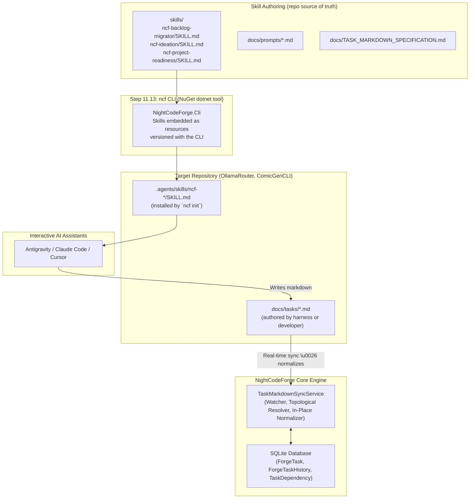

# 📦 Step 11.12: Packaged Agent Skills for Backlog Migration, Ideation & Flexible Task Dependencies

> **Phase 11 Implementation Step (Post-MVP)**  
> *Parent Plan:* [Phase 11 Master Plan](../11_EXTEND_FEATURES.md)  
> *Target Components:* `skills/` (packaging source of truth), `src/NightCodeForge.Agents/Skills`, `src/NightCodeForge.Core/Services`, `docs/prompts/`, `docs/TASK_MARKDOWN_SPECIFICATION.md` | *Status:* Completed  
> *Canonical Reference:* [Task Markdown & Frontmatter Specification](../../TASK_MARKDOWN_SPECIFICATION.md)  
> *Companion Step:* [Step 11.13: `ncf` CLI — Deterministic Project Preparation & Onboarding](STEP_11_13_PROJECT_PREPAREDNESS_AND_ONBOARDING.md) (packages and installs the skills produced by this step)

---

## 1. Executive Objective

To enable rapid developer adoption of **NightCodeForge** on active, existing repositories (such as **OllamaRouter** and **ComicGenCLI**), developers must not be forced to manually copy-paste or re-author existing backlogs item by item.

This step produces **first-class, package-ready agent skills** that any external interactive AI assistant (Antigravity IDE, Claude Code, Cursor) or human developer can discover and load. The skills are authored as self-contained, versioned packages so that **Step 11.13 (the `ncf` CLI, a NuGet `dotnet tool`)** can embed them as resources and install them into a target repository's `.agents/skills/` directory with a single deterministic command:

1. **Backlog Migration Skill (`ncf-backlog-migrator`):**
   - Ingests raw project artifacts—existing `ROADMAP.md`, `TODO.md`, `issues/*.md`, GitHub issue dumps, or scratch notes.
   - Deconstructs them into well-scoped, PR-sized [ForgeTask](file:///c:/Users/Julien/source/repos/jetelain/NightCodeForge/src/NightCodeForge.Core/Domain/ForgeTask.cs) proposals with structured acceptance criteria, affected files, test strategies, priority (1–5), and initial dependency linking.
   - Directly authors standardized task markdown files in `docs/tasks/*.md` which NightCodeForge automatically detects, synchronizes into the SQLite database, and tracks with full temporal audit history.
2. **Ideation Skill (`ncf-ideation`):**
   - Guided interactive brainstorming and architectural decomposition for new features or subsystems directly within the developer's favorite chat tool, emitting task markdown files into `docs/tasks/`.
3. **Flexible `depends_on` Resolution & In-Place Normalization:**
   - Enhances [TaskFrontmatter](file:///c:/Users/Julien/source/repos/jetelain/NightCodeForge/src/NightCodeForge.Core/Services/TaskFrontmatter.cs) and [TaskMarkdownSyncService](file:///c:/Users/Julien/source/repos/jetelain/NightCodeForge/src/NightCodeForge.Core/Services/TaskMarkdownSyncService.cs) so external harnesses and developers can author batches of interdependent tasks referencing prerequisites by **numeric ID**, **filename**, **title**, or **slug**.
   - Analyzes dependency DAGs topologically, allocating database IDs to prerequisites first, detecting circular dependencies fail-fast, and automatically rewriting markdown files on disk with canonical numeric IDs.
4. **Readiness Remediation Skill (`ncf-project-readiness`):**
   - Interactive companion to the deterministic `ncf init` / `ncf audit` CLI passes (Step 11.13): interprets the green/yellow/red scorecard, walks the developer through non-deterministic remediation (failing tests, missing mocks, environment variables), and re-verifies.
5. **Ready-to-Use Prompt Templates:**
   - Self-contained, model-agnostic prompt templates in `docs/prompts/` that any developer can paste into an LLM session to structure or migrate tasks for NCF.

### Scope Adjustments & Deferrals
- **Web UI Bulk Import Tooling (`/tasks/import`):** Intentionally deferred to a later step (see §9). The skills emit well-formed `docs/tasks/*.md` files which are continuously ingested by the real-time background sync service.
- **`ncf sync` CLI Command:** The addition of a manual `ncf sync` command to `NightCodeForge.Cli` (forcing synchronous disk-to-database flush on demand) is deferred to Step 11.13 alongside CLI commands like `ncf init` and `ncf install`. In the meantime, the background `FileSystemWatcher` and `TaskMarkdownSyncService` provide continuous real-time synchronization, and topological ordering with flexible `depends_on` ensures new batches resolve cleanly without requiring an external sync CLI.

---

## 2. Packaged Skills Architecture



---

## 3. Skill Packaging Specification

### 3.1 Source of Truth Location
- Authoring root: `skills/` at the repository root (one directory per skill).
- The `ncf` CLI (Step 11.13) embeds `skills/**` as embedded resources and installs them into `.agents/skills/` of the target repository.

### 3.2 Per-Skill Layout
```text
skills/
├── ncf-backlog-migrator/
│   ├── SKILL.md              # frontmatter + instructions (self-contained)
│   └── assets/               # task markdown template
│       └── TASK_TEMPLATE.md
├── ncf-ideation/
│   └── SKILL.md              # frontmatter + instructions
└── ncf-project-readiness/
    └── SKILL.md              # frontmatter + instructions
```

### 3.3 SKILL.md Frontmatter Contract
```yaml
---
name: ncf-backlog-migrator
version: 1
description: Migrates external project backlogs, roadmaps, and TODOs into cohesive, PR-sized NightCodeForge tasks with acceptance criteria, priority, and dependency links.
---
```
- **External harness focus:** instructions focus exclusively on managing `docs/tasks/*.md`, adhering to the frontmatter schema, explaining background database synchronization, and managing dependency DAGs.
- **Idempotent:** repeated loads must not duplicate state; skills instruct agents to check existing `docs/tasks/` before writing.
- **Offline at load time:** skill installation works without network access (external issue dumps are pasted or pre-fetched, never pulled via external network APIs).

### 3.4 Compatibility Invariants
- Every skill must be loadable by [SkillsService](file:///c:/Users/Julien/source/repos/jetelain/NightCodeForge/src/NightCodeForge.Agents/Skills/SkillsService.cs) (valid YAML frontmatter, parseable markdown) — enforced by unit tests in `PackagedSkillsTests`.
- Skills must not hardcode absolute paths; they reference workspace-relative locations only (`docs/tasks/`, `.agents/skills/`).
- Skills are versioned (`version:` in frontmatter); the CLI stamps the NCF release version into config so drift between installed skills and CLI is detectable by `ncf audit` (Step 11.13).

---

## 4. Skill Specification: `ncf-backlog-migrator`

### 4.1 Core Behaviors
1. **Sizing & Granularity Principles:**
   - Every NCF task represents a complete Pull Request / Merge Request that will run through deterministic builds, unit tests, agentic implementation, SAST gates, and code review.
   - **Do NOT create micro-tasks** ("Add configuration key", "Fix typo"). Group related sub-tasks into a cohesive feature task.
   - **Do NOT create multi-month epics:** break large features into logical milestones where each milestone compiles, has passing tests, and leaves the codebase healthy.
2. **Required Structure per Task:**
   - **Title**: Clear, imperative statement (e.g. `Implement Ollama model health check endpoint`).
   - **Priority**: 1 (Critical), 2 (High), 3 (Normal), 4 (Low), 5 (Trivial).
   - **Summary**: Concise user/system value.
   - **Sub-tasks / Implementation Checklist**: Concrete technical items to implement.
   - **Affected Files**: Expected files to create or modify.
   - **Acceptance Criteria**: Verifiable assertions (e.g. "Returns 200 OK with model latency", "Unit test passes").
   - **Dependencies (`depends_on`)**: Prerequisite tasks referenced by numeric ID, filename, slug, or title.
3. **Output Format:**
   - Writes markdown task files directly to `docs/tasks/{yyyy-MM-dd}-{slug}.md` adhering to `TASK_MARKDOWN_SPECIFICATION.md`.

---

## 5. Skill Specification: `ncf-ideation`

### 5.1 Core Behaviors
- Inspects repository structure, existing classes, tests, and dependencies.
- Interviews the developer interactively:
  - *"What is the main user problem or capability we are targeting?"*
  - *"Are there existing classes or services that should be extended rather than rebuilt?"*
  - *"What test harness exists (unit tests, CLI invocation, integration tests)?"*
- Synthesizes findings into structured task proposals written directly to `docs/tasks/{yyyy-MM-dd}-{slug}.md`, linking prerequisite dependencies by slug or filename.

---

## 6. Flexible Dependency Resolution & In-Place Normalization Engine

A critical addition in Step 11.12 is the **flexible dependency resolution engine** in `TaskMarkdownSyncService` and `TaskFrontmatter`.

### 6.1 Problem Solved
Previously, `TaskFrontmatter.DependsOn` only accepted a list of integer database IDs (`List<int>`). When an external harness (Antigravity IDE, Claude Code, Cursor) or human developer created multiple interdependent tasks at once, downstream tasks could not reference prerequisites because database IDs had not yet been assigned. Developers had to wait for the system to assign IDs one file at a time, or manually edit files after the fact.

### 6.2 Solution Architecture
1. **Polymorphic Dependency Collection:**
   - [TaskDependencyReferenceList](file:///c:/Users/Julien/source/repos/jetelain/NightCodeForge/src/NightCodeForge.Core/Services/TaskDependencyReferenceList.cs): Implements `IList<object>` supporting mixed integer IDs and string references (`"task-alpha"`, `"2026-10-20-task-alpha.md"`, `"Task Alpha"`).
   - [TaskDependencyReferenceListYamlConverter](file:///c:/Users/Julien/source/repos/jetelain/NightCodeForge/src/NightCodeForge.Core/Services/TaskDependencyReferenceListYamlConverter.cs): Custom YamlDotNet type converter ensuring scalar integers deserialize as `int` and strings deserialize cleanly.
2. **Unified Fuzzy Resolution (`NormalizeDependencyKey`):**
   - Strips `.md` extensions, date prefixes (`^\d{4}-\d{2}-\d{2}-`), and non-alphanumeric characters into a normalized slug.
   - Matches references against existing database tasks (by ID, title, title slug, filename, file slug) and pending batch tasks.
3. **Topological Order Processing:**
   - For batch ingestions (`SyncAllTasksFromDiskAsync`), the engine builds a combined dependency graph of both database tasks and pending disk files.
   - Performs a topological sort: prerequisite tasks are created in SQLite first and receive primary keys. Downstream tasks are created next with the newly minted IDs wired into `TaskDependency`.
4. **Unified Cycle Detection (`HasCycleDfs`):**
   - Traverses the unified graph before inserting records. If a cycle exists (e.g. `A -> B -> A`), synchronization fails fast with a `TaskMarkdownSyncException` showing the exact path.
   - Self-dependencies (e.g. `A -> A`) are detected and rejected immediately.
5. **In-Place Normalization:**
   - Once database records are created, `TaskMarkdownSyncService` rewrites the markdown files on disk, replacing raw string references with canonical numeric IDs:
     ```yaml
     # Before sync:
     depends_on:
       - "2026-10-20-task-alpha.md"

     # After sync (rewritten on disk):
     depends_on:
       - 101
     ```

---

## 7. Skill Specification: `ncf-project-readiness`

### 7.1 Role
Interactive remediation companion to the deterministic `ncf init` / `ncf audit` CLI (Step 11.13). The CLI performs all *deterministic* preparation (`.gitignore`, `.editorconfig`, stack detection, format pass, skill installation, config bootstrap). This skill handles the *diagnostic* loop:

1. Reads the CLI readiness scorecard on disk (`.nightcodeforge/audit-report.md`).
2. Explains each warning/blocker in plain developer language.
3. Guides non-deterministic fixes: making tests pass on the base branch, removing hardcoded machine paths, adding Moq/NSubstitute stubs, fixing non-deterministic builds.
4. Re-runs the CLI audit and re-evaluates until the scorecard is green.

The skill must never re-implement deterministic checks in prose — it defers to the CLI output as the source of truth.

---

## 8. "Ready-to-Use" Prompt Library

For developers working in external chat interfaces without skill integration, pre-packaged prompts are provided in `docs/prompts/`:

- `docs/prompts/BACKLOG_MIGRATION_PROMPT.md` — copy-pasteable prompt instructing any LLM to analyze pasted roadmap text or issue lists and output markdown compliant with the NCF task format.
- `docs/prompts/TASK_DECOMPOSITION_PROMPT.md` — copy-pasteable prompt to break down a single large architectural specification into ordered, PR-sized NCF tasks with explicit dependency links.
- `docs/prompts/PROJECT_PREPAREDNESS_PROMPT.md` — audit-and-prepare prompt for developers without the CLI installed.

---

## 9. Web UI Bulk Import & CLI Sync — ⏸️ DEFERRED (later step)

> **Status: Deferred / Lower priority.**
> - **Web UI Bulk Import Tooling (`/tasks/import`):** Intentionally excluded from Step 11.12. The skills emit well-formed `docs/tasks/*.md` files; importing them into `ForgeTask` database records is handled automatically by the background `TaskMarkdownSyncService`. A dedicated web page `/tasks/import` with manual directory scanning and JSON paste is deferred to a future step.
> - **`ncf sync` Command:** Adding a synchronous `ncf sync` verb to `NightCodeForge.Cli` is deferred to Step 11.13 alongside `ncf init` and `ncf install`. The continuous background sync and flexible batch topological sorting ensure immediate and robust intake without requiring an external sync command.

---

## 10. Implementation Checklist & Deliverables

- [x] **Skill Authoring (packaging source of truth):**
  - Create `skills/ncf-backlog-migrator/SKILL.md` + `assets/TASK_TEMPLATE.md`.
  - Create `skills/ncf-ideation/SKILL.md`.
  - Create `skills/ncf-project-readiness/SKILL.md`.
  - Unit tests validating the frontmatter contract and `SkillsService` loadability for every skill (`PackagedSkillsTests`).
- [x] **Prompt Library:**
  - Create `docs/prompts/BACKLOG_MIGRATION_PROMPT.md`, `TASK_DECOMPOSITION_PROMPT.md`, `PROJECT_PREPAREDNESS_PROMPT.md`.
- [x] **Flexible `depends_on` in `TaskFrontmatter` & `TaskMarkdownSyncService`:**
  - Implemented `TaskDependencyReferenceList` and `TaskDependencyReferenceListYamlConverter` supporting numeric IDs, filenames, slugs, and titles.
  - Unified multi-task batch synchronization with topological dependency sorting and in-place normalization of markdown files to canonical integer IDs.
  - Cycle detection (`HasCycleDfs`) and self-dependency guards covering both pending batch tasks and existing database tasks.
  - Single-file synchronization in `ProcessFileContentAsync` resolving slug/filename references and updating disk files.
  - Comprehensive unit test suite in `TaskFlexibleDependencySyncTests` (10 tests).
- [x] **Canonical Specification Documentation:**
  - Create `docs/TASK_MARKDOWN_SPECIFICATION.md` as the definitive reference for task markdown structure, YAML frontmatter schema, synchronization rules, and dependency mechanics.
- [x] **Bulk Import UI & CLI Sync — ⏸️ DEFERRED to a later step** (see §9):
  - ~~Implement `ITaskImportService` supporting markdown file batch import and JSON parsing.~~
  - ~~Build `/tasks/import` page with preview and dependency resolution.~~
  - ~~Add `ncf sync` command to `NightCodeForge.Cli` (deferred to Step 11.13).~~
- [x] **Tests:**
  - Unit tests validating skill frontmatter contract and `SkillsService` loadability (`PackagedSkillsTests`).
  - Unit tests verifying flexible dependency parsing, batch resolution, topological ordering, and normalization (`TaskFlexibleDependencySyncTests`).
  - Full test suite verified: **1,368 tests passed, 0 failed**.
