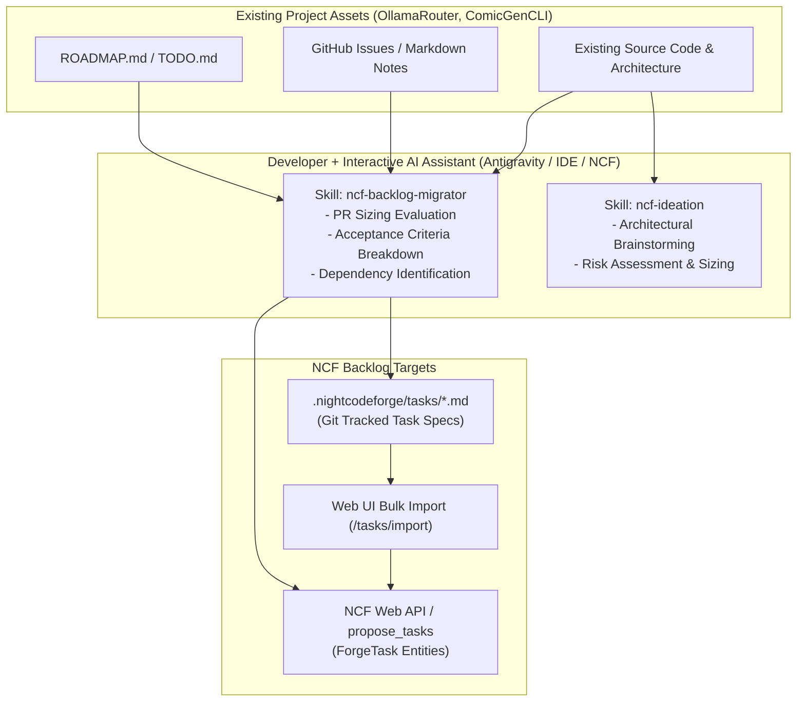

# 📋 Step 11.12: Interactive Agent Skills for Backlog Migration & Ideation

> **Phase 11 Implementation Step (Post-MVP)**  
> *Parent Plan:* [Phase 11 Master Plan](../11_EXTEND_FEATURES.md)  
> *Target Components:* `.nightcodeforge/skills/`, `.agents/skills/`, `src/NightCodeForge.Agents/Skills`, `src/NightCodeForge.Web/Components/Pages`, `src/NightCodeForge.Core/Services` | *Status:* Planned

---

## 1. Executive Objective

To enable rapid developer adoption of **NightCodeForge** on active, existing repositories (such as **OllamaRouter** and **ComicGenCLI**), developers must not be forced to manually copy-paste or re-author existing backlogs item by item.

This step introduces **first-class interactive agent skills** and **ready-to-use prompts** that allow a developer paired with an interactive AI assistant (via Antigravity IDE, Claude Code, Cursor, or the NCF Ideation interface) to:
1. **Migrate Existing Backlogs (`ncf-backlog-migrator` skill):**
   - Ingest raw project artifacts—such as existing `ROADMAP.md`, `TODO.md`, `issues/*.md`, GitHub issue dumps, or scratch notes.
   - Deconstruct them into well-scoped, PR-sized [ForgeTask](file:///c:/Users/Julien/source/repos/jetelain/NightCodeForge/src/NightCodeForge.Core/Domain/ForgeTask.cs) proposals with structured acceptance criteria, affected files, test strategies, priority (1–5), and initial dependency linking.
   - Bulk-import them directly into the NightCodeForge database or export them as synchronized `.nightcodeforge/tasks/*.md` markdown files.
2. **Interactive Ideation Assistant (`ncf-ideation` skill):**
   - Provide guided interactive brainstorming and architectural decomposition for new features or subsystems directly within the developer's favorite chat tool.
3. **Ready-to-Use Prompt Templates:**
   - Supply self-contained, model-agnostic prompt templates that any developer can immediately paste into an LLM session to structure or migrate tasks for NCF.
4. **Web UI Bulk Import Tooling:**
   - Provide a simple bulk intake mechanism on the Web dashboard (`/tasks/import` or inside `/backlog`) to upload or scan a folder of markdown tasks and create [ForgeTask](file:///c:/Users/Julien/source/repos/jetelain/NightCodeForge/src/NightCodeForge.Core/Domain/ForgeTask.cs) records in batch.

---

## 2. Interactive Agent Skills Architecture



---

## 3. Skill Specification: `ncf-backlog-migrator`

### 3.1 Skill Location & Discovery
- File Path: `.nightcodeforge/skills/ncf-backlog-migrator/SKILL.md` (or `.agents/skills/ncf-backlog-migrator/SKILL.md`).
- Automatically discoverable by [SkillsService](file:///c:/Users/Julien/source/repos/jetelain/NightCodeForge/src/NightCodeForge.Agents/Skills/SkillsService.cs) and external IDE assistants.

### 3.2 Skill Content (`SKILL.md`)
```markdown
---
name: ncf-backlog-migrator
description: Migrates external project backlogs, roadmaps, and TODOs into cohesive, PR-sized NightCodeForge tasks with acceptance criteria, priority, and dependency links.
---

# NightCodeForge Backlog Migration Skill

Use this skill when onboarding an existing project into NightCodeForge or translating roadmap documents into actionable NCF backlog items.

## Sizing & Granularity Principles
1. **PR-Sized Units of Work:**
   - Every NCF task represents a complete Pull Request / Merge Request.
   - It will run through deterministic builds, unit tests, agentic implementation, SAST gates, and code review.
   - **Do NOT create micro-tasks:** (e.g., "Add configuration key", "Create single interface", "Fix typo"). Group related sub-tasks into a cohesive feature task.
   - **Do NOT create multi-month epics:** Break large features into logical milestones where each milestone compiles, has passing tests, and leaves the codebase in a healthy state.

2. **Required Structure per Task:**
   Each migrated task MUST specify:
   - **Title**: Clear, imperative statement (e.g. "Implement Ollama model health check endpoint").
   - **Priority**: 1 (Low), 2 (Normal), 3 (High), 4 (Very High), 5 (Critical/Urgent).
   - **Summary**: Concise description of user/system value.
   - **Sub-tasks / Implementation Checklist**: Concrete technical items to implement.
   - **Affected Files**: Expected files to create or modify.
   - **Acceptance Criteria**: Verifiable assertions (e.g., "Returns 200 OK with model latency", "Unit test passes").
   - **Dependencies (`dependsOn`)**: Explicit titles or IDs of prerequisite tasks that must land first.

3. **Output Formats:**
   - When running inside NCF Ideation: Call `propose_tasks` tool directly.
   - When running in an external IDE (Antigravity/Cursor): Output markdown task files in `.nightcodeforge/tasks/{priority}-{slug}.md`.
```

---

## 4. Skill Specification: `ncf-ideation`

### 4.1 Skill Location & Discovery
- File Path: `.nightcodeforge/skills/ncf-ideation/SKILL.md`.

### 4.2 Core Behaviors
- Inspects repository structure, existing classes, tests, and dependencies.
- Interviews the developer interactively:
  - *"What is the main user problem or capability we are targeting?"*
  - *"Are there existing classes or services that should be extended rather than rebuilt?"*
  - *"What test harness exists (unit tests, CLI invocation, integration tests)?"*
- Synthesizes findings into structured [TaskProposal](file:///c:/Users/Julien/source/repos/jetelain/NightCodeForge/src/NightCodeForge.Core/Domain/ForgeTask.cs) items ready for execution.

---

## 5. "Ready-to-Use" Prompt Library

For developers working in external chat interfaces (e.g., ChatGPT, Claude, Gemini web interface) without direct skill integration, provide pre-packaged prompts in `docs/prompts/`:

### 5.1 `docs/prompts/BACKLOG_MIGRATION_PROMPT.md`
> Copy-pasteable prompt instructing any LLM to analyze pasted roadmap text or issue lists and output YAML/JSON compliant with NCF task format.

### 5.2 `docs/prompts/TASK_DECOMPOSITION_PROMPT.md`
> Copy-pasteable prompt to break down a single large architectural specification into ordered, PR-sized NCF tasks with explicit dependency links.

---

## 6. Web UI Bulk Import Tooling

### 6.1 Route & UX
- Route: `/tasks/import` (also accessible as a button in [Backlog.razor](file:///c:/Users/Julien/source/repos/jetelain/NightCodeForge/src/NightCodeForge.Web/Components/Pages/Backlog.razor)).
- Features:
  - **Scan Directory:** Scans `.nightcodeforge/tasks/*.md` in the workspace repository and previews discovered tasks in a table.
  - **Paste JSON/Markdown:** Paste a batch proposal JSON or markdown document.
  - **Batch Validation:** Checks for title duplicates, circular dependencies, and missing prerequisites.
  - **Bulk Import Action:** Instantiates [ForgeTask](file:///c:/Users/Julien/source/repos/jetelain/NightCodeForge/src/NightCodeForge.Core/Domain/ForgeTask.cs) records in `Suggested` or `Open` status, wiring [TaskDependency](file:///c:/Users/Julien/source/repos/jetelain/NightCodeForge/src/NightCodeForge.Core/Domain/TaskDependency.cs) records in a single database transaction.

---

## 7. Implementation Checklist & Deliverables

- [ ] **Skills Creation:**
  - Create `.nightcodeforge/skills/ncf-backlog-migrator/SKILL.md`.
  - Create `.nightcodeforge/skills/ncf-ideation/SKILL.md`.
  - Register default skill templates in `SkillsService` so newly initialized workspaces can auto-populate them.
- [ ] **Prompt Library:**
  - Create `docs/prompts/BACKLOG_MIGRATION_PROMPT.md`.
  - Create `docs/prompts/TASK_DECOMPOSITION_PROMPT.md`.
- [ ] **Bulk Import UI & Service:**
  - Implement `ITaskImportService` supporting markdown file batch import and JSON parsing.
  - Build `TaskBulkImportModal.razor` or `/tasks/import` page with preview and dependency resolution.
- [ ] **Tests:**
  - Unit tests verifying markdown task parser and dependency linking during bulk import.
  - Integration test demonstrating ingestion of a sample roadmap into [ForgeTask](file:///c:/Users/Julien/source/repos/jetelain/NightCodeForge/src/NightCodeForge.Core/Domain/ForgeTask.cs) entities.
