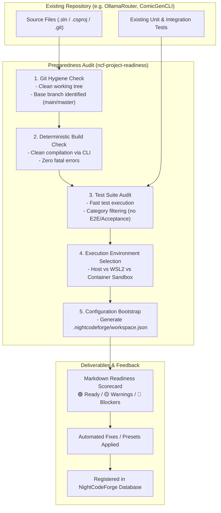

# 🚀 Step 11.13: Project Preparedness, Compatibility Audit & Onboarding Tooling

> **Phase 11 Implementation Step (Post-MVP)**  
> *Parent Plan:* [Phase 11 Master Plan](../11_EXTEND_FEATURES.md)  
> *Target Components:* `.nightcodeforge/skills/`, `src/NightCodeForge.Core/Services`, `src/NightCodeForge.Web/Components/Workspaces`, `docs/prompts/` | *Status:* Planned

---

## 1. Executive Objective

Before onboarding active development repositories (specifically **OllamaRouter** and **ComicGenCLI**) into NightCodeForge, developers need confidence that their repository setup satisfies the autonomous pipeline requirements. If an existing codebase has failing tests on the base branch, uncommitted files, missing environment variables, or incompatible build scripts, autonomous agents will fail repeatedly at the pre-implementation baseline gate.

This step introduces:
1. **Interactive Project Preparedness Skill (`ncf-project-readiness`):**
   - An interactive agent skill that audits an existing project for NCF compatibility, diagnoses issues, and guides the developer through immediate remediation.
2. **"Ready-to-Use" Project Preparedness Prompt:**
   - A standalone prompt template for developers to audit and prepare a repository using their existing AI assistant.
3. **Automated Configuration Generator (`.nightcodeforge/` bootstrap):**
   - Inspects project files (`.sln`, `.csproj`, `package.json`, etc.) and automatically generates the `.nightcodeforge/workspace.json` configuration, stack preset, and deterministic verification scripts.
4. **Deterministic Pre-flight Audit Script (`ncf-audit`):**
   - A cross-platform CLI tool (PowerShell & Bash) that performs pre-flight checks and outputs a clear green/yellow/red readiness scorecard.

---

## 2. Readiness Audit Workflow



---

## 3. Skill Specification: `ncf-project-readiness`

### 3.1 Skill Location & Discovery
- File Path: `.nightcodeforge/skills/ncf-project-readiness/SKILL.md` (or `.agents/skills/ncf-project-readiness/SKILL.md`).
- Automatically loaded by [SkillsService](file:///c:/Users/Julien/source/repos/jetelain/NightCodeForge/src/NightCodeForge.Agents/Skills/SkillsService.cs) or external IDE agents.

### 3.2 Audit Checklist Performed by the Skill
The agent evaluates the following 5 critical pillars:

| Pillar | Requirement | Evaluation Criteria & Rules |
| :--- | :--- | :--- |
| **1. Git Health** | Clean baseline | Repository must have a committed `HEAD`, a designated default branch (`main` or `master`), and a clean working tree. |
| **2. Build Determinism** | CLI compile | Project must compile via CLI (`dotnet build --nologo` or equivalent) without interactive UI prompts or proprietary IDE dependencies. |
| **3. Test Fast Feedback** | Reliable unit tests | Unit tests must pass completely on the base branch. E2E or long-running integration tests must be tagged or filtered out (e.g., `--filter "Category!=Acceptance&Category!=E2E"`). |
| **4. Isolation Readiness** | Minimal side effects | Tests must not require hardcoded local machine paths or unmocked external production services. Mocking libraries (e.g. Moq, NSubstitute) or stubs should be used for external dependencies. |
| **5. Configuration** | NCF config | Presence of `.nightcodeforge/` configuration directory with verification commands and build timeouts. |

---

## 4. Configuration Bootstrapping (`.nightcodeforge/workspace.json`)

When auditing an unconfigured repository, the readiness tool automatically detects project types and emits `.nightcodeforge/workspace.json`:

### 4.1 Example: C# .NET Project (e.g. `OllamaRouter` / `ComicGenCLI`)
```json
{
  "$schema": "https://nightcodeforge.dev/schemas/workspace.json",
  "name": "OllamaRouter",
  "stackPreset": "DotNet",
  "executionMode": "Host",
  "baseBranch": "main",
  "verification": {
    "buildCommand": "dotnet build --nologo -c Debug",
    "testCommand": "dotnet test --no-build --nologo -c Debug --filter \"Category!=Acceptance&Category!=E2E\"",
    "buildTimeoutSeconds": 180,
    "testTimeoutSeconds": 180
  },
  "conventions": {
    "cleanBreakPolicy": true,
    "noSilentFailures": true,
    "requireExplicitDependencies": true
  }
}
```

---

## 5. "Ready-to-Use" Prompt: `docs/prompts/PROJECT_PREPAREDNESS_PROMPT.md`

A standalone prompt template provided in the repository:
```markdown
# NightCodeForge Project Preparedness & Onboarding Prompt

You are an expert DevSecOps and Autonomous Agent Architect. Your task is to inspect the current repository and evaluate its readiness to be onboarded into NightCodeForge (an autonomous engineering orchestrator).

Execute the following verification steps:
1. Verify git status and current branch. Ensure working tree is clean.
2. Run the command-line build and report any errors or missing packages.
3. Run the unit test suite without slow or acceptance tests. Verify all tests pass.
4. Check if external services are appropriately mocked or stubbed.
5. Create or verify the `.nightcodeforge/workspace.json` configuration file with appropriate build and test commands.

Generate a comprehensive Readiness Scorecard with:
- Status: READY / ACTION_REQUIRED
- List of passing requirements
- List of blockers and recommended command fixes
```

---

## 6. Implementation Checklist & Deliverables

- [ ] **Skill Definition:**
  - Create `.nightcodeforge/skills/ncf-project-readiness/SKILL.md`.
  - Provide automated detection of C# .NET solutions and CLI projects.
- [ ] **Preparedness Prompt Template:**
  - Create `docs/prompts/PROJECT_PREPAREDNESS_PROMPT.md`.
- [ ] **Configuration Generator:**
  - Implement `WorkspaceConfigGenerator` in `NightCodeForge.Core` to auto-detect project types and produce `workspace.json`.
  - Integrate with Workspace Creation Wizard ([WizardStep1Directory.razor](file:///c:/Users/Julien/source/repos/jetelain/NightCodeForge/src/NightCodeForge.Web/Components/Workspaces/WizardStep1Directory.razor)).
- [ ] **Pre-flight Audit Script:**
  - Implement `scripts/ncf-audit.ps1` and `scripts/ncf-audit.sh` for fast one-command repository certification.
- [ ] **Tests:**
  - Unit tests verifying config generation across sample C# solution directories.
  - Test verifying readiness detection flags broken builds or failing tests.
