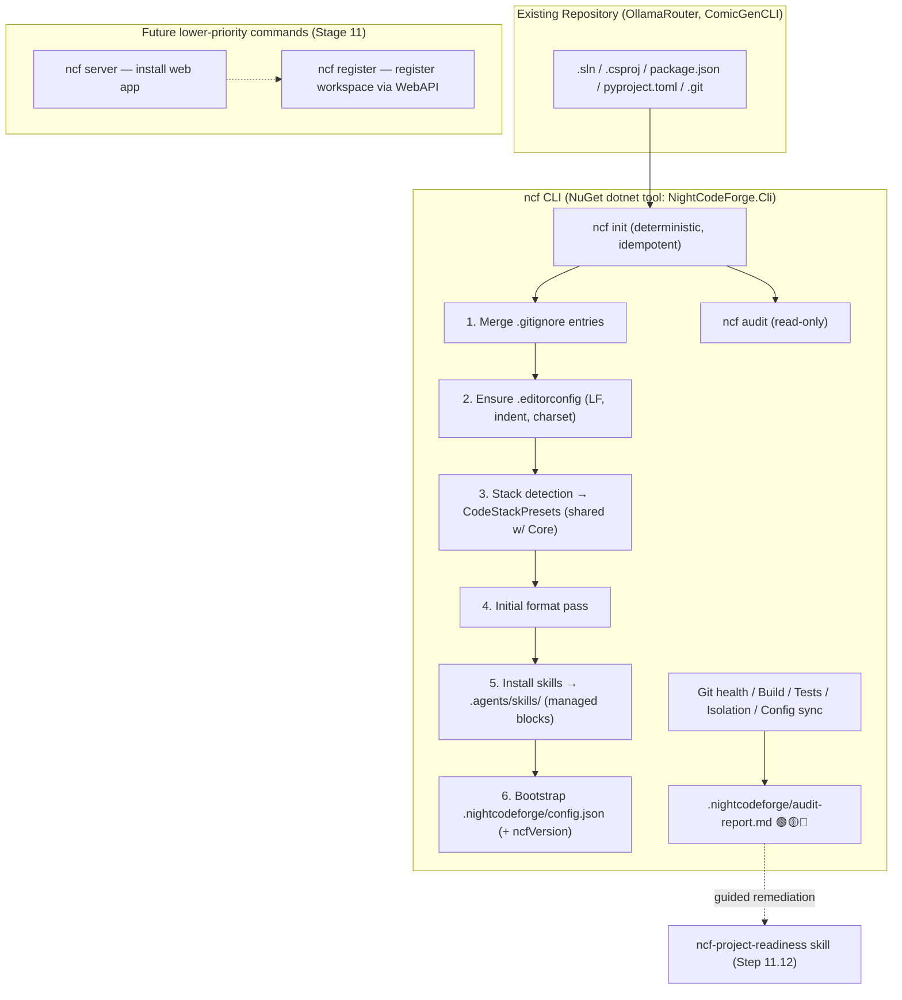

# 🚀 Step 11.13: `ncf` CLI — Deterministic Project Preparation & Onboarding (NuGet dotnet tool)

> **Phase 11 Implementation Step (Post-MVP)**  
> *Parent Plan:* [Phase 11 Master Plan](../11_EXTEND_FEATURES.md)  
> *Target Components:* `src/NightCodeForge.Cli/` (new, `PackAsTool`), `src/NightCodeForge.Core` (shared `CodeStackPresets` / `WorkspaceProjectConfig`), `skills/` (embedded resources, produced by Step 11.12), `.nightcodeforge/`, `.gitignore`, `.editorconfig` | *Status:* Completed  
> *Companion Step:* [Step 11.12: Packaged Agent Skills for Backlog Migration & Ideation](STEP_11_12_BACKLOG_MIGRATION_AND_IDEATION_SKILLS.md) (authors the skills this CLI packages and installs)

---

## 1. Executive Objective

Onboarding an existing repository (e.g. **OllamaRouter**, **ComicGenCLI**) into NightCodeForge today requires a long manual ritual: writing `.gitignore` entries, adding `.editorconfig`, identifying the stack, choosing build/test commands, running a first format pass, and copying agent skills by hand. Every one of these steps is **deterministic** and does not belong in an LLM prompt.

This step delivers the best UX: **a single `ncf` CLI, packaged as a NuGet `dotnet tool`**, that performs all deterministic preparation in one command:

```
dotnet tool install --global NightCodeForge.Cli
cd path/to/existing/repo
ncf init        # prepare the repository
ncf audit       # readiness scorecard (🟢 / 🟡 / 🔴)
```

### 1.1 In-Scope: Deterministic Preparation (`ncf init`)
1. **`.gitignore` update/creation** — merges the NCF-mandatory entries (bin/, obj/, .vs/, TestResults/, \*.trx, `.nightcodeforge/` runtime artifacts such as transcripts) into the existing file without clobbering user entries; creates the file if absent.
2. **`.editorconfig` update/creation** — ensures `root = true`, `end_of_line = lf`, and per-language indent/charset sections, aligned with `EditorConfigFileApplier` behavior (Phase 2 / Phase 4 LF enforcement) so agent edits produce zero phantom diffs.
3. **Stack detection** — detects the project stack (`.sln`/`.csproj`, `package.json`, `pyproject.toml`/`setup.py`, `Cargo.toml`, `go.mod`) and resolves the matching preset from the **shared** [`CodeStackPresets`](file:///c:/Users/Julien/source/repos/jetelain/NightCodeForge/src/NightCodeForge.Core/Domain/CodeStack.cs) table (dotnet, node, python, rust, go) — the exact same table the workflow engine uses, so CLI and pipeline can never drift.
4. **Initial format pass** — runs the stack's format command (e.g. `dotnet format --no-restore`, `cargo fmt`, `ruff format .`, `gofmt -w .`) once, so the baseline the agents start from is clean.
5. **External harness skills installation** — writes the Step 11.12 packaged skills (`ncf-backlog-migrator`, `ncf-ideation`, `ncf-project-readiness`) into `.agents/skills/ncf-*/SKILL.md`, discoverable both by external IDE assistants (Claude Code, Cursor, Antigravity) and by NCF `SkillsService` (workspace-scoped discovery). Installed files are wrapped in managed-block markers so re-running `ncf init` is idempotent and re-syncs to the new CLI version.
6. **Configuration bootstrap** — generates `.nightcodeforge/config.json` (the format already consumed by `CodeStackPresets.ResolveConfig`), stamped with the detected stack, build/test/format commands, base branch, and the CLI's `ncfVersion`.

### 1.2 Readiness Audit (`ncf audit`)
A fast, repeatable pre-flight check producing a green/yellow/red scorecard (console + `.nightcodeforge/audit-report.md`) across 5 pillars:

| Pillar | Check | Result |
| :--- | :--- | :--- |
| **1. Git Health** | Committed HEAD, default branch (`main`/`master`), clean working tree | 🟢 / 🔴 |
| **2. Build Determinism** | CLI build (`dotnet build --nologo` or stack equivalent) succeeds without interactive prompts | 🟢 / 🔴 |
| **3. Test Fast Feedback** | Fast test run passes on base branch (category filtering: no E2E/Acceptance) | 🟢 / 🟡 / 🔴 |
| **4. Isolation Readiness** | Heuristic scan for hardcoded machine paths and unmocked external service calls in tests | 🟢 / 🟡 |
| **5. NCF Configuration** | `.nightcodeforge/config.json` present, `ncfVersion` matches installed CLI, installed skills in sync | 🟢 / 🟡 / 🔴 |

The audit is **non-mutating** (read-only); remediation suggestions are printed, and the interactive `ncf-project-readiness` skill (Step 11.12) reads `audit-report.md` to guide the human through fixes.

### 1.3 Explicitly Out of Scope (Future, Lower Priority — still Stage 11)
The CLI is designed so these commands slot in later without breaking `init`/`audit`:
- **`ncf server`** — detect and (re)install the NightCodeForge web application if not yet present on the machine.
- **`ncf register`** — register the prepared workspace in the web application via its Web API (workspace name, path, base branch, stack).
- **`ncf import`** — push `.nightcodeforge/tasks/*.md` into the database (pairs with the deferred bulk import of Step 11.12).
- Etc. (telemetry opt-in, multi-repo batch preparation, …).

---

## 2. Workflow



---

## 3. CLI Architecture (`src/NightCodeForge.Cli/`)

### 3.1 Project & Packaging
- New project `src/NightCodeForge.Cli/NightCodeForge.Cli.csproj`:
  - `<OutputType>Exe</OutputType>`, `<PackAsTool>true</PackAsTool>`, `<ToolCommandName>ncf</ToolCommandName>`.
  - References `NightCodeForge.Core` (for `CodeStackPresets` / `WorkspaceProjectConfig`) — the CLI must reuse, never re-implement, stack detection.
  - Embeds `skills/**` (Step 11.12 authoring root) as embedded resources; the installed skills are bit-identical to the CLI release.
- Install: `dotnet tool install --global NightCodeForge.Cli` (or local: `dotnet tool install NightCodeForge.Cli --add-to-manifest` with a `.config/dotnet-tools.json` per target repo).

### 3.2 Command Surface (v1)
| Command | Description | Exit Codes |
| :--- | :--- | :--- |
| `ncf init [path]` | Deterministic preparation: gitignore, editorconfig, stack detection, format pass, skill install, config bootstrap. Idempotent. `--dry-run` previews; `--skip-format` available. | 0 ok · 1 fatal error · 2 user error (not a git repo, path not found) |
| `ncf audit [path]` | Read-only readiness scorecard across the 5 pillars; writes `.nightcodeforge/audit-report.md`. | 0 🟢 · 1 🟡 warnings · 2 🔴 blockers |
| `ncf --version` | CLI + NCF version (matches `ncfVersion` stamped in config). | 0 |

### 3.3 Design Invariants
- **Deterministic & idempotent:** running `ncf init` twice produces the same tree; managed-block markers (`# >>> nightcodeforge (managed — do not edit between markers) >>>` … `# <<< nightcodeforge <<<`) delimit CLI-owned regions in `.gitignore`, `.editorconfig`, and `.agents/skills/ncf-*` so user edits outside the blocks survive.
- **Fail fast, no silent fallbacks:** an undetectable stack is a hard error with a clear message and a hint to pass `--stack <name>` explicitly — the CLI never guesses `dotnet` silently (mirrors the repository's fail-fast / no-synthetic-values policy).
- **No network in v1:** `init` and `audit` work fully offline (skills are embedded resources; no downloads).
- **No LLM in the CLI:** every action is deterministic code; anything requiring judgment is emitted as an audit warning and handed to the `ncf-project-readiness` skill.
- **Core reuse:** stack presets, config file format, and timeout defaults come from `NightCodeForge.Core` (`CodeStackPresets.ResolveConfig` reads `.nightcodeforge/config.json` / `nightcodeforge.json`); the CLI writes exactly what the pipeline reads.
- **Cross-platform:** .NET tool, runs on Windows, Linux, and macOS; shell out to git/dotnet/npm/etc. with no POSIX-only assumptions.

### 3.4 Configuration Bootstrap (`.nightcodeforge/config.json`)
Generated to the existing [`WorkspaceProjectConfig`](file:///c:/Users/Julien/source/repos/jetelain/NightCodeForge/src/NightCodeForge.Core/Domain/CodeStack.cs) shape, e.g. for a .NET repo:
```json
{
  "codeStack": "dotnet",
  "buildCommand": "dotnet build",
  "testCommand": "dotnet test --no-build",
  "formatCommand": "dotnet format",
  "buildTimeoutSeconds": 180,
  "testTimeoutSeconds": 180
}
```
Plus CLI-managed metadata fields (`ncfVersion`, `baseBranch`) that the audit checks for drift.

---

## 4. Skills Installed by `ncf init`

| Skill | Source (Step 11.12) | Installed To |
| :--- | :--- | :--- |
| `ncf-backlog-migrator` | `skills/ncf-backlog-migrator/` | `.agents/skills/ncf-backlog-migrator/` |
| `ncf-ideation` | `skills/ncf-ideation/` | `.agents/skills/ncf-ideation/` |
| `ncf-project-readiness` | `skills/ncf-project-readiness/` | `.agents/skills/ncf-project-readiness/` |

- Installed inside managed-block markers; `ncf init` re-syncs them to the CLI's embedded copy on every run (version stamp compared against skill `version:` frontmatter).
- Discoverable by external harnesses (`.agents/skills/` convention) **and** by [SkillsService](file:///c:/Users/Julien/source/repos/jetelain/NightCodeForge/src/NightCodeForge.Agents/Skills/SkillsService.cs) workspace discovery, so the same files serve both contexts.

---

## 5. Implementation Checklist & Deliverables

- [x] **CLI Project:**
  - Create `src/NightCodeForge.Cli/` with `PackAsTool` NuGet packaging (`ToolCommandName=ncf`), added to `NightCodeForge.slnx`.
  - Implement `ncf init` (gitignore merge, editorconfig, stack detection via `CodeStackPresets`, format pass, skill install with managed blocks, config bootstrap).
  - Implement `ncf audit` (5 pillars, `.nightcodeforge/audit-report.md`, exit codes 0/1/2).
  - Embed `skills/**` as resources; `--dry-run` and `--stack` escape hatch.
- [x] **Integration Points:**
  - Verify `CodeStackPresets.ResolveConfig` parses the exact JSON the CLI emits (shared types, no duplication).
  - Workspace Creation Wizard ([WizardStep1PathProbe.razor](file:///c:/Users/Julien/source/repos/jetelain/NightCodeForge/src/NightCodeForge.Web/Components/Workspaces/Steps/WizardStep1PathProbe.razor)) displays a hint pointing to `ncf init` for existing repositories.
- [x] **Tests:**
  - Unit tests: gitignore/editorconfig merge idempotency (managed blocks, user entries preserved), stack detection across dotnet/node/python/rust/go fixture repos, config bootstrap JSON conformance to `WorkspaceProjectConfig`.
  - Integration tests: `ncf init` on a sample git repo installs skills under managed blocks and is idempotent; `ncf audit` returns 🔴 on a broken build / failing tests and 🟢 on a healthy fixture.
- [x] **Docs:**
  - `README.md` section: one-command onboarding (`dotnet tool install` + `ncf init` + `ncf audit`).
  - Future commands (`ncf server`, `ncf register`, `ncf import`) documented as a forward-looking roadmap note, not implemented.

---

## 6. Future Commands (Lower Priority — Stage 11, Later)

| Command | Description | Depends On |
| :--- | :--- | :--- |
| `ncf server` | Detect and install the NightCodeForge web application on the machine if not yet done. | Web app installable packaging |
| `ncf register` | Register the prepared workspace in the web application via a Web API endpoint (name, path, base branch, stack, `ncfVersion`). | Web API workspace registration endpoint |
| `ncf import` | Push `.nightcodeforge/tasks/*.md` into the workspace database. | Step 11.12 deferred bulk import service (`ITaskImportService`) |

These intentionally extend the CLI rather than adding parallel tooling, keeping `ncf` the single deterministic onboarding surface.
