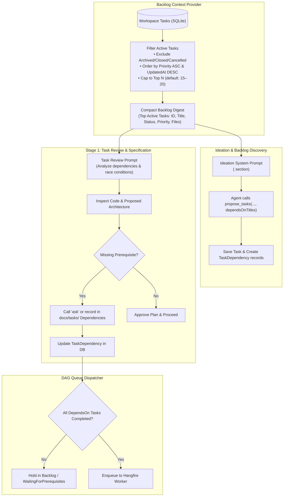

# 🔗 Step 11.14: Intelligent Task Dependency Detection in Ideation & Review Agents

> **Phase 11 Implementation Step (Post-MVP)**  
> *Parent Plan:* [Phase 11 Master Plan](../11_EXTEND_FEATURES.md)  
> *Target Components:* `src/NightCodeForge.Agents/Ideation`, `src/NightCodeForge.Agents/Crucible`, `src/NightCodeForge.Core/Workflow`, `src/NightCodeForge.Web/Components/Backlog` | *Status:* Planned

---

## 1. Executive Objective

In real-world repositories with active backlogs (such as **OllamaRouter** and **ComicGenCLI**), tasks are rarely completely independent. If tasks that modify the same subsystem or depend on new interfaces run concurrently or out of order, merge conflicts, compiler breaks, and wasted LLM inference cycles inevitably occur.

While NightCodeForge's database and queue orchestrator already support DAG-based execution via [TaskDependency](file:///c:/Users/Julien/source/repos/jetelain/NightCodeForge/src/NightCodeForge.Core/Domain/TaskDependency.cs), agents currently operate mostly in isolation without proactive awareness of other tasks in the workspace.

This step instructs and equips both the **Ideation Agent** and the **Stage 1 (Task Review) Agent** to:
1. **Understand Workspace Backlog Context:**
   - Ingest a lightweight, token-optimized summary of active workspace tasks (capped at top 15–20 tasks ordered by priority, strictly excluding archived/closed tasks).
2. **Detect Semantic & Architectural Dependencies in Ideation:**
   - Automatically analyze newly proposed tasks against existing backlog items.
   - Populate `dependsOnTitles` or task IDs in [TaskProposal](file:///c:/Users/Julien/source/repos/jetelain/NightCodeForge/src/NightCodeForge.Core/Domain/ForgeTask.cs) / `propose_tasks` calls.
3. **Verify & Enforce Dependencies in Stage 1 (Task Review):**
   - The Task Review agent explicitly inspects whether the task relies on APIs, models, or schema changes from another task that is not yet merged.
   - Proactively links prerequisites or queries the maintainer via `ask` before coding begins.
4. **Surface Dependencies Clearly in UI:**
   - Display clickable dependency badges ("Depends on #12", "Blocks #15") and DAG relationship indicators across [KanbanCard.razor](file:///c:/Users/Julien/source/repos/jetelain/NightCodeForge/src/NightCodeForge.Web/Components/Backlog/KanbanCard.razor) and [TaskDetailDrawer.razor](file:///c:/Users/Julien/source/repos/jetelain/NightCodeForge/src/NightCodeForge.Web/Components/Backlog/TaskDetailDrawer.razor).

---

## 2. Dependency Discovery & Enforcement Pipeline



---

## 3. Backlog Context Injection

### 3.1 Backlog Scalability, Archival Filtering & Active Task Capping
In real-world projects with active backlogs (e.g., OllamaRouter, ComicGenCLI), repositories can easily accumulate hundreds of tasks over time if historical, completed, or rejected items are retained. Blindly injecting all workspace tasks into agent prompts would cause massive context bloat, degrade LLM instruction-following, and waste inference tokens.

To keep the backlog context lean (~300–400 tokens total) and sharply focused on actionable work, the following ingestion policy is enforced:

1. **Strict Exclusion of Archived & Terminal Tasks:**
   - Tasks in terminal states (`TaskOverallStatus.Closed`, `TaskOverallStatus.Rejected`, `TaskOverallStatus.Cancelled`) are **excluded entirely**.
   - **Rationale:** Code from `Closed` (merged) tasks already exists directly in the repository filesystem on disk. Agents can and should inspect the codebase using standard tools (`read`, `grep`, `bash`). Ingesting closed or cancelled tasks adds no actionable dependency information and clutters the prompt.

2. **Active Task Selection & Priority Ordering:**
   - Only active tasks are considered (`TaskOverallStatus.Suggested`, `Open`, `Reviewed`, `Implemented`, `Ready`).
   - Active candidates are ordered deterministically by:
     1. `Priority ASC` (`TaskPriority.Critical` [1] $\rightarrow$ `TaskPriority.High` [2] $\rightarrow$ `TaskPriority.Normal` [3] $\rightarrow$ `TaskPriority.Low` [4] $\rightarrow$ `TaskPriority.Trivial` [5]).
     2. `UpdatedAt DESC` (most recently modified tasks within the same priority tier).

3. **Configurable Cap (15–20 Tasks):**
   - The digest caps active tasks to a maximum limit (default: **20 tasks**, configurable e.g. 15 or 20 via options).
   - If the workspace has more active tasks than the cap, an explicit overflow notice is appended to the digest indicating how many tasks were omitted:
     ```xml
     <!-- Showing top 20 of 64 active tasks by priority order (P1 Critical -> P5 Trivial). Lower-priority tasks omitted. -->
     ```
   - This ensures the agent is aware that additional lower-priority tasks exist while guaranteeing the prompt token footprint remains predictable and compact.

### 3.2 Compact Backlog Digest Format
To minimize token consumption (~15–20 tokens per task), a lean XML block is injected into the agent's instructions:

```xml
<existing_workspace_tasks>
<!-- Showing top 3 of 14 active tasks by priority order (excluding archived/closed tasks) -->
- #101 [P1/Critical - Ready]: Core LLM HTTP client abstractions (Files: Client/IHttpClient.cs, Client/Models.cs)
- #102 [P2/High - Open]: Implement Ollama streaming response parser (Files: Parsers/OllamaStreamParser.cs)
- #103 [P3/Normal - Suggested]: Add CLI command for model benchmarking (Files: Commands/BenchmarkCommand.cs)
</existing_workspace_tasks>
```

---

## 4. Agent Instructions & Stage Directives

### 4.1 Ideation Stage Guidance (`IdeationService.cs`)
Updated task planning guidelines:
```markdown
<dependency_identification_rules>
When planning or proposing tasks:
1. Cross-reference your ideas against the `<existing_workspace_tasks>` list above (which contains top active backlog tasks ordered by priority).
2. DO NOT propose duplicate tasks for capabilities already captured in existing tasks or already merged in the codebase.
3. If your proposed task builds on, calls, or extends interfaces or data models introduced in an existing open/suggested task, you MUST set 'dependsOnTitles' in your 'propose_tasks' call with the title or ID of the prerequisite task.
4. Explain to the developer why this dependency exists and the recommended order of execution.
</dependency_identification_rules>
```

### 4.2 Stage 1: Task Review Directive (`CrucibleAgentHarness.cs`)
Updated `StandardStageIds.TaskReview` directive:
```csharp
StandardStageIds.TaskReview or "stage-1" =>
    "You are a Staff Software Architect & Requirements Investigator. " +
    "1. Thoroughly investigate the task requirements and inspect the codebase using 'read' and 'bash'. " +
    "2. BACKLOG DEPENDENCY AUDIT: Inspect the <existing_workspace_tasks> list (top active tasks by priority). Determine whether this task depends on any unmerged tasks (e.g. shared database migrations, missing models, interface definitions). If a hard dependency is found, document it under '## Dependencies' in docs/tasks/ and call 'ask' if you need user confirmation to sequence it. " +
    "3. MANDATORY FILE EDIT: Edit the task specification document on disk in docs/tasks/ using 'edit' or 'write' with your approved architecture, affected files, technical plan, dependencies, and acceptance criteria. " +
    "4. Gather all questions and ambiguities into a single 'ask' call using the question list. Do not guess. " +
    "5. Do not write production code.",
```

---

## 5. Specification Markdown Synchronization for Dependencies

When the Stage 1 review agent updates `docs/tasks/{id}-{slug}.md`, it records dependencies under a standardized markdown header:

```markdown
## Dependencies
- Depends on: #101 (Core LLM HTTP client abstractions)
```

[TaskMarkdownSyncService](file:///c:/Users/Julien/source/repos/jetelain/NightCodeForge/src/NightCodeForge.Core/Services/TaskMarkdownSyncService.cs) parses this section upon stage completion, verifies the referenced task IDs or titles exist, and creates or updates the corresponding [TaskDependency](file:///c:/Users/Julien/source/repos/jetelain/NightCodeForge/src/NightCodeForge.Core/Domain/TaskDependency.cs) database records automatically.

---

## 6. UI Presentation: Interactive Dependency Badges

### 6.1 Kanban Cards ([KanbanCard.razor](file:///c:/Users/Julien/source/repos/jetelain/NightCodeForge/src/NightCodeForge.Web/Components/Backlog/KanbanCard.razor))
- Shows interactive chips:
  - 🔗 `Prereq: #101` (hover shows title and status; clicking navigates to or opens task drawer for #101).
  - ⚠️ Amber indicator if an upstream prerequisite failed or is blocked.

### 6.2 Task Detail Drawer ([TaskDetailDrawer.razor](file:///c:/Users/Julien/source/repos/jetelain/NightCodeForge/src/NightCodeForge.Web/Components/Backlog/TaskDetailDrawer.razor))
- Displays "Dependencies & Blockers" card:
  - Lists **Prerequisite Tasks** (tasks this task depends on).
  - Lists **Downstream Blocked Tasks** (tasks waiting on this task).
  - Quick **Add/Remove Dependency** button linking to [DependencyLinkingModal.razor](file:///c:/Users/Julien/source/repos/jetelain/NightCodeForge/src/NightCodeForge.Web/Components/Backlog/DependencyLinkingModal.razor).

---

## 7. Implementation Checklist & Deliverables

- [ ] **Backlog Context Builder:**
  - Implement `IWorkspaceBacklogSummaryService` generating compact `<existing_workspace_tasks>` digests.
  - Filter out archived and terminal tasks (`Closed`, `Rejected`, `Cancelled`).
  - Sort active tasks by `Priority ASC` (`TaskPriority.Critical` $\rightarrow$ `Trivial`) then `UpdatedAt DESC`, capped to configurable limit (default: 20, e.g. 15–20 tasks).
  - Include overflow notice when total active tasks exceed the limit.
  - Inject summary into [IdeationService](file:///c:/Users/Julien/source/repos/jetelain/NightCodeForge/src/NightCodeForge.Agents/Ideation/IdeationService.cs) system prompt.
  - Inject summary into Stage 1 Task Review stage prompt in [CrucibleAgentHarness](file:///c:/Users/Julien/source/repos/jetelain/NightCodeForge/src/NightCodeForge.Agents/Crucible/CrucibleAgentHarness.cs).
- [ ] **Stage Directives Update:**
  - Update Stage 1 directive to explicitly instruct agents to identify task dependencies against active backlog tasks.
  - Update Ideation task planning guidelines to require `dependsOnTitles` on overlapping work.
- [ ] **Markdown Sync Dependency Parsing:**
  - Update [TaskMarkdownSyncService](file:///c:/Users/Julien/source/repos/jetelain/NightCodeForge/src/NightCodeForge.Core/Services/TaskMarkdownSyncService.cs) to parse `## Dependencies` from `docs/tasks/*.md` and synchronize [TaskDependency](file:///c:/Users/Julien/source/repos/jetelain/NightCodeForge/src/NightCodeForge.Core/Domain/TaskDependency.cs) records.
- [ ] **UI Dependency Enhancements:**
  - Render prerequisite and downstream chips in [KanbanCard.razor](file:///c:/Users/Julien/source/repos/jetelain/NightCodeForge/src/NightCodeForge.Web/Components/Backlog/KanbanCard.razor).
  - Add dependency section with link modal in [TaskDetailDrawer.razor](file:///c:/Users/Julien/source/repos/jetelain/NightCodeForge/src/NightCodeForge.Web/Components/Backlog/TaskDetailDrawer.razor).
- [ ] **Tests:**
  - Unit test verifying backlog summary filters out archived, closed, rejected, and cancelled tasks.
  - Unit test verifying active task capping (e.g. max 15 or 20 tasks) and strict priority ordering (`Priority ASC`, then `UpdatedAt DESC`) with overflow notice.
  - Unit test verifying dependency parsing in markdown sync.
  - Scenario test validating that Ideation agent proposes tasks with linked dependencies.
