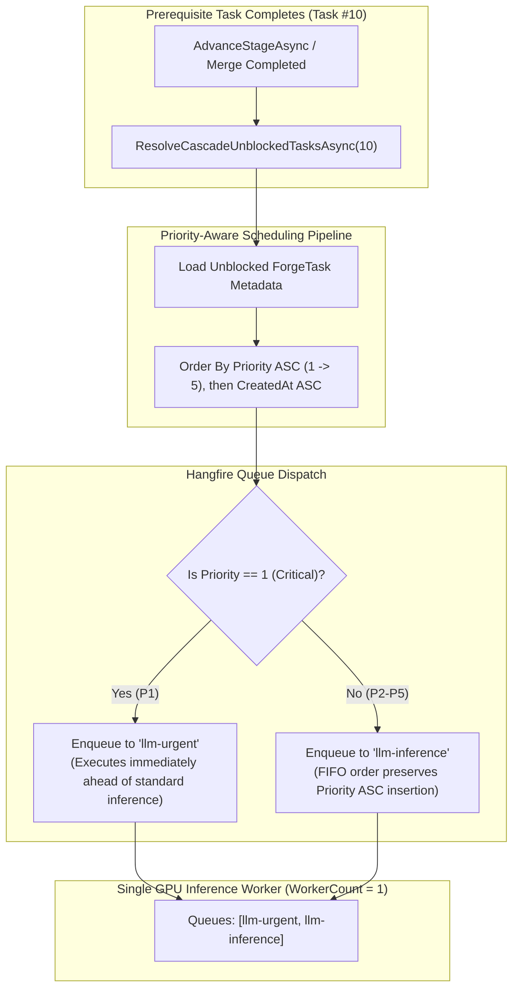

# ⏱️ Step 11.15: Priority-Aware Task Queue Scheduling & Execution Ordering

> **Phase 11 Implementation Step (Post-MVP - Top Priority)**  
> *Parent Plan:* [Phase 11 Master Plan](../11_EXTEND_FEATURES.md)  
> *Project Target:* `src/NightCodeForge.Core/Workflow`, `src/NightCodeForge.Infrastructure/BackgroundJobs`, `src/NightCodeForge.Web/Services`, `src/NightCodeForge.Web/Components/DevQueue` | *Status:* Planned

---

## 1. Executive Objective

NightCodeForge enforces a single-worker GPU inference queue (`WorkerCount = 1`) to eliminate GPU VRAM thrashing and model eviction overhead. Because LLM workloads run sequentially on the worker, **task scheduling order directly dictates when work gets completed**.

In our formal priority hierarchy:
- **Priority 1 (P1):** Critical / Urgent (Highest priority — blockers, hotfixes, critical bugs).
- **Priority 2 (P2):** High (Major milestones, core architectural prerequisites).
- **Priority 3 (P3):** Normal / Medium (Default feature development).
- **Priority 4 (P4):** Low (Minor enhancements, non-critical improvements).
- **Priority 5 (P5):** Lowest / Trivial (Cleanup, typos, cosmetic polishes).

This step ensures that the **entire task queue lifecycle—from DAG cascade unblocking to Hangfire queue ingestion, DevQueue monitoring, and head-of-line promotion—strictly respects this priority ordering (1 Highest $\rightarrow$ 5 Lowest)**.

---

## 2. Queue Architecture & Priority Enforcement



---

## 3. Core Problem Areas & Detailed Specifications

### 3.1 Default Priority Alignment across Domain & Intake
- **Change in [ForgeTask.cs](file:///c:/Users/Julien/source/repos/jetelain/NightCodeForge/src/NightCodeForge.Core/Domain/ForgeTask.cs):**
  - Update `public int Priority { get; set; } = 3;` (Default: Normal).
  - Ensures tasks authored without explicit priority do not accidentally hijack the highest (P1) priority.
- **Change in [TaskCreationModal.razor](file:///c:/Users/Julien/source/repos/jetelain/NightCodeForge/src/NightCodeForge.Web/Components/Backlog/TaskCreationModal.razor) & [MaintainerPromotionModal.razor](file:///c:/Users/Julien/source/repos/jetelain/NightCodeForge/src/NightCodeForge.Web/Components/Backlog/MaintainerPromotionModal.razor):**
  - Default selection initialized to `3` (Normal).
  - Dropdown options clearly labeled:
    - `1 - Critical / Urgent (Highest)`
    - `2 - High`
    - `3 - Normal (Default)`
    - `4 - Low`
    - `5 - Lowest / Trivial`
- **Change in [CanonicalTools.cs](file:///c:/Users/Julien/source/repos/jetelain/NightCodeForge/src/NightCodeForge.Agents/Tools/CanonicalTools.cs):**
  - Default fallback in `ProposeTasks` when `priority` parameter is omitted: defaults to `3` (Normal).

### 3.2 DAG Cascade Unblocking Ordering
In [TaskOrchestrator.cs](file:///c:/Users/Julien/source/repos/jetelain/NightCodeForge/src/NightCodeForge.Core/Workflow/TaskOrchestrator.cs) (around line 1506):
- When a task completes and calls `_dependencyEngine.ResolveCascadeUnblockedTasksAsync(task.Id)`:
  - Previously, tasks were enqueued in arbitrary database ID order.
  - **New Behavior:** Load task records for all unblocked IDs and sort them by:
    ```csharp
    var unblockedTasks = await _taskRepository.GetByIdsAsync(unblockedIds, cancellationToken);
    var orderedUnblocked = unblockedTasks
        .OrderBy(t => t.Priority)     // 1 (Highest) first
        .ThenBy(t => t.CreatedAt)    // Older tasks first on priority tie
        .ToList();
    
    foreach (var unblocked in orderedUnblocked)
    {
        if (unblocked.Priority == 1)
        {
            _jobQueue.EnqueueUrgent(unblocked.Id);
        }
        else
        {
            _jobQueue.EnqueueInference(unblocked.Id);
        }
    }
    ```

### 3.3 Batch Promotion & Backlog Scheduling
When a developer promotes multiple tasks to `Open` in batch, or when the bulk importer (Step 11.12) ingests tasks:
- Any enqueuing operation to Hangfire must sort tasks by `Priority ASC` before calling `EnqueueInference`.
- Because Hangfire's internal queue preserves insertion order (FIFO), inserting P1/P2 ahead of P4/P5 guarantees that higher priority tasks execute first on the single worker.

### 3.4 DevQueue Table & Promotion Controls
In [DevQueueTable.razor](file:///c:/Users/Julien/source/repos/jetelain/NightCodeForge/src/NightCodeForge.Web/Components/DevQueue/DevQueueTable.razor) and [DevQueueService.cs](file:///c:/Users/Julien/source/repos/jetelain/NightCodeForge/src/NightCodeForge.Web/Services/DevQueueService.cs):
- Display color-coded priority badges:
  - `P1`: Crimson (`#ef4444`)
  - `P2`: Amber-Orange (`#f97316`)
  - `P3`: Blue (`#3b82f6`)
  - `P4`: Slate (`#64748b`)
  - `P5`: Gray (`#475569`)
- Provide an inline action: **"Promote to Urgent"** (`llm-urgent`) allowing maintainers to bump any queue item to top priority on demand.
- Add an automated **"Re-order Queue by Priority"** action in `DevQueueService` to re-sequence waiting jobs in Hangfire if manual priority updates occurred.

---

## 4. Implementation Checklist & Deliverables

- [ ] **Domain Defaults & Enums:**
  - Change default priority in [ForgeTask.cs](file:///c:/Users/Julien/source/repos/jetelain/NightCodeForge/src/NightCodeForge.Core/Domain/ForgeTask.cs) and [TaskProposal](file:///c:/Users/Julien/source/repos/jetelain/NightCodeForge/src/NightCodeForge.Core/Domain/ForgeTask.cs) to `3` (Normal).
  - Add `TaskPriority` constants/helper class defining `1 = Critical`, `2 = High`, `3 = Normal`, `4 = Low`, `5 = Trivial`.
- [ ] **DAG Orchestrator Cascade Ordering:**
  - Update `TaskOrchestrator.cs` cascade unblocking loop to sort unblocked tasks by `Priority ASC, CreatedAt ASC`.
  - Dispatch Priority 1 unblocked tasks directly to `llm-urgent`.
- [ ] **UI Dropdowns & Badges:**
  - Update priority dropdown options in `TaskCreationModal.razor` and `MaintainerPromotionModal.razor`.
  - Update priority badges in `KanbanCard.razor`, `TaskDetailDrawer.razor`, and `DevQueueTable.razor` matching the new colors.
- [ ] **DevQueue Re-Ordering Service:**
  - Add `ReorderInferenceQueueByPriorityAsync` in `DevQueueService`.
  - Add "Sort by Priority" button in `DevQueue.razor`.
- [ ] **Tests:**
  - Unit test verifying unblocked DAG cascade schedules tasks in `Priority ASC` order.
  - Unit test verifying P1 tasks enqueue to `llm-urgent`.
  - Scenario test ensuring a P1 task executes ahead of previously queued P3 tasks.
