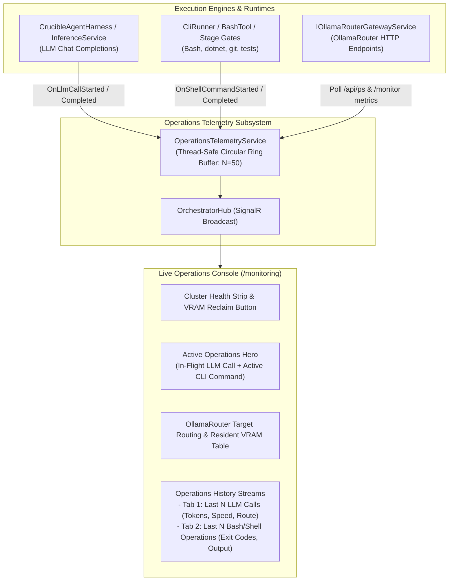

# ⚡ Step 11.18: Live Operations Telemetry: Real-Time LLM Calls, Shell Activity & OllamaRouter Deep Monitoring

> **Phase 11 Implementation Step (Post-MVP - High Impact Ergonomics & Operations)**  
> *Parent Plan:* [Phase 11 Master Plan](../11_EXTEND_FEATURES.md)  
> *Project Target:* `src/NightCodeForge.Core/Workflow`, `src/NightCodeForge.Core/Interfaces`, `src/NightCodeForge.Agents/Inference`, `src/NightCodeForge.Infrastructure/Inference`, `src/NightCodeForge.Web/Components/Pages`, `src/NightCodeForge.Web/Components/Monitoring`  
> *Status:* Planned | *Target Framework:* .NET 10 (C# 13)

---

## 1. Executive Objective & Architectural Pivot

With the delivery of the **Task Execution Inspector** (`/inspector` and `/tasks/{id}`), deep per-task pipeline stepping, turn-by-turn stage conversations, diffs, and execution logs are now cleanly housed within dedicated, task-centric views.

Previously, the **Live Telemetry** page (`/monitoring`) duplicated the visual 7-step pipeline stepper and focused on a single selected task. As development scales, developers need a **system-wide developer operations console** rather than another task stepper.

This step re-architects `/monitoring` into the **Live Developer Operations & Hardware Telemetry Console**, providing real-time visibility into:
1. **LLM Calls Stream:** Currently in-flight LLM calls and a bounded history of the last $N$ calls (prompt preview, completion, token count, generation speed in tokens/sec, latency, model, target backend, and status).
2. **Deterministic Shell & Bash Operations Stream:** Currently running command and a bounded history of the last $N$ CLI / shell executions (`run_bash`, `dotnet build`, `dotnet test`, git operations, script runners) with working directory, exit code, duration, and output logs.
3. **Deep OllamaRouter Cluster & VRAM Telemetry:** Direct runtime integration with the OllamaRouter gateway (`C:\Users\Julien\source\repos\jetelain\OllamaRouter`), displaying target backend health (Local GPU, Dedicated LAN Server, Cloud Overflow), resident VRAM models (`/api/ps`), wire-level auto-heal counters, and one-click memory reclaim.

---

## 2. Architecture & Data Flow



---

## 3. Detailed Specifications

### 3.1 Operations Telemetry Domain Models & Buffer Service

1. **Domain Models (`NightCodeForge.Core.Workflow`):**
   ```csharp
   namespace NightCodeForge.Core.Workflow;

   public record LlmCallRecord(
       string CallId,
       int? TaskId,
       string? StageId,
       string? AgentProfileId,
       string Model,
       string TargetBackend,       // "Local", "Remote", "Cloud"
       DateTime StartTime,
       double DurationMs,
       int PromptTokens,
       int CompletionTokens,
       double TokensPerSecond,
       string PromptPreview,
       string? CompletionPreview,
       LlmCallStatus Status,       // Running, Completed, Failed, Cancelled
       string? ErrorMessage);

   public record ShellCommandRecord(
       string CommandId,
       int? TaskId,
       string? StageId,
       string CommandLine,
       string WorkingDirectory,
       DateTime StartTime,
       double DurationMs,
       int? ExitCode,
       ShellCommandStatus Status,   // Running, Completed, Failed
       string? OutputPreview,
       string? ErrorPreview);
   ```

2. **Ring Buffer Service (`IOperationsTelemetryService`):**
   - Implemented as a thread-safe singleton using lock-free or concurrent ring buffers.
   - Configurable bounded capacity:
     - `MaxLlmCalls = 50`
     - `MaxShellCommands = 50`
   - Automatically evicts the oldest record when capacity is exceeded.
   - Provides snapshot queries:
     - `IReadOnlyList<LlmCallRecord> GetRecentLlmCalls(int count = 25)`
     - `LlmCallRecord? GetActiveLlmCall()`
     - `IReadOnlyList<ShellCommandRecord> GetRecentShellCommands(int count = 25)`
     - `ShellCommandRecord? GetActiveShellCommand()`
   - Broadcasts real-time events via `IHubContext<OrchestratorHub>`.

---

### 3.2 Telemetry Instrumentation

1. **LLM Inference Capture (`CrucibleAgentHarness` & `InferenceService`):**
   - **Start:** When a call to `IChatClient.CompleteAsync` or `CompleteStreamingAsync` begins, record a new `LlmCallRecord` with `Status = Running`, start timestamp, target backend header (`X-OllamaRouter-Target`), model name, and prompt head preview (first 500 characters).
   - **Progress:** During streaming, update current token count and calculate running `TokensPerSecond = TokensGenerated / ElapsedSeconds`.
   - **Completion:** Record total prompt/completion tokens, total duration in milliseconds, completion head snippet, and mark `Status = Completed`.
   - **Error / Failure:** On exception or HTTP timeout, mark `Status = Failed` with the sanitized error message.

2. **Bash & CLI Execution Capture (`CliRunner`, `BashTool`, `DeterministicVerificationStage`):**
   - **Start:** Before executing a CLI process via `CliWrap`, record `ShellCommandRecord` with `CommandLine`, sanitized `WorkingDirectory`, and `Status = Running`.
   - **Completion:** On process exit, capture `ExitCode`, execution duration, and truncated `OutputPreview` / `ErrorPreview` (last 200 lines / 10KB).

---

### 3.3 Deep OllamaRouter Telemetry & Cluster Integration

Inspired by the OllamaRouter monitoring dashboard (`http://localhost:11434/monitor`), `/monitoring` directly incorporates live gateway metrics:

1. **Cluster Target Routing Status:**
   - Query `IOllamaRouterGatewayService.GetGatewayStatusAsync`:
     - **Host GPU (Local):** Active/Available/Offline, current model, latency.
     - **Dedicated LAN Server (Remote):** High-VRAM batch server status, queue depth.
     - **Cloud Overflow:** On-demand cloud fallback status.
2. **Resident GPU Models Table (`/api/ps`):**
   - Model name (e.g. `qwen2.5-coder:32b`, `deepseek-r1:14b`).
   - VRAM memory footprint (e.g. `19.2 GB / 24.0 GB`) with visual progress bars.
   - Total model size on disk.
   - Time-to-live / model expiration timestamp.
3. **Wire-Level Auto-Healing Counters:**
   - Display auto-repaired JSON payload count, stripped markdown fences (` ```json `), and promoted `<tool_call>` pseudo-tags.
4. **Interactive VRAM Reclaim:**
   - Action button in the console header executing `ReclaimVramAsync` (releasing idle models without killing active jobs).

---

### 3.4 Web UI Layout: Live Developer Operations Console (`Monitoring.razor`)

Replace the single-task pipeline stepper layout with a high-density, real-time command center:

```
+---------------------------------------------------------------------------------------+
| ⚡ Live Operations Console     [🟢 Gateway Connected] [Cluster: 3 Targets] [🧹 Reclaim] |
+---------------------------------------------------------------------------------------+
| ACTIVE OPERATIONS HERO                                                                |
| +-----------------------------------------------+ +---------------------------------+ |
| | 🧠 In-Flight LLM Inference                    | | 💻 In-Flight Shell Operation     | |
| | Model: Qwen 2.5 Coder 32B  | Route: Remote    | | Command: dotnet test --filter... | |
| | Speed: 34.2 t/s | Tokens: 412 | Elapsed: 2.1s | | Cwd: /workspace/clone            | |
| | Prompt Preview: "Implement method Parse..."   | | Elapsed: 4.8s                    | |
| +-----------------------------------------------+ +---------------------------------+ |
+---------------------------------------------------------------------------------------+
| OLLAMAROUTER CLUSTER & VRAM MONITOR                                                   |
| - Target Backends: [Local GPU: 12ms] [Dedicated LAN Server: 24ms] [Cloud: Standby]     |
| - Resident VRAM: qwen2.5-coder:32b (19.2 GB) | Expires in 04:12                       |
+---------------------------------------------------------------------------------------+
| OPERATIONS STREAMS (Tabs: [🧠 LLM Calls (50)] | [💻 Shell Commands (50)])               |
| +-----------------------------------------------------------------------------------+ |
| | Time     | Task  | Stage         | Model       | Route  | Tokens | Duration | Status | |
| | 08:32:01 | #42   | Implementation| Qwen 32B    | Remote | 1,420  | 3,420ms  | ✅ Done| |
| | 08:31:12 | #42   | TaskReview    | Qwen 32B    | Local  | 890    | 1,210ms  | ✅ Done| |
| | 08:30:05 | #41   | CodeReview    | DeepSeek 14B| Remote | 2,150  | 5,610ms  | ✅ Done| |
| +-----------------------------------------------------------------------------------+ |
+---------------------------------------------------------------------------------------+
```

- Clicking on any historical LLM call opens an **Inference Inspection Modal** showing full prompt parameters, raw completion, and token metrics.
- Clicking on any shell command opens a **Terminal Output Drawer** showing the raw stdout/stderr output.

---

## 4. Definition of Done Checklist

- [ ] **Operations Telemetry Service:**
  - [ ] Implement `IOperationsTelemetryService` with thread-safe ring buffer (`MaxLlmCalls = 50`, `MaxShellCommands = 50`).
  - [ ] Add domain models `LlmCallRecord` and `ShellCommandRecord`.
  - [ ] Integrate with SignalR `OrchestratorHub` broadcasting live events (`LlmCallStarted`, `LlmCallCompleted`, `ShellCommandStarted`, `ShellCommandCompleted`).
- [ ] **Telemetry Instrumentation:**
  - [ ] Instrument `CrucibleAgentHarness` and `InferenceService` to emit start/progress/completion telemetry on every chat completion call.
  - [ ] Instrument `CliRunner` and deterministic execution stages to emit shell command start and finish telemetry.
- [ ] **OllamaRouter Gateway Integration:**
  - [ ] Extend `IOllamaRouterGatewayService` with cluster latency checks and resident model VRAM percentage calculations.
  - [ ] Wire VRAM reclaim button to trigger non-destructive memory release directly from `/monitoring`.
- [ ] **Web UI Redesign (`Monitoring.razor`):**
  - [ ] Replace redundant pipeline stepper with `ActiveOperationsHero` (live LLM inference card + live shell command card).
  - [ ] Embed OllamaRouter cluster health and resident VRAM models card.
  - [ ] Build `LlmCallsHistoryTable` with token metrics, target route badges, and expandable prompt/completion viewer modal.
  - [ ] Build `ShellOperationsFeed` with command line, exit code pill, execution duration, and expandable stdout/stderr viewer.
- [ ] **Automated Tests:**
  - [ ] Unit tests for `OperationsTelemetryService` ring buffer bounded eviction and concurrent thread safety.
  - [ ] Component tests for `Monitoring.razor` rendering live active operations and history tables without throwing exceptions when idle.
