# 🎨 Step 11.19: Conversational UI Unification, Stepper Running Hygiene, Review File Tree & Syntax Highlighting

> **Phase 11 Implementation Step (Post-MVP - Developer Ergonomics & UI Polish)**  
> *Parent Plan:* [Phase 11 Master Plan](../11_EXTEND_FEATURES.md)  
> *Project Target:* `src/NightCodeForge.Web/Components/Inbox`, `src/NightCodeForge.Web/Components/Monitoring`, `src/NightCodeForge.Web/Components/Pages`, `src/NightCodeForge.Web/Components/Review`, `src/NightCodeForge.Web/Services`  
> *Status:* Planned | *Target Framework:* .NET 10 (C# 13)

---

## 1. Executive Summary & Problem Statement

User feedback across real-world project trials highlighted six UX inconsistencies, state tracking issues, and review ergonomics friction points:

1. **Question Inbox vs. Task Inspector Clarification UI Divergence:**
   The Question Inbox (`/inbox` via `QuestionCard.razor`) and the Task Execution Inspector (`AgentQuestionTurnCard.razor`) implemented two divergent visual designs and interaction models for the exact same human-in-the-loop clarification workflow. `AgentQuestionTurnCard` provides a significantly cleaner experience (pulsing "Waiting for Answer" badge, suggested option chips, inline response area, and clear resolution state), whereas `QuestionCard` relies on bulky legacy styling.
   *Resolution:* Unify the clarification UI by reusing `AgentQuestionTurnCard` across both the Question Inbox and Task Inspector, wrapping it in an inbox-friendly task/workspace header badge.

2. **Pipeline Stepper False "Pending" State for Running Stages:**
   In `TaskExecutionInspector.razor`, when a task is actively executing (e.g. stage "ForgeTask Review" with conversation status `Running`), the stepper erroneously displayed `Pending` instead of `Running` (with active pulse animation). The conversation viewer below correctly showed `Running`.
   *Root Cause:* `TaskExecutionInspector.razor` passed `Conversations` and `CurrentStageId` to `PipelineStepper`, but omitted `CurrentStageStatus` (defaulting it to `null`). While `Conversations` initially updated the stage status to `Running`, subsequent logic in `PipelineStepper.OnParametersSet` evaluated `CurrentStageStatus ?? StageExecutionStatus.Pending`, invoking `ApplyStageTransition(CurrentStageId, StageExecutionStatus.Pending)` and overwriting the stage status back to `Pending`.
   *Resolution:* Fix stage status resolution in `PipelineStepper` and `TaskExecutionInspector` so running tasks (`TaskOverallStatus.InProgress` or active conversation `StageExecutionStatus.Running`) maintain authoritative `Running` status without being clobbered by fallback defaults.

3. **Inconsistent Conversation Density (Ideation Chat vs. Task Inspector):**
   The Ideation Chat (`Ideation.razor`) and Task Inspector (`StageConversationViewer.razor`) both present agent-human conversations, but their presentation is radically disjointed. Ideation Chat is compact, sleek, and highly readable with user/agent avatar chips, inline collapsible reasoning traces (`<details class="think-trace">`), and collapsible tool execution pills (`<details class="tool-trace">`). In contrast, `StageConversationViewer` uses large cards with heavy padding that force excessive vertical scrolling.
   *Resolution:* Unify the conversation presentation style across both pages: port the compact bubble layout, avatar gutter, inline reasoning collapsible summaries, and tool summary pills to `StageConversationViewer`, standardizing on a cohesive conversation design language.

4. **Review Room File List Stickiness & Task Inspector Deep Link:**
   In `/review` (`Review.razor`), the changed files tree scrolls out of view when reviewing large file diffs, forcing maintainers to scroll all the way back to the top to switch files. Furthermore, maintainers in the review room lacked a direct way to view the task execution history and logs.
   *Resolution:* Make `.file-tree` sticky (`position: sticky; top: 1rem; max-height: calc(100vh - 2rem); overflow-y: auto;`) and add a prominent "🔍 View Task Inspector" deep link in the review room header pointing directly to `/inspector/{TaskId}`.

5. **Review Room File Path Truncation in Left Panel (Missing Tree View):**
   In `/review` (`Review.razor`), the changed files in the left sidebar are rendered as flat strings (`file.Path`) with `overflow: hidden; text-overflow: ellipsis; white-space: nowrap;`. Because real-world projects contain deeply nested paths (e.g. `src/NightCodeForge.Web/Components/Pages/Review.razor`), the 240px–300px sidebar cuts off the path trailing characters, completely hiding the actual filename and extension. Maintainers cannot identify which file they are selecting without hovering or clicking.
   *Resolution:* Rework the flat file list into an interactive Hierarchical Tree View. Group changed files by directory structure, collapse single-child intermediate directory chains (e.g. `src/NightCodeForge.Web/` as a single folder node), render directories as collapsible nodes, and present the leaf file name prominently so the filename is **always fully visible**. Adhering to the UI/presentation separation rule, extract tree-building, sorting, and path-compression logic into a dedicated `ReviewFileTreeBuilder` helper class in `NightCodeForge.Web.Services` rather than placing non-trivial logic in Razor `@code` blocks.

6. **Plain Text Code in Diff Viewer (Missing Syntax Highlighting):**
   In `DiffViewer.razor`, both Side-by-Side and Unified diff views display code lines as plain, unformatted monospaced text inside table cells. Reviewing diffs across diverse project languages (C#, TypeScript, JavaScript, Python, JSON, XML, Markdown, Shell) is cognitively taxing without visual distinctions for keywords, strings, comments, types, and numbers.
   *Resolution:* Implement a lightweight, zero-dependency server-side syntax highlighting service (`ISyntaxHighlightingService` / `SimpleSyntaxHighlighter`) in `NightCodeForge.Web.Services`. The service performs deterministic lexical tokenization per line based on file extension, wrapping tokens in standard CSS spans (`tok-keyword`, `tok-string`, `tok-comment`, `tok-type`, `tok-number`, `tok-punct`) with full HTML entity encoding for safety. `DiffViewer.razor` calls the highlighter to render formatted code lines while maintaining diff row background highlights, character-level diff spans, and inline commenting capability.

---

## 2. Architecture & Component Reuse Model

```mermaid
flowchart TD
    subgraph SharedClarificationUI ["Unified Human Clarification Component"]
        TurnCard["AgentQuestionTurnCard.razor<br/>- Pulsing Status Badge<br/>- Suggested Option Chips<br/>- Answer Input Box<br/>- Answered Resolution State"]
        InboxHeader["Task & Workspace Context Header<br/>(Task #Id, Title, Stage, Time)"]
        
        InboxHeader --> TurnCard
        TurnCard -->|Rendered in| InboxView["Question Inbox (/inbox)"]
        TurnCard -->|Rendered in| InspectorView["Task Inspector (/inspector)"]
        TurnCard -->|Rendered in| IdeationView["Ideation Chat (/ideation)"]
    end

    subgraph StepperHygiene ["Pipeline Stepper Status Resolution"]
        TaskEntity["ForgeTask Entity<br/>(Status: InProgress)"] --> Stepper["PipelineStepper.razor"]
        Convs["Conversation Records<br/>(Stage: TaskReview, Status: Running)"] --> Stepper
        Stepper --> PriorityCheck{"Is Conversation Running<br/>or Task InProgress?"}
        PriorityCheck -->|Yes| SetRunning["Status = StageExecutionStatus.Running<br/>(Active Pulse Spinner)"]
        PriorityCheck -->|No| CheckWaiting{"Is WaitingForHuman?"}
        CheckWaiting -->|Yes| SetWaiting["Status = StageExecutionStatus.WaitingForHuman (✋)"]
        CheckWaiting -->|No| SetPending["Status = Pending / Completed"]
    end

    subgraph CompactConversations ["Unified Compact Conversation Design"]
        AvatarGutter["Avatar Column (👤 / 🤖 / ⚙️)"] --> Bubble["Compact Bubble Body"]
        Bubble --> ThinkTrace["Inline Collapsible Reasoning (&lt;details class='think-trace'&gt;)"]
        Bubble --> ToolTrace["Collapsible Tool Pill (&lt;details class='tool-trace'&gt;)"]
        Bubble --> Clarification["Embedded AgentQuestionTurnCard"]
        Bubble --> Markdown["Rendered Markdown Text"]
    end

    subgraph ReviewTreeAndSyntax ["Review Room Tree & Syntax Highlighting"]
        SnapFiles["Flat FileChangeSnapshot List<br/>(e.g. src/A/B/File.cs)"] --> TreeBuilder["ReviewFileTreeBuilder<br/>(Path splitting, single-child collapse, sorting)"]
        TreeBuilder --> TreeNode["ReviewFileTreeNode Hierarchy<br/>- Folders: Collapsible, Dir Path<br/>- Files: Full Filename Always Visible, Badge, +/-"]
        TreeNode --> TreeUI["Review.razor (.file-tree-container)"]

        DiffLine["Diff Line Text + File Extension<br/>(e.g. public class Foo, .cs)"] --> SyntaxSvc["ISyntaxHighlightingService<br/>(SimpleSyntaxHighlighter)"]
        SyntaxSvc --> SafeHtml["Tokenized MarkupString<br/>&lt;span class='tok-keyword'&gt;public&lt;/span&gt; ..."]
        SafeHtml --> DiffView["DiffViewer.razor (Side-by-Side & Unified)"]
    end
```



---

## 3. Detailed Specifications

### 3.1 Unified Clarification Card in Question Inbox

1. **Extract or Adapt Shared Presentation Model:**
   - Enhance `AgentQuestionTurnCard.razor` to support optional external task header metadata:
     - `TaskId` (int?)
     - `TaskTitle` (string?)
     - `WorkspaceName` (string?)
     - `StageId` (string?)
     - `AskedAt` (DateTime?)
   - When external task context is provided, render a top metadata bar with clickable link to `/inspector/{TaskId}`, stage badge, workspace badge, and formatted timestamp.
   - Retain full support for both single-question and batched questions (`IReadOnlyList<QuestionItem>`).

2. **Update [Inbox.razor](file:///c:/Users/Julien/source/repos/jetelain/NightCodeForge/src/NightCodeForge.Web/Components/Pages/Inbox.razor):**
   - Refactor `QuestionCard.razor` to wrap `AgentQuestionTurnCard.razor` or directly render `AgentQuestionTurnCard` with task metadata and event handlers:
     - `OnAnswerSubmitted` $\rightarrow$ invokes `TaskOrchestrator.SubmitAnswersAsync` and resumes execution on `llm-urgent`.
     - `OnBatchAnswersSubmitted` $\rightarrow$ maps batch answers and resumes execution on `llm-urgent`.
   - Maintain full test compatibility and SignalR live updates upon answer submission.

### 3.2 Pipeline Stepper Running State Bug Fix

1. **Update [PipelineStepper.razor](file:///c:/Users/Julien/source/repos/jetelain/NightCodeForge/src/NightCodeForge.Web/Components/Monitoring/PipelineStepper.razor):**
   - Correct the fallback evaluation in `OnParametersSet`:
     ```csharp
     if (!string.IsNullOrEmpty(CurrentStageId) && 
         OverallStatus != TaskOverallStatus.Closed && 
         OverallStatus != TaskOverallStatus.Ready && 
         OverallStatus != TaskOverallStatus.Failed)
     {
         StageExecutionStatus effectiveStatus;
         if (IsWaitingForHuman || CurrentStageStatus == StageExecutionStatus.WaitingForHuman)
         {
             effectiveStatus = StageExecutionStatus.WaitingForHuman;
         }
         else if (CurrentStageStatus.HasValue)
         {
             effectiveStatus = CurrentStageStatus.Value;
         }
         else if (OverallStatus == TaskOverallStatus.InProgress)
         {
             // If overall task is actively executing, the current stage is running
             effectiveStatus = StageExecutionStatus.Running;
         }
         else
         {
             // Check if active conversation for this stage is Running
             var activeConv = Conversations?.FirstOrDefault(c => 
                 string.Equals(c.StageId, CurrentStageId, StringComparison.OrdinalIgnoreCase) && 
                 c.Status == StageExecutionStatus.Running);
             
             effectiveStatus = activeConv != null ? StageExecutionStatus.Running : StageExecutionStatus.Pending;
         }

         ApplyStageTransition(CurrentStageId, effectiveStatus);
     }
     ```
   - Do not overwrite an existing `StageExecutionStatus.Running` or `WaitingForHuman` with `Pending` when `CurrentStageStatus` parameter is not supplied.

2. **Update [TaskExecutionInspector.razor](file:///c:/Users/Julien/source/repos/jetelain/NightCodeForge/src/NightCodeForge.Web/Components/Monitoring/TaskExecutionInspector.razor):**
   - Explicitly compute and pass `CurrentStageStatus` to `<PipelineStepper>` based on the latest conversation status or overall task execution state.

### 3.3 Compact Conversation UI Unification

1. **Unify `StageConversationViewer.razor` with `Ideation.razor` Styling:**
   - Adopt the `.chat-bubble` layout architecture:
     - Avatar gutter: `👤` for User/Orchestrator prompts, `🤖` for Agent responses, `⚙️` for deterministic stage outputs.
     - Body: author name, timestamp, and content.
   - Reasoning Traces:
     - Replace large thinking containers with `<details class="think-trace">` containing `<summary>🧠 Reasoning Trace (<span class="font-mono">{count} chars</span>)</summary>`.
   - Tool Invocations:
     - Replace heavy tool result blocks with `<details class="tool-trace {status}">` featuring a compact header with tool icon, tool name, compact arguments summary (`GetToolSummary(args)`), duration badge (`✓ {ms}ms` or `Failed`), and expandable parameter/result views.
   - Questions / Clarifications:
     - Render `AgentQuestionTurnCard` inline within the stream with full interactivity.
   - Retain live streaming cursor (`<span class="cursor-blink">▊</span>`) and smooth auto-scroll.

2. **Shared Style Standardization in CSS:**
   - Ensure `.chat-bubble`, `.think-trace`, `.tool-trace`, and `.agent-question-turn-card` rules in `app.css` are shared and consistent across both `/ideation` and `/inspector`.

### 3.4 Review Room Ergonomics: Sticky Navigation, Tree View & Syntax Highlighting

#### 3.4.1 Sticky Navigation & Task Inspector Deep Link
1. **Sticky File Tree Container:**
   - In `Review.razor` (and related stylesheet), style the `.file-tree` container with:
     ```css
     .file-tree {
         position: sticky;
         top: 1rem;
         max-height: calc(100vh - 2rem);
         overflow-y: auto;
     }
     ```
   - Ensure the file tree remains accessible while reviewing diffs spanning thousands of lines.

2. **Deep Link to Task Inspector:**
   - In the review header action bar of `Review.razor`, add a direct navigation link:
     ```razor
     <a href="/inspector/@_snapshot.TaskId" 
        class="btn btn-secondary" 
        id="btn-view-inspector"
        title="View execution transcripts, conversations, and terminal logs for this task">
         🔍 Task Inspector
     </a>
     ```

#### 3.4.2 Hierarchical File Tree View
To eliminate the issue of truncated file paths hiding filenames in the left panel, implement a hierarchical tree view that separates directory hierarchy from filenames:

1. **Domain Model & Service Separation (`ReviewFileTreeNode` & `ReviewFileTreeBuilder`):**
   In accordance with the UI separation rule, all tree structuring, directory grouping, single-child collapsing, and sorting logic lives in a dedicated helper in `src/NightCodeForge.Web/Services/ReviewFileTreeBuilder.cs`:
   ```csharp
   public class ReviewFileTreeNode
   {
       public string Name { get; set; } = string.Empty;
       public string FullPath { get; set; } = string.Empty;
       public bool IsDirectory { get; set; }
       public bool IsExpanded { get; set; } = true;
       public FileChangeType? ChangeType { get; set; }
       public int Additions { get; set; }
       public int Deletions { get; set; }
       public FileChangeSnapshot? FileSnapshot { get; set; }
       public List<ReviewFileTreeNode> Children { get; set; } = new();
   }
   ```
2. **Path Compression & Sorting Rules:**
   - Split each `FileChangeSnapshot.Path` by `/`.
   - Compress chains of single-child intermediate directories (e.g. `src/NightCodeForge.Web/Components` renders as a single folder node label `src/NightCodeForge.Web/Components`, rather than 4 separate indented levels).
   - Order folder nodes first, followed by file nodes alphabetically.
   - Aggregate additions and deletions on directory nodes to display folder-level impact summaries.
   - Auto-expand nodes leading to the currently selected file.
3. **Presentation & Styling in `Review.razor`:**
   - Directory Node:
     - Folder toggle button (`📁` / `📂` or chevron icon) with folder path label.
     - Clicking toggles `IsExpanded`.
   - File Leaf Node:
     - Prominently displays the **bare filename** (`Review.razor`), ensuring it is **never truncated** by parent path prefixes.
     - Displays change type badge (`[M]`, `[A]`, `[D]`, `[R]`).
     - Displays change line counts (`+42 -12`).
     - Selected file highlighted with active border and background accent.
   - CSS Indentation:
     - Clean hierarchical indentation (`margin-left: 0.75rem`) with subtle vertical guide lines.

#### 3.4.3 Simple Syntax Highlighting in `DiffViewer.razor`
To provide clear visual distinctions for keywords, strings, comments, types, and numbers without external heavy JavaScript bundle overhead:

1. **Service Abstraction (`ISyntaxHighlightingService` / `SimpleSyntaxHighlighter`):**
   Create `ISyntaxHighlightingService` in `src/NightCodeForge.Web/Services/`:
   ```csharp
   public interface ISyntaxHighlightingService
   {
       MarkupString HighlightLine(string lineText, string? filePath);
   }
   ```
2. **Lexical Tokenization Engine (`SimpleSyntaxHighlighter.cs`):**
   - Detects language family from file extension:
     - C# (`.cs`, `.csx`)
     - TypeScript / JavaScript (`.ts`, `.tsx`, `.js`, `.jsx`)
     - Python (`.py`)
     - JSON (`.json`)
     - Markup / XML (`.xml`, `.csproj`, `.props`, `.html`, `.razor`)
     - Shell / Scripting (`.sh`, `.bash`, `.ps1`)
     - Fallback / Text (`.txt`, `.md`, unknown extensions)
   - Performs line-by-line lexical tokenization:
     - **Keywords:** `public`, `class`, `async`, `await`, `return`, `if`, `else`, `function`, `const`, `let`, `def`, `import`, `using`, `namespace`, etc. $\rightarrow$ `<span class="tok-keyword">...</span>`
     - **Types / Built-ins:** `string`, `int`, `bool`, `Task`, `void`, `List`, `IReadOnlyList`, `var`, etc. $\rightarrow$ `<span class="tok-type">...</span>`
     - **Strings & Characters:** `"..."`, `'...'`, `$"..."`, `` `...` `` $\rightarrow$ `<span class="tok-string">...</span>`
     - **Comments:** `// ...`, `/* ... */`, `# ...` $\rightarrow$ `<span class="tok-comment">...</span>`
     - **Numbers & Literals:** `0-9+`, `true`, `false`, `null`, `None` $\rightarrow$ `<span class="tok-number">...</span>`
     - **Punctuation & Operators:** `{ } [ ] ( ) => ; = + - * /` $\rightarrow$ `<span class="tok-punct">...</span>`
   - **XSS Safety Mandate:** All raw text within tokens is passed through `System.Text.Encodings.Web.HtmlEncoder.Default.Encode()` before assembling the `MarkupString`.
3. **Integration in `DiffViewer.razor`:**
   - Inject `ISyntaxHighlightingService`.
   - In Side-by-Side view:
     - `<td class="diff-text old-text ...">@SyntaxHighlighter.HighlightLine(oldLine?.Text ?? "", File.Path)</td>`
     - `<td class="diff-text new-text ...">@SyntaxHighlighter.HighlightLine(newLine?.Text ?? "", File.Path)</td>`
   - In Unified view:
     - `<td class="diff-text">@SyntaxHighlighter.HighlightLine(line.Text, File.Path)</td>`
   - Retain background color coding for additions (`diff-added`), deletions (`diff-deleted`), and modifications (`diff-modified`), allowing syntax highlighting to render atop diff row backgrounds seamlessly.
   - Maintain full comment thread interactivity and line clicking behavior.
4. **CSS Token Theme in `app.css`:**
   - Define theme tokens matching modern IDE dark-mode palettes:
     ```css
     .tok-keyword { color: #c678dd; font-weight: 600; }
     .tok-type { color: #4ec9b0; }
     .tok-string { color: #98c379; }
     .tok-comment { color: #7f848e; font-style: italic; }
     .tok-number { color: #d19a66; }
     .tok-punct { color: #abb2bf; }
     ```

---

## 4. Verification & Testing Strategy

1. **Unit & BUnit Tests:**
   - `PipelineStepperTests`: Test that when `OverallStatus == TaskOverallStatus.InProgress` and `CurrentStageStatus == null`, the active stage receives `Running` status with pulse spinner.
   - `TaskExecutionInspectorComponentTests`: Verify that selecting a running task correctly renders the active stage as running in the stepper.
   - `InboxPageTests`: Verify that `Inbox.razor` renders the unified clarification card with suggested option chips and submits answers via `TaskOrchestrator`.
   - `ReviewFileTreeBuilderTests`:
     - Test tree generation from flat file paths.
     - Test directory grouping and alphabetical sorting (folders before files).
     - Test single-child folder chain compression (`a/b/c` $\rightarrow$ `a/b/c`).
     - Test file node properties: bare filename, additions/deletions counts, change type.
     - Test that deep paths (e.g. `src/A/B/C/Component.razor`) produce `Component.razor` as the node name.
   - `SyntaxHighlightingServiceTests`:
     - Test C# tokenization: keywords, strings, comments, numbers, types.
     - Test HTML safety: verify strings containing `<`, `>`, `&` are HTML-encoded.
     - Test fallback behavior for unknown extensions.
     - Test blank and whitespace-only lines.
   - `DiffViewerComponentTests`:
     - Verify diff lines render syntax token spans.
     - Verify toggle comment box and inline comment threads remain functional.
   - `ReviewPageTests`:
     - Verify `Review.razor` renders the tree view with folder expand/collapse.
     - Verify clicking a file node loads the file into `DiffViewer`.
     - Verify sticky `.file-tree` class and task inspector deep link button `/inspector/{taskId}`.

2. **Manual Acceptance:**
   - Navigate to `/inbox` and verify visual parity with Task Inspector clarification cards.
   - Trigger a task execution and inspect `/inspector/{taskId}`: verify the stepper stage pulses "Running" while the stage conversation executes.
   - Open `/review/{taskId}` on a task modifying files across nested subfolders:
     - Verify the left panel displays a clean hierarchical tree view with folders.
     - Verify that every file displays its bare filename clearly without being cut off by ellipsis.
     - Verify collapsible folders expand and collapse smoothly.
     - Verify diff code lines in `DiffViewer` display syntax highlighting (colored keywords, strings, comments) for both side-by-side and unified views.
     - Verify sticky file tree behavior when scrolling large diffs.
     - Click "🔍 Task Inspector" to verify direct navigation.

