# 🎨 Step 11.19: Conversational UI Unification, Stepper Running Hygiene & Review Room Ergonomics

> **Phase 11 Implementation Step (Post-MVP - Developer Ergonomics & UI Polish)**  
> *Parent Plan:* [Phase 11 Master Plan](../11_EXTEND_FEATURES.md)  
> *Project Target:* `src/NightCodeForge.Web/Components/Inbox`, `src/NightCodeForge.Web/Components/Monitoring`, `src/NightCodeForge.Web/Components/Pages`, `src/NightCodeForge.Web/Components/Review`, `src/NightCodeForge.Web/Services`  
> *Status:* Planned | *Target Framework:* .NET 10 (C# 13)

---

## 1. Executive Summary & Problem Statement

User feedback across real-world project trials highlighted four UX inconsistencies and state tracking issues:

1. **Question Inbox vs. Task Inspector Clarification UI Divergence:**
   The Question Inbox (`/inbox` via `QuestionCard.razor`) and the Task Execution Inspector (`AgentQuestionTurnCard.razor`) implemented two divergent visual designs and interaction models for the exact same human-in-the-loop clarification workflow. `AgentQuestionTurnCard` provides a significantly cleaner experience (pulsing "Waiting for Answer" badge, suggested option chips, inline response area, and clear resolution state), whereas `QuestionCard` relies on bulky legacy styling.
   *Resolution:* Unify the clarification UI by reusing `AgentQuestionTurnCard` across both the Question Inbox and Task Inspector, wrapping it in an inbox-friendly task/workspace header badge.

2. **Pipeline Stepper False "Pending" State for Running Stages:**
   In `TaskExecutionInspector.razor`, when a task is actively executing (e.g. stage "ForgeTask Review" with conversation status `Running`), the stepper erroneously displayed `Pending` instead of `Running` (with active pulse animation). The conversation viewer below correctly showed `Running`.
   *Root Cause:* `TaskExecutionInspector.razor` passed `Conversations` and `CurrentStageId` to `PipelineStepper`, but omitted `CurrentStageStatus` (defaulting it to `null`). While `Conversations` initially updated the stage status to `Running`, subsequent logic in `PipelineStepper.OnParametersSet` evaluated `CurrentStageStatus ?? StageExecutionStatus.Pending`, invoking `ApplyStageTransition(CurrentStageId, StageExecutionStatus.Pending)` and overwriting the stage status back to `Pending`.
   *Resolution:* Fix stage status resolution in `PipelineStepper` and `TaskExecutionInspector` so running tasks (`TaskOverallStatus.InProgress` or active conversation `StageExecutionStatus.Running`) maintain authoritative `Running` status without being clobbered by fallback defaults.

3. **Inconsistent Conversation Density (Ideation Chat vs. Task Inspector):**
   The Ideation Chat (`Ideation.razor`) and Task Inspector (`StageConversationViewer.razor`) both present agent-human conversations, but their presentation is radically disjointed. Ideation Chat is compact, sleek, and highly readable with user/agent avatar chips, inline collapsible reasoning traces (`<details class="think-trace">`), and collapsible tool execution pills (`<details class="tool-trace">`). In contrast, `StageConversationViewer` uses large cards with heavy padding that force excessive vertical scrolling.
   *Resolution:* Unify the conversation presentation style across both pages: port the compact bubble layout, avatar gutter, inline reasoning collapsible summaries, and tool summary pills to `StageConversationViewer`, standardizing on a cohesive conversation design language.

4. **Review Room File List Stickiness & Task Inspector Deep Link:**
   In `/review` (`Review.razor`), the changed files tree scrolls out of view when reviewing large file diffs, forcing maintainers to scroll all the way back to the top to switch files. Furthermore, maintainers in the review room lacked a direct way to view the task execution history and logs.
   *Resolution:* Make `.file-tree` sticky (`position: sticky; top: 1rem; max-height: calc(100vh - 2rem); overflow-y: auto;`) and add a prominent "🔍 View Task Inspector" deep link in the review room header pointing directly to `/inspector/{TaskId}`.

---

## 2. Architecture & Component Reuse Model

```mermaid
flowchart TD
    subgraph SharedClarificationUI ["Unified Human Clarification Component"]
        TurnCard["AgentQuestionTurnCard.razor<br/>- Pulsing Status Badge<br/>- Suggested Option Chips<br/>- Answer Input Box<br/>- Answered Resolution State"]
        InboxHeader["Task & Workspace Context Header<br/>(Task #Id, Title, Stage, Time)"]
        
        InboxHeader --> TurnCard
        TurnCard -->|Rendered in| InboxView["Question Inbox (/inbox)"]
        TurnCard -->|Rendered in| InspectorView["Task Inspector (/inspector)"]
        TurnCard -->|Rendered in| IdeationView["Ideation Chat (/ideation)"]
    end

    subgraph StepperHygiene ["Pipeline Stepper Status Resolution"]
        TaskEntity["ForgeTask Entity<br/>(Status: InProgress)"] --> Stepper["PipelineStepper.razor"]
        Convs["Conversation Records<br/>(Stage: TaskReview, Status: Running)"] --> Stepper
        Stepper --> PriorityCheck{"Is Conversation Running<br/>or Task InProgress?"}
        PriorityCheck -->|Yes| SetRunning["Status = StageExecutionStatus.Running<br/>(Active Pulse Spinner)"]
        PriorityCheck -->|No| CheckWaiting{"Is WaitingForHuman?"}
        CheckWaiting -->|Yes| SetWaiting["Status = StageExecutionStatus.WaitingForHuman (✋)"]
        CheckWaiting -->|No| SetPending["Status = Pending / Completed"]
    end

    subgraph CompactConversations ["Unified Compact Conversation Design"]
        AvatarGutter["Avatar Column (👤 / 🤖 / ⚙️)"] --> Bubble["Compact Bubble Body"]
        Bubble --> ThinkTrace["Inline Collapsible Reasoning (&lt;details class='think-trace'&gt;)"]
        Bubble --> ToolTrace["Collapsible Tool Pill (&lt;details class='tool-trace'&gt;)"]
        Bubble --> Clarification["Embedded AgentQuestionTurnCard"]
        Bubble --> Markdown["Rendered Markdown Text"]
    end
```



---

## 3. Detailed Specifications

### 3.1 Unified Clarification Card in Question Inbox

1. **Extract or Adapt Shared Presentation Model:**
   - Enhance `AgentQuestionTurnCard.razor` to support optional external task header metadata:
     - `TaskId` (int?)
     - `TaskTitle` (string?)
     - `WorkspaceName` (string?)
     - `StageId` (string?)
     - `AskedAt` (DateTime?)
   - When external task context is provided, render a top metadata bar with clickable link to `/inspector/{TaskId}`, stage badge, workspace badge, and formatted timestamp.
   - Retain full support for both single-question and batched questions (`IReadOnlyList<QuestionItem>`).

2. **Update [Inbox.razor](file:///c:/Users/Julien/source/repos/jetelain/NightCodeForge/src/NightCodeForge.Web/Components/Pages/Inbox.razor):**
   - Refactor `QuestionCard.razor` to wrap `AgentQuestionTurnCard.razor` or directly render `AgentQuestionTurnCard` with task metadata and event handlers:
     - `OnAnswerSubmitted` $\rightarrow$ invokes `TaskOrchestrator.SubmitAnswersAsync` and resumes execution on `llm-urgent`.
     - `OnBatchAnswersSubmitted` $\rightarrow$ maps batch answers and resumes execution on `llm-urgent`.
   - Maintain full test compatibility and SignalR live updates upon answer submission.

### 3.2 Pipeline Stepper Running State Bug Fix

1. **Update [PipelineStepper.razor](file:///c:/Users/Julien/source/repos/jetelain/NightCodeForge/src/NightCodeForge.Web/Components/Monitoring/PipelineStepper.razor):**
   - Correct the fallback evaluation in `OnParametersSet`:
     ```csharp
     if (!string.IsNullOrEmpty(CurrentStageId) && 
         OverallStatus != TaskOverallStatus.Closed && 
         OverallStatus != TaskOverallStatus.Ready && 
         OverallStatus != TaskOverallStatus.Failed)
     {
         StageExecutionStatus effectiveStatus;
         if (IsWaitingForHuman || CurrentStageStatus == StageExecutionStatus.WaitingForHuman)
         {
             effectiveStatus = StageExecutionStatus.WaitingForHuman;
         }
         else if (CurrentStageStatus.HasValue)
         {
             effectiveStatus = CurrentStageStatus.Value;
         }
         else if (OverallStatus == TaskOverallStatus.InProgress)
         {
             // If overall task is actively executing, the current stage is running
             effectiveStatus = StageExecutionStatus.Running;
         }
         else
         {
             // Check if active conversation for this stage is Running
             var activeConv = Conversations?.FirstOrDefault(c => 
                 string.Equals(c.StageId, CurrentStageId, StringComparison.OrdinalIgnoreCase) && 
                 c.Status == StageExecutionStatus.Running);
             
             effectiveStatus = activeConv != null ? StageExecutionStatus.Running : StageExecutionStatus.Pending;
         }

         ApplyStageTransition(CurrentStageId, effectiveStatus);
     }
     ```
   - Do not overwrite an existing `StageExecutionStatus.Running` or `WaitingForHuman` with `Pending` when `CurrentStageStatus` parameter is not supplied.

2. **Update [TaskExecutionInspector.razor](file:///c:/Users/Julien/source/repos/jetelain/NightCodeForge/src/NightCodeForge.Web/Components/Monitoring/TaskExecutionInspector.razor):**
   - Explicitly compute and pass `CurrentStageStatus` to `<PipelineStepper>` based on the latest conversation status or overall task execution state.

### 3.3 Compact Conversation UI Unification

1. **Unify `StageConversationViewer.razor` with `Ideation.razor` Styling:**
   - Adopt the `.chat-bubble` layout architecture:
     - Avatar gutter: `👤` for User/Orchestrator prompts, `🤖` for Agent responses, `⚙️` for deterministic stage outputs.
     - Body: author name, timestamp, and content.
   - Reasoning Traces:
     - Replace large thinking containers with `<details class="think-trace">` containing `<summary>🧠 Reasoning Trace (<span class="font-mono">{count} chars</span>)</summary>`.
   - Tool Invocations:
     - Replace heavy tool result blocks with `<details class="tool-trace {status}">` featuring a compact header with tool icon, tool name, compact arguments summary (`GetToolSummary(args)`), duration badge (`✓ {ms}ms` or `Failed`), and expandable parameter/result views.
   - Questions / Clarifications:
     - Render `AgentQuestionTurnCard` inline within the stream with full interactivity.
   - Retain live streaming cursor (`<span class="cursor-blink">▊</span>`) and smooth auto-scroll.

2. **Shared Style Standardization in CSS:**
   - Ensure `.chat-bubble`, `.think-trace`, `.tool-trace`, and `.agent-question-turn-card` rules in `app.css` are shared and consistent across both `/ideation` and `/inspector`.

### 3.4 Review Room Ergonomics

1. **Sticky File Tree:**
   - In `Review.razor` (and related stylesheet), style the `.file-tree` container with:
     ```css
     .file-tree {
         position: sticky;
         top: 1rem;
         max-height: calc(100vh - 2rem);
         overflow-y: auto;
     }
     ```
   - Ensure the file tree remains accessible while reviewing diffs spanning thousands of lines.

2. **Deep Link to Task Inspector:**
   - In the review header action bar of `Review.razor`, add a direct navigation link:
     ```razor
     <a href="/inspector/@_snapshot.TaskId" 
        class="btn btn-secondary" 
        id="btn-view-inspector"
        title="View execution transcripts, conversations, and terminal logs for this task">
         🔍 Task Inspector
     </a>
     ```

---

## 4. Verification & Testing Strategy

1. **Unit & BUnit Tests:**
   - `PipelineStepperTests`: Test that when `OverallStatus == TaskOverallStatus.InProgress` and `CurrentStageStatus == null`, the active stage receives `Running` status with pulse spinner.
   - `TaskExecutionInspectorComponentTests`: Verify that selecting a running task correctly renders the active stage as running in the stepper.
   - `InboxPageTests`: Verify that `Inbox.razor` renders the unified clarification card with suggested option chips and submits answers via `TaskOrchestrator`.
   - `ReviewPageTests`: Verify that `Review.razor` renders the sticky file list classes and contains the valid link to `/inspector/{taskId}`.

2. **Manual Acceptance:**
   - Navigate to `/inbox` and verify visual parity with Task Inspector clarification cards.
   - Trigger a task execution and inspect `/inspector/{taskId}`: verify the stepper stage pulses "Running" while the stage conversation executes.
   - Open `/review/{taskId}`: verify sticky file tree behavior on scroll and click "Task Inspector" link to confirm seamless cross-portal navigation.
