# 🛡️ Step 11.21: Dynamic Tool Timeouts, Container ICU Globalization & Review Rejection Test Mandate

> **Phase 11 Implementation Step (Post-MVP - Toolchain Robustness & Quality Gates)**  
> *Parent Plan:* [Phase 11 Master Plan](../11_EXTEND_FEATURES.md)  
> *Project Target:* `src/NightCodeForge.Agents/Tools`, `src/NightCodeForge.Infrastructure/Execution`, `src/NightCodeForge.Core/Domain`, `src/NightCodeForge.Agents/Crucible`, `src/NightCodeForge.Core/Workflow`  
> *Status:* Planned | *Target Framework:* .NET 10 (C# 13)

---

## 1. Executive Summary & Problem Statement

Real-world test passes across production repositories (**OllamaRouter** and **ComicGenCLI**) revealed three operational and architectural constraints:

1. **Premature Bash Tool Timeouts on Combined Build & Test Suites:**
   Developers encountered command terminations:
   `[TIMEOUT]: Command execution timed out after 180s. Execution was aborted to prevent resource lockup. Check for hanging tests, infinite loops, or deadlocks.`
   *Root Cause:* In `CanonicalTools.cs`, the bash tool resolved timeout using individual thresholds (`_testTimeoutSeconds ?? 120` or `_buildTimeoutSeconds ?? 120` or `DefaultCommandTimeoutSeconds = 60`). When agents run combined commands (`dotnet build && dotnet test`) or when repositories have comprehensive suites, the 180s ceiling was prematurely triggered.
   *Resolution:* Enforce a dynamic timeout formula for the bash tool:
   $$\text{Timeout} = \max(300\text{s (5 mins)}, \text{BuildTimeout} + \text{TestTimeout})$$
   ensuring operations have sufficient runway while still preventing runaway infinite loops.

2. **Missing `libicu` and Invariant Globalization in Agent Container:**
   During .NET builds in the Docker sandbox, builds produced warnings:
   `/usr/lib/dotnet/sdk/10.0.112/Sdks/Microsoft.NET.Sdk/targets/Microsoft.PackageDependencyResolution.targets(266,5): warning NETSDK1188: Package Microsoft.TestPlatform.ObjectModel 18.10.1 has a resource with the locale 'fr'. This locale is not recognized by .NET. Consider notifying the package author that it appears to be using an invalid locale.`
   *Root Cause:* The base container image (`DefaultAgentBaseDockerfile`) lacked `libicu` libraries and locale generation packages. Furthermore, `NightCodeForgeContainerExecutor` explicitly injected `export DOTNET_SYSTEM_GLOBALIZATION_INVARIANT=1`. In invariant mode, .NET cannot recognize international resource assemblies (e.g. `'fr'`, `'de'`, `'es'`).
   *Resolution:* Update `DefaultAgentBaseDockerfile` to install `libicu-dev` (or `libicu74`), `locales`, and generate UTF-8 locales (`en_US.UTF-8`, `fr_FR.UTF-8`). Configure `DOTNET_SYSTEM_GLOBALIZATION_INVARIANT=0`, `LANG=en_US.UTF-8`, and `LC_ALL=en_US.UTF-8`, giving .NET full internationalization support.

3. **Missing Automated Test Mandate on Review Agent Rejection:**
   When the Stage 3 Review Agent rejected an implementation via `request_changes`, it listed missing features or code bugs, but did not strictly require the implementation agent to create automated tests for each defect found. Consequently, the Stage 2 Implementation Agent often applied quick patches without writing regression tests, leading to repeat rejections.
   *Resolution:* Update review directives in `StandardWorkflowDefinitions` and `CrucibleAgentHarness`: when rejecting an implementation, the Review Agent MUST instruct the implementation agent to author a dedicated automated test (unit or integration) for every bug found. Update the Implementation Agent prompt to enforce this test creation requirement upon loopback.

---

## 2. Architecture & Data Flow

```mermaid
flowchart TD
    subgraph TimeoutCalculation ["Dynamic Bash Timeout Engine"]
        Config["Workspace Project Config<br/>(BuildTimeout: 120s, TestTimeout: 180s)"] --> Formula["Math.Max(300, BuildTimeout + TestTimeout)"]
        Formula --> EffectiveTimeout["Effective Timeout = 300s (5m)"]
        EffectiveTimeout --> BashTool["CanonicalTools.bash(command, timeout)"]
    end

    subgraph ContainerGlobalization ["Full ICU Container Environment"]
        Dockerfile["Ubuntu 24.04 Base Image"] --> Apt["Install libicu-dev + locales"]
        Apt --> LocaleGen["locale-gen en_US.UTF-8 fr_FR.UTF-8"]
        LocaleGen --> EnvVars["DOTNET_SYSTEM_GLOBALIZATION_INVARIANT=0<br/>LANG=en_US.UTF-8<br/>LC_ALL=en_US.UTF-8"]
        EnvVars --> DotNetSDK["DotNet SDK Package Resolution<br/>(Zero NETSDK1188 Locale Warnings)"]
    end

    subgraph ReviewLoopbackEnforcement ["Review Rejection Test Mandate"]
        Reviewer["Stage 3: Review Agent"] --> DefectsFound{"Defects / Bugs Detected?"}
        DefectsFound -->|Yes| RequestChanges["Invoke 'request_changes' Tool"]
        RequestChanges --> Directive["Mandate: Add Automated Regression Test<br/>for Each Defect Identified"]
        Directive --> Loopback["Loopback to Stage 2: Implementation"]
        Loopback --> ImplAgent["Implementation Agent Writes Tests First,<br/>Verifies Green Suite, Passes Quality Gate"]
    end
```



---

## 3. Detailed Specifications

### 3.1 Dynamic Bash Tool Timeout Formula

1. **Update [CanonicalTools.cs](file:///c:/Users/Julien/source/repos/jetelain/NightCodeForge/src/NightCodeForge.Agents/Tools/CanonicalTools.cs):**
   - Replace the legacy timeout branching in `bash`:
     ```csharp
     // Minimum ceiling of 5 minutes (300 seconds)
     const int MinimumBashTimeoutSeconds = 300;

     int configuredBuildTimeout = _buildTimeoutSeconds ?? WorkflowDefaults.DefaultBuildTimeoutSeconds;
     int configuredTestTimeout = _testTimeoutSeconds ?? WorkflowDefaults.DefaultTestTimeoutSeconds;
     int combinedSuiteTimeout = Math.Max(MinimumBashTimeoutSeconds, configuredBuildTimeout + configuredTestTimeout);

     int effectiveTimeout;
     if (timeout.HasValue && timeout.Value > 0)
     {
         // If agent requests an explicit timeout, honor it up to the combined suite ceiling or specified value
         effectiveTimeout = Math.Max(timeout.Value, combinedSuiteTimeout);
     }
     else
     {
         effectiveTimeout = combinedSuiteTimeout;
     }
     ```
   - This ensures simple commands receive ample time, while combined build and test invocations never time out prematurely at 180s.

2. **Update [WorkflowDefaults.cs](file:///c:/Users/Julien/source/repos/jetelain/NightCodeForge/src/NightCodeForge.Core/Workflow/WorkflowDefaults.cs):**
   - Define canonical constant:
     ```csharp
     public const int MinimumBashToolTimeoutSeconds = 300;
     ```

### 3.2 Full ICU Globalization in Agent Base Container

1. **Update [ContainerExecutorOptions.DefaultAgentBaseDockerfile](file:///c:/Users/Julien/source/repos/jetelain/NightCodeForge/src/NightCodeForge.Infrastructure/Execution/NightCodeForgeContainerExecutor.cs):**
   - Add `libicu-dev`, `locales` to `apt-get install`.
   - Run `locale-gen en_US.UTF-8 fr_FR.UTF-8` and configure locale environment variables:
     ```dockerfile
     FROM ubuntu:24.04
     ENV DEBIAN_FRONTEND=noninteractive
     RUN apt-get update && apt-get install -y --no-install-recommends \
         git \
         ripgrep \
         curl \
         ca-certificates \
         jq \
         procps \
         build-essential \
         unzip \
         tar \
         gzip \
         python3 \
         python3-venv \
         python3-pip \
         locales \
         libicu-dev \
         && locale-gen en_US.UTF-8 fr_FR.UTF-8 \
         && rm -rf /var/lib/apt/lists/*

     ENV LANG=en_US.UTF-8
     ENV LANGUAGE=en_US:en
     ENV LC_ALL=en_US.UTF-8
     ```

2. **Update [NightCodeForgeContainerExecutor.cs](file:///c:/Users/Julien/source/repos/jetelain/NightCodeForge/src/NightCodeForge.Infrastructure/Execution/NightCodeForgeContainerExecutor.cs):**
   - In `ExecuteAsync`:
     - Replace:
       ```csharp
       await _stdin!.WriteLineAsync("export DOTNET_SYSTEM_GLOBALIZATION_INVARIANT=1");
       ```
       with:
       ```csharp
       await _stdin!.WriteLineAsync("export DOTNET_SYSTEM_GLOBALIZATION_INVARIANT=0");
       await _stdin!.WriteLineAsync("export LANG=en_US.UTF-8");
       await _stdin!.WriteLineAsync("export LC_ALL=en_US.UTF-8");
       ```
   - In `EnsureImageReady`:
     - Update base image tag or version hash (e.g. `ncf-agent-base:v2`) so that existing local images missing `libicu` are automatically upgraded.

### 3.3 Review Agent Rejection Test Mandate

1. **Update [StandardWorkflowDefinitions.cs](file:///c:/Users/Julien/source/repos/jetelain/NightCodeForge/src/NightCodeForge.Core/Domain/StandardWorkflowDefinitions.cs):**
   - Enhance the Review Stage Directive (Tier 2 Rejection Gate):
     ```text
     3. TIER 2 - REJECTION GATE: Rejection is strictly reserved for major tasks or missing features. If core acceptance criteria are unfulfilled, if tests fundamentally fail, or if bugs are found, REJECT the implementation immediately:
        - If 'request_changes' tool is available, invoke 'request_changes(feedback, reason)' immediately.
        - Otherwise, conclude your final response with:
          <request_changes>
          [Detailed explanation of missing features, broken requirements, and instructions for rework]
          </request_changes>
        MANDATORY BUG REGRESSION POLICY: When rejecting due to bugs, regressions, or unfulfilled requirements, your feedback MUST explicitly require the implementation agent to create a dedicated automated test (unit or integration test) reproducing each bug found before declaring the fix complete.
     ```

2. **Update [CrucibleAgentHarness.cs](file:///c:/Users/Julien/source/repos/jetelain/NightCodeForge/src/NightCodeForge.Agents/Crucible/CrucibleAgentHarness.cs):**
   - In `BuildReviewDirective()` and `BuildImplementationDirective()`:
     - Reinforce the regression test contract:
       - **Reviewer Prompt:** "For every defect you find, instruct the implementation agent to author a corresponding automated test verifying the fix."
       - **Implementation Loopback Prompt:** "The Reviewer requested changes. Notice: You are required to implement a dedicated automated test for every bug or defect identified in the reviewer's feedback before completing your implementation."

---

## 4. Verification & Testing Strategy

1. **Unit & Integration Tests:**
   - `CanonicalToolsTests`:
     - Test that `bash` with null timeout uses `Math.Max(300, buildTimeout + testTimeout)`.
     - Test that explicit timeout $\le 300$ is promoted to at least $300\text{s}$.
   - `ContainerExecutorOptionsTests`:
     - Verify Dockerfile string includes `libicu-dev` and `locale-gen`.
   - `ReviewPromptTests`:
     - Verify generated system prompt for Reviewer contains the mandatory bug regression policy.
     - Verify Implementation loopback prompt contains the test authoring mandate.

2. **Manual Acceptance:**
   - Run a test suite referencing `Microsoft.TestPlatform.ObjectModel` with French resources: verify zero `NETSDK1188` locale warnings.
   - Run a 4-minute build and test command through the `bash` tool: verify it completes without timing out at 180s.
   - Trigger a review rejection in a mock workflow: observe the generated loopback message and verify the implementation agent authors regression tests.
