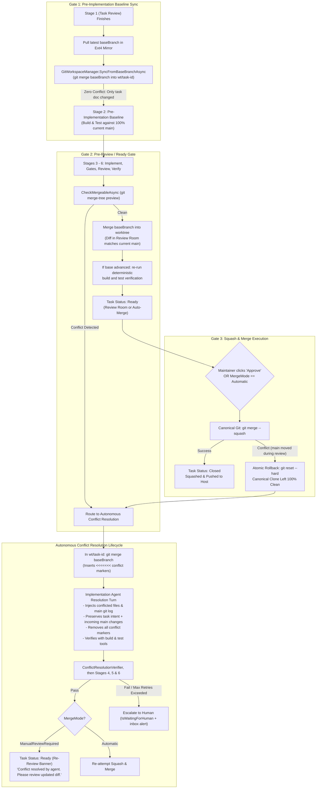

# 🔀 Step 11.25: Autonomous Git Conflict Management, Baseline Synchronization & Re-Review Lifecycle

> **Phase 11 Implementation Step (Post-MVP - Git Subsystem & Concurrency Resilience)**  
> *Parent Plan:* [Phase 11 Master Plan](../11_EXTEND_FEATURES.md)  
> *Project Target:* `src/NightCodeForge.Core`, `src/NightCodeForge.Infrastructure`, `src/NightCodeForge.Web`, `tests/NightCodeForge.Core.Tests`, `tests/NightCodeForge.Infrastructure.Tests`  
> *Status:* Planned | *Target Framework:* .NET 10 (C# 13)

---

## 1. Executive Summary & Problem Statement

NightCodeForge coordinates autonomous software engineering tasks across isolated Git worktrees. However, tasks are not instantaneous: they involve multi-turn LLM reasoning, deterministic compilation and test runs, human clarification intervals (`ask` questions waiting for maintainer answers in Stage 1), and human code reviews in the Review Room (`/review`).

Because multiple tasks execute concurrently or pause for human interaction, the target base branch (`main`) frequently advances before a task completes:
1. Other concurrent tasks are approved and squash-merged into `main`.
2. Human maintainers push commits, hotfixes, or refactorings directly to `main` on the host repository.

When `main` moves forward while a task is in flight or waiting for review, **Git merge conflicts** can emerge.

---

### 1.1 The Three Conflict Touchpoints

```
[Task Created]
       │
       ▼
 Stage 1: Task Review (Architect updates docs/tasks/*.md; may pause for human 'ask')
       │
       ▼  ◄─── TOUCHPOINT 1: Before Pre-Implementation Baseline
 Stage 2: Pre-Implementation Baseline (Deterministic build & test)
       │
       ▼
 Stage 3: Implementation (Agent writes code & tests)
       │
       ▼
 Stage 4: Post-Implementation Gates
       │
       ▼
 Stage 5: Code Review & Fix
       │
       ▼
 Stage 6: Post-Review Verification
       │
       ▼  ◄─── TOUCHPOINT 2: Transition to 'Ready' / Review Room Entry
 Maintainer Review (Review Room modal; may sit for hours or days)
       │
       ▼  ◄─── TOUCHPOINT 3: At Squash & Merge Action (Manual or Automatic)
 Squash & Merge into main
```

1. **Touchpoint 1 — Start of Pre-Implementation Baseline (Stage 2):**
   - In Stage 1 (`ForgeTask Review`), the architect agent only inspects the codebase, drafts the technical architecture in `docs/tasks/task-{id}.md`, and asks clarification questions. If questions are asked, the task halts (`IsWaitingForHuman = true`) for hours or days.
   - If the task branch does not synchronize with `main` before Stage 2, the baseline test suite runs against stale code. Worse, Stage 3 (`Implementation`) will write code against obsolete interfaces and files, guaranteeing merge conflicts later.
   - **Key Fact:** Because Stage 1 only touches `docs/tasks/task-{id}.md` (a file strictly isolated to this task), synchronizing from `main` at the start of Stage 2 is **expected to be conflict-free**, provided Stage 1 output is committed first (git refuses to merge over a dirty tree). If a conflict still occurs (e.g. `main` touched that same task document), it is a hard error (`MergeConflictException`), never silently ignored.

2. **Touchpoint 2 — Transition to `Ready` / Review Room Entry:**
   - When a task completes Stage 6, it may sit in the Review Room awaiting human maintainer review.
   - If `main` advanced during implementation, the diff shown to the maintainer in the Review Room might be stale or already in conflict with `main`. Presenting a conflicting diff to a reviewer wastes human time.

3. **Touchpoint 3 — At Squash & Merge Action (Manual or `MergeMode.Automatic`):**
   - While the maintainer is reviewing, or right as `MergeMode.Automatic` triggers, `main` may have moved forward (e.g., another task merged 30 seconds earlier).
   - Currently, `GitWorkspaceManager.SquashAndMergeAsync` executes `git merge --squash feature/task-{id}`. If a conflict occurs, Git exits with code 1, leaving the canonical working repository with unmerged index entries and throwing an unhandled exception that crashes the Hangfire job or shows a generic error toast in the UI.

---

### 1.2 Strategic Comparison: Continuous Eager Rebase vs. Just-In-Time (JIT) Strategic Synchronization Gates

| Dimension | Continuous Eager Rebase (Background on every merge) | Just-In-Time (JIT) Strategic Synchronization Gates (Recommended) |
| :--- | :--- | :--- |
| **GPU / CPU Queue Impact** | **Severe contention:** If 4 tasks are in flight and Task A merges, all 4 tasks re-evaluate/re-run simultaneously, starving the single GPU Hangfire worker. | **Zero overhead:** Only synchronizes a specific task when it reaches defined pipeline milestones. |
| **Worktree Race Conditions** | **High risk:** Rebasing under an actively generating agent causes `.git/index.lock` collisions, mid-edit file mutations, and compiler crashes. | **Zero race conditions:** Worktree synchronizations occur only between discrete stages or when execution is paused. |
| **Wasted Compute** | **High:** A task waiting for human input might get rebased 5 times as 5 other tasks merge, even if it touches unrelated files. | **Minimal:** Only resolves conflicts when code is actually ready to be verified or merged. |
| **Blast Radius** | Unpredictable background state mutations across all tasks. | Isolated, deterministic, and auditable per-task lifecycle transitions. |

**Recommendation:** Adopt **Just-In-Time (JIT) Strategic Synchronization Gates** at the three critical touchpoints.

---

### 1.3 Git Strategy: `git merge` vs. `git rebase` for Agent Autonomy

When conflicts must be resolved by an implementation agent in its isolated worktree:
- **Why NOT `git rebase`?**
  - Rebase pauses mid-rebase in a detached HEAD state (`.git/rebase-apply` or `.git/rebase-merge`).
  - If an agent generates invalid code or tool calls fail, recovering or aborting a mid-rebase state across asynchronous turns is fragile.
  - Intermediate commit history on a feature branch does not matter: NightCodeForge performs `git merge --squash` into `main` at task completion.
- **Why `git merge {baseBranch}`?**
  - Non-destructive to branch HEAD: preserves standard branch tracking.
  - Git automatically inserts standard conflict markers (`<<<<<<< HEAD`, `=======`, `>>>>>>> {baseBranch}`) in only the conflicted files. Clean files are merged automatically.
  - LLMs are exceptionally proficient at identifying conflict markers in context, understanding both sides of the change, and applying precision edits with the `edit` tool.
  - Once resolved, the agent runs `dotnet build` and `dotnet test` to verify; the orchestrator (not the agent) stages the files and creates the merge commit after deterministic verification (3.3.4).
  - When later squashed into `main`, all merge commits are collapsed into one single clean commit.

---

## 2. Architecture & Data Flow



---

## 3. Detailed Specifications

> Per the project convention, this section states **required behaviors, data and constraints**. Signatures and code structure are left to the implementer. All git command names/arguments, `PipelineDataBag` keys, audit messages, and UI texts MUST be defined as constants (no magic strings or numbers).

### 3.0 Terminology & Concurrency Model

- **Canonical clone:** the NightCodeForge-owned shared clone of the workspace (Step 11.24), distinct from the host repository. It is only mutated under the atomic workspace lock (`AcquireLockAsync`, < 500 ms operations).
- **Host repository:** the maintainer's repository, updated only through the mirror push at the end of a successful squash.
- **Task worktree (`wt/task-{id}`):** mutated only under the **task lock** (`AcquireTaskLockAsync`), never concurrently with an agent run.
- **Rule:** no git operation in this step may run on the Blazor UI thread against a task worktree. UI-initiated flows (Approve & Merge) only mutate the canonical clone under the workspace lock; any worktree work is deferred to the Hangfire job (which holds the task lock).

---

### 3.1 Git Subsystem Enhancements (`IGitWorkspaceManager` / `GitWorkspaceManager`)

#### Result and error contracts
- **`MergeSyncResult`** carries: success flag, conflict flag, the list of conflicted file paths, and the resulting merge commit SHA (when successful). It has **no** free-text error field.
- **`MergeabilityCheckResult`** carries: mergeable flag, the list of conflicted file paths, the base branch SHA, and the feature branch SHA.
- **Fail-fast rule:** only *merge conflicts* are modelled as results. Any other git failure (lock files, missing refs, dirty tree, I/O) throws a dedicated domain exception (e.g. `GitCommandException`) and must never be converted into an error string.
- **`MergeConflictException`** carries: task id, base branch, conflicted files, and raw git output.
- **`MirrorPushRejectedException`** (new) is thrown when the host push is rejected as non-fast-forward after the bounded retry defined in 3.1.4.

#### 1. `SyncFromBaseBranchAsync`
- Target: the task worktree (`wt/task-{id}`), under the task lock.
- Pre-condition: the worktree is clean. If it has uncommitted changes, the caller (orchestrator) MUST commit pending stage output first; if it is still dirty, throw `GitCommandException` (no silent stash/reset).
- **Merge already in progress:** if `MERGE_HEAD` is present, the call is a *resume*: it does not re-run the merge or pull; it returns a conflict result with the freshly enumerated unmerged files (empty list if all are already resolved). This makes job retries, crashes and post-escalation resumes safe. The clean-tree precondition does not apply in this case.
- Behavior:
  1. Pull the latest base branch from the host into the canonical clone / ext4 mirror (`_gitMirrorSyncService.PullFromHostAsync`) under the workspace lock.
  2. In the worktree, run `git merge --no-edit` of the base branch with `merge.conflictStyle=diff3` (so conflict blocks also contain the common ancestor).
  3. Exit code 0 → return success with the merge commit SHA (or the unchanged HEAD SHA when already up to date).
  4. Conflict → enumerate conflicted files with `git diff --name-only --diff-filter=U`, **leave the merge in progress** (markers on disk, `MERGE_HEAD` present) for the implementation agent, and return a conflict result.
- Idempotent: calling it when the base branch has not advanced is a no-op success.

#### 2. `CheckMergeableAsync`
- Target: read-only preview; it must not modify the worktree, index, or any ref.
- Pre-condition: the base branch has been refreshed from the host (same pull as above); the method itself must not assume freshness.
- Behavior: `git merge-tree --write-tree --name-only` between the feature branch HEAD and the base branch (Git 2.38+ required for `--name-only`; verify and fail fast at startup preflight if the installed git is older).
  - **Exit code 0** → mergeable.
  - **Exit code 1** → conflicts; the conflicted file list is read from the structured `--name-only` output section (never by scanning for conflict markers in text).
  - Any other exit code → throw `GitCommandException`.

#### 3. `AbortMergeAsync`
- Target: the task worktree (`wt/task-{id}`), under the task lock.
- Invokes `git merge --abort` when `MERGE_HEAD` exists, safely resetting unmerged index and worktree state. Throws `GitCommandException` on unexpected failure.

#### 4. Atomic Rollback in `SquashAndMergeAsync`
- Runs entirely on the canonical clone under the workspace lock.
- **Pre-squash SHA capture:** capture `preSquashSha` (`git rev-parse HEAD` on the base branch) before staging or committing the squash, ensuring deterministic rollback capability if push fails.
- On a conflicting `git merge --squash` (non-zero exit):
  1. Restore the canonical clone with `git reset --hard HEAD`. (`git merge --abort` is **not** valid here: a squash merge creates no `MERGE_HEAD`. It may only be issued if `MERGE_HEAD` exists.)
  2. `git clean -fd` is **forbidden**: a squash only stages tracked changes, which `reset --hard` already reverts, and `clean` could delete maintainer/untracked files.
  3. Collect the conflicted files **before** the reset (`git diff --name-only --diff-filter=U`).
  4. Throw `MergeConflictException`.
- **Worktree Preservation Rule:** `SquashAndMergeAsync` MUST NOT invoke `RemoveWorktreeAsync`. The task worktree (`wt/task-{id}`) must remain intact until host push succeeds and the task transitions to `Closed`, guaranteeing worktree availability if push fails or if conflict resolution is triggered.
- Post-condition (tested): the canonical clone has no staged, unmerged, or modified tracked files and HEAD equals the pre-merge SHA.

#### 5. Host Push Race Handling & Coordination (`TaskOrchestrator` / `IGitMirrorSyncService`)
Human maintainers may push to the host base branch between the pull and the push of a squash.
- **Push error classification in `IGitMirrorSyncService.PushBaseBranchToHostAsync`:**
  - Non-fast-forward rejection (`[rejected]` / `non-fast-forward` / `fetch first` in git stderr): indicates base branch advanced on host. Throws or returns typed status indicating non-fast-forward rejection. It MUST NOT fall back to `{baseBranch}-ncf`.
  - Dirty host working tree (`updateInstead` rejection): falls back to `{baseBranch}-ncf` and alerts maintainer.
- **Orchestration & retry in `TaskOrchestrator` (under workspace lock):**
  - If the mirror push is rejected as non-fast-forward: reset the canonical clone to the pre-squash SHA (`git reset --hard {preSquashSha}`), pull from host (`PullFromHostAsync`), and retry the whole squash **once** (constant `MaxPushRetries = 1`). The retried squash is not preceded by a build/test re-verification (accepted race window, same as Gate 3).
  - If the retried squash conflicts → standard `MergeConflictException` path (Gate 3). Because the task worktree was preserved, conflict resolution proceeds in the existing worktree.
  - If the retried push is still rejected → reset the canonical clone to `preSquashSha` and throw `MirrorPushRejectedException`. The silent catch in `TaskOrchestrator` is removed; the UI displays the error and the task remains `Ready` (no data loss, no auto-resolution).
  - On complete success (squash + push): remove the task worktree (`RemoveWorktreeAsync`), mark task `Closed`, and cascade unblocking.

---

### 3.2 Task Orchestration & Pipeline Gate Integration (`TaskOrchestrator`)

#### Gate 1: Pre-Implementation Baseline Synchronization
- In `TaskOrchestrator.ProcessTaskAsync`, right before executing Stage 2 (`StandardStageIds.PreImplementationBaseline`):
  - Commit any pending Stage 1 output in the worktree.
  - Invoke `SyncFromBaseBranchAsync` for `task.BaseBranch`.
  - Success → append to the execution log: `Synchronized feature branch with latest '{task.BaseBranch}' prior to baseline verification.`
  - Conflict (unexpected at this stage) → call `_gitWorkspaceManager.AbortMergeAsync(workspace, task.Id, cancellationToken)` (valid: `MERGE_HEAD` exists) so the worktree is left clean and retryable, then throw `MergeConflictException`, surfaced as a failed stage with a clear audit entry. Do **not** auto-resolve at this gate.
- Gate 1 runs every time Stage 2 is entered and relies on idempotency (no-op if base has not advanced).

#### Gate 2: Pre-Review / Ready Gate Verification
When Stage 6 (`PostReviewVerification`) finishes and before setting `TaskOverallStatus.Ready`:
1. Commit any pending worktree output (the preview only sees committed state), refresh the base branch and run `CheckMergeableAsync`.
2. **Not mergeable** → do not set `Ready`; log a warning and call `InitiateConflictResolutionAsync` with the conflicted files.
3. **Mergeable** → run `SyncFromBaseBranchAsync` in the worktree.
   - If the base branch had not advanced (no new merge commit) → proceed directly to `Ready`.
   - If the merge brought in new changes → **re-run the deterministic verification** (build + test, same gates as Stage 6) against the merged tree *before* `Ready`. A pass proceeds to `Ready`; a failure follows the standard Stage 6 failure routing (loopback to Implementation). This prevents semantic breakage (clean textual merge, broken build/tests) from reaching the maintainer.
   - If a race caused `SyncFromBaseBranchAsync` to conflict → call `InitiateConflictResolutionAsync`.
   - The final diff displayed in the Review Room is then computed against the (refreshed) base branch.
4. The race window between Gate 2 and the maintainer's approval is accepted; Gate 3 covers it.

#### Gate 3: Squash & Merge Conflict Recovery
In `CompleteTaskAndCascadeInternalAsync` (invoked from `ApproveMergeModal` or auto-merge):
- Formal return contract: `Task<CompleteTaskResult>` on `ITaskOrchestrator.CompleteTaskAndCascadeAsync`:
  - `CompleteTaskStatus.Completed`: squash and host push completed successfully; worktree removed; task transitioned to `Closed`.
  - `CompleteTaskStatus.ConflictResolutionDispatched`: merge conflict detected; maintainer approval discarded; conflict resolution enqueued.
- Catch `MergeConflictException` from `SquashAndMergeAsync`:
  - Log: `Squash and merge failed for ForgeTask #{task.Id} due to merge conflict with '{task.BaseBranch}'.`
  - Call `InitiateConflictResolutionAsync` (state change + enqueue only; no worktree git work on the caller's thread).
  - The maintainer's approval is **discarded**: in `ManualReviewRequired` a new approval is required after re-review; in `Automatic` the merge is re-attempted automatically once the resolution passes verification.
  - Record a `TaskHistory` entry for the discarded approval.
  - Return `new CompleteTaskResult(CompleteTaskStatus.ConflictResolutionDispatched, ...)` to `ApproveMergeModal`.
- **Dependent tasks:** cascade unblocking (DAG) only happens after a *successful* merge. While a parent is in conflict resolution its dependents stay blocked; no special handling is required.

---

### 3.3 Autonomous Conflict Resolution Stage & Agent Directive

#### 1. Retry Budget & Escalation
- Constant `MaxConflictResolutionAttempts` (default 3) = the maximum number of **consecutive failed** resolution attempts. Counter stored in `PipelineDataBagKeys.ConflictResolutionAttempts`.
- The counter increments on each failed resolution verification (`ConflictResolutionVerifier` or Stages 4/6 failing on the resolved tree). `InitiateConflictResolutionAsync` does not increment it.
- When the counter **reaches** the maximum: **stop looping**, set the task to wait for a human (`IsWaitingForHuman = true`) through the existing human-attention mechanism (inbox entry / alert), record a `TaskHistory` entry, and leave the worktree as-is for manual inspection. This applies to `Automatic` mode as well (no unbounded loop).
- The counter resets after each *verified* resolution, on a successful merge into base branch, and on explicit maintainer action (resume). A repository where main keeps advancing therefore does not escalate as long as each resolution succeeds.

#### 2. `InitiateConflictResolutionAsync`
- Pure state transition + enqueue (safe to call from the UI/approval path):
  - Store in `PipelineDataBag`: `ConflictFiles`, `ConflictBaseBranch`, `ConflictDetectedAt` (all keys are constants in `PipelineDataBagKeys`).
  - Set `task.Status = TaskOverallStatus.Open` and `task.CurrentStageId = StandardStageIds.Implementation` (consistent with the Step 11.14 loopback pattern); the orchestrator moves it to `InProgress` when the job starts. This method is the **single owner** of the enqueue for this transition: any scheduler/Kanban path that dispatches `Open` tasks must not enqueue a task that already has a pending conflict-resolution job (guard against double dispatch).
  - Record `TaskHistory` with `ChangedBy = AuditActors.TaskOrchestrator` and `ChangeReason = "Merge conflict detected with {baseBranch}. Routed to Implementation Agent for resolution."`
  - Enqueue the task in Hangfire.
- **Marker materialization:** when the Implementation stage starts and `ConflictFiles` is present, the job (holding the task lock) runs `SyncFromBaseBranchAsync` (which resumes if a merge is already in progress, see 3.1.1) so the conflict markers/merge-in-progress exist on disk before the agent runs. The file list stored in `ConflictFiles` is refreshed from this sync result, which is authoritative. If the sync unexpectedly succeeds (the conflict disappeared, e.g. base was reverted), clear the conflict keys and continue the normal pipeline.

#### 3. Conflict Resolution Agent Directive
When the Implementation Agent executes with `ConflictFiles` present, an authoritative directive is appended to its prompt (text lives in a constant/template resource):

```markdown
[CRITICAL: Autonomous Merge Conflict Resolution Required]
Your feature branch has conflicts with target branch '{{ context.conflict_base_branch }}'.
A merge is in progress in your worktree. The following files are conflicted:
{{ for file in context.conflict_files }}
- {{ file }}
{{ end }}

INSTRUCTIONS:
1. Inspect each conflicted file with 'read'. Conflict blocks look like:
   <<<<<<< HEAD                 (your feature changes)
   ||||||| <ancestor label>      (original code; label varies)
   =======
   >>>>>>> {{ context.conflict_base_branch }}   (incoming changes from base branch)
2. Preserve the functionality of this task while integrating the incoming changes. Use 'edit' to replace each whole block with clean resolved code. NO conflict markers may remain.
3. Non-textual conflicts (a file deleted on one side and modified on the other, or binary files) have no markers: decide explicitly and resolve with 'git rm <file>' or 'git add <file>'. For textual conflicts you do NOT need to stage anything; the orchestrator stages resolved files.
4. Run 'dotnet build' and 'dotnet test' via 'bash' to verify.
5. DO NOT run 'git commit', 'git merge --abort' or 'git reset'. Finish your turn once the files are resolved and verified; the orchestrator completes the merge.
```

#### 4. Deterministic Resolution Verification (`ConflictResolutionVerifier`)
The agent's claim is never trusted. After the agent turn, before Stages 4–6, the orchestrator verifies, in the worktree, **in this order** (unmerged index entries persist until files are staged, so the index check must come after staging):
1. **Marker scan** of every file in the refreshed conflicted list and every file changed by the merge:
   - For existing files (`File.Exists(filePath)`), verify no line starts with `<<<<<<< `, `||||||| ` (diff3 ancestor), or `>>>>>>> `. A bare `=======` line is NOT a marker on its own (valid in Markdown/RST); it only counts inside a block opened by `<<<<<<< `. Marker literals are constants.
   - For deleted files (e.g. file removed on one side in delete/modify conflict), skip the text scan; verify removal in index check.
2. **Stage** the resolved files (`git add` of the conflicted/changed paths; no blind `git add -A` that could include unrelated untracked files).
3. **`git ls-files -u` is empty** (no unmerged entries remain, including delete/modify and binary conflicts the agent did not decide).
4. If `MERGE_HEAD` is present, create the merge commit (`git commit --no-edit` with message `Resolve merge conflicts with {baseBranch}`). The squash into the base branch later collapses it.

On any verification failure: increment the attempts counter and loop back to Implementation with a concrete feedback message (remaining files/markers listed); once the budget is reached, escalate (3.3.1).
On success: reset the attempts counter, clear `ConflictFiles`, `ConflictBaseBranch`, `ConflictDetectedAt`, set `PipelineDataBagKeys.HasResolvedConflict = true`, and continue through Stage 4 (post-implementation gates), Stage 5 (code review & fix) and Stage 6 (post-review verification).

#### 5. Post-Resolution Transition & `HasResolvedConflict` Lifecycle
- After Stage 6 passes (and Gate 2 re-checks mergeability):
  - `ManualReviewRequired` → `Status = Ready`; the Review Room shows the re-review banner.
  - `Automatic` → the squash & merge is re-attempted; if it conflicts again the budget in 3.3.1 applies.
- `HasResolvedConflict` stays `true` while the task is `Ready` and is cleared when the maintainer approves (merge succeeds) or rejects the task (cleared immediately on rejection, since the task re-enters the pipeline; a new resolution sets it again, so the banner is only shown for the most recent unreviewed resolution).

---

### 3.4 Web UI & Review Room Ergonomics

1. **Review Room Re-Review Alert Banner (`Review.razor`):**
   - If `PipelineDataBag` has `HasResolvedConflict == true`, render an amber alert at the top of the Review Room stating that the task conflicted with the base branch, that the implementation agent resolved the conflicts and re-verified build/tests, and that the updated diff must be inspected before approving. The base branch name is displayed from the task snapshot; the text is a constant/localizable resource.
   - Data retrieval (`PipelineDataBag` parsing) goes through a service/helper (e.g. on the review snapshot DTO), not directly in the `@code` block.

2. **Approve & Merge Modal (`ApproveMergeModal.razor`):**
   - The modal consumes the typed `CompleteTaskResult`:
     - `CompleteTaskStatus.Completed` → displays success toast and invokes `OnApproved`.
     - `CompleteTaskStatus.ConflictResolutionDispatched` → displays notice: `Merge conflict detected with {baseBranch}. An implementation agent has been dispatched to resolve the conflict and will notify you when ready for re-review.`, dismisses itself, and refreshes the parent view (`OnApproved` / refresh event).
   - `MirrorPushRejectedException` and other git failures are displayed as errors (no silent handling) and leave the task `Ready`.
   - **UI Separation & Service Cleanup:** `ApproveMergeModal` must inject and call `ITaskMutationService.UpdateMergeModeAsync` to change `MergeMode`, eliminating the `ServiceProvider.GetService<ITaskRepository>()` anti-pattern from `@code`.

3. **Kanban & Task Detail Timeline (`TaskHistoryTimeline.razor`):** shows temporal audit events such as:
   - `Merge conflict with main detected during merge attempt.`
   - `Maintainer approval discarded due to merge conflict.`
   - `Implementation Agent resolved merge conflicts in N files (<file list>).`
   - `Post-Review Verification passed. Re-opened for maintainer review.`
   - `Conflict resolution budget exhausted. Escalated to maintainer.`

---

## 4. Definition of Done (DoD) Checklist

- [ ] Domain & constants:
  - [ ] `MergeConflictException`, `MirrorPushRejectedException`, `GitCommandException` usage for non-conflict failures.
  - [ ] `CompleteTaskResult` record and `CompleteTaskStatus` enum (`Completed`, `ConflictResolutionDispatched`).
  - [ ] New `PipelineDataBagKeys`: `ConflictFiles`, `ConflictBaseBranch`, `ConflictDetectedAt`, `ConflictResolutionAttempts`, `HasResolvedConflict`; constants for `MaxConflictResolutionAttempts`, `MaxPushRetries`, git arguments, audit messages and UI texts.
  - [ ] Git version preflight (>= 2.38 for `merge-tree --write-tree --name-only`).
- [ ] `IGitWorkspaceManager` and `GitWorkspaceManager`:
  - [ ] `SyncFromBaseBranchAsync`: clean-tree precondition, diff3 merge in worktree, conflict detection leaving the merge in progress, idempotent, resume when `MERGE_HEAD` already present.
  - [ ] `CheckMergeableAsync`: non-destructive, exit-code based `git merge-tree` preview with structured file list.
  - [ ] `AbortMergeAsync`: cleanly aborts in-progress merge in worktree when `MERGE_HEAD` exists.
  - [ ] `SquashAndMergeAsync`: pre-squash SHA captured before commit, atomic rollback (`git reset --hard HEAD`, no `git clean`, no blind `merge --abort`), conflicted files captured before reset, throws `MergeConflictException`.
  - [ ] Worktree preservation: `wt/task-{id}` is NOT removed inside `SquashAndMergeAsync`; removed only after host push succeeds at `Closed` transition.
  - [ ] All canonical operations under the workspace lock; all worktree operations under the task lock.
- [ ] `IGitMirrorSyncService` & Host Push Race:
  - [ ] `PushBaseBranchToHostAsync` classifies errors: non-fast-forward throws or returns non-fast-forward indicator (no blind `-ncf` push); dirty host tree triggers `-ncf` fallback.
- [ ] `TaskOrchestrator`:
  - [ ] Gate 1: commit Stage 1 output, sync base before Stage 2; unexpected conflict calls `AbortMergeAsync` (clean worktree) then is a hard error.
  - [ ] Gate 2: commit pending output, refreshed mergeability check; merge + deterministic re-verification when base advanced; conflict routing otherwise.
  - [ ] Gate 3: catch `MergeConflictException`, discard approval with history entry, trigger conflict resolution, return `CompleteTaskResult` to caller.
  - [ ] Host push race retry: bounded retry (`MaxPushRetries = 1`) with canonical clone reset to `preSquashSha`, re-pull, and re-squash; removes silent `catch` block.
  - [ ] `InitiateConflictResolutionAsync` (state + enqueue only) and marker materialization at Implementation start under the task lock.
  - [ ] Retry budget with escalation to a human (no unbounded loop, including `Automatic` mode).
  - [ ] `ConflictResolutionVerifier` (order: marker scan including `||||||| ` and `File.Exists` guard, stage, unmerged index check, orchestrator-owned merge commit) with `HasResolvedConflict` lifecycle.
- [ ] Agent Directives & Prompts:
  - [ ] Inject the conflict directive and file list into the Implementation prompt via `StandardWorkflowDefinitions` / `TaskOrchestrator` (including delete/modify and binary conflicts; agent must not commit/abort).
- [ ] Web UI & Ergonomics:
  - [ ] "Conflict Resolved by Agent" banner in `Review.razor` (logic outside `@code`).
  - [ ] `ApproveMergeModal.razor` consumes `CompleteTaskResult` (dispatched feedback and push rejection error display).
  - [ ] `ApproveMergeModal.razor` uses `ITaskMutationService.UpdateMergeModeAsync` instead of `ServiceProvider.GetService`.
  - [ ] `TaskHistoryTimeline` entries for the new audit events.
- [ ] Tests:
  - [ ] `GitWorkspaceManagerTests`: `CheckMergeableAsync` (clean/conflict/error), `SyncFromBaseBranchAsync` (clean, conflict, dirty tree, idempotent), `AbortMergeAsync`, squash rollback post-conditions (no `MERGE_HEAD`, untracked files preserved, worktree preserved), push rejection retry.
  - [ ] `TaskOrchestratorTests`: Gate 1 sync & abort, Gate 2 (clean no-advance, clean with advance + re-verification, conflict), Gate 3 loopback with approval discard, `Automatic` re-merge, retry cap escalation, dependents stay blocked.
  - [ ] `ConflictResolutionVerifier` unit tests (leftover markers including `||||||| `, resolved-but-unstaged file passes, bare `=======` in Markdown not flagged, deleted files handled cleanly, unmerged entries, delete/modify conflicts, orchestrator commit).
  - [ ] Resilience tests: Gate 1 conflict then retry leaves a clean worktree; resume with `MERGE_HEAD` present after crash; Gate 2 with uncommitted worktree changes; attempts-counter boundary (exactly `MaxConflictResolutionAttempts` consecutive failures escalate); no double enqueue on `Open` task.
  - [ ] UI tests for the banner, `ApproveMergeModal` conflict feedback, and mutation service call.
  - [ ] Run the fast suite (`dotnet test --filter "Category!=Acceptance&Category!=E2E"`), then the **full suite including E2E/Acceptance** at the end of the step; all must pass.
