# 🔄 Step 11.28: Pipeline Restart Git Options: Soft Resume vs Hard Reset & Base Branch Rebase

> **Phase 11 Implementation Step (Post-MVP - Pipeline Management, Git Worktree Hygiene & Developer Ergonomics)**  
> *Parent Plan:* [Phase 11 Master Plan](../11_EXTEND_FEATURES.md)  
> *Project Target:* `src/NightCodeForge.Core`, `src/NightCodeForge.Infrastructure`, `src/NightCodeForge.Web`, `tests/NightCodeForge.Core.Tests`, `tests/NightCodeForge.Infrastructure.Tests`, `tests/NightCodeForge.Web.Tests`  
> *Status:* Proposed / Specified | *Target Framework:* .NET 10 (C# 13)

---

## 1. Executive Summary & Problem Statement

NightCodeForge enables developers to inspect in-flight, failed, and completed task workflows through the **Task Execution Inspector** (`/inspector` -> [TaskExecutionInspector.razor](file:///c:/Users/Julien/source/repos/jetelain/NightCodeForge/src/NightCodeForge.Web/Components/Monitoring/TaskExecutionInspector.razor)). Within this view, the header action bar provides a **"⏮ Restart Pipeline"** button designed to re-run execution from Stage 1 (`task-review`).

However, architectural review of [DevQueueService.cs](file:///c:/Users/Julien/source/repos/jetelain/NightCodeForge/src/NightCodeForge.Web/Services/DevQueueService.cs) and [TaskOrchestrator.cs](file:///c:/Users/Julien/source/repos/jetelain/NightCodeForge/src/NightCodeForge.Core/Workflow/TaskOrchestrator.cs) reveals a significant operational gap in how Git state is handled:

### 1.1 The Current Behavior: Silent Preservation of Prior Artifacts

When a developer clicks **"⏮ Restart Pipeline"**:
1. [DevQueueService.RescheduleTaskAsync](file:///c:/Users/Julien/source/repos/jetelain/NightCodeForge/src/NightCodeForge.Web/Services/DevQueueService.cs#L366-L418) updates only the database record:
   - Sets `task.CurrentStageId = string.Empty`.
   - Sets `task.Status = TaskOverallStatus.Open`.
   - Clears `task.SquashCommitSha = null`.
   - Clears human-wait and interruption flags.
   - Enqueues the task back into the Hangfire inference queue.
2. **Git State is Untouched:**
   - The task's isolated worktree (`wt/task-{id}`) and Git branch (`feature/task-{id}`) remain intact.
   - All previous WIP checkpoint commits created by `CreateWipCheckpointAsync`, all code changes authored by the implementation agent, and any uncommitted or generated files remain on the branch.
3. When [TaskOrchestrator.ProcessTaskAsync](file:///c:/Users/Julien/source/repos/jetelain/NightCodeForge/src/NightCodeForge.Core/Workflow/TaskOrchestrator.cs#L202) dequeues the task, it calls [GitWorkspaceManager.CheckoutTaskBranchAsync](file:///c:/Users/Julien/source/repos/jetelain/NightCodeForge/src/NightCodeForge.Infrastructure/Git/GitWorkspaceManager.cs#L63-L93), which sees that the worktree already exists and reuses it as-is without resetting commits or cleaning the directory (verified by [GitWorkspaceManagerTests.cs](file:///c:/Users/Julien/source/repos/jetelain/NightCodeForge/tests/NightCodeForge.Infrastructure.Tests/Git/GitWorkspaceManagerTests.cs#L103-L122)).

### 1.2 The Missing Capability: Clean Slate / Hard Reset to Base Branch

In real-world engineering workflows, restarting a pipeline arises under two fundamentally distinct operator intents:

| Operator Intent | Use Case & Expectations | Current Behavior |
| :--- | :--- | :--- |
| **Soft Restart (Preserve Work)** | The operator wants to re-run the pipeline stages on top of existing code (e.g. to re-verify quality gates with updated test configurations, retry review with a different prompt/model profile, or continue iterating on existing changes). | Supported (Existing behavior). |
| **Hard Reset & Rebase on Base Branch (`main`)** | The previous attempt produced broken code, architectural dead ends, or dirty worktree states that should be completely discarded. The operator wants to restart the task **from scratch on a clean state directly aligned with the latest `main` (or `baseBranch`)**, exactly as if the task were being executed for the first time. | **Not Supported.** Stale commits and broken files carry over, polluting subsequent runs and causing premature stage failures. |

Furthermore, when a task is hard-reset, any running sandbox Docker container (`ncf-sandbox-{workspaceId}-task-{taskId}`) retains stale build caches (`obj/`, `bin/`) and open file handles that will block Git resets on Windows/WSL mounts unless the container is recycled first.

---

## 2. Architecture & Workflow

### 2.1 Pipeline Restart Decision & Execution Flow

```mermaid
flowchart TD
    subgraph UI ["Task Execution Inspector (TaskExecutionInspector.razor)"]
        ClickRestart["User clicks '⏮ Restart Pipeline'"]
        OpenModal["Display Restart Pipeline Modal<br/>(RestartPipelineModal.razor)"]
        SelectMode{"Select Restart Git Mode"}
        SoftOption["Option 1: Soft Restart<br/>- Keep existing branch commits<br/>- Preserve worktree files<br/>- Reset pipeline to Stage 1"]
        HardOption["Option 2: Hard Reset & Rebase<br/>- Discard all WIP commits & files<br/>- Reset branch to latest baseBranch (main)<br/>- Teardown sandbox container first<br/>- Clear conflict & pipeline bags<br/>- Force-push/align host-origin<br/>- Start Stage 1 on clean baseline"]
    end

    subgraph ServiceLayer ["Core Orchestration Layer (TaskOrchestrator)"]
        CallRestart["TaskOrchestrator.RestartTaskPipelineAsync<br/>(taskId, gitMode)"]
        GuardMerged{"Is task merged?<br/>(SquashCommitSha != null)"}
        RejectMerged["Throw InvalidOperationException<br/>(Merged tasks cannot be restarted)"]
        HandleActive{"Is task active or queued?"}
        CancelActive["1. Cancel running execution via ITaskCancellationManager<br/>2. Delete enqueued job via ITaskJobQueue.Delete(LastHangfireJobId)"]
        AcquireLock["Acquire Workspace Mutual Exclusion Lock"]
        CheckMode{"gitMode == HardResetToBaseBranch?"}
        
        subgraph HardResetPath ["Hard Reset & Clean Baseline Operations (Container-First Order)"]
            CleanContainer["1. Teardown Sandbox Container<br/>(CleanupTaskContainerAsync releases file locks)"]
            FetchBase["2. Fetch latest baseBranch from origin<br/>(git fetch host-origin {baseBranch})"]
            ResetGit["3. GitWorkspaceManager.ResetTaskBranchToBaseAsync<br/>- Discard dirty edits & untracked files (git clean -fdx)<br/>- Hard reset branch to origin/{baseBranch}<br/>- Re-verify relative paths"]
            SyncRemote["4. Reconcile remote branch<br/>(git push --force host-origin feature/task-{id})"]
        end
        
        UpdateDB["Reset Task DB Record & History<br/>- Clear all conflict & interrupted keys in PipelineDataJson<br/>- Set HasExecutionRun = false<br/>- Mark active conversations as Superseded<br/>- Status = Open, CurrentStageId = initialStage.StageId"]
        Enqueue["TaskJobQueue.EnqueueStage<br/>(Enqueue initialStage using initialStage.QueueTier)"]
    end

    subgraph Worker ["Single GPU Hangfire Worker"]
        ExecStage1["ProcessTaskAsync<br/>Runs Stage 1 on Clean or Preserved Worktree"]
    end

    ClickRestart --> OpenModal
    OpenModal --> SelectMode
    SelectMode -->|Soft Restart| SoftOption
    SelectMode -->|Hard Reset| HardOption
    SoftOption --> CallRestart
    HardOption --> CallRestart

    CallRestart --> GuardMerged
    GuardMerged -- Yes --> RejectMerged
    GuardMerged -- No --> HandleActive
    HandleActive --> CancelActive
    CancelActive --> AcquireLock
    AcquireLock --> CheckMode
    CheckMode -- Yes --> CleanContainer
    CleanContainer --> FetchBase
    FetchBase --> ResetGit
    ResetGit --> SyncRemote
    SyncRemote --> UpdateDB
    CheckMode -- No --> UpdateDB

    UpdateDB --> Enqueue
    Enqueue --> ExecStage1
```



---

## 3. Detailed Specifications

### 3.1 Domain Contracts & Data Model

1. **`TaskRestartGitMode` Enum:**
   Add a first-class enum in `src/NightCodeForge.Core/Domain/TaskRestartGitMode.cs` to eliminate magic booleans and represent operator restart modes explicitly:
   ```csharp
   namespace NightCodeForge.Core.Domain;

   /// <summary>
   /// Defines the Git worktree and branch strategy when restarting a task pipeline.
   /// </summary>
   public enum TaskRestartGitMode
   {
       /// <summary>
       /// Preserves existing feature branch commits and modified worktree files,
       /// restarting workflow stages from the workflow initial stage on top of existing work.
       /// </summary>
       PreserveWork = 0,

       /// <summary>
       /// Hard-resets the task's feature branch to the latest commit of its base branch (e.g. main),
       /// cleans uncommitted files, recycles any running sandbox container, clears conflict states,
       /// force-aligns remote branch, and starts the workflow fresh.
       /// </summary>
       HardResetToBaseBranch = 1
   }
   ```

2. **Core Layer Orchestration Contract (`ITaskOrchestrator.cs`):**
   In accordance with the project rule on architectural layering, task pipeline restart orchestration belongs in the `Core` workflow domain, not directly inside Web services:
   ```csharp
   namespace NightCodeForge.Core.Workflow;

   public partial interface ITaskOrchestrator
   {
       /// <summary>
       /// Restarts execution of a task from the initial stage of its workflow,
       /// applying the specified Git branch reset strategy and recycling resources.
       /// </summary>
       Task<bool> RestartTaskPipelineAsync(
           int taskId,
           TaskRestartGitMode gitMode = TaskRestartGitMode.PreserveWork,
           CancellationToken cancellationToken = default);
   }
   ```

3. **Web Layer Contract (`IDevQueueService.cs`):**
   Update [IDevQueueService.cs](file:///c:/Users/Julien/source/repos/jetelain/NightCodeForge/src/NightCodeForge.Web/Services/IDevQueueService.cs) to delegate to `TaskOrchestrator.RestartTaskPipelineAsync` when restarting:
   ```csharp
   Task<bool> RescheduleTaskAsync(
       int taskId,
       TaskRestartGitMode gitMode = TaskRestartGitMode.PreserveWork,
       CancellationToken cancellationToken = default);
   ```

4. **`IGitWorkspaceManager` Contract Extension:**
   Add a dedicated branch reset method to [IGitWorkspaceManager.cs](file:///c:/Users/Julien/source/repos/jetelain/NightCodeForge/src/NightCodeForge.Core/Interfaces/IGitWorkspaceManager.cs):
   ```csharp
   /// <summary>
   /// Discards all uncommitted changes and commits on feature/task-{id}, hard-resetting
   /// the branch directly to the head of the specified baseBranch.
   /// </summary>
   Task ResetTaskBranchToBaseAsync(
       Workspace workspace,
       int taskId,
       string baseBranch,
       CancellationToken cancellationToken = default);
   ```

---

### 3.2 Git Workspace Reset Operations (`GitWorkspaceManager.ResetTaskBranchToBaseAsync`)

When `HardResetToBaseBranch` is triggered, operations execute in strict sequence under workspace mutual exclusion:

1. **Precondition & Invariant Checks:**
   - **Protection for Merged Tasks:** If `task.SquashCommitSha != null` or `task.Status == TaskOverallStatus.Merged`, throw `InvalidOperationException("Cannot restart a task that has already been merged.")`.
   - **Active Task Cancellation:** If the task is running (`WorkerStateService.ActiveTaskId == taskId` or `_cancellationManager.IsRegistered(taskId)`), request cancellation and await release.
   - **Dangling Hangfire Job Deletion:** If `task.LastHangfireJobId` is non-empty, call `_taskJobQueue.Delete(task.LastHangfireJobId)` before resetting Git or re-enqueuing.

2. **Container Teardown (First Step before Git Commands):**
   - Recycles any existing Docker container for this task via `_executionEnvironmentProvider.CleanupTaskContainerAsync(workspace, taskId, cancellationToken)`.
   - This releases all open file handles, file-system locks, and container volume bindings that would otherwise cause `git clean -fdx` or file deletion to fail on Windows / WSL mounts.

3. **Upstream Base Branch Synchronization:**
   - Always execute `git fetch host-origin {baseBranch}` (or `_gitMirrorSyncService.PullFromHostAsync` if mirror is enabled) to guarantee the local base branch reference matches the latest upstream commit.

4. **Worktree Clean and Reset:**
   Determine the task worktree path via `GetWorktreePath(workspace, taskId)`.
   - **Case A: Worktree Exists & Is Registered:**
     1. Discard uncommitted edits and purge untracked files:
        `git -C <worktreePath> reset --hard HEAD`
        `git -C <worktreePath> clean -fdx`
     2. Hard-reset the branch reference to the target base branch:
        `git -C <worktreePath> reset --hard host-origin/<baseBranch>`
     3. Verify bidirectional relative path pointers via `EnsureWorktreeRelativePathsAsync` to ensure container/WSL mount integrity.
   - **Case B: Worktree Does Not Exist or Is Corrupted:**
     1. Prune stale worktrees: `git worktree prune`.
     2. Forcefully re-point the branch to `host-origin/<baseBranch>`:
        `git branch -f feature/task-{taskId} host-origin/<baseBranch>`
     3. Invoke `EnsureWorktreeAsync(workspace, taskId, baseBranch, cancellationToken)`.

5. **Remote Branch Reconciliation:**
   - Check if remote branch `feature/task-{taskId}` exists on `host-origin`.
   - If present, force push the reset branch:
     `git push --force host-origin feature/task-{taskId}`
     (or delete the remote branch so subsequent stages create and push it cleanly).
   - This ensures that subsequent pushes in conflict resolution or merge gates do not fail due to rejected non-fast-forward updates.

6. **No Silent Failures:**
   All Git commands must throw `GitCommandException` on non-zero exit codes. If Git reset fails, the operation must fail fast and not re-enqueue the task in a corrupted state.

---

### 3.3 Database State & Pipeline Bag Sanitization

When performing `HardResetToBaseBranch`:
1. **Pipeline Data Bag Reset:**
   Completely purge all conflict resolution, compiler diagnostics, and interruption artifacts from `task.PipelineDataJson`:
   - Remove `PipelineDataBagKeys.ConflictFiles`
   - Remove `PipelineDataBagKeys.ConflictBaseBranch`
   - Remove `PipelineDataBagKeys.ConflictDetectedAt`
   - Reset `PipelineDataBagKeys.ConflictResolutionAttempts = 0`
   - Reset `PipelineDataBagKeys.TotalConflictResolutionAttempts = 0`
   - Reset `PipelineDataBagKeys.LifetimeConflictDetections = 0`
   - Reset `PipelineDataBagKeys.HasResolvedConflict = false`
   - Remove `PipelineDataBagKeys.CompilerErrors`
2. **Task Record Attributes:**
   - `task.Status = TaskOverallStatus.Open`
   - `task.CurrentStageId = initialStage.StageId`
   - `task.SquashCommitSha = null`
   - `task.HasExecutionRun = false`
   - `task.IsWaitingForHuman = false`
   - `task.InterruptedStageId = null`
   - `task.InterruptedAgentProfileId = null`
   - `task.UpdatedAt = DateTime.UtcNow`
3. **Stage Conversations:**
   Mark any existing active or running conversations for this task with `StageExecutionStatus.Superseded`, ensuring historical runs are closed and telemetry reflects a fresh execution session.
4. **Stage Dispatch:**
   Enqueue the task using the initial workflow stage's declared tier via:
   `_taskJobQueue.EnqueueStage(task.Id, initialStage.QueueTier, task.Priority);`

---

### 3.4 Audit Trail, History & Telemetry

1. **Task History Snapshot:**
   When saving the rescheduled task via `_taskRepository.UpdateWithHistoryAsync`:
   - `ChangedBy`: `AuditActors.User`.
   - `ChangeReason`:
     - If `HardResetToBaseBranch`: `"Pipeline restarted from Stage 1 with Hard Reset to '{task.BaseBranch}' (discards previous work)"`
     - If `PreserveWork`: `"Pipeline restarted from Stage 1 with preserved worktree changes"`
2. **Execution Logs:**
   Write an `ExecutionLog` record documenting the restart mode, previous stage, and timestamp.
3. **SignalR Telemetry Event:**
   Broadcast an `AgentActivityEvent` indicating `AgentActivityKind.TaskRestarted` (or `AgentActivityKind.StageStarted`) with metadata `["RestartMode"] = gitMode.ToString()`.

---

### 3.5 Web UI & Presentation Separation (`RestartPipelineModal.razor`)

In accordance with the project rule on UI and presentation separation (keeping Razor components focused strictly on presentation and user interaction, delegating logic to services):

1. **Action Trigger in `TaskExecutionInspector.razor`:**
   - Clicking **"⏮ Restart Pipeline"** no longer triggers an immediate background mutation.
   - Instead, it sets a modal visibility flag: `_showRestartModal = true`.

2. **Dedicated Modal Component (`RestartPipelineModal.razor`):**
   Create `src/NightCodeForge.Web/Components/Monitoring/RestartPipelineModal.razor` with rich visual design:
   - **Header:** "Restart Workflow Pipeline - Task #{TaskId}"
   - **Mode Selection Cards (Radio / Interactive Cards):**
     - **Card 1: Soft Restart (Keep Existing Work)**
       - Icon: 🔄
       - Badge: `Recommended for Iteration`
       - Description: "Re-runs the pipeline starting from the initial stage while keeping all existing commits and code changes on branch `feature/task-{id}`. Ideal for retrying review, tuning prompts, or continuing work."
     - **Card 2: Clean Hard Reset & Rebase on `{BaseBranch}`**
       - Icon: ⚠️ / ⚡
       - Badge: `Destructive / Clean Baseline` (Warning/Amber styling)
       - Description: "Completely wipes all commits and uncommitted changes on `feature/task-{id}`, aligns the branch directly to the latest commit of `{BaseBranch}`, recycles the container sandbox, and restarts the workflow on a pristine working tree."
       - **Safeguard Alert:** Selecting Card 2 displays a warning banner:
         > *"⚠️ Warning: All commits and untracked files on branch `feature/task-{TaskId}` will be permanently discarded. Any local untracked configs or test outputs will be wiped via `git clean -fdx`."*
   - **Action Buttons:**
     - **Cancel:** Closes modal without action.
     - **Confirm Restart:** Executes `DevQueueService.RescheduleTaskAsync(taskId, selectedGitMode)` and displays a loading spinner during execution.

---

## 4. Test Strategy & Quality Verification

### 4.1 Unit & Integration Tests

1. **`NightCodeForge.Infrastructure.Tests/Git/GitWorkspaceManagerTests.cs`:**
   - `ResetTaskBranchToBaseAsync_WhenBranchHasCommits_ResetsHeadToBaseBranchCommit`:
     - Commit files to `feature/task-201`.
     - Advance `main` with a new commit.
     - Invoke `ResetTaskBranchToBaseAsync(workspace, 201, "main")`.
     - Assert `rev-parse HEAD` in the worktree equals `main` HEAD.
     - Assert previous branch files are gone and `main` files are present.
   - `ResetTaskBranchToBaseAsync_WithUntrackedAndDirtyFiles_CleansWorkingTree`:
     - Create dirty uncommitted files and untracked directories in worktree.
     - Invoke `ResetTaskBranchToBaseAsync`.
     - Assert `git status --porcelain` is completely clean.

2. **`NightCodeForge.Core.Tests/TaskOrchestratorRestartTests.cs`:**
   - `RestartTaskPipelineAsync_WhenTaskIsMerged_ThrowsInvalidOperationException`:
     - Given a task with `SquashCommitSha != null`.
     - Calling `RestartTaskPipelineAsync` throws `InvalidOperationException`.
   - `RestartTaskPipelineAsync_WhenTaskIsRunning_CancelsRunningExecutionAndDeletesHangfireJob`:
     - Verify `_cancellationManager.Cancel(taskId)` is invoked.
     - Verify `_taskJobQueue.Delete(lastJobId)` is called before Git operations.
   - `RestartTaskPipelineAsync_HardReset_RecyclesContainerBeforeGitReset`:
     - Verify invocation sequence: `CleanupTaskContainerAsync` occurs before `ResetTaskBranchToBaseAsync`.
   - `RestartTaskPipelineAsync_HardReset_ClearsPipelineDataBagKeysAndFlags`:
     - Verify `ConflictFiles`, `HasResolvedConflict`, `CompilerErrors`, and `InterruptedStageId` are wiped.
     - Verify `HasExecutionRun == false`.
     - Verify task is re-enqueued via `EnqueueStage` with the initial stage's tier.

3. **`NightCodeForge.Web.Tests/DevQueueServiceTests.cs`:**
   - `RescheduleTaskAsync_DelegatesToTaskOrchestratorWithSelectedMode`:
     - Verify `DevQueueService.RescheduleTaskAsync` delegates to `TaskOrchestrator.RestartTaskPipelineAsync`.

4. **`NightCodeForge.Web.Tests/TaskExecutionInspectorComponentTests.cs`:**
   - `ClickingRestartButton_OpensRestartPipelineModal`:
     - Render `TaskExecutionInspector`.
     - Click "⏮ Restart Pipeline".
     - Assert `RestartPipelineModal` is rendered.
   - `ConfirmingHardReset_InvokesDevQueueServiceWithHardResetMode`:
     - Select Hard Reset option in modal.
     - Click Confirm.
     - Assert `RescheduleTaskAsync` is called with `TaskRestartGitMode.HardResetToBaseBranch`.

---

## 5. Acceptance Criteria Checklist

- [ ] `TaskRestartGitMode` enum defined in `NightCodeForge.Core.Domain` (`PreserveWork = 0`, `HardResetToBaseBranch = 1`).
- [ ] `ITaskOrchestrator.RestartTaskPipelineAsync` defined and implemented in `Core`, owning the restart workflow.
- [ ] Restart rejected with `InvalidOperationException` if task is already merged (`SquashCommitSha != null`).
- [ ] Active running tasks are cancelled and dangling Hangfire jobs deleted (`_taskJobQueue.Delete`) prior to reset.
- [ ] Sandbox container recycled (`CleanupTaskContainerAsync`) strictly BEFORE Git reset operations.
- [ ] `IGitWorkspaceManager.ResetTaskBranchToBaseAsync` implemented in `GitWorkspaceManager` with hard reset, untracked file purge (`git clean -fdx`), relative path normalization, and remote branch force-push.
- [ ] Pipeline data bag keys for conflict resolution and interruption fully purged on hard reset.
- [ ] Task re-enqueued via `TaskJobQueue.EnqueueStage` using initial workflow stage's declared `QueueTier`.
- [ ] `IDevQueueService.RescheduleTaskAsync` updated to accept `TaskRestartGitMode` and delegate to Core.
- [ ] `RestartPipelineModal.razor` created with clear card options, destructive warning banner, and cancellation support.
- [ ] `TaskExecutionInspector.razor` updated to open modal instead of executing immediate soft restart.
- [ ] All tests passing with `dotnet test --filter "Category!=Acceptance&Category!=E2E"`.
