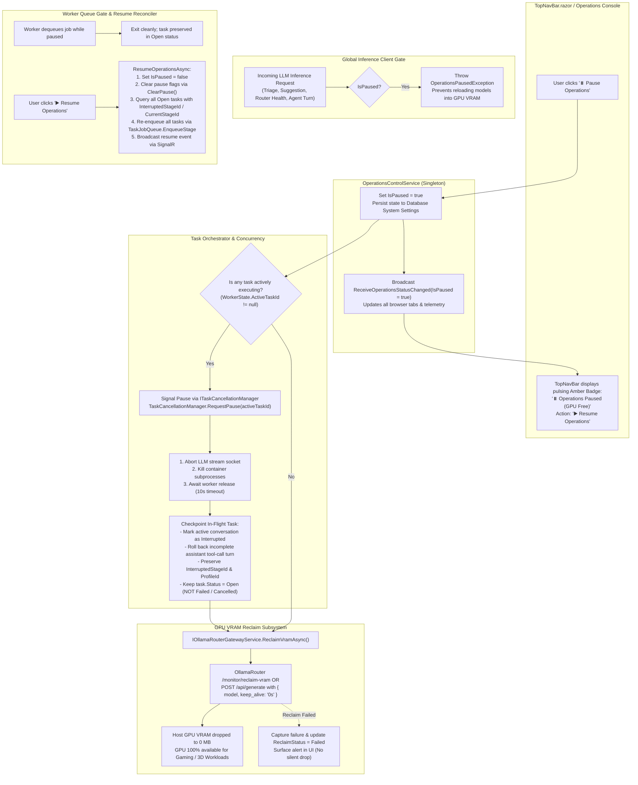

# ⏸️ Step 11.29: Global Operations Pause & GPU VRAM Eviction (Gamer / Dedicated Workload Mode)

> **Phase 11 Implementation Step (Post-MVP - Queue Control, Hardware Resource Management & Developer Ergonomics)**  
> *Parent Plan:* [Phase 11 Master Plan](../11_EXTEND_FEATURES.md)  
> *Project Target:* `src/NightCodeForge.Core`, `src/NightCodeForge.Infrastructure`, `src/NightCodeForge.Web`, `tests/NightCodeForge.Core.Tests`, `tests/NightCodeForge.Infrastructure.Tests`, `tests/NightCodeForge.Web.Tests`  
> *Status:* Proposed / Specified | *Target Framework:* .NET 10 (C# 13)

---

## 1. Executive Summary & Problem Statement

NightCodeForge orchestrates automated software development using local LLM inference engines (via **OllamaRouter** or native **Ollama**) and background worker queues (**Hangfire**). Active background pipelines consume substantial local compute resources:
1. **GPU VRAM Allocation:** Resident models (such as Qwen 2.5 Coder 32B, DeepSeek-R1 32B, Llama 3.3 70B quantizations) hold between 14 GB and 32+ GB of dedicated GPU VRAM continuously via default `keep_alive` timeouts.
2. **GPU & CPU Compute Saturation:** When an agentic turn or deterministic test gate executes, local GPU shaders, CUDA cores, CPU threads, and memory bandwidth are heavily utilized.

### 1.1 The "Gamer Problem" & Workstation Resource Contention

Developer workstations running NightCodeForge are frequently shared dual-use systems: developers write and orchestrate code during working hours, and use the same workstation hardware for gaming, 3D graphics, video rendering, or other VRAM-intensive workloads during breaks or evenings.

Currently, if a developer wants to play a video game on the host machine:
- Background Hangfire workers continue polling and picking up queued tasks.
- Resident models remain pinned in GPU VRAM, causing video games to stutter, drop frames severely, or crash instantly with `DXGI_ERROR_DEVICE_RESET` / CUDA out-of-memory errors.
- The developer's only recourse is to terminate the web process (`ncf-web.cmd`), which risks dirty Git worktree states, ungraceful task aborts, and requires manual service startup later.

### 1.2 Proposed Solution: Global "Pause Operations" & VRAM Reclaim

Step 11.29 introduces a first-class, one-click **"Pause Operations"** toggle in the global navigation bar and operations console:
- **Immediate In-Flight Task Suspension:** Gracefully interrupts active task execution without failing or cancelling the task, checkpointing the active stage so execution can resume seamlessly.
- **Immediate GPU VRAM Eviction:** Instantly unloads resident models from the host GPU using [IOllamaRouterGatewayService.ReclaimVramAsync](file:///c:/Users/Julien/source/repos/jetelain/NightCodeForge/src/NightCodeForge.Core/Interfaces/IOllamaRouterGatewayService.cs#L51) (setting `keep_alive: 0`), dropping host GPU VRAM consumption to 0 MB.
- **Queue Gatekeeping:** Prevents Hangfire workers from starting any new inference or deterministic tasks while operations remain paused.
- **Instant Resume:** Clicking **"▶️ Resume Operations"** restores worker queue consumption immediately without requiring application restart or re-configuration.

---

## 2. Architecture & Operational Workflow

### 2.1 Global Pause & Resume Flow



---

## 3. Detailed Specifications

### 3.1 Domain Contracts & Service Abstractions

1. **`OperationsReclaimStatus` Enum:**
   Add domain enum in `src/NightCodeForge.Core/Domain/OperationsReclaimStatus.cs`:
   ```csharp
   namespace NightCodeForge.Core.Domain;

   public enum OperationsReclaimStatus
   {
       Idle = 0,
       Evicting = 1,
       Evicted = 2,
       Failed = 3
   }
   ```

2. **`IOperationsControlService` Interface:**
   Add a dedicated domain interface in `src/NightCodeForge.Core/Interfaces/IOperationsControlService.cs`:
   ```csharp
   namespace NightCodeForge.Core.Interfaces;

   /// <summary>
   /// Controls global execution state across all background inference and deterministic queues,
   /// coordinating graceful task suspension, GPU VRAM eviction, and resumption reconciliation.
   /// </summary>
   public interface IOperationsControlService
   {
       /// <summary>
       /// Indicates whether background operations are currently paused by the user.
       /// </summary>
       bool IsPaused { get; }

       /// <summary>
       /// Current status of host GPU VRAM eviction.
       /// </summary>
       OperationsReclaimStatus ReclaimStatus { get; }

       /// <summary>
       /// Last error message if VRAM reclaim failed.
       /// </summary>
       string? LastReclaimError { get; }

       /// <summary>
       /// Suspends background operations, checkpointing in-flight tasks and unloading GPU VRAM.
       /// </summary>
       Task<bool> PauseOperationsAsync(string reason = "User initiated pause (Gamer / Dedicated Workload Mode)", CancellationToken cancellationToken = default);

       /// <summary>
       /// Resumes background operations, clears pause tracking, and re-enqueues waiting and interrupted tasks.
       /// </summary>
       Task<bool> ResumeOperationsAsync(CancellationToken cancellationToken = default);

       /// <summary>
       /// Event triggered whenever the global operations pause or reclaim status changes.
       /// </summary>
       event Action<bool>? OnOperationsStateChanged;
   }
   ```

3. **`OperationsControlService` Concrete Implementation:**
   Implement in `src/NightCodeForge.Core/Services/OperationsControlService.cs`, registered as a **Singleton**:
   - Thread-safe state using lock or `volatile bool _isPaused`.
   - Persists state in the database settings (`SystemSettingsRepository`) so that if the application or server restarts while paused, operations remain paused until explicitly resumed.
   - **Startup Recovery Interplay:**
     In [StartupRecoveryService.cs](file:///c:/Users/Julien/source/repos/jetelain/NightCodeForge/src/NightCodeForge.Core/Services/StartupRecoveryService.cs), check `_operationsControlService.IsPaused` before dispatching tasks:
     If the server boots while operations are paused, Git locks and Ext4 mirrors are reconciled normally, but active/orphaned tasks are checkpointed with `InterruptedStageId` and held in `Open` status without enqueuing to Hangfire. They will be dispatched when `ResumeOperationsAsync` is called.
   - **Blazor UI Lifecycle & Disposal Rule:**
     Components subscribing to `OnOperationsStateChanged` must dispatch UI updates using `await InvokeAsync(StateHasChanged)` and must implement `IDisposable` to unsubscribe when torn down.

---

### 3.2 In-Flight Task Suspension & Cancellation Precedence

1. **`ITaskCancellationManager` Contract Extension:**
   In [ITaskCancellationManager.cs](file:///c:/Users/Julien/source/repos/jetelain/NightCodeForge/src/NightCodeForge.Core/Interfaces/ITaskCancellationManager.cs), add:
   ```csharp
   void RequestPause(int taskId);
   bool IsPauseRequested(int taskId);
   void ClearPause(int taskId);
   ```

2. **Cancellation vs. Pause Precedence in `TaskOrchestrator.ProcessTaskAsync`:**
   When catching `OperationCanceledException`:
   ```csharp
   if (_cancellationManager.IsCancelRequested(taskId))
   {
       // 1. Explicit user cancellation: task is terminated
       _logger.LogInformation("Task #{TaskId} execution cancelled by user.", taskId);
       task.Status = TaskOverallStatus.Cancelled;
       await CloseActiveConversationsAsync(taskId, StageExecutionStatus.Cancelled, "Task cancelled by user.");
       await _taskRepository.UpdateWithHistoryAsync(task, changedBy: AuditActors.User, reason: "Cancelled by user.");
       return;
   }

   if (_cancellationManager.IsPauseRequested(taskId) || _operationsControlService.IsPaused)
   {
       // 2. Operational pause: task is checkpointed for seamless resumption
       _logger.LogInformation("Task #{TaskId} paused due to global operations suspension.", taskId);

       await CloseActiveConversationsAsync(taskId, StageExecutionStatus.Interrupted, "Operations paused by user (GPU VRAM reclaimed).");

       task.Status = TaskOverallStatus.Open;
       task.InterruptedStageId = stage.StageId;
       task.InterruptedAgentProfileId = profile?.Id;
       task.IsWaitingForHuman = false;

       await _taskRepository.UpdateWithHistoryAsync(
           task,
           changedBy: AuditActors.User,
           reason: "Operations paused by user (GPU reclaimed).",
           cancellationToken: ct);
       return;
   }
   ```
   - The task is **never marked `Failed` or `Cancelled`** on pause. It remains in `Open` status with `InterruptedStageId` checkpointed.
   - **Atomic Non-Cancellable Critical Sections:** Critical Git operations (committing merge resolutions, squash merges, pushing to `host-origin`) execute using `CancellationToken.None` (or non-cancellable wrapper) so that pause interruption never leaves a dirty, unfinalized Git index mid-commit.

---

### 3.3 Crucible Agent Harness Suspension & Turn Sanitization

When an active task is suspended mid-flight in [CrucibleAgentHarness.cs](file:///c:/Users/Julien/source/repos/jetelain/NightCodeForge/src/NightCodeForge.Agents/Crucible/CrucibleAgentHarness.cs):

1. **Pause vs. Cancellation Distinction:**
   - Detect `_cancellationManager.IsPauseRequested(taskId)` or `_operationsControlService.IsPaused`.
   - When paused, invoke `SuspendOnPauseAsync()` instead of `AbortOnCancellationAsync()`.
   - Mark the conversation with `StageExecutionStatus.Interrupted`.
   - Broadcast `AgentActivityKind.Interrupted` (never `AgentActivityKind.Error`).

2. **In-Flight Turn Sanitization (Clean Rollback):**
   - **The Vulnerability:** An assistant message with `tool_calls` that has not received matching tool responses violates OpenAI/Ollama chat protocol specifications, causing HTTP 400 Bad Request on resume.
   - **Rule:** If the last assistant message has tool calls that did not receive execution results:
     - Roll back and remove the incomplete assistant turn from `chatHistory`.
     - When the task resumes, the agent starts cleanly from the prior prompt turn and re-evaluates the action without orphan `tool_call_id` syntax errors.

3. **Subprocess & Container Process Termination:**
   - To ensure host CPU and memory are 100% freed for gaming, long-running processes (tests, builds) inside the task sandbox must be terminated.
   - The harness signals `interruptionCts.Cancel()` to the local runner, and for container executions, terminates the container process tree (e.g. `docker kill --signal=SIGTERM` or stops the container) before concluding suspension.

4. **Inference Socket Teardown Timing:**
   - The streaming HTTP socket (`agent.RunStreamingAsync`) aborts and closes before `ReclaimVramAsync` executes, preventing token generation in the background.

---

### 3.4 Hardware VRAM Reclamation (`IOllamaRouterGatewayService.ReclaimVramAsync`)

1. **Sequenced Execution on Pause:**
   `OperationsControlService.PauseOperationsAsync` coordinates hardware release in strict order:
   ```csharp
   // 1. Set paused flag immediately to block new requests
   _isPaused = true;
   ReclaimStatus = OperationsReclaimStatus.Evicting;
   OnOperationsStateChanged?.Invoke(true);

   // 2. Signal pause to any active task
   var activeTaskId = _workerStateService.ActiveTaskId;
   if (activeTaskId.HasValue)
   {
       _cancellationManager.RequestPause(activeTaskId.Value);
       // Wait for worker release up to 10 seconds
       await WaitForWorkerIdleAsync(TimeSpan.FromSeconds(10), cancellationToken);
   }

   // 3. Trigger GPU VRAM unload
   try
   {
       var success = await _ollamaRouterGatewayService.ReclaimVramAsync(cancellationToken);
       ReclaimStatus = success ? OperationsReclaimStatus.Evicted : OperationsReclaimStatus.Failed;
       if (!success)
       {
           LastReclaimError = "OllamaRouter reported VRAM reclaim failure or endpoint unavailable.";
       }
   }
   catch (Exception ex)
   {
       _logger.LogError(ex, "Failed to reclaim GPU VRAM during operations pause.");
       ReclaimStatus = OperationsReclaimStatus.Failed;
       LastReclaimError = ex.Message;
   }
   ```
2. **Reclaim Strategy:**
   - **Primary:** POST `/monitor/reclaim-vram?disableTarget=false` to OllamaRouter.
   - **Fallback:** Query resident models via GET `/api/ps` and post `keep_alive: "0s"` to `/api/generate` for every resident model.
   - **Verification:** Host GPU VRAM drops to baseline idle, leaving the GPU free for 3D games or graphic software. If eviction fails, the UI surfaces the error rather than failing silently.

---

### 3.5 Global Inference Client Gatekeeping (`OperationsPausedException`)

To guarantee models are not accidentally re-loaded into GPU VRAM while the operator is gaming:
1. In `src/NightCodeForge.Core/Exceptions/OperationsPausedException.cs`:
   ```csharp
   namespace NightCodeForge.Core.Exceptions;

   public class OperationsPausedException : InvalidOperationException
   {
       public OperationsPausedException(string message = "LLM inference is disabled while global operations are paused.")
           : base(message) { }
   }
   ```
2. In `OllamaRouterGatewayService.cs`, `CrucibleClient.cs`, and any inference dispatchers:
   - Before executing any prompt generation or `/api/generate` call, check `_operationsControlService.IsPaused`.
   - If paused, fail fast with `OperationsPausedException`.
   - Out-of-band operations (such as ideation triage, task suggestions, router health queries, or background prompt builders) are prevented from consuming VRAM.

---

### 3.6 Resumption Reconciler & Worker Queue Management

1. **Worker Queue Gate:**
   At the entry of [TaskOrchestrator.ProcessTaskAsync](file:///c:/Users/Julien/source/repos/jetelain/NightCodeForge/src/NightCodeForge.Core/Workflow/TaskOrchestrator.cs):
   ```csharp
   if (_operationsControlService.IsPaused)
   {
       _logger.LogInformation("Task #{TaskId} execution deferred: operations are globally paused.", taskId);
       return;
   }
   ```
2. **Resumption Reconciliation (`ResumeOperationsAsync`):**
   When the user clicks **"▶️ Resume Operations"**:
   - Set `_isPaused = false` and `ReclaimStatus = OperationsReclaimStatus.Idle`.
   - Clear all pause flags via `_cancellationManager.ClearPause(taskId)`.
   - **Re-enqueue Orphaned / Interrupted Tasks:**
     Query `taskRepository` for all tasks where:
     `t.Status == TaskOverallStatus.Open && !t.IsWaitingForHuman && (t.InterruptedStageId != null || t.CurrentStageId != null)`
     For each eligible task:
     - Resolve target stage definition from workflow (using `InterruptedStageId` or `CurrentStageId`, or initial stage if blank).
     - Enqueue via `_taskJobQueue.EnqueueStage(task.Id, targetStage.QueueTier, task.Priority)`.
   - Broadcast SignalR activity event to update all client views.

---

### 3.7 Web UI & Presentation Separation

1. **Top Navigation Bar (`TopNavBar.razor`):**
   - **When Running:**
     - Button: `⏸️ Pause Operations` (or `⏸️ Pause`)
     - Class: `forge-btn forge-btn-secondary btn-sm`
     - Tooltip: *"Pause background operations & unload GPU VRAM for gaming or dedicated workloads"*
   - **When Paused:**
     - Button: `▶️ Resume Operations`
     - Class: `forge-btn forge-btn-warning btn-sm btn-pulse-amber`
     - Tooltip: *"Operations paused. Host GPU VRAM is free. Click to resume operations."*
   - **When VRAM Reclaim Failed:**
     - Render warning badge adjacent to button: `⚠️ GPU Reclaim Incomplete` with tooltip showing `LastReclaimError`.

2. **Operations Telemetry Console (`ActiveOperationsHero.razor` / `/monitoring`):**
   - High-visibility amber status card explaining Gamer / Dedicated Workload Mode.
   - Shows VRAM eviction status (`Evicted` vs `Failed`).

3. **Kanban & DevQueue Awareness:**
   - [DevQueueTable.razor](file:///c:/Users/Julien/source/repos/jetelain/NightCodeForge/src/NightCodeForge.Web/Components/DevQueue/DevQueueTable.razor) and [Backlog.razor](file:///c:/Users/Julien/source/repos/jetelain/NightCodeForge/src/NightCodeForge.Web/Components/Pages/Backlog.razor) display a paused warning banner indicating that queue advancement is suspended.

---

## 4. Test Strategy & Quality Verification

### 4.1 Unit & Integration Tests

1. **`NightCodeForge.Core.Tests/OperationsControlServiceTests.cs`:**
   - `PauseOperationsAsync_SetsIsPausedTrue_AndTriggersVramReclaim`:
     - Verify `IsPaused` transitions to `true`.
     - Verify `IOllamaRouterGatewayService.ReclaimVramAsync` is called after active task pause.
     - Verify `OnOperationsStateChanged` event is fired with `true`.
   - `PauseOperationsAsync_WhenReclaimFails_SetsStatusFailedWithoutSilentDrop`:
     - Mock `ReclaimVramAsync` failure.
     - Assert `ReclaimStatus == OperationsReclaimStatus.Failed` and `LastReclaimError` is populated.
   - `ResumeOperationsAsync_ReEnqueuesOpenTasks_ViaStageQueueTier`:
     - Set up tasks in `Open` status with `InterruptedStageId`.
     - Call `ResumeOperationsAsync`.
     - Verify each task is re-enqueued via `ITaskJobQueue.EnqueueStage` with correct tier and priority.
     - Verify `ClearPause` is invoked.

2. **`NightCodeForge.Core.Tests/TaskOrchestratorPauseTests.cs`:**
   - `ProcessTaskAsync_WhenExplicitCancelRequested_CancelsTask`:
     - Assert task marked `Cancelled` (not `Open`).
   - `ProcessTaskAsync_WhenPauseRequested_CheckpointsTaskAsOpen`:
     - Trigger pause.
     - Assert `task.Status == TaskOverallStatus.Open`.
     - Assert `task.InterruptedStageId` equals the active stage.
     - Assert conversation marked as `Interrupted`.
   - `CriticalGitSection_DoesNotAbortMidCommit_OnPause`:
     - Verify Git commit/merge operations execute to completion before pause suspension.

3. **`NightCodeForge.Agents.Tests/Crucible/CrucibleAgentHarnessPauseTests.cs`:**
   - `RunStageAsync_WhenPauseRequested_SavesInterruptedStatusWithoutError`:
     - Verify `AgentActivityKind.Interrupted` broadcast (not `AgentActivityKind.Error`).
     - Verify conversation status is saved as `Interrupted`.
   - `RunStageAsync_WhenPausedMidToolCall_RollsBackIncompleteAssistantTurn`:
     - Trigger pause while assistant has streamed `tool_calls` without tool results.
     - Assert incomplete assistant message is rolled back from saved chat history.
     - Assert resumption from saved checkpoint succeeds without syntax errors.

4. **`NightCodeForge.Infrastructure.Tests/Inference/InferencePauseGateTests.cs`:**
   - `GenerateAsync_WhenOperationsPaused_ThrowsOperationsPausedException`:
     - Set `OperationsControl.IsPaused = true`.
     - Attempt inference call.
     - Assert `OperationsPausedException` is thrown and zero network calls made to Ollama.

5. **`NightCodeForge.Core.Tests/StartupRecoveryServicePauseTests.cs`:**
   - `ReconcileWorkspacesAsync_WhenOperationsPaused_ReconcilesLocks_WithoutEnqueuingTasks`:
     - Verify worktrees and locks are reconciled.
     - Verify no tasks are enqueued to Hangfire queues until operations resume.

6. **`NightCodeForge.Web.Tests/TopNavBarTests.cs`:**
   - `RendersPauseButton_WhenOperationsRunning` / `RendersResumeButton_WhenOperationsPaused`.
   - `SubscribesAndUnsubscribes_OnOperationsStateChanged`:
     - Verify `IDisposable` unsubscribes cleanly to avoid memory leaks.

---

## 5. Acceptance Criteria Checklist

- [ ] `OperationsReclaimStatus` enum defined in `NightCodeForge.Core.Domain`.
- [ ] `OperationsPausedException` defined in `NightCodeForge.Core.Exceptions`.
- [ ] `IOperationsControlService` defined and implemented in Core as a Singleton with persistent database backing.
- [ ] `ITaskCancellationManager` extended with `RequestPause`, `IsPauseRequested`, and `ClearPause`.
- [ ] Precedence logic in `TaskOrchestrator`: explicit cancellation sets `Cancelled`; pause checkpoints `InterruptedStageId` with `Open`.
- [ ] Atomic non-cancellable wrapper protects critical Git operations (merge, commit, squash).
- [ ] In-flight assistant turns with pending tool calls rolled back in Crucible on pause.
- [ ] Active container child processes terminated upon pause signal.
- [ ] Streaming inference sockets closed before GPU VRAM unload begins.
- [ ] VRAM eviction triggered via `ReclaimVramAsync`; failures captured and surfaced in UI.
- [ ] Global inference client gate throws `OperationsPausedException` when paused, preventing out-of-band model reloads.
- [ ] `ResumeOperationsAsync` reconciles and re-enqueues all waiting/interrupted tasks via `TaskJobQueue.EnqueueStage`.
- [ ] `StartupRecoveryService` respects `IsPaused` on boot without dispatching active tasks.
- [ ] `TopNavBar.razor` displays one-click toggle with visual pulse, and surfaces reclaim failure alerts.
- [ ] Razor components marshal state updates via `InvokeAsync` and implement `IDisposable`.
- [ ] All unit and integration tests passing (`dotnet test --filter "Category!=Acceptance&Category!=E2E"`).

