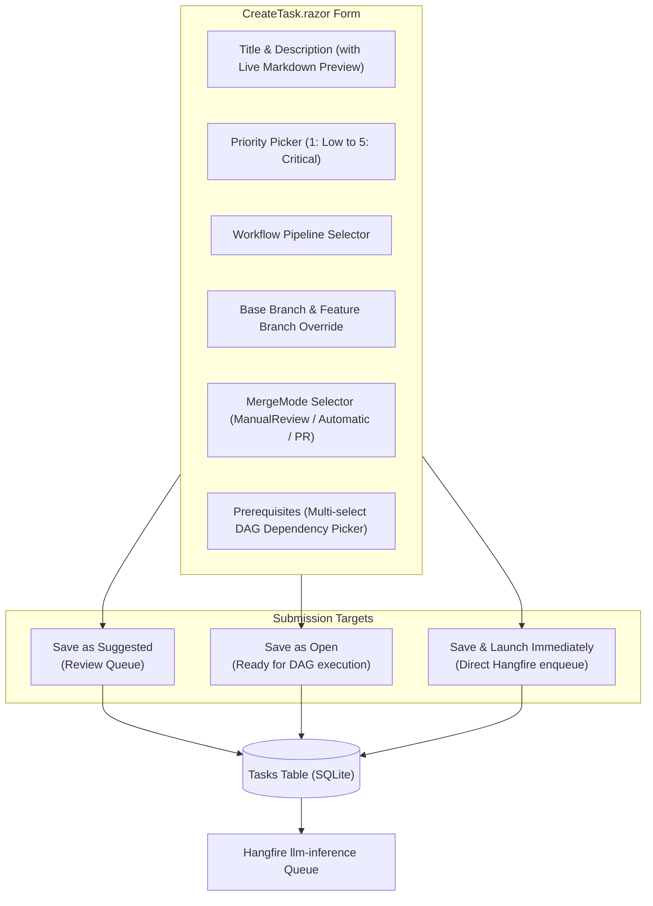

# 📄 Step 11.2: Dedicated Task Creation Page, Priority Management & MergeMode

> **Phase 11 Implementation Step (Post-MVP - Top Priority)**  
> *Parent Plan:* [Phase 11 Master Plan](../11_EXTEND_FEATURES.md)  
> *Project Target:* `src/NightCodeForge.Web/Components/Pages`, `src/NightCodeForge.Web/Components/Backlog`, `src/NightCodeForge.Core/Domain`, `tests/NightCodeForge.Web.Tests` | *Status:* Planned

---

## 1. Executive Objective

To enable the immediate migration of existing projects (such as **OllamaRouter** and **ComicGenCLI**) into NightCodeForge, developers need direct, friction-free task management without having to wait on or converse with an LLM.

This step delivers three core capabilities prioritized for developer ergonomics and quick wins:
1. **Dedicated Task Creation Page (`/tasks/new`) & Modal:**
   - Full-page structured form to author tasks directly with real-time markdown preview, workflow selector, base branch targeting, priority assignment, and prerequisite dependency selection.
   - Three immediate submission targets:
     - **Save as Suggested:** Queues task in triage/ideation review.
     - **Save as Open:** Queues task directly into the active backlog for DAG scheduling.
     - **Save & Launch Immediately:** Promotes and enqueues task to the Hangfire worker queue for immediate autonomous execution.
2. **Comprehensive Priority Management (P1–P5):**
   - Formalize task priority levels (`1: Critical / Urgent`, `2: High`, `3: Normal`, `4: Low`, `5: Lowest / Trivial`).
   - Align with agent tool declarations (`propose_tasks: "Task priority (1 Highest - 5 Lowest)"`).
   - Visual priority badges across [KanbanCard.razor](file:///c:/Users/Julien/source/repos/jetelain/NightCodeForge/src/NightCodeForge.Web/Components/Backlog/KanbanCard.razor), [Backlog.razor](file:///c:/Users/Julien/source/repos/jetelain/NightCodeForge/src/NightCodeForge.Web/Components/Pages/Backlog.razor), and [TaskDetailDrawer.razor](file:///c:/Users/Julien/source/repos/jetelain/NightCodeForge/src/NightCodeForge.Web/Components/Backlog/TaskDetailDrawer.razor).
   - Fast inline priority editor in the drawer and backlog table.
   - Sorting and filtering by priority in the Backlog view (`OrderBy(t => t.Priority)` puts P1 first).
3. **Full MergeMode Lifecycle & Editing:**
   - Expanded delivery options in [MergeMode](file:///c:/Users/Julien/source/repos/jetelain/NightCodeForge/src/NightCodeForge.Core/Domain/Enums.cs):
     - **`Automatic`:** Auto-squashes and merges to `BaseBranch` upon reaching `Ready`.
     - **`ManualReviewRequired` (Default):** Pauses at `Ready` for human review in the Review Room.
     - **`ExternalPullRequest`:** Pushes feature branch to remote and creates a GitHub PR.
   - Interactive editing of `MergeMode` on existing tasks inside the [TaskDetailDrawer.razor](file:///c:/Users/Julien/source/repos/jetelain/NightCodeForge/src/NightCodeForge.Web/Components/Backlog/TaskDetailDrawer.razor) and [ApproveMergeModal.razor](file:///c:/Users/Julien/source/repos/jetelain/NightCodeForge/src/NightCodeForge.Web/Components/Review/ApproveMergeModal.razor).

---

## 2. Priority Hierarchy & Badges

In [ForgeTask.cs](file:///c:/Users/Julien/source/repos/jetelain/NightCodeForge/src/NightCodeForge.Core/Domain/ForgeTask.cs), `Priority` is an integer value (1 = Highest, 5 = Lowest) mapped to standardized UI indicators:

| Priority | Level Name | Badge Color | Meaning & Scheduling Rule |
| :---: | :--- | :--- | :--- |
| **1** | Critical / Urgent (Highest) | Crimson (`#ef4444`) | Immediate blocker or critical bug fix. Prioritized first in DAG execution queue. |
| **2** | High | Amber-Orange (`#f97316`) | Core architectural prerequisite or time-sensitive feature milestone. |
| **3** | Normal (Default) | Blue (`#3b82f6`) | Standard implementation task. Default for newly authored tasks. |
| **4** | Low | Slate (`#64748b`) | Minor refactoring, cosmetic polish, or secondary documentation. |
| **5** | Lowest / Trivial | Muted Gray (`#475569`) | Non-essential cleanup, minor typos, or background experiments. |

---

## 3. UI Architecture: Dedicated Task Creation Page (`CreateTask.razor`)

### 3.1 Route & Layout
- Route: `@page "/tasks/new"` and `@page "/tasks/create"`
- Accessible from:
  - Global Top Navigation bar: **`+ New Task`** button.
  - Backlog page header: **`+ New Task`** button.
  - Empty workspace hero card.

### 3.2 Prerequisite Dependency Linking on Creation
The form includes an autocomplete / multi-select component querying open tasks in the active workspace. Selecting one or more tasks automatically persists corresponding [TaskDependency](file:///c:/Users/Julien/source/repos/jetelain/NightCodeForge/src/NightCodeForge.Core/Domain/TaskDependency.cs) records, ensuring that the DAG scheduler respects the execution sequence.

---

## 4. Editing Priority & MergeMode on Existing Tasks

### 4.1 In Task Detail Drawer ([TaskDetailDrawer.razor](file:///c:/Users/Julien/source/repos/jetelain/NightCodeForge/src/NightCodeForge.Web/Components/Backlog/TaskDetailDrawer.razor))
- **Priority Selector:** Dropdown or clickable priority chips allowing instant re-prioritization.
- **Merge Mode Selector:** Radio/dropdown offering:
  - 🔍 **Manual Review Required** (recommended default)
  - ⚡ **Automatic Merge**
  - 🐙 **External Pull Request** *(disabled with tooltip if GitHub is not configured for the workspace)*
- **Save Changes Button:** Updates `ForgeTask`, recording a new revision in [ForgeTaskHistory](file:///c:/Users/Julien/source/repos/jetelain/NightCodeForge/src/NightCodeForge.Core/Domain/ForgeTaskHistory.cs) with `ChangedBy = "User"`, `ChangeReason = "Updated Priority/MergeMode"`.

### 4.2 In Backlog View ([Backlog.razor](file:///c:/Users/Julien/source/repos/jetelain/NightCodeForge/src/NightCodeForge.Web/Components/Pages/Backlog.razor))
- Default sorting and column header sorting by `Priority` (ascending: 1 $\rightarrow$ 5, placing P1 Critical at the top).
- Quick filter chip bar: `All Priorities`, `P1 Critical Only`, `P1-P2 High+`.

---

## 5. Implementation Checklist & Deliverables

- [ ] **Domain Model & Migration:**
  - Add `MergeMode.ExternalPullRequest = 2` to [Enums.cs](file:///c:/Users/Julien/source/repos/jetelain/NightCodeForge/src/NightCodeForge.Core/Domain/Enums.cs).
  - Ensure `TaskPriority` helper methods and display labels exist in `NightCodeForge.Core`.
- [ ] **Dedicated Task Creation Page:**
  - Create `CreateTask.razor` at `/tasks/new` with full responsive fields and live markdown preview.
  - Add prerequisite dependency selector querying existing workspace tasks.
  - Implement submission modes (`Suggested`, `Open`, and `Immediate Run`).
  - Add `+ New Task` button in Top Navigation bar and Backlog header.
- [ ] **Priority Management & Sorting:**
  - Add priority badge styling and dropdown editor in [TaskDetailDrawer.razor](file:///c:/Users/Julien/source/repos/jetelain/NightCodeForge/src/NightCodeForge.Web/Components/Backlog/TaskDetailDrawer.razor).
  - Add priority sorting and filtering in [Backlog.razor](file:///c:/Users/Julien/source/repos/jetelain/NightCodeForge/src/NightCodeForge.Web/Components/Pages/Backlog.razor).
  - Display priority pill on [KanbanCard.razor](file:///c:/Users/Julien/source/repos/jetelain/NightCodeForge/src/NightCodeForge.Web/Components/Backlog/KanbanCard.razor).
- [ ] **MergeMode Editing:**
  - Update `TaskDetailDrawer.razor` to display and allow editing `MergeMode`.
  - Persist edits to database and record history snapshot in `TaskHistories`.
- [ ] **Unit & Component Tests:**
  - Test `CreateTask.razor` form validation, priority assignment, and dependency creation.
  - Test priority sorting query in repository.
  - Test `MergeMode` persistence and editing in `TaskDetailDrawer`.
