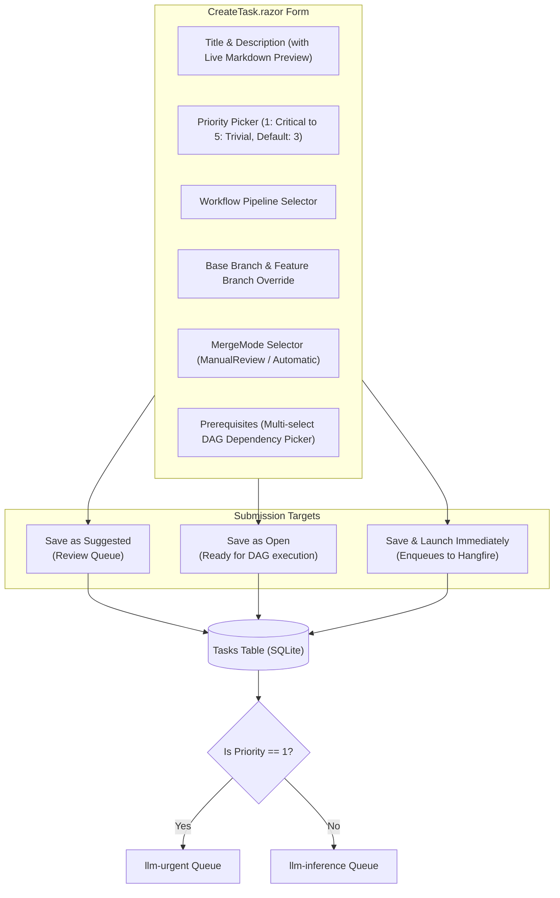

# 📄 Step 11.2: Dedicated Task Creation Page, Priority Management & MergeMode

> **Phase 11 Implementation Step (Post-MVP - Top Priority)**  
> *Parent Plan:* [Phase 11 Master Plan](../11_EXTEND_FEATURES.md)  
> *Related Implementation:* [Step 11.15: Priority-Aware Task Queue Scheduling](STEP_11_15_PRIORITY_AWARE_TASK_QUEUE_SCHEDULING.md) *(Already Completed)*  
> *Project Target:* `src/NightCodeForge.Web/Components/Pages`, `src/NightCodeForge.Web/Components/Backlog`, `src/NightCodeForge.Core/Domain`, `src/NightCodeForge.Web/Services`, `tests/NightCodeForge.Web.Tests` | *Status:* Planned

---

## 1. Executive Objective

To enable the immediate migration of existing projects (such as **OllamaRouter** and **ComicGenCLI**) into NightCodeForge, developers need direct, friction-free task management without having to wait on or converse with an LLM.

With the underlying priority scheduling engine and Hangfire queues already completed in [Step 11.15](STEP_11_15_PRIORITY_AWARE_TASK_QUEUE_SCHEDULING.md), this step delivers the full user-facing authoring, interactive priority editing, and merge lifecycle capabilities:
1. **Dedicated Task Creation Page (`/tasks/new`) & Modal:**
   - Full-page structured form to author tasks directly with real-time markdown preview, workflow selector, base branch targeting, priority assignment (P1–P5, default P3 Normal), and prerequisite dependency selection.
   - Three immediate submission targets:
     - **Save as Suggested:** Queues task in triage/ideation review.
     - **Save as Open:** Queues task directly into the active backlog for DAG scheduling.
     - **Save & Launch Immediately:** Promotes and enqueues task to the Hangfire worker queue (`llm-urgent` if P1, `llm-inference` if P2–P5) for immediate autonomous execution.
2. **First-Class Editable Priority Management (P1–P5):**
   - **Editable Across Entire Lifecycle:** Priority must not be static or write-once; developers must be able to change priority at creation, in the backlog, in the Kanban board, and within the task details drawer at any lifecycle state.
   - **Instant Inline & Drawer Editing:**
     - Interactive priority editor in [TaskDetailDrawer.razor](file:///c:/Users/Julien/source/repos/jetelain/NightCodeForge/src/NightCodeForge.Web/Components/Backlog/TaskDetailDrawer.razor).
     - Fast inline priority selector/popover on [KanbanCard.razor](file:///c:/Users/Julien/source/repos/jetelain/NightCodeForge/src/NightCodeForge.Web/Components/Backlog/KanbanCard.razor) and [Backlog.razor](file:///c:/Users/Julien/source/repos/jetelain/NightCodeForge/src/NightCodeForge.Web/Components/Pages/Backlog.razor) for quick triage without opening the full drawer.
   - **Operational Queue Synchronization:** Changing priority on an active or queued task synchronizes with [IDevQueueService.cs](file:///c:/Users/Julien/source/repos/jetelain/NightCodeForge/src/NightCodeForge.Web/Services/IDevQueueService.cs) (e.g., escalating to P1 promotes to `llm-urgent`, or invokes `ReorderInferenceQueueByPriorityAsync`).
   - **Backlog Sorting & Filtering:** Backlog views sort by `Priority ASC (1 -> 5), CreatedAt ASC` by default, with quick filter chips (`All`, `P1 Critical`, `P1-P2 High+`).
3. **MergeMode Lifecycle & Interactive Editing:**
   - Supported local delivery options in [MergeMode](file:///c:/Users/Julien/source/repos/jetelain/NightCodeForge/src/NightCodeForge.Core/Domain/Enums.cs):
     - **`Automatic`:** Auto-squashes and merges to `BaseBranch` upon reaching `Ready`.
     - **`ManualReviewRequired` (Default):** Pauses at `Ready` for human review in the Review Room.
     - *(Note: Remote GitHub PR delivery via `MergeMode.ExternalPullRequest` is deferred to [Step 11.10: GitHub Integration, Untrusted Issue Triage & PR Delivery](STEP_11_10_GITHUB_INTEGRATION_ISSUES_AND_PRS.md)).*
   - Interactive editing of `MergeMode` on existing tasks inside [TaskDetailDrawer.razor](file:///c:/Users/Julien/source/repos/jetelain/NightCodeForge/src/NightCodeForge.Web/Components/Backlog/TaskDetailDrawer.razor) and [ApproveMergeModal.razor](file:///c:/Users/Julien/source/repos/jetelain/NightCodeForge/src/NightCodeForge.Web/Components/Review/ApproveMergeModal.razor).

---

## 2. Priority Hierarchy & Badges

As established in [TaskPriority.cs](file:///c:/Users/Julien/source/repos/jetelain/NightCodeForge/src/NightCodeForge.Core/Domain/TaskPriority.cs) (from Step 11.15), `Priority` is an integer value (1 = Highest, 5 = Lowest) mapped to standardized UI indicators and queue dispatch behaviors:

| Priority | Constant Name | Badge Color | Meaning & Scheduling Rule |
| :---: | :--- | :--- | :--- |
| **1** | `TaskPriority.Critical` | Crimson (`#ef4444`) | Immediate blocker or critical bug fix. Dispatched to `llm-urgent` queue. |
| **2** | `TaskPriority.High` | Amber-Orange (`#f97316`) | Core architectural prerequisite or time-sensitive feature milestone. |
| **3** | `TaskPriority.Normal` (Default) | Blue (`#3b82f6`) | Standard implementation task. Default for newly authored tasks. |
| **4** | `TaskPriority.Low` | Slate (`#64748b`) | Minor refactoring, cosmetic polish, or secondary documentation. |
| **5** | `TaskPriority.Trivial` | Muted Gray (`#475569`) | Non-essential cleanup, minor typos, or background experiments. |

---

## 3. UI Architecture: Dedicated Task Creation Page (`CreateTask.razor`)

### 3.1 Route & Layout
- Route: `@page "/tasks/new"` and `@page "/tasks/create"`
- Accessible from:
  - Global Top Navigation bar: **`+ New Task`** button.
  - Backlog page header: **`+ New Task`** button.
  - Empty workspace hero card.

### 3.2 Form Controls & Priority Selection
- **Priority Selector:**
  - Styled radio button group or segmented button chips showing P1 (`#ef4444`) through P5 (`#475569`) with badges and descriptive labels.
  - Default selection initialized to `TaskPriority.Normal` (3).
- **Prerequisite Dependency Linking on Creation:**
  - Multi-select autocomplete component querying open tasks in the active workspace.
  - Automatically creates corresponding [TaskDependency](file:///c:/Users/Julien/source/repos/jetelain/NightCodeForge/src/NightCodeForge.Core/Domain/TaskDependency.cs) records upon save.
- **MergeMode Selector:**
  - Segmented card selection for `ManualReviewRequired` (default) and `Automatic`.
  - *(Note: Remote PR delivery via `ExternalPullRequest` is deferred to [Step 11.10](STEP_11_10_GITHUB_INTEGRATION_ISSUES_AND_PRS.md)).*

---

## 4. Interactive Editing of Priority & MergeMode on Existing Tasks

### 4.1 In Task Detail Drawer ([TaskDetailDrawer.razor](file:///c:/Users/Julien/source/repos/jetelain/NightCodeForge/src/NightCodeForge.Web/Components/Backlog/TaskDetailDrawer.razor))
- **Interactive Priority Selector:**
  - Replaces static priority badge in drawer header or adds an editable row in the metadata section.
  - Interactive dropdown or clickable priority chips (`P1 Critical`, `P2 High`, `P3 Normal`, `P4 Low`, `P5 Trivial`).
  - Allows maintainers to modify the priority of tasks in any state (`Suggested`, `Open`, `Ready`, etc.).
- **Merge Mode Selector:**
  - Radio/dropdown offering:
    - 🔍 **Manual Review Required** (recommended default)
    - ⚡ **Automatic Merge**
    - *(Note: `ExternalPullRequest` is deferred to [Step 11.10](STEP_11_10_GITHUB_INTEGRATION_ISSUES_AND_PRS.md)).*
- **Save & Audit Trail:**
  - Updates `ForgeTask` in database.
  - Emits event callback (`OnTaskUpdated`) so parent views refresh immediately.
  - Records an immutable history snapshot in [ForgeTaskHistory](file:///c:/Users/Julien/source/repos/jetelain/NightCodeForge/src/NightCodeForge.Core/Domain/ForgeTaskHistory.cs) with `ChangedBy = "User"` and `ChangeReason = "Updated Priority from P{Old} to P{New}"` or `"Updated MergeMode to {Mode}"`.
- **Queue Synchronization (Integration with Step 11.15):**
  - If the task is currently queued in Hangfire:
    - Changing to **P1 (Critical):** Triggers `IDevQueueService.PromoteToUrgentAsync(taskId)` to bump it immediately to the head of `llm-urgent`.
    - Changing between **P2–P5:** Triggers or offers an inline prompt to run `IDevQueueService.ReorderInferenceQueueByPriorityAsync()` to re-sequence waiting jobs according to the updated priority.

### 4.2 In Backlog View & Kanban Board ([Backlog.razor](file:///c:/Users/Julien/source/repos/jetelain/NightCodeForge/src/NightCodeForge.Web/Components/Pages/Backlog.razor), [KanbanCard.razor](file:///c:/Users/Julien/source/repos/jetelain/NightCodeForge/src/NightCodeForge.Web/Components/Backlog/KanbanCard.razor))
- **Fast Inline Priority Editor on Kanban Cards:**
  - Clicking on the `P{Priority}` badge on [KanbanCard.razor](file:///c:/Users/Julien/source/repos/jetelain/NightCodeForge/src/NightCodeForge.Web/Components/Backlog/KanbanCard.razor) opens a lightweight inline priority dropdown/popover.
  - Allows maintainers to re-prioritize backlog items on the fly with a single click without opening the full drawer.
  - Invokes quick update callback, persists change, and shows a brief toast confirmation.
- **Sorting & Filtering by Priority in Backlog:**
  - Default ordering in backlog queries and views: `OrderBy(t => t.Priority).ThenBy(t => t.CreatedAt)` (placing P1 Critical at top).
  - Quick filter chip bar: `All Priorities`, `P1 Critical Only`, `P1-P2 High+`, `P3 Normal`, `P4-P5 Low`.

### 4.3 In Triage & Promotion Modals
- [MaintainerPromotionModal.razor](file:///c:/Users/Julien/source/repos/jetelain/NightCodeForge/src/NightCodeForge.Web/Components/Backlog/MaintainerPromotionModal.razor):
  - Maintainers can review and adjust the task's priority dropdown before confirming promotion from `Suggested` to `Open`.
- [TaskCreationModal.razor](file:///c:/Users/Julien/source/repos/jetelain/NightCodeForge/src/NightCodeForge.Web/Components/Backlog/TaskCreationModal.razor):
  - Retains full priority selection capability for quick modal task creation.

---

## 5. Implementation Checklist & Deliverables

- [x] **Foundational Priority Infrastructure (Completed in Step 11.15):**
  - [x] Domain constants and formatting helpers in [TaskPriority.cs](file:///c:/Users/Julien/source/repos/jetelain/NightCodeForge/src/NightCodeForge.Core/Domain/TaskPriority.cs).
  - [x] Default priority set to `TaskPriority.Normal` (3) in [ForgeTask.cs](file:///c:/Users/Julien/source/repos/jetelain/NightCodeForge/src/NightCodeForge.Core/Domain/ForgeTask.cs).
  - [x] DAG cascade unblocking dispatches P1 tasks to `llm-urgent` and P2–P5 in `Priority ASC` order.
  - [x] DevQueue priority reordering in [DevQueueService.cs](file:///c:/Users/Julien/source/repos/jetelain/NightCodeForge/src/NightCodeForge.Web/Services/DevQueueService.cs).
- [ ] **Domain Model & Helpers:**
  - [ ] Ensure `MergeMode` (`Automatic` and `ManualReviewRequired`) display labels and helper methods exist in `NightCodeForge.Core` *(Note: `ExternalPullRequest = 2` is deferred to [Step 11.10](STEP_11_10_GITHUB_INTEGRATION_ISSUES_AND_PRS.md))*.
  - [ ] Ensure `TaskPriority` helper methods and display labels are fully leveraged across all Web components.
- [ ] **Dedicated Task Creation Page:**
  - [ ] Create `CreateTask.razor` at `/tasks/new` and `/tasks/create` with responsive layout and live markdown preview.
  - [ ] Implement priority picker (P1–P5 chips, default P3 Normal).
  - [ ] Add prerequisite dependency selector querying existing workspace tasks.
  - [ ] Implement submission modes (`Save as Suggested`, `Save as Open`, and `Save & Launch Immediately` dispatching to `llm-urgent`/`llm-inference`).
  - [ ] Add `+ New Task` button in Top Navigation bar and Backlog header linking to `/tasks/new`.
- [ ] **Editable Priority on Existing Tasks:**
  - [ ] Add interactive priority dropdown/chips editor to [TaskDetailDrawer.razor](file:///c:/Users/Julien/source/repos/jetelain/NightCodeForge/src/NightCodeForge.Web/Components/Backlog/TaskDetailDrawer.razor).
  - [ ] Add inline priority popover/dropdown on [KanbanCard.razor](file:///c:/Users/Julien/source/repos/jetelain/NightCodeForge/src/NightCodeForge.Web/Components/Backlog/KanbanCard.razor) for one-click re-prioritization.
  - [ ] Persist priority changes to database and record history snapshot in `TaskHistories`.
  - [ ] Connect priority escalation to [IDevQueueService.cs](file:///c:/Users/Julien/source/repos/jetelain/NightCodeForge/src/NightCodeForge.Web/Services/IDevQueueService.cs) (promote to `llm-urgent` when changed to P1).
- [ ] **Backlog Sorting & Filtering:**
  - [ ] Implement default priority sorting (`Priority ASC, CreatedAt ASC`) in [Backlog.razor](file:///c:/Users/Julien/source/repos/jetelain/NightCodeForge/src/NightCodeForge.Web/Components/Pages/Backlog.razor).
  - [ ] Add priority filter chip bar (`All`, `P1 Critical Only`, `P1-P2 High+`) to Backlog toolbar.
- [ ] **MergeMode Editing:**
  - [ ] Update `TaskDetailDrawer.razor` to display and allow editing `MergeMode` (`Automatic` vs `ManualReviewRequired`).
  - [ ] Persist edits to database and record history snapshot in `TaskHistories`.
- [ ] **Unit & Component Tests:**
  - [ ] Test `CreateTask.razor` form validation, priority assignment, and dependency creation.
  - [ ] Test priority editing in `TaskDetailDrawer` and `KanbanCard` with database persistence.
  - [ ] Test priority sorting and filtering queries in Backlog view.
  - [ ] Test `MergeMode` persistence and editing in `TaskDetailDrawer`.

