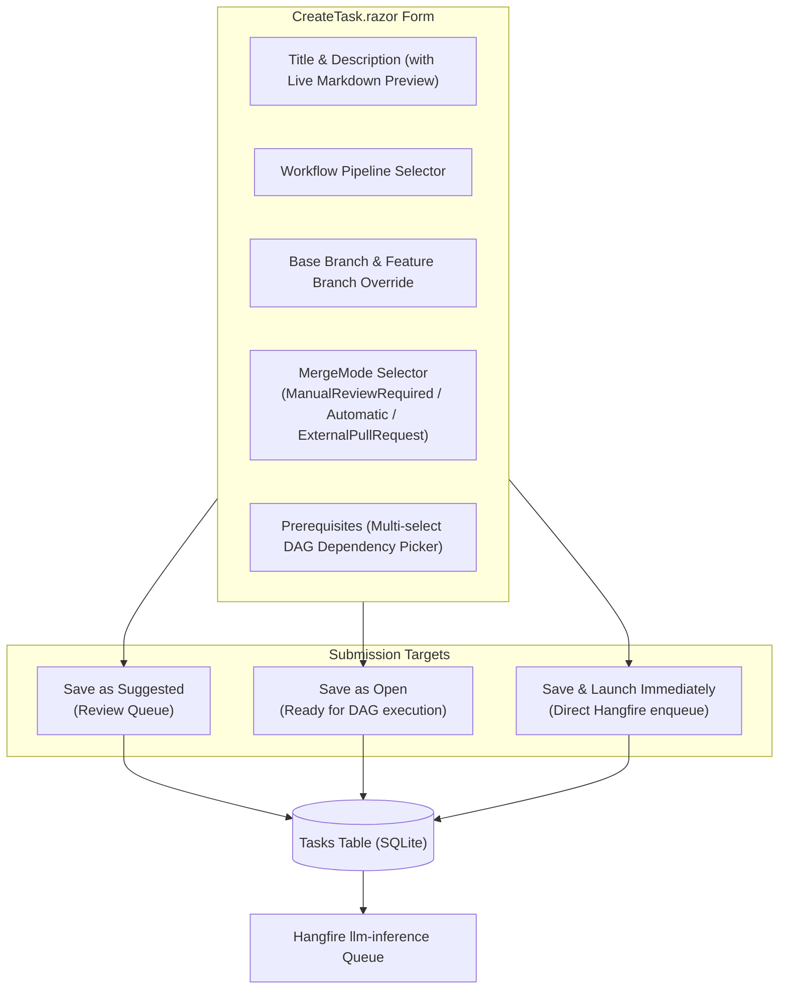

# 📄 Step 11.2: Dedicated Task Creation Page & MergeMode Management

> **Phase 11 Implementation Step (Post-MVP)**  
> *Parent Plan:* [Phase 11 Master Plan](../11_EXTEND_FEATURES.md)  
> *Project Target:* `src/NightCodeForge.Web/Components/Pages/Tasks`, `src/NightCodeForge.Web/Components/Backlog`, `src/NightCodeForge.Core/Domain`, `tests/NightCodeForge.Web.Tests` | *Status:* Planned

---

## 1. Executive Objective

Provide a dedicated task authoring interface outside of the AI conversational loop, and ensure full maintainer control over task delivery via **[MergeMode](file:///c:/Users/Julien/source/repos/jetelain/NightCodeForge/src/NightCodeForge.Core/Domain/Enums.cs)**:

1. **Dedicated Task Creation Page (`/tasks/new`):**
   - Provide a full-page, structured form for developers to specify requirements, acceptance criteria, workflows, base branches, and dependencies directly—without requiring an interactive conversation with the Ideation LLM.
   - Includes real-time markdown preview, branch selectors, priority, initial dependency linking, and direct submission targets:
     - **Create as Suggested:** Places task in review triage queue.
     - **Create as Open:** Directly queues task in active backlog for DAG execution.
     - **Create & Launch Immediately:** Promotes and enqueues task to Hangfire inference queue immediately.

2. **Expanded `MergeMode` Support:**
   - Formalize the complete set of delivery modes in [MergeMode](file:///c:/Users/Julien/source/repos/jetelain/NightCodeForge/src/NightCodeForge.Core/Domain/Enums.cs):
     - **`Automatic`:** Auto-squashes and merges to `BaseBranch` in the local workspace once status reaches `Ready`.
     - **`ManualReviewRequired` (Default):** Pauses at `Ready`; maintainer reviews diffs/tests in the Review Room before triggering merge.
     - **`ExternalPullRequest`:** Pushes feature branch to remote origin and opens a GitHub Pull Request (available when GitHub integration is enabled in Step 11.3).

3. **Editable `MergeMode` on Existing Tasks:**
   - Fix the gap where maintainers cannot choose or modify the merge mode of an existing task.
   - Provide an interactive `MergeMode` editor in:
     - The **Task Detail Drawer** ([TaskDetailDrawer.razor](file:///c:/Users/Julien/source/repos/jetelain/NightCodeForge/src/NightCodeForge.Web/Components/Backlog/TaskDetailDrawer.razor)).
     - The **Backlog Promotion Modal** ([MaintainerPromotionModal.razor](file:///c:/Users/Julien/source/repos/jetelain/NightCodeForge/src/NightCodeForge.Web/Components/Backlog/MaintainerPromotionModal.razor)).
     - The **Review Room** ([Review.razor](file:///c:/Users/Julien/source/repos/jetelain/NightCodeForge/src/NightCodeForge.Web/Components/Pages/Review.razor)).
   - Edits are audited in `ForgeTaskHistory` (Step 11.6).

---

## 2. Domain & Enumeration Definition

In [Enums.cs](file:///c:/Users/Julien/source/repos/jetelain/NightCodeForge/src/NightCodeForge.Core/Domain/Enums.cs):

```csharp
namespace NightCodeForge.Core.Domain;

/// <summary>
/// Determines how an approved and verified task is merged or delivered.
/// </summary>
public enum MergeMode
{
    Automatic = 0,               // Auto-squashes and merges to base branch once status reaches Ready
    ManualReviewRequired = 1,    // Pauses at Ready; maintainer reviews diff/tests before triggering merge
    ExternalPullRequest = 2     // Pushes to remote origin and opens a GitHub Pull Request
}
```

---

## 3. UI Architecture: Dedicated Task Creation Page (`CreateTask.razor`)

### 3.1 Route & Layout
- Route: `@page "/tasks/new"` and `@page "/tasks/create"`
- Accessible from:
  - Global Top Navigation bar: **`+ New Task`** button.
  - Backlog page header: **`+ New Task`** button.
  - Empty workspace hero card.



---

## 4. Editing MergeMode on Existing Tasks

### 4.1 In Task Detail Drawer ([TaskDetailDrawer.razor](file:///c:/Users/Julien/source/repos/jetelain/NightCodeForge/src/NightCodeForge.Web/Components/Backlog/TaskDetailDrawer.razor))
Under the "Delivery & Merging" section:
- **Merge Mode Selector:** Radio/dropdown offering:
  - 🔍 **Manual Review Required** (recommended default)
  - ⚡ **Automatic Merge**
  - 🐙 **External Pull Request** *(disabled with tooltip if GitHub is not configured for the workspace)*
- **Save Changes Button:** Updates `ForgeTask.MergeMode`, recording a new revision in `ForgeTaskHistory` with `ChangedBy = "User"`, `ChangeReason = "Updated MergeMode to Automatic"`.

### 4.2 In Review Room ([ApproveMergeModal.razor](file:///c:/Users/Julien/source/repos/jetelain/NightCodeForge/src/NightCodeForge.Web/Components/Review/ApproveMergeModal.razor))
- Allows modifying the delivery mode or switching to `ExternalPullRequest` before triggering the cascade.

---

## 5. Implementation Checklist & Deliverables

- [ ] **Domain Model & Migration:**
  - Add `MergeMode.ExternalPullRequest = 2` to [Enums.cs](file:///c:/Users/Julien/source/repos/jetelain/NightCodeForge/src/NightCodeForge.Core/Domain/Enums.cs).
  - Update `TaskOrchestrator` delivery branch logic based on `MergeMode`.
- [ ] **Dedicated Task Creation Page:**
  - Create `CreateTask.razor` at `/tasks/new` with full responsive fields and live markdown preview.
  - Implement submission modes (`Suggested`, `Open`, and `Immediate Run`).
  - Add `+ New Task` button in Top Navigation bar and Backlog header.
- [ ] **Task Detail Drawer MergeMode Editing:**
  - Update `TaskDetailDrawer.razor` to display and allow editing `MergeMode`.
  - Persist edits to database and record history snapshot in `TaskHistories`.
- [ ] **Unit & Component Tests:**
  - Test `CreateTask.razor` form validation and submission actions.
  - Test `MergeMode` persistence and editing in `TaskDetailDrawer`.
  - Test `ExternalPullRequest` dispatch integration.
