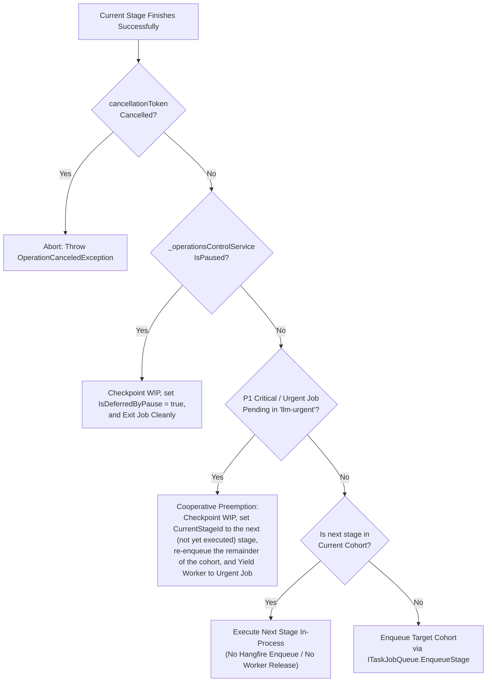

# ⚡ Step 11.30: Pipeline Stage Chaining & Atomic Cohort Job Execution

> **Phase 11 Implementation Step (Post-MVP - Queue Scheduling, Pipeline Continuity & Conflict Mitigation)**  
> *Parent Plan:* [Phase 11 Master Plan](../11_EXTEND_FEATURES.md)  
> *Project Target:* `src/NightCodeForge.Core`, `src/NightCodeForge.Infrastructure`, `src/NightCodeForge.Web`, `tests/NightCodeForge.Core.Tests`, `tests/NightCodeForge.Infrastructure.Tests`, `tests/NightCodeForge.Web.Tests`  
> *Status:* Proposed / Specified | *Target Framework:* .NET 10 (C# 13)  
> *Amends:* [11.27](STEP_11_27_STAGE_PRIORITY_SCHEDULING_AND_CONFLICT_RESOLUTION_HARDENING.md) (one job per stage becomes one job per cohort), [11.28](STEP_11_28_PIPELINE_RESTART_GIT_RESET_AND_REBASE_OPTIONS.md) (restart may re-enter at a stage inside a cohort), [11.29](STEP_11_29_GLOBAL_OPERATIONS_PAUSE_AND_GPU_VRAM_RECLAMATION.md) (pause is also checked between chained stages).

---

## 1. Executive Summary & Problem Statement

NightCodeForge orchestrates autonomous software engineering tasks on a dedicated single-worker GPU inference queue (`WorkerCount = 1`) to eliminate model thrashing and GPU out-of-memory contention on local Ollama / OllamaRouter backends.

In [Step 11.27](STEP_11_27_STAGE_PRIORITY_SCHEDULING_AND_CONFLICT_RESOLUTION_HARDENING.md), the system introduced a **Stage-Priority Queue Hierarchy** (`llm-code-review` -> `llm-implementation` -> `llm-task-review`) based on the **"Task as a Whole"** principle: tasks closest to completion must be prioritized to minimize base branch drift and eliminate merge conflicts against `main`.

However, an execution vulnerability remains in the stage transition model:

### 1.1 The Inter-Stage Vulnerability & GPU Resource Starvation

Under the standard 3-agent pipeline, workflow stages alternate between GPU (Agentic LLM) and CPU (Deterministic) workloads:
- **Stage 1 (Task Review):** GPU / Agentic
- **Stage 2 (Pre-Implementation Baseline):** CPU / Deterministic
- **Stage 3 (Implementation):** GPU / Agentic
- **Stage 4 (Post-Implementation Gates):** CPU / Deterministic
- **Stage 5 (Code Review & Fix):** GPU / Agentic
- **Stage 6 (Post-Review Verification):** CPU / Deterministic
- **Gate 2 (Pre-Review Mergeability Check & Automated Delivery):** CPU / Deterministic (terminal orchestrator logic, not a separate stage)

Under the existing model, **each stage is dispatched as an isolated Hangfire background job**. When Stage 3 (Implementation) finishes:
1. `TaskOrchestrator.ProcessTaskAsync` updates the database, enqueues Stage 4 (`deterministic-post-impl`) into Hangfire, and **exits the worker execution turn**.
2. Every re-enqueue releases the single worker slot, so any other job of an equal or higher tier can be dequeued before the next stage of this task:
   - A concurrent task can claim the worker and start a 15–30 minute LLM inference turn.
   - The first task, having just finished its 45-second deterministic test suite, is stranded waiting for its next stage.
   - During this stall, the base branch (`main`) keeps advancing, leading to branch drift and merge conflicts.
3. Conversely, having the worker sleep or poll while waiting for a separately dispatched deterministic job would introduce fragile synchronization and deadlocks, since CPU and GPU steps share the same worker.

> **Scope note:** Chaining guarantees zero interleaving *inside* a cohort. Interleaving *between* cohorts (e.g. Intake -> Implementation) remains possible by design and is arbitrated by the 11.27 tier priorities. Because Tier 1 (`llm-code-review`) is strictly preferred, a task entering the Review & Delivery Cohort always overtakes queued Implementation jobs; this is intended (closest-to-completion first) and inherits the 11.27 starvation trade-offs.

### 1.2 The Solution: Pipeline Stage Chaining via Atomic Cohorts

To eliminate interleaving, race conditions, and queue re-poll latency, `TaskOrchestrator` implements **In-Process Stage Chaining** organized into two atomic execution cohorts:

1. **Intake Phase (Stage 1: `task-review`):**
   - Dispatched as an independent job in `llm-task-review` (Tier 3).
   - If clarification is needed, the task invokes `ask` and waits safely in intake (`IsWaitingForHuman = true`) without consuming downstream resources.
   - Upon completion, it enqueues the **Implementation Cohort**.

2. **Implementation Cohort (Stages 2 -> 3 -> 4 in the SAME job):**
   - **Stage 2:** Pre-Implementation Baseline (Deterministic).
   - **Stage 3:** Implementation (Agentic LLM authoring).
   - **Stage 4:** Post-Implementation Gates (Deterministic verification: format, build, test, sast).
   - **Atomic Invariant:** Executes sequentially within a single worker turn. Stage 4 immediately follows Stage 3 without relinquishing the worker slot. If Stage 4 detects compiler or test failures, it loops back to Stage 3 **within the same job turn** to fix them.
   - Upon successful verification, enqueues the **Review & Delivery Cohort**.

3. **Review & Delivery Cohort (Stages 5 -> 6 & Gate 2 Delivery in the SAME job):**
   - **Stage 5:** Code Review & Fix (Agentic LLM review).
   - **Stage 6:** Post-Review Verification (Deterministic verification).
   - **Gate 2 & Automated Delivery:** Pre-Review Mergeability Check, WIP checkpoint, and Automated Delivery (terminal logic, not a separate stage):
     - If `MergeMode == Automatic`: Instant squash & merge into `baseBranch`, status `Closed` (terminal state), record `SquashCommitSha`, cascade DAG unblocking.
     - If `MergeMode == ManualReviewRequired`: Transition to status `Ready` for maintainer approval in the Review Room.
   - **Atomic Invariant:** Executes seamlessly in a single worker turn. Code review, verification, and merge occur in rapid succession, preventing branch drift at the most critical finish line.

---

## 2. Architecture & Workflow

### 2.1 Atomic Cohort Execution Pipeline

```mermaid
flowchart TD
    subgraph Intake ["Intake Phase (Tier 3: 'llm-task-review')"]
        S1["Stage 1: ForgeTask Review / Architecture<br/>(Agentic LLM)"]
        S1Ask{"Needs Clarification<br/>('ask' tool)?"}
        S1Wait["IsWaitingForHuman = true<br/>(Safe pause in intake)"]
        S1Done["Enrich Task Specification on Disk<br/>& Complete Stage 1"]
    end

    subgraph Cohort1 ["Cohort 1: Implementation Cohort (Tier 2: 'llm-implementation') - SINGLE HANGFIRE JOB"]
        direction TB
        S2["Stage 2: Pre-Implementation Baseline<br/>(Deterministic: build & tests)"]
        S3["Stage 3: Implementation Turn<br/>(Agentic LLM: code authoring)"]
        S4["Stage 4: Post-Implementation Gates<br/>(Deterministic: format, build, test, sast)"]
        Gate4Check{"Stage 4 Passed<br/>(Exit Code 0)?"}
        Loopback3["In-Job Loopback to Stage 3<br/>(Inject Compiler Errors / Test Failures)"]
    end

    subgraph Cohort2 ["Cohort 2: Review & Delivery Cohort (Tier 1: 'llm-code-review') - SINGLE HANGFIRE JOB"]
        direction TB
        S5["Stage 5: Code Review & Fix<br/>(Agentic LLM: review diff & add tests)"]
        S6["Stage 6: Post-Review Verification<br/>(Deterministic: full build & tests)"]
        Gate2["Gate 2: Pre-Review Mergeability Check<br/>(git merge-tree check)"]
        CheckMode{"task.MergeMode"}
        AutoMerge["Immediate Squash & Merge to baseBranch<br/>Status = Closed | Cascade Unblock"]
        ReadyState["Status = Ready<br/>(Review Room Maintainer Approval)"]
    end

    S1 --> S1Ask
    S1Ask -- Yes --> S1Wait
    S1Ask -- No --> S1Done
    S1Done -->|Enqueue Cohort 1 to llm-implementation| S2

    S2 -->|Chained In-Process| S3
    S3 -->|Chained In-Process| S4
    S4 --> Gate4Check
    Gate4Check -- Failed (Attempts < Max) --> Loopback3 --> S3
    Gate4Check -- Failed (Attempts >= Max) --> FailStage4["Status = Failed<br/>(Max Quality Gate Retries Exceeded)"]
    Gate4Check -- Success -->|Enqueue Cohort 2 to llm-code-review| S5

    S5 -->|Chained In-Process| S6
    S6 -->|Chained In-Process| Gate2
    Gate2 -- Conflict Detected --> ConflictInit["Initiate Conflict Resolution<br/>(Re-enqueue to Cohort 1 Tier 2)"]
    Gate2 -- Clean --> CheckMode
    CheckMode -- Automatic --> AutoMerge
    CheckMode -- ManualReviewRequired --> ReadyState
```

---

### 2.2 Worker Preemption & Cooperative Guard Checks

Between chained stages within a cohort, `TaskOrchestrator` performs cooperative safety checks before advancing:



---

## 3. Detailed Specifications

### 3.1 Cohort Groupings & Boundary Contracts

1. **Cohort Definitions:**
   Add a domain enum next to `StageDefinition` in `NightCodeForge.Core.Domain` (same namespace, so the domain model does not depend on `Core.Workflow`):
   ```csharp
   public enum PipelineCohort
   {
       Intake,
       Implementation,
       ReviewAndDelivery
   }
   ```
   An enum (not free strings) prevents typos in custom workflow definitions. Persisted/serialized as its name.
   A cohort's **dispatch tier is the `QueueTier` of its first stage**. Workflow validation MUST reject a cohort whose stages are not contiguous in sequence, and MUST reject mixed tiers in a cohort other than the first-stage rule (all stages of a cohort are executed on the first stage's tier worker turn; their own `QueueTier` is ignored while chained).

2. **Stage-to-Cohort Mapping:**
   In [StandardWorkflowDefinitions.cs](file:///c:/Users/Julien/source/repos/jetelain/NightCodeForge/src/NightCodeForge.Core/Domain/StandardWorkflowDefinitions.cs):
   - **Intake:** `StandardStageIds.TaskReview`, `StandardStageIds.Triage` (Triage precedes Task Review in sequence; both run in their own job turns because Intake is not an atomic cohort: each Intake stage can end in a human wait, so Intake stages are dispatched individually and only the cohort tag is used for the boundary decision).
   - **Implementation Cohort:**
     - `StandardStageIds.PreImplementationBaseline` (Sequence 2)
     - `StandardStageIds.Implementation` (Sequence 3)
     - `StandardStageIds.PostImplementationGates` (Sequence 4)
   - **Review & Delivery Cohort:**
     - `StandardStageIds.CodeReviewAndFix` (Sequence 5)
     - `StandardStageIds.PostReviewVerification` (Sequence 6)
     - Gate 2 Pre-Review Verification & Automated Delivery (Terminal logic, NOT a stage: no `StageDefinition`, conversation tab or stepper entry; `HandleGate2AndDeliveryAsync` runs when there is no next stage)

3. **Stage Definition Contract:**
   Add `CohortGroup` property to [StageDefinition.cs](file:///c:/Users/Julien/source/repos/jetelain/NightCodeForge/src/NightCodeForge.Core/Domain/StageDefinition.cs) and runtime interface [IWorkflowStage.cs](file:///c:/Users/Julien/source/repos/jetelain/NightCodeForge/src/NightCodeForge.Core/Workflow/IWorkflowStage.cs):
   ```csharp
   public PipelineCohort? CohortGroup { get; init; }
   ```
   Custom workflows can declare custom cohort groupings or leave null (single-stage execution). This is a breaking change to `IWorkflowStage` (clean-break policy): every implementing stage class and test fake MUST be updated; the implementer lists them in the PR description.

---

### 3.2 In-Process Chaining Loop in `TaskOrchestrator`

Refactor the outer execution loop in `TaskOrchestrator.ProcessTaskAsync`:

1. **Loop Structure:**
   Replace the single-stage execution and immediate exit with an in-process stage progression loop:
   ```csharp
   var isFirstIteration = true;
   while (!cancellationToken.IsCancellationRequested)
   {
       // 1. Check Global Pause
       if (_operationsControlService.IsPaused)
       {
           task.IsDeferredByPause = true;
           await _taskRepository.UpdateAsync(task, cancellationToken);
           return;
       }

       // 2. Check Urgent Preemption (skipped on the first iteration: strict queue priority
       //    already selected this job over any urgent one; CurrentStageId == stage.StageId)
       if (!isFirstIteration && await _jobQueue.HasUrgentJobsWaitingAsync(cancellationToken))
       {
           _logger.LogInformation("Cooperatively yielding task #{TaskId} before stage '{StageId}' (not yet executed; CurrentStageId == StageId, resume re-enters here) for pending P1 Urgent job.", task.Id, stage.StageId);
           task.LastHangfireJobId = _jobQueue.EnqueueStage(task.Id, stage.QueueTier, task.Priority);
           await _taskRepository.UpdateAsync(task, cancellationToken);
           return;
       }

       isFirstIteration = false;

       // 3. Execute Current Stage
       var result = await ExecuteStageCoreAsync(task, workspace, stage, pipelineContext, cancellationToken);

       // 4. Handle Clarification Request ('ask' tool invoked by agent)
       if (result.RequiresHumanClarification || task.IsWaitingForHuman)
       {
           _logger.LogInformation("Task #{TaskId} suspended at stage '{StageId}' waiting for human clarification.", task.Id, stage.StageId);
           // InterruptedStageId is set, WIP checkpoint persisted, and worker turn exits cleanly to release GPU
           return;
       }

       // 5. Handle Quality Gate / Stage Failure
       if (!result.IsSuccess)
       {
           var loopBackStageId = result.TargetRoutingStageId ?? stage.LoopBackStageId;
           var retries = pipelineContext.IncrementRetry(stage.StageId);
           var effectiveMaxRetries = pipelineContext.DataBag.Get<int?>(PipelineDataBagKeys.MaxRetries) 
               ?? WorkflowDefaults.DefaultMaxStageRetries;

           if (!string.IsNullOrWhiteSpace(loopBackStageId) && retries <= effectiveMaxRetries)
           {
               var targetStage = pipeline.GetStage(loopBackStageId);
               if (targetStage != null && targetStage.CohortGroup.HasValue && targetStage.CohortGroup == stage.CohortGroup)
               {
                   // IN-PROCESS LOOPBACK (e.g. Stage 4 -> Stage 3):
                   // Inject compiler/test errors into DataBag, update task.CurrentStageId, and continue loop immediately
                   await PrepareInProcessLoopBackAsync(task, workspace, stage, targetStage, result, pipelineContext, cancellationToken);
                   stage = targetStage;
                   continue;
               }
               else if (targetStage != null)
               {
                   // CROSS-COHORT LOOPBACK (e.g. Stage 5/6 routing back to Stage 3 in Cohort 1):
                   // Enqueue target cohort to its priority tier (Tier 2 llm-implementation) and exit current worker turn
                   await HandleCrossCohortLoopBackAsync(task, workspace, stage, targetStage, result, pipelineContext, cancellationToken);
                   return;
               }
           }

           // Unrecoverable Failure or Retries Exhausted
           await HandleStageFatalFailureAsync(task, workspace, stage, result, pipelineContext, cancellationToken);
           return;
       }

       // 6. Resolve Next Stage (honor dynamic routing if set by stage)
       var nextStageId = result.TargetRoutingStageId;
       var nextStage = (!string.IsNullOrWhiteSpace(nextStageId) ? pipeline.GetStage(nextStageId) : null)
           ?? pipeline.GetNextStage(stage.StageId);

       if (nextStage == null)
       {
           // Terminal Gate 2 & Delivery (no further stages in pipeline)
           await HandleGate2AndDeliveryAsync(task, workspace, pipelineContext, cancellationToken);
           return;
       }

       // 7. Cohort Boundary Check
       bool isSameCohort = stage.CohortGroup.HasValue && stage.CohortGroup == nextStage.CohortGroup;

       if (isSameCohort)
       {
           // ADVANCE IN-PROCESS: Transition state, commit WIP checkpoint, emit SignalR events, and continue loop immediately
           await TransitionToNextStageInProcessAsync(task, workspace, stage, nextStage, pipelineContext, cancellationToken);
           stage = nextStage;
           continue;
       }
       else
       {
           // COHORT BOUNDARY: Enqueue next cohort to its designated priority tier and exit worker turn
           await TransitionAndEnqueueNextCohortAsync(task, workspace, stage, nextStage, pipelineContext, cancellationToken);
           return;
       }
   }
   ```

2. **In-Job Loopback (Stage 4 -> Stage 3):**
   When Stage 4 (`PostImplementationGates`) fails and loopback is triggered:
   - If `retryCount <= maxRetries`, update `task.CurrentStageId = StandardStageIds.Implementation`, store diagnostics in `PipelineDataBagKeys.CompilerErrors` and `FailedTests`.
   - Instead of enqueuing to Hangfire, **continue the in-process loop directly to Stage 3** within the same worker turn.
   - If retry budget is exhausted, set `task.Status = TaskOverallStatus.Failed` and exit.
   - **The retry counter MUST be persisted in the task data bag** (`PipelineDataBagKeys.StageRetries`), so it survives pause, urgent yield, crash, and restart; the budget is per task, not per job turn.

3. **Resume Semantics (pause, urgent yield, human answer, crash recovery, restart per 11.28):**
   A resumed job always starts at `task.CurrentStageId`, never at the first stage of the cohort. The `isSameCohort` logic is evaluated from that stage onward, so a resumed job continues the remainder of its cohort in-process.

4. **New queue contract:**
   `ITaskJobQueue` gains `Task<bool> HasUrgentJobsWaitingAsync(CancellationToken)`. It MUST be implemented by the Hangfire queue (Infrastructure) and `InMemoryTaskJobQueue` (ScenarioRunner), and be mockable for unit tests. There is no "enqueue at head": a yielded task is simply re-enqueued on its cohort tier, and the strict tier priority of 11.27 determines when it resumes.

---

### 3.3 Cohort 2: Terminal Automated Delivery (Gate 2)

Within the Review & Delivery Cohort, when Stage 6 (`PostReviewVerification`) succeeds:

1. **Gate 2 Mergeability Verification:**
   - Execute `_gitWorkspaceManager.CreateWipCheckpointAsync`.
   - Synchronize base branch from host mirror if configured.
   - Run `_gitWorkspaceManager.CheckMergeableAsync(workspace, task.Id, task.BaseBranch)`.
   - If merge conflict detected -> initiate autonomous conflict resolution per 11.25/11.27: the task is re-entered at the conflict-resolution entry point defined there (the Implementation stage with conflict context), enqueued on the Implementation cohort tier (`llm-implementation`), and the job exits.
   - **Base Branch Advance Re-Verification:** If `main` advanced while the task executed, synchronize in worktree and re-verify deterministic gates (`stage.ExecuteAsync`). If re-verification fails, route backward to `Implementation` (Stage 3), which enqueues Cohort 1 and exits.

2. **Delivery Dispatch:**
   - **`task.MergeMode == MergeMode.Automatic`:**
     - Execute `_gitWorkspaceManager.SquashAndMergeAsync(workspace, task.Id, task.BaseBranch, commitMessage)`.
     - **Ordering:** persist `Status = TaskOverallStatus.Closed` and `SquashCommitSha` (via `UpdateWithHistoryAsync`) immediately after the merge succeeds and BEFORE any follow-up, so a later failure can never leave the repository merged with an open task.
     - Set `task.Status = TaskOverallStatus.Closed`.
     - Set `task.SquashCommitSha = resultSha`.
     - Cascade DAG dependencies via `_dependencyEngine.ResolveCascadeUnblockedTasksAsync` (which checks for `TaskOverallStatus.Closed`) and enqueue newly unblocked tasks.
     - Clean up task sandbox container via `_environmentProvider.CleanupTaskContainerAsync`. Follow-up failures (cascade, cleanup) are logged and surfaced as domain errors, never swallowed, and never revert `Closed`.
     - Log completion audit trail: `Task #{TaskId} automatically verified and merged into {BaseBranch}`.
   - **`task.MergeMode == MergeMode.ManualReviewRequired`:**
     - Set `task.Status = TaskOverallStatus.Ready`.
     - Task appears in Review Room with green approval button. Maintainer reviews verified diff.

---

### 3.4 Telemetry, Inspector & UI Stepper Continuity

1. **Real-Time Stepper & UI Reflection:**
   - Even though stages chain within the same job, every stage transition calls `_taskRepository.UpdateWithHistoryAsync` and updates `task.CurrentStageId`.
   - `_streamer.BroadcastAsync` emits `StageStarted` and `StageCompleted` events for every chained stage.
   - `_telemetryService.RecordActiveTask` updates the active stage and hardware target in real-time.
   - The UI Kanban board, `/inspector` execution stepper, and `/monitoring` live ops console reflect exact active stage progression with zero delay.

2. **Conversation Records:**
   - Each stage creates its own `Conversation` and records its turns in the database.
   - Stage conversation viewer maintains discrete tabs for Stage 2, Stage 3, Stage 4, Stage 5, and Stage 6 (Gate 2 / delivery has no tab, see 3.1).

3. **Job Duration Observability:**
   A Hangfire job now spans a whole cohort. `OperationsTelemetryService` and the `/monitoring` console MUST show the active stage (not just the job), and cohort job duration is logged on exit together with the exit reason (`CohortCompleted`, `Paused`, `Yielded`, `WaitingForHuman`, `Failed`, `Cancelled`).

---

### 3.5 Failure & Exit Routing Table

| Situation | Outcome |
|---|---|
| Stage 2 (baseline) fails | Baseline failure (merge conflict with base branch or build/test error): `task.Status = TaskOverallStatus.Failed`, job exits (no retry loop) |
| Stage 3 asks a question (`ask`) | `IsWaitingForHuman = true`, `CurrentStageId` stays Stage 3, job exits to free GPU slot; human answer re-enqueues the Implementation cohort and resumes at Stage 3 |
| Stage 4 fails, budget left | In-job loopback to Stage 3 (persisted retry counter incremented in `PipelineDataBagKeys.StageRetries`) |
| Stage 4 fails, budget exhausted | `task.Status = TaskOverallStatus.Failed`, job exits |
| Stage 5 fails (rejection / request changes) | Loops back to `Implementation` (Stage 3). Crosses cohort boundary (Cohort 2 -> Cohort 1), so re-enqueues Cohort 1 to `llm-implementation` (Tier 2); job exits |
| Stage 6 fails | Loops back to `Implementation` (Stage 3) per `StandardWorkflowDefinitions`. Crosses cohort boundary (Cohort 2 -> Cohort 1), so re-enqueues Cohort 1 to `llm-implementation` (Tier 2); job exits. If retry budget exhausted, `task.Status = TaskOverallStatus.Failed` and job exits |
| Gate 2 conflict | Re-enter conflict resolution on Implementation cohort tier (see 3.3); job exits |
| Gate 2 re-verification fails (base advanced) | Re-verification test failure: loops back to `Implementation` (Stage 3), re-enqueues Cohort 1 to `llm-implementation` (Tier 2); job exits |
| Global pause detected between stages | Checkpoint WIP, `IsDeferredByPause = true`, `CurrentStageId` = next stage, exit |
| Urgent job waiting between stages | Yield (see 3.2), `CurrentStageId` = next stage, re-enqueue, exit |
| Cancellation | `OperationCanceledException`; `CurrentStageId` unchanged for the stage being executed |

Each row MUST have a unit test (see DoD).

---

### 3.6 Long-Running Job Requirements (Hangfire SQLite Invisibility Timeout)

A cohort job spans multiple chained stages (and in-job loopbacks) and may execute for 1 to 2 hours or more.
Under [HangfireConfigurationExtensions.cs](file:///c:/Users/Julien/source/repos/jetelain/NightCodeForge/src/NightCodeForge.Infrastructure/BackgroundJobs/HangfireConfigurationExtensions.cs#L43), SQLite storage is registered via `Hangfire.Storage.SQLite`.
By default, `SQLiteStorageOptions.InvisibilityTimeout` in `Hangfire.Storage.SQLite` is 30 minutes. If a single job execution turn exceeds 30 minutes, Hangfire's background watchdog considers the worker dead, returns the job to the queue, and a second worker turn can pick it up concurrently, leading to duplicated runs and worktree corruption.

Infrastructure configuration MUST explicitly configure:
```csharp
new SQLiteStorageOptions
{
    QueuePollInterval = TimeSpan.FromSeconds(1),
    InvisibilityTimeout = TimeSpan.FromHours(4) // Exceeds maximum possible cohort duration
}
```
This configuration MUST be covered by an automated configuration test.

---

## 4. Definition of Done (DoD) Checklist

### 1. Cohort Configuration & Domain Models
- [ ] Add `PipelineCohort` enum (`Intake`, `Implementation`, `ReviewAndDelivery`) in `Core.Domain`, with workflow validation (contiguous stages per cohort; cohort dispatch tier = first stage's tier).
- [ ] Add `PipelineCohort? CohortGroup` to `StageDefinition` and `IWorkflowStage`; update all stage implementations and test fakes.
- [ ] Assign cohort groupings in `StandardWorkflowDefinitions`:
  - Intake: `task-review`, `triage`.
  - Implementation Cohort: `deterministic-pre-impl`, `implementation`, `deterministic-post-impl`.
  - Review & Delivery Cohort: `code-review-fix`, `deterministic-post-review`.

### 2. In-Process Stage Chaining in `TaskOrchestrator`
- [ ] Refactor `TaskOrchestrator.ProcessTaskAsync` into a stage progression `while` loop.
- [ ] Implement `isSameCohort` detection: chained execution continues in-process without enqueuing Hangfire jobs.
- [ ] Add `ITaskJobQueue.HasUrgentJobsWaitingAsync` (Hangfire + `InMemoryTaskJobQueue`) and implement the cooperative urgent yield (CurrentStageId = stage not yet executed; skipped on first iteration).
- [ ] Resume always starts at `task.CurrentStageId` and continues the remainder of its cohort in-process.
- [ ] Persist the Stage 4 -> 3 retry counter in `PipelineDataBagKeys.StageRetries` so it survives pause/yield/restart.
- [ ] Implement global pause check (`_operationsControlService.IsPaused`) between chained stages.
- [ ] In-job loopback: Stage 4 gate failures directly re-execute Stage 3 in the same turn without worker release until retry budget is exhausted; on budget exhaustion, transition to `TaskOverallStatus.Failed`.
- [ ] In-job pause on human clarification (`ask` tool in Stage 3): persist WIP checkpoint, mark `IsWaitingForHuman = true`, set `InterruptedStageId = stage.StageId`, and exit worker turn.
- [ ] Cross-cohort loopback: Stage 5 rejection or Stage 6 failure re-enqueues Stage 3 on `llm-implementation` (Tier 2) and exits worker turn.
- [ ] Cohort boundary transition: Stage 4 success enqueues Cohort 2 to `llm-code-review` (Tier 1).

### 3. Review & Delivery Cohort Terminal Execution
- [ ] Stage 6 success immediately executes Gate 2 mergeability check in the same job turn.
- [ ] Re-verify deterministic gates if base branch advanced during execution; route back to `Implementation` (Stage 3) on failure.
- [ ] Implement immediate automated squash & merge when `MergeMode.Automatic`:
  - Commit squash merge to `baseBranch`.
  - Persist `Status = TaskOverallStatus.Closed` + `SquashCommitSha` before cascade/cleanup; follow-up failures never revert `Closed` and are never swallowed.
  - Cascade DAG unblocking (unblocks tasks waiting on `Closed` status).
- [ ] Transition to `TaskOverallStatus.Ready` when `MergeMode.ManualReviewRequired`.

### 4. Telemetry & Observability
- [ ] Verify `StageStarted` and `StageCompleted` SignalR activity events emit on each chained transition.
- [ ] Verify `OperationsTelemetryService.RecordActiveTask` updates stage name and hardware target on each chained transition.
- [ ] Verify individual `Conversation` records are generated for every chained stage (none for Gate 2).
- [ ] Log cohort job duration and exit reason (`CohortCompleted`, `Paused`, `Yielded`, `WaitingForHuman`, `Failed`, `Cancelled`).
- [ ] Configure `SQLiteStorageOptions.InvisibilityTimeout = TimeSpan.FromHours(4)` in `AddNightCodeForgeHangfire` and add configuration test (3.6).

### 5. Automated Tests & Validation
- [ ] **Unit Tests:**
  - `CohortChainingTests`: Assert Stages 2, 3, and 4 execute within a single orchestrator invocation.
  - `CohortLoopbackTests`: Assert Stage 4 failure immediately re-runs Stage 3 without Hangfire enqueue.
  - `CohortCrossCohortLoopbackTests`: Assert Stage 6 failure re-enqueues Cohort 1 on Tier 2 and exits Tier 1 turn.
  - `CohortUrgentPreemptionTests`: Assert pending P1 job causes active cohort to yield gracefully between stages.
  - `CohortDeliveryTests`: Assert Stages 5, 6, and Auto-Merge execute in a single invocation, transition to `Closed`, and persist `SquashCommitSha`.
  - `CohortFailureRoutingTests`: One test per row of the 3.5 routing table.
  - `CohortResumeTests`: Pause mid-cohort and resume at the correct stage; urgent yield then resume; cancellation mid-cohort; retry budget persisted across restart.
  - `CohortAskTests`: `ask` raised in Stage 3 exits the job and the answer resumes at Stage 3.
  - `CohortGate2ConflictTests`: Conflict at Gate 2 re-enters conflict resolution on the Implementation tier.
  - `CohortGate2ReverifyTests`: Base branch advance with test failure routes back to Implementation.
  - `CohortValidationTests`: Non-contiguous cohort definitions are rejected.
  - `HangfireInvisibilityTimeoutConfigTests`: Verify `SQLiteStorageOptions.InvisibilityTimeout` >= 4 hours.
- [ ] **Integration / Scenario Tests:**
  - Verify full end-to-end task run through both cohorts with zero interleaving from a concurrent lower-tier task, using the deterministic `InMemoryTaskJobQueue` fake.
- [ ] **Regression Test Run:**
  - Run `dotnet test --filter "Category!=Acceptance&Category!=E2E"` and ensure all tests pass.
