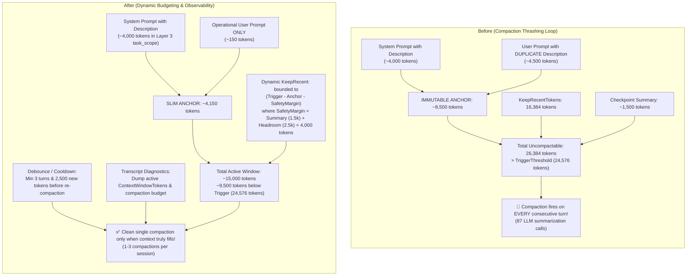

# ⚡ Step 11.31: Prompt Deduplication, Dynamic Compaction Budgeting & Inference Ergonomics

> **Phase 11 Implementation Step (Post-MVP - Real-Project Hardening, Token Efficiency & Sandbox Ergonomics)**  
> *Parent Plan:* [Phase 11 Master Plan](../11_EXTEND_FEATURES.md)  
> *Project Target:* [`src/NightCodeForge.Core`](file:///c:/Users/Julien/source/repos/jetelain/NightCodeForge/src/NightCodeForge.Core), [`src/NightCodeForge.Infrastructure`](file:///c:/Users/Julien/source/repos/jetelain/NightCodeForge/src/NightCodeForge.Infrastructure), [`src/NightCodeForge.Agents`](file:///c:/Users/Julien/source/repos/jetelain/NightCodeForge/src/NightCodeForge.Agents), [`src/NightCodeForge.Web`](file:///c:/Users/Julien/source/repos/jetelain/NightCodeForge/src/NightCodeForge.Web), [`tests/NightCodeForge.Agents.Tests`](file:///c:/Users/Julien/source/repos/jetelain/NightCodeForge/tests/NightCodeForge.Agents.Tests), [`tests/NightCodeForge.Core.Tests`](file:///c:/Users/Julien/source/repos/jetelain/NightCodeForge/tests/NightCodeForge.Core.Tests)  
> *Status:* Proposed / Specified | *Target Framework:* .NET 10 (C# 13)  
> *Derived From:* Empirical transcript analysis of real project onboarding (`OllamaRouter/docs/transcripts`, Tasks 7, 8, 10).

---

## 1. Executive Summary & Problem Statement

During live validation on the **OllamaRouter** repository (`OllamaRouter/docs/transcripts`), multi-stage tasks executed against local GPU models (`Qwen3.8-27B`) revealed critical token bloat, severe context compaction thrashing, and tooling bottlenecks:

```text
Task 7 (Implementation) : 142.6 min | 12,225,395 prompt tokens | 87 Compaction Passes!
Task 10 (Implementation): 126.3 min |  8,022,289 prompt tokens | 83 Compaction Passes!
Task 8 (Code-Review-Fix): 113.5 min |  5,839,439 prompt tokens | 63 Compaction Passes!
Task 8 (Implementation) :  43.9 min |    807,107 prompt tokens | CANCELLED (hung in NuGet 'strings' loop)
```

Detailed inspection of the 16 execution transcripts uncovered five distinct structural defects responsible for these pathological runs:

---

### 1.1 Problem 1: Dual Task Description Injection & Anchor Token Bloat

In [StandardWorkflowDefinitions.cs](file:///c:/Users/Julien/source/repos/jetelain/NightCodeForge/src/NightCodeForge.Core/Domain/StandardWorkflowDefinitions.cs), the default bootstrap prompt template for every agentic stage (Task Review, Implementation, Code Review Fix) contained:

```text
Execute stage '{{ stage.display_name }}' for task #{{ task.id }}: {{ task.title }}
{{ task.description }}
{{- if context.task_markdown_path }}
...
```

Simultaneously, [CrucibleAgentHarness.cs](file:///c:/Users/Julien/source/repos/jetelain/NightCodeForge/src/NightCodeForge.Agents/Crucible/CrucibleAgentHarness.cs) and [PromptPrefixStabilizer.cs](file:///c:/Users/Julien/source/repos/jetelain/NightCodeForge/src/NightCodeForge.Agents/Optimizations/PromptPrefixStabilizer.cs) construct the stabilized System Prompt (Layer 3 `task_scope`):

```xml
<task id="7" title="Implement hot-model affinity scoring pipeline with concurrency cliff" path="docs/tasks/..." date="2026-10-25">
[Full Task Description, Checklist, Architecture & Acceptance Criteria]
</task>
```

**Consequence:**
1. In real repositories, task descriptions average **15,000 to 25,000 characters** (~3,500 to 5,500 tokens). Injecting it twice wastes ~4,000 tokens on turn 1.
2. Under [PiStyleCrucibleCompactionStrategy.cs](file:///c:/Users/Julien/source/repos/jetelain/NightCodeForge/src/NightCodeForge.Agents/Compaction/PiStyleCrucibleCompactionStrategy.cs), both the System Prompt and the initial User message form the **immutable Task Anchor** that is *never* evicted during context compaction.
3. As a result, the duplicate description persisted across **all 50–80 turns** of every run, silently burning **200,000 to 350,000 redundant prompt tokens** per task without providing any new context to the LLM.
4. Keeping the description strictly in the System Prompt ensures it remains permanently accessible to the model across turns and compactions while cutting the initial user message size by 80%.

---

### 1.2 Problem 2: Catastrophic Compaction Thrashing, Budget Inversion & Observability Blind Spots

In [CrucibleCompactionOptions.cs](file:///c:/Users/Julien/source/repos/jetelain/NightCodeForge/src/NightCodeForge.Agents/Compaction/CrucibleCompactionOptions.cs), the baseline static defaults are:
- `ContextWindowTokens = 32,768`
- `ReserveTokens = 8,192` $\implies$ `TriggerThresholdTokens = 24,576`
- `KeepRecentTokens = 16,384`

While production deployments configure `"ContextWindowTokens": 225280` in `appsettings.json` (under `LlmProvider:ContextWindowTokens`), empirical runs on local backends exhibited two compounded failures:

1. **Context Window Resolution Fallback & Lack of Transcript Diagnostics:**
   - In [ModelCapabilityResolver.cs](file:///c:/Users/Julien/source/repos/jetelain/NightCodeForge/src/NightCodeForge.Agents/Inference/ModelCapabilityResolver.cs), context window resolution follows:
     `AgentProfile.ContextWindowTokens` $\to$ `ModelCapabilityProfile.ContextWindowTokens` $\to$ `LlmProviderOptions.ContextWindowTokens` $\to$ `DefaultContextWindowTokens (32,768)`.
   - When seeded profiles left `ContextWindowTokens` null and model profiles lacked explicit overrides, runs fell through to the small-window tier (`32,768` tokens, triggering at `24,576`).
   - Neither [TranscriptMetadata](file:///c:/Users/Julien/source/repos/jetelain/NightCodeForge/src/NightCodeForge.Agents/Transcripts/SessionTranscriptService.cs) nor [SessionTranscriptService.cs](file:///c:/Users/Julien/source/repos/jetelain/NightCodeForge/src/NightCodeForge.Agents/Transcripts/SessionTranscriptService.cs) recorded the active compaction budget or the resolved context window in the transcript YAML frontmatter or Environment block, creating an **observability blind spot** where maintainers could not verify at runtime whether the agent ran with 225k or fell back to 32k.

2. **Budget Inversion & Infinite Re-Compaction Churn:**
   - The **Task Anchor** (System Prompt + Initial User Message) consumed **8,000 to 10,000 tokens** due to the dual task description and tool definitions.
   - The strategy attempted to retain `KeepRecentTokens = 16,384` recent tokens verbatim.
   - Therefore, the minimum uncompactable context was:
     $$\text{Anchor} (9,000) + \text{KeepRecent} (16,384) + \text{Checkpoint Summary} (1,500) = 26,884 \text{ tokens}$$
   - Because $26,884 > 24,576$ (`TriggerThresholdTokens`), **the context size after compaction STILL exceeded the trigger threshold!**
   - On the very next turn, the compaction trigger fired again, resulting in an **infinite compaction churn on every consecutive turn**:
     - **87 compactions** in Task 7 Implementation
     - **83 compactions** in Task 10 Implementation
     - **63 compactions** in Task 8 Code Review Fix
   - Each compaction executed a full LLM summarization turn over ~25,000 tokens. This compaction churn consumed over **2.2 million prompt tokens** and **1.5 hours of GPU compute time** per task in summarization alone!

---

### 1.3 Problem 3: 3rd-Party NuGet & Assembly API Blindness (The `strings` Loop)

In `2026-10-24-task-8-implementation-cancelled.md`, the agent needed to integrate with the NuGet package `Yarp.ReverseProxy` (v2.3.0). Because it did not know the constructor parameters for `HttpForwarder` or the abstract methods of `HttpTransformer`:
1. The agent spent **44 minutes** running exploratory bash commands:
   ```bash
   find /cache/nuget -maxdepth 1 -type d
   strings /cache/nuget/yarp.reverseproxy/2.3.0/lib/net8.0/Yarp.ReverseProxy.dll | grep -c "OllamaRouterOptions"
   ```
2. The agent entered a rambling internal monologue trying to deduce type signatures from binary strings, eventually generating a single thought exceeding 32,768 characters before the human operator aborted the task.
3. **Phase Separation & Scope Boundary:** Rather than hacking an ad-hoc CLI tool into Phase 11, the comprehensive architectural solution to assembly inspection and external developer tooling is the introduction of a **Global Skills Injection System** delivering stack-specific tools (`csnav` from [PmadCSharpNav](https://github.com/jetelain/PmadCSharpNav), `mdfetch` from [MarkdownFetch](https://github.com/jetelain/MarkdownFetch), and `codecondenser` from [PmadCodeCondenser](https://github.com/jetelain/PmadCodeCondenser)) via transparent worktree symlinks/mounts, specified in **[Step 12.14: Global Skills Injection & Stack-Specific Tool Provisioning](../phase-12/STEP_12_14_GLOBAL_SKILLS_INJECTION_AND_STACK_TOOLING.md)**.
4. **Phase 11 Focus:** Phase 11 remains strictly disciplined on optimizing and fixing existing features (prompt deduplication, dynamic compaction budgeting, transcript diagnostic dumping, multi-match edit replacements, and transcript sizing).

---

### 1.4 Problem 4: Test Signature Multi-Site Refactoring (Python Bash Heredocs)

In `2026-10-25-task-7-implementation-completed.md`, updating `RoutingDecisionService.DecideAsync` broke 30+ unit test call sites across `OllamaRoutingMiddlewareTests.cs`.
1. Because the `edit` tool only supported strict literal substring matches and single occurrences, the agent found it impossible or excessively slow to make 30 individual precision edits.
2. The agent bypassed the `edit` tool and wrote an ad-hoc Python script with a heredoc in `bash`:
   ```bash
   python3 - <<'EOF'
   s = open('OllamaRoutingMiddlewareTests.cs').read()
   for a, b in [(100, "llama3"), (200_000, "qwen3.6-35b-a3b"), ...]:
       s = s.replace(f"DecideAsync({a}, \"{b}\", It.IsAny<CancellationToken>())", ...)
   open('OllamaRoutingMiddlewareTests.cs', 'w').write(s)
   EOF
   ```
3. The first attempt failed due to quoting errors and syntax mismatches before succeeding on retry. The existing `edit` tool requires first-class batch / multi-match replacement ergonomics (`replaceAll: true`), supported in both array and single-edit shortcut forms.

---

### 1.5 Problem 5: Transcript Truncation at 32k Chars & Audit Blindness

In [SessionTranscriptService.cs](file:///c:/Users/Julien/source/repos/jetelain/NightCodeForge/src/NightCodeForge.Agents/Transcripts/SessionTranscriptService.cs), `MaxEntryChars = 32768`.
When the accumulated task description, checklist, architectural notes, and test plans in `task.Description` grew large:
1. The System Prompt alone exceeded 32,768 characters.
2. In `2026-10-24-task-8-implementation-cancelled.md`, the System Prompt was cut off midway through the test plan with:
   ```text
   ... [Output truncated; exceeded 32768 characters]
   ```
3. This prevented human maintainers from inspecting what guidelines or rules the agent was actually given during post-mortem audits.

---

## 2. Architecture & Workflow

### 2.1 Context Window Budgeting: Before vs After



---

## 3. Technical Specifications

### 3.1 Prompt Deduplication & Initial User Message Streamlining

#### 3.1.1 Retention in System Prompt (Layer 3 `task_scope`)
The full task description remains in the **System Prompt** inside Layer 3 (`task_scope`) generated by [PromptPrefixStabilizer.cs](file:///c:/Users/Julien/source/repos/jetelain/NightCodeForge/src/NightCodeForge.Agents/Optimizations/PromptPrefixStabilizer.cs) and [CrucibleAgentHarness.cs](file:///c:/Users/Julien/source/repos/jetelain/NightCodeForge/src/NightCodeForge.Agents/Crucible/CrucibleAgentHarness.cs):
```xml
<task id="{{ task.id }}" title="{{ task.title }}" path="{{ task.markdown_path }}" date="{{ current_date }}">
{{ task.description }}
</task>
```
*Rationale:* The system prompt is byte-stabilized for KV prefix caching and is never evicted during conversation compaction, ensuring the agent never loses sight of the primary goal, constraints, and acceptance criteria.

#### 3.1.2 Removal from Initial Bootstrap User Prompt & Template Context
1. **Default Templates in Core and Tests:**
   In [StandardWorkflowDefinitions.cs](file:///c:/Users/Julien/source/repos/jetelain/NightCodeForge/src/NightCodeForge.Core/Domain/StandardWorkflowDefinitions.cs) and [TestWorkflowPipelines.cs](file:///c:/Users/Julien/source/repos/jetelain/NightCodeForge/tests/NightCodeForge.Core.Tests/TestWorkflowPipelines.cs), remove `{{ task.description }}` from all default `PromptTemplate` definitions (Task Review, Implementation, Code Review & Fix):

   ```diff
   - Execute stage '{{ stage.display_name }}' for task #{{ task.id }}: {{ task.title }}
   - {{ task.description }}
   + Execute stage '{{ stage.display_name }}' for task #{{ task.id }}: {{ task.title }}
   + Please review the task specification in the system prompt and [ForgeTask Specification Document] below to begin execution.
   ```

2. **Template Context Model Retention:**
   In [DefaultBootstrapPromptBuilder.cs](file:///c:/Users/Julien/source/repos/jetelain/NightCodeForge/src/NightCodeForge.Core/Workflow/DefaultBootstrapPromptBuilder.cs), preserve `description = task.Description` inside the Scriban `model.task` anonymous object so that custom user-defined stage templates can still access it if explicitly desired, while the standard default stage templates omit it to eliminate duplicate tokens from the immutable anchor.

#### 3.1.3 Seeded Database Workflow Template Refresh
In existing SQLite databases (`nightcodeforge.db`), `StageDefinition.ConfigurationJson` contains previously seeded prompt templates with `{{ task.description }}`.
In [AppDbContext.cs](file:///c:/Users/Julien/source/repos/jetelain/NightCodeForge/src/NightCodeForge.Infrastructure/Data/AppDbContext.cs) (`EnsureStandardWorkflowAsync`):
- When inspecting stages of an existing default standard workflow (`IsDefault == true`), detect if `stage.ConfigurationJson` contains `{{ task.description }}`.
- Refresh `stage.ConfigurationJson` with the updated canonical definition from [StandardWorkflowDefinitions.CreateStandard3AgentWorkflow()](file:///c:/Users/Julien/source/repos/jetelain/NightCodeForge/src/NightCodeForge.Core/Domain/StandardWorkflowDefinitions.cs#L15), ensuring pre-existing databases automatically benefit from prompt deduplication without manual database reset.

#### 3.1.4 Prevention of Task Description Snowballing
During Stage 1 (Task Review), the stage directive in [StandardWorkflowDefinitions.cs](file:///c:/Users/Julien/source/repos/jetelain/NightCodeForge/src/NightCodeForge.Core/Domain/StandardWorkflowDefinitions.cs) explicitly requires the agent to write the technical architecture, plan, and acceptance criteria into the task document on disk (`docs/tasks/*.md`) using `edit` or `write`. It explicitly forbids appending conversational chat history, transcript dialogue, or duplicate reasoning monologues. The task markdown document must remain a structured, clean technical specification when read back by [TaskMarkdownSyncService.cs](file:///c:/Users/Julien/source/repos/jetelain/NightCodeForge/src/NightCodeForge.Core/Services/TaskMarkdownSyncService.cs).

---

### 3.2 Dynamic Compaction Budgeting, Anti-Churn Hysteresis & Transcript Observability

To eliminate the $80+$ compaction passes per session, [PiStyleCrucibleCompactionStrategy.cs](file:///c:/Users/Julien/source/repos/jetelain/NightCodeForge/src/NightCodeForge.Agents/Compaction/PiStyleCrucibleCompactionStrategy.cs) and [CrucibleCompactionOptions.cs](file:///c:/Users/Julien/source/repos/jetelain/NightCodeForge/src/NightCodeForge.Agents/Compaction/CrucibleCompactionOptions.cs) are hardened with mathematically sound bounds and debounce guards.

#### 3.2.1 Mathematically Sound Dynamic Budgeting
The post-compaction context invariant must hold at all times:
$$\text{AnchorTokens} + \text{EffectiveKeepRecent} + \text{EstimatedSummaryBudget} \le \text{TriggerThresholdTokens} - \text{HeadroomMargin}$$

1. **Calculate Anchor Tokens at Runtime:**
   In [PiStyleCrucibleCompactionStrategy.cs](file:///c:/Users/Julien/source/repos/jetelain/NightCodeForge/src/NightCodeForge.Agents/Compaction/PiStyleCrucibleCompactionStrategy.cs), locate `anchorEndIndex` (System messages + initial User message) and sum the actual token count of all anchor groups:
   $$\text{Tokens}_{\text{anchor}} = \sum_{i=0}^{\text{anchorEndIndex}} \text{groups}[i].\text{TokenCount}$$
2. **Account for Summary Checkpoint & Headroom Margin:**
   Subtracting a static $2,048$ tokens is mathematically flawed because the injected summary checkpoint itself consumes $\sim 1,500$ tokens, leaving only $\sim 548$ tokens of headroom and causing immediate re-compaction on the next turn.
   The total safety margin must explicitly account for both the summary budget and generation headroom:
   $$\text{SafetyMargin} = \text{EstimatedSummaryBudget} (1,500) + \text{HeadroomMargin} (2,500) = 4,000 \text{ tokens}$$
3. **Compute Dynamic `KeepRecentTokens`:**
   $$\text{EffectiveKeepRecent} = \min\Big(\text{Options.KeepRecentTokens},\, \max\big(0,\, \text{TriggerThreshold} - \text{Tokens}_{\text{anchor}} - \text{SafetyMargin}\big)\Big)$$
   - If $\text{TriggerThreshold} - \text{Tokens}_{\text{anchor}} \ge \text{SafetyMargin} + \text{MinRecentTokens}$ (where `MinRecentTokens` defaults to `4,096`), recent turns are preserved with full conversational fidelity up to `KeepRecentTokens`.
   - If the anchor is unusually large ($\text{Tokens}_{\text{anchor}} > \text{TriggerThreshold} - \text{SafetyMargin}$), `EffectiveKeepRecent` is clamped to 0 and emergency tool output clamping is prioritized, ensuring the post-compaction context remains strictly below `TriggerThreshold`.
4. **Constants on [CrucibleCompactionOptions.cs](file:///c:/Users/Julien/source/repos/jetelain/NightCodeForge/src/NightCodeForge.Agents/Compaction/CrucibleCompactionOptions.cs):**
   ```csharp
   public const int DefaultSafetyMarginTokens = 4000;
   public const int DefaultMinRecentTokens = 4096;
   public const int DefaultDebounceTurnCooldown = 3;
   public const int DefaultDebounceTokenDelta = 2500;
   public const double EmergencyCompactionThresholdRatio = 0.95;
   public const int DefaultEmergencyToolResultMaxChars = 8000;
   ```

#### 3.2.2 Compaction Debounce & Turn Cooldown
Because [PiStyleCrucibleCompactionStrategy.cs](file:///c:/Users/Julien/source/repos/jetelain/NightCodeForge/src/NightCodeForge.Agents/Compaction/PiStyleCrucibleCompactionStrategy.cs) is instantiated per agent session in [CrucibleAgentHarness.cs](file:///c:/Users/Julien/source/repos/jetelain/NightCodeForge/src/NightCodeForge.Agents/Crucible/CrucibleAgentHarness.cs), stateful debounce prevents back-to-back compaction loops:
1. **Turn Cooldown:** Once a compaction executes, `CompactCoreAsync` returns `false` for the next **$N = 3$ turns**, unless the current context exceeds **95%** of `ContextWindowTokens` (`EmergencyCompactionThresholdRatio`). Turns are tracked by counting non-excluded assistant turns or group boundaries in `index.Groups`, ensuring immunity to transient trigger evaluations.
2. **Token Delta Threshold:** Compaction returns `false` unless at least **$2,500$ new tokens** (`DefaultDebounceTokenDelta`) have been added to history since the last compaction checkpoint.
3. **Framework Safety Invariant:** In Microsoft Agents Framework (MAF), when `CompactCoreAsync` returns `false`, no compaction is executed and the active conversation proceeds normally without errors or dropped messages.
4. **Two-Tier Tool Result Clamping:**
   - *Tier 1 (Execution Source):* In [CanonicalTools.cs](file:///c:/Users/Julien/source/repos/jetelain/NightCodeForge/src/NightCodeForge.Agents/Tools/CanonicalTools.cs#L454) (`BashAsync`), apply a defensive maximum stdout/stderr limit to avoid capturing hundreds of thousands of characters into conversational turn history.
   - *Tier 2 (Compaction Emergency):* In [PiStyleCrucibleCompactionStrategy.cs](file:///c:/Users/Julien/source/repos/jetelain/NightCodeForge/src/NightCodeForge.Agents/Compaction/PiStyleCrucibleCompactionStrategy.cs), if an individual tool result in `index.Groups` exceeds `DefaultEmergencyToolResultMaxChars` (8,000 characters), clamp its contents with `... [Output clamped to 2,000 characters]` prior to summarization to immediately relieve context pressure.

#### 3.2.3 Backend-Aware Context Windows & Transcript Configuration Dumping
1. **Hierarchical Context Window Resolution:** Ensure [ModelCapabilityResolver.cs](file:///c:/Users/Julien/source/repos/jetelain/NightCodeForge/src/NightCodeForge.Agents/Inference/ModelCapabilityResolver.cs) accurately resolves:
   `AgentProfile.ContextWindowTokens` $\to$ `ModelCapabilityProfile.ContextWindowTokens` $\to$ `LlmProviderOptions.ContextWindowTokens` (configured at `225,280` in `appsettings.json`) $\to$ default `32,768`.
2. **Resolution Source Tracking:**
   Add `public string? ResolutionSource { get; set; }` to [CrucibleCompactionOptions.cs](file:///c:/Users/Julien/source/repos/jetelain/NightCodeForge/src/NightCodeForge.Agents/Compaction/CrucibleCompactionOptions.cs). [ModelCapabilityResolver.BuildCompactionStrategy](file:///c:/Users/Julien/source/repos/jetelain/NightCodeForge/src/NightCodeForge.Agents/Inference/ModelCapabilityResolver.cs#L98) records the source: `"AgentProfile"`, `"ModelCapabilityProfile"`, `"LlmProviderOptions (appsettings.json)"`, or `"Default (32k fallback)"`.
3. **Mandatory Transcript Compaction Metadata:**
   Define a dedicated record in [SessionTranscriptService.cs](file:///c:/Users/Julien/source/repos/jetelain/NightCodeForge/src/NightCodeForge.Agents/Transcripts/SessionTranscriptService.cs):
   ```csharp
   public record TranscriptCompactionMetadata(
       string Strategy,
       int ContextWindowTokens,
       int ReserveTokens,
       int TriggerThresholdTokens,
       int KeepRecentTokens,
       string ResolutionSource);
   ```
   Add `TranscriptCompactionMetadata? Compaction = null` to [TranscriptMetadata](file:///c:/Users/Julien/source/repos/jetelain/NightCodeForge/src/NightCodeForge.Agents/Transcripts/SessionTranscriptService.cs#L16).
4. **Frontmatter and Environment Rendering:**
   - In YAML frontmatter:
     ```yaml
     compaction:
       strategy: PiStyleCrucibleCompactionStrategy
       context_window_tokens: 225280
       reserve_tokens: 8192
       trigger_threshold_tokens: 217088
       keep_recent_tokens: 16384
       resolution_source: "LlmProviderOptions (appsettings.json)"
     ```
   - In `### Environment` section:
     ```markdown
     **Context Compaction Budget**
     - Strategy: `PiStyleCrucibleCompactionStrategy`
     - Context Window: 225,280 tokens (Resolution Source: `LlmProviderOptions (appsettings.json)`)
     - Trigger Threshold: 217,088 tokens | Reserve Headroom: 8,192 tokens
     - Keep Recent Budget: 16,384 tokens
     ```
5. **Compaction Event Logging:**
   In [CrucibleAgentHarness.cs](file:///c:/Users/Julien/source/repos/jetelain/NightCodeForge/src/NightCodeForge.Agents/Crucible/CrucibleAgentHarness.cs) (`BuildTranscriptEntries`), when an entry's text begins with `[CONTEXT COMPACTION CHECKPOINT]` ([PiStyleCrucibleCompactionStrategy.CheckpointPreamble](file:///c:/Users/Julien/source/repos/jetelain/NightCodeForge/src/NightCodeForge.Agents/Compaction/PiStyleCrucibleCompactionStrategy.cs#L96)), stamp `Role = "COMPACTION"`. [SessionTranscriptService.cs](file:///c:/Users/Julien/source/repos/jetelain/NightCodeForge/src/NightCodeForge.Agents/Transcripts/SessionTranscriptService.cs#L164) renders `✂️ COMPACTION` with the summary body, distinguishing compaction passes from human user messages.

---

### 3.3 Multi-Match Replacement in `edit` Tool

To eliminate the need for agents to write Python heredocs in `bash` to refactor test call sites:

1. **Update [EditChunk](file:///c:/Users/Julien/source/repos/jetelain/NightCodeForge/src/NightCodeForge.Agents/Tools/CanonicalTools.cs#L12) Record:**
   ```csharp
   public record EditChunk(string OldText, string NewText, bool ReplaceAll = false);
   ```
2. **Single-Edit Shortcut Support:**
   In addition to array chunks, support `replaceAll` in the flattened single-edit shortcut:
   - In [CanonicalTools.cs](file:///c:/Users/Julien/source/repos/jetelain/NightCodeForge/src/NightCodeForge.Agents/Tools/CanonicalTools.cs#L313):
     `Task<string> EditAsync(string path, string oldText, string newText, bool replaceAll = false, CancellationToken cancellationToken = default)`.
   - In [CanonicalAIFunctionFactory.cs](file:///c:/Users/Julien/source/repos/jetelain/NightCodeForge/src/NightCodeForge.Agents/Tools/CanonicalAIFunctionFactory.cs#L42): expose `[Description("When true, replaces all occurrences of old_text")] bool replace_all = false`.
   - In [LenientToolDispatcher.cs](file:///c:/Users/Julien/source/repos/jetelain/NightCodeForge/src/NightCodeForge.Agents/Dispatcher/LenientToolDispatcher.cs#L742): extract `replaceAll` / `replace_all` / `all` for both array chunks and single-edit arguments.
3. **Execution Semantics & Reporting:**
   - **Pass 1 Exact Matching:** When `replaceAll: true`, replace all matching occurrences across the file and track the count of occurrences replaced.
   - **Zero Occurrences (Fail Fast):** If `replaceAll: true` and 0 occurrences are found in the file, fail fast with the standard domain error:
     `$"Edit #{editIndex} failed: could not locate target chunk in '{path}'."`
     (Adheres strictly to the clean-break, no-silent-failures rule).
   - **Ambiguity Guard When `replaceAll: false`:** If `replaceAll: false` (default) and multiple occurrences are found, preserve the strict safety check:
     `$"Edit #{editIndex} failed: oldText matches multiple locations in '{path}'. Please provide more surrounding context to disambiguate or use replaceAll: true."`
   - **Return Message:** Return:
     `$"Successfully applied {edits.Count} edit(s) ({totalOccurrencesReplaced} occurrence(s) replaced) to '{path}'."`
     (Preserves backward compatibility with unit tests asserting `$"Successfully applied {edits.Count} edit(s)"`).

---

### 3.4 Transcript Diagnostic Integrity & Sizing

In [SessionTranscriptService.cs](file:///c:/Users/Julien/source/repos/jetelain/NightCodeForge/src/NightCodeForge.Agents/Transcripts/SessionTranscriptService.cs):
1. **Increase `MaxEntryChars` Limit:** Raise `MaxEntryChars` from 32,768 to **65,536 characters**.
2. **Dedicated System Prompt Handling:** The System Prompt in `### Environment` must never be silently truncated if it is within 65,536 characters.
3. **Informative Truncation Marker:** If truncation occurs on a massive tool result or message, the marker must explicitly state the total original character count:
   ```text
   ... [Output truncated; 142,500 chars total; showing first 65,536 characters]
   ```
4. **Existing Regression Test Update:**
   In [SessionTranscriptServiceTests.cs](file:///c:/Users/Julien/source/repos/jetelain/NightCodeForge/tests/NightCodeForge.Agents.Tests/SessionTranscriptServiceTests.cs#L158) (`SessionTranscriptService_RendersFullFidelityEnvironment_AndTruncatesLargeEntries`), the existing test string of 40,000 characters is smaller than 65,536. Update the test fixture to generate 80,000 characters and assert the new truncation format:
   `Assert.Contains("... [Output truncated; 80,000 chars total; showing first 65,536 characters]", content);`

---

## 4. Verification & Testing Strategy

### 4.1 Unit Tests

1. **Prompt Deduplication Tests ([NightCodeForge.Core.Tests](file:///c:/Users/Julien/source/repos/jetelain/NightCodeForge/tests/NightCodeForge.Core.Tests)):**
   - Verify that [DefaultBootstrapPromptBuilder.Build(...)](file:///c:/Users/Julien/source/repos/jetelain/NightCodeForge/src/NightCodeForge.Core/Workflow/DefaultBootstrapPromptBuilder.cs#L10) with standard workflow stage templates produces output omitting raw `task.Description`.
   - Verify that [CrucibleAgentHarness.cs](file:///c:/Users/Julien/source/repos/jetelain/NightCodeForge/src/NightCodeForge.Agents/Crucible/CrucibleAgentHarness.cs#L1219) continues to inject `<task id="...">\n{Description}\n</task>` into the System Prompt.
   - Assert that the initial user message token count drops by $\ge 75\%$ for tasks with realistic 15k-character descriptions.
   - Test that [AppDbContext.EnsureStandardWorkflowAsync](file:///c:/Users/Julien/source/repos/jetelain/NightCodeForge/src/NightCodeForge.Infrastructure/Data/AppDbContext.cs#L625) updates outdated prompt templates containing `{{ task.description }}` in pre-existing database records.

2. **Dynamic Compaction Budget Tests ([NightCodeForge.Agents.Tests](file:///c:/Users/Julien/source/repos/jetelain/NightCodeForge/tests/NightCodeForge.Agents.Tests)):**
   - Test that when $\text{Tokens}_{\text{anchor}} = 10,000$ and `TriggerThreshold = 24,576`, with $\text{SafetyMargin} = 4,000$, `EffectiveKeepRecent` is dynamically clamped to $\le 10,576$ tokens so total post-compaction context remains strictly below $22,000$ tokens.
   - Verify turn cooldown: assert compaction returns `false` on turn $N+1$ and $N+2$ following a compaction turn unless context exceeds $95\%$.
   - Verify token delta threshold: assert compaction returns `false` when fewer than 2,500 new tokens have accumulated since the last compaction pass.
   - Assert zero back-to-back compactions under a synthetic 50-turn conversation test.

3. **Transcript Compaction Metadata Tests ([NightCodeForge.Agents.Tests](file:///c:/Users/Julien/source/repos/jetelain/NightCodeForge/tests/NightCodeForge.Agents.Tests)):**
   - Verify that [SessionTranscriptService.cs](file:///c:/Users/Julien/source/repos/jetelain/NightCodeForge/src/NightCodeForge.Agents/Transcripts/SessionTranscriptService.cs) renders compaction options and resolution source in the YAML frontmatter.
   - Verify that the `### Environment` section includes the context compaction budget details.
   - Verify that compaction events are logged with role `COMPACTION` and rendered with `✂️ COMPACTION`.

4. **Multi-Match `edit` Tool Tests ([NightCodeForge.Agents.Tests](file:///c:/Users/Julien/source/repos/jetelain/NightCodeForge/tests/NightCodeForge.Agents.Tests)):**
   - Verify that `replaceAll: true` replaces all matching occurrences across a file in both chunk array and single-edit shortcut modes.
   - Verify that `replaceAll: false` continues to throw an error when multiple occurrences exist.
   - Verify that `replaceAll: true` throws a domain error when 0 occurrences are found.
   - Verify that the success message accurately reports the count of replaced occurrences.

5. **Transcript Logging Integrity Tests ([NightCodeForge.Agents.Tests](file:///c:/Users/Julien/source/repos/jetelain/NightCodeForge/tests/NightCodeForge.Agents.Tests)):**
   - Verify that [SessionTranscriptService.cs](file:///c:/Users/Julien/source/repos/jetelain/NightCodeForge/src/NightCodeForge.Agents/Transcripts/SessionTranscriptService.cs) preserves system prompts up to 65,536 characters without truncation.
   - Verify that truncated tool entries include total character metadata and formatted char counts.
   - Update existing 40k test to 80k to validate new 65,536 limit.

---

## 5. Deliverables & Implementation Checklist

- [ ] **StandardWorkflowDefinitions & TestPipelines:** Remove `{{ task.description }}` from default prompt templates in [`src/NightCodeForge.Core/Domain/StandardWorkflowDefinitions.cs`](file:///c:/Users/Julien/source/repos/jetelain/NightCodeForge/src/NightCodeForge.Core/Domain/StandardWorkflowDefinitions.cs) and [`tests/NightCodeForge.Core.Tests/TestWorkflowPipelines.cs`](file:///c:/Users/Julien/source/repos/jetelain/NightCodeForge/tests/NightCodeForge.Core.Tests/TestWorkflowPipelines.cs).
- [ ] **DefaultBootstrapPromptBuilder:** Ensure default prompt rendering omits raw task description while retaining `task.description` in the Scriban template context in [`src/NightCodeForge.Core/Workflow/DefaultBootstrapPromptBuilder.cs`](file:///c:/Users/Julien/source/repos/jetelain/NightCodeForge/src/NightCodeForge.Core/Workflow/DefaultBootstrapPromptBuilder.cs).
- [ ] **Database Standard Workflow Refresh:** Update `EnsureStandardWorkflowAsync` in [`src/NightCodeForge.Infrastructure/Data/AppDbContext.cs`](file:///c:/Users/Julien/source/repos/jetelain/NightCodeForge/src/NightCodeForge.Infrastructure/Data/AppDbContext.cs) to refresh outdated prompt templates on default workflows.
- [ ] **Dynamic Compaction Budgeting:** Implement `EffectiveKeepRecent` with $\text{SafetyMargin} = 4,000$, turn cooldown, and token delta debounce in [`src/NightCodeForge.Agents/Compaction/PiStyleCrucibleCompactionStrategy.cs`](file:///c:/Users/Julien/source/repos/jetelain/NightCodeForge/src/NightCodeForge.Agents/Compaction/PiStyleCrucibleCompactionStrategy.cs) and [`CrucibleCompactionOptions.cs`](file:///c:/Users/Julien/source/repos/jetelain/NightCodeForge/src/NightCodeForge.Agents/Compaction/CrucibleCompactionOptions.cs).
- [ ] **Model Capability Resolution Source:** Populate `ResolutionSource` in [`src/NightCodeForge.Agents/Inference/ModelCapabilityResolver.cs`](file:///c:/Users/Julien/source/repos/jetelain/NightCodeForge/src/NightCodeForge.Agents/Inference/ModelCapabilityResolver.cs).
- [ ] **Transcript Compaction Observability:** Add `TranscriptCompactionMetadata` to `TranscriptMetadata`, dump in frontmatter and Environment block, and stamp `role: "COMPACTION"` in [`src/NightCodeForge.Agents/Transcripts/SessionTranscriptService.cs`](file:///c:/Users/Julien/source/repos/jetelain/NightCodeForge/src/NightCodeForge.Agents/Transcripts/SessionTranscriptService.cs) and [`src/NightCodeForge.Agents/Crucible/CrucibleAgentHarness.cs`](file:///c:/Users/Julien/source/repos/jetelain/NightCodeForge/src/NightCodeForge.Agents/Crucible/CrucibleAgentHarness.cs).
- [ ] **Multi-Match Edit Tool:** Support `replaceAll: true` in [`src/NightCodeForge.Agents/Tools/CanonicalTools.cs`](file:///c:/Users/Julien/source/repos/jetelain/NightCodeForge/src/NightCodeForge.Agents/Tools/CanonicalTools.cs), [`src/NightCodeForge.Agents/Tools/CanonicalAIFunctionFactory.cs`](file:///c:/Users/Julien/source/repos/jetelain/NightCodeForge/src/NightCodeForge.Agents/Tools/CanonicalAIFunctionFactory.cs), and [`src/NightCodeForge.Agents/Dispatcher/LenientToolDispatcher.cs`](file:///c:/Users/Julien/source/repos/jetelain/NightCodeForge/src/NightCodeForge.Agents/Dispatcher/LenientToolDispatcher.cs).
- [ ] **Transcript Truncation Hardening:** Increase limits to 65,536 and add total character count metadata in [`src/NightCodeForge.Agents/Transcripts/SessionTranscriptService.cs`](file:///c:/Users/Julien/source/repos/jetelain/NightCodeForge/src/NightCodeForge.Agents/Transcripts/SessionTranscriptService.cs).
- [ ] **Master Plan Alignment:** Update Step 11.31 descriptions in [`docs/plan/11_EXTEND_FEATURES.md`](file:///c:/Users/Julien/source/repos/jetelain/NightCodeForge/docs/plan/11_EXTEND_FEATURES.md).
- [ ] **Unit Tests & Regression Updates:** Add comprehensive test coverage in [`NightCodeForge.Agents.Tests`](file:///c:/Users/Julien/source/repos/jetelain/NightCodeForge/tests/NightCodeForge.Agents.Tests) and [`NightCodeForge.Core.Tests`](file:///c:/Users/Julien/source/repos/jetelain/NightCodeForge/tests/NightCodeForge.Core.Tests), and update the 40k test in `SessionTranscriptServiceTests.cs`.
