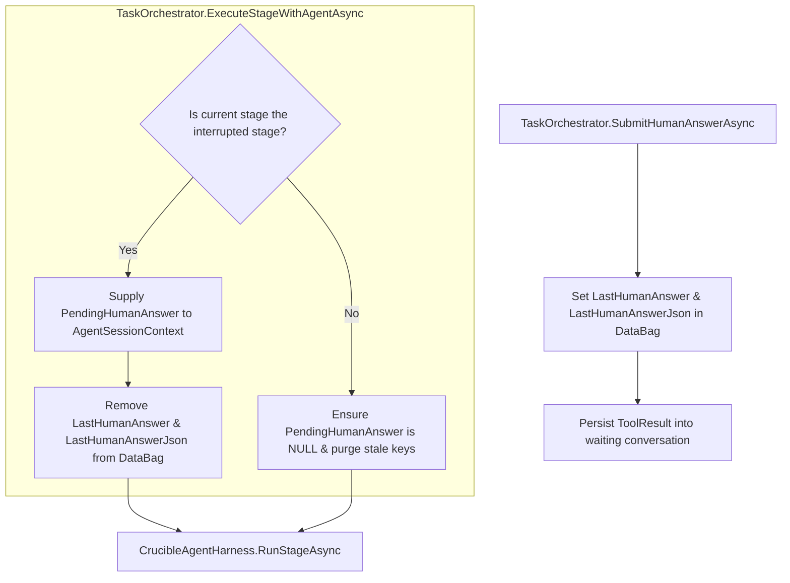
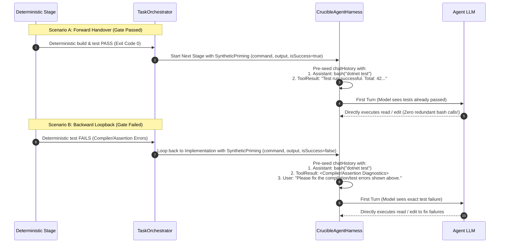

# ⚡ Step 11.32: Synthetic Conversation Priming & Human Clarification Answer Hygiene

> **Phase 11 Implementation Step (Post-MVP - Real-Project Hardening, Token Efficiency & Agent Ergonomics)**  
> *Parent Plan:* [Phase 11 Master Plan](../11_EXTEND_FEATURES.md)  
> *Project Target:* [`src/NightCodeForge.Core`](file:///c:/Users/Julien/source/repos/jetelain/NightCodeForge/src/NightCodeForge.Core), [`src/NightCodeForge.Agents`](file:///c:/Users/Julien/source/repos/jetelain/NightCodeForge/src/NightCodeForge.Agents), [`src/NightCodeForge.Web`](file:///c:/Users/Julien/source/repos/jetelain/NightCodeForge/src/NightCodeForge.Web), [`tests/NightCodeForge.Agents.Tests`](file:///c:/Users/Julien/source/repos/jetelain/NightCodeForge/tests/NightCodeForge.Agents.Tests), [`tests/NightCodeForge.Core.Tests`](file:///c:/Users/Julien/source/repos/jetelain/NightCodeForge/tests/NightCodeForge.Core.Tests)  
> *Status:* Proposed / Specified | *Target Framework:* .NET 10 (C# 13)  
> *Aligns With:* [docs/PLAN.md line 324](file:///c:/Users/Julien/source/repos/jetelain/NightCodeForge/docs/PLAN.md#L324), [docs/CRUCIBLE.md §6.5](file:///c:/Users/Julien/source/repos/jetelain/NightCodeForge/docs/CRUCIBLE.md#L567-L594), [docs/ARCHITECTURE.md §3.10 & §7.1.6.3](file:///c:/Users/Julien/source/repos/jetelain/NightCodeForge/docs/ARCHITECTURE.md#L567)

---

## 1. Executive Summary & Problem Statements

During end-to-end workflow execution where human clarifications are requested during Stage 1 (`task-review`, [`StandardStageIds.TaskReview`](file:///c:/Users/Julien/source/repos/jetelain/NightCodeForge/src/NightCodeForge.Core/Domain/StandardStageIds.cs#L8)), two critical behavioral defects emerge across downstream stages:

1. **Human Answer Cross-Stage Pollution:** Every subsequent agent stage (`implementation` / [`StandardStageIds.Implementation`](file:///c:/Users/Julien/source/repos/jetelain/NightCodeForge/src/NightCodeForge.Core/Domain/StandardStageIds.cs#L10), `code-review-fix` / [`StandardStageIds.CodeReviewAndFix`](file:///c:/Users/Julien/source/repos/jetelain/NightCodeForge/src/NightCodeForge.Core/Domain/StandardStageIds.cs#L12)) begins with an unexpected pre-seeded `ask` tool card and a user directive stating `"Please proceed with your plan based on the clarified answers."`
2. **Missing Deterministic Conversation Priming (Agent Re-Do):** Despite explicit architectural plans for **Synthetic Conversation Priming** in [docs/CRUCIBLE.md §6.5](file:///c:/Users/Julien/source/repos/jetelain/NightCodeForge/docs/CRUCIBLE.md#L567-L594) and [docs/ARCHITECTURE.md §3.10](file:///c:/Users/Julien/source/repos/jetelain/NightCodeForge/docs/ARCHITECTURE.md#L567), downstream agents start with only text prompt instructions. Consequently, local LLMs repeatedly execute redundant `bash("dotnet test")` or `bash("dotnet build")` calls on their first turn, duplicating CPU-bound deterministic checks and wasting 30–60 seconds of GPU inference compute per stage.

This specification defines the remediation for human clarification answer hygiene and specifies the end-to-end contract for **Synthetic Conversation Priming**.

---

### 1.1 Problem 1: Leaking Human Answers & Rogue "ask" Tool Turns

#### 1.1.1 Root Cause Trace
1. **Submission & Storage:** When a maintainer answers an `ask` clarification request in the web UI, [TaskOrchestrator.cs](file:///c:/Users/Julien/source/repos/jetelain/NightCodeForge/src/NightCodeForge.Core/Workflow/TaskOrchestrator.cs#L2267-L2268) writes the answered questions into [`PipelineDataBag`](file:///c:/Users/Julien/source/repos/jetelain/NightCodeForge/src/NightCodeForge.Core/Workflow/PipelineDataBag.cs):
   ```csharp
   bag.Set(PipelineDataBagKeys.LastHumanAnswer, formattedQna);
   bag.Set(PipelineDataBagKeys.LastHumanAnswerJson, structuredJson);
   ```
   It also appends the `ToolResult` turn directly into the paused conversation record (`waitingConv`).
2. **Permanent DataBag Retention:** When resuming the task, [TaskOrchestrator.cs](file:///c:/Users/Julien/source/repos/jetelain/NightCodeForge/src/NightCodeForge.Core/Workflow/TaskOrchestrator.cs#L779) reads:
   ```csharp
   var lastHumanAnswer = pipelineContext.DataBag.Get<string>(PipelineDataBagKeys.LastHumanAnswer);
   ```
   Unlike `RecoveredSerializedMemory` (which is consumed once and immediately removed via `pipelineContext.DataBag.Remove(PipelineDataBagKeys.RecoveredSerializedMemory)`), **`LastHumanAnswer` and `LastHumanAnswerJson` are never removed**. They remain in the DataBag for all subsequent stages of the task.
3. **Unintended Trigger in Downstream Agents:**
   - When Stage 3 (`implementation` / [`StandardStageIds.Implementation`](file:///c:/Users/Julien/source/repos/jetelain/NightCodeForge/src/NightCodeForge.Core/Domain/StandardStageIds.cs#L10)) runs, [TaskOrchestrator.cs](file:///c:/Users/Julien/source/repos/jetelain/NightCodeForge/src/NightCodeForge.Core/Workflow/TaskOrchestrator.cs#L827) passes `PendingHumanAnswer = lastHumanAnswer` to the brand-new [`AgentSessionContext`](file:///c:/Users/Julien/source/repos/jetelain/NightCodeForge/src/NightCodeForge.Core/Domain/AgentSessionContext.cs).
   - [CrucibleAgentHarness.cs](file:///c:/Users/Julien/source/repos/jetelain/NightCodeForge/src/NightCodeForge.Agents/Crucible/CrucibleAgentHarness.cs#L374) checks `if (!string.IsNullOrWhiteSpace(context.PendingHumanAnswer))`.
   - Because `implementation` is a new conversation without pending `ask` calls, the harness triggers fallback logic intended for cold resumptions:
     - Appends `[Human Clarification]` to `chatHistory`.
     - Appends an orphan `StageTurnRole.ToolResult` turn with `toolName: CanonicalToolNames.Ask` to the database conversation.
     - Appends a `StageTurnRole.User` turn with `"Please proceed with your plan based on the clarified answers."`
4. **UI Presentation Breakdown:**
   - In [StageConversationParser.cs](file:///c:/Users/Julien/source/repos/jetelain/NightCodeForge/src/NightCodeForge.Web/Services/StageConversationParser.cs#L54-L73), `PairToolResults` hides a `ToolResult` turn only if a preceding `Tool` call with the same tool name exists in the conversation.
   - Because the `implementation` conversation has no preceding `Tool` call for `ask`, the turn is not hidden.
   - [StageConversationViewer.razor](file:///c:/Users/Julien/source/repos/jetelain/NightCodeForge/src/NightCodeForge.Web/Components/Monitoring/StageConversationViewer.razor#L168-L214) falls through to `<ToolCallCard ToolName="@turn.ToolName" ... />`, displaying an **`ask`** tool card followed by `"Please proceed with your plan based on the clarified answers."`
5. **Stage Propagation:** The same defect re-occurs when Stage 5 (`code-review-fix` / [`StandardStageIds.CodeReviewAndFix`](file:///c:/Users/Julien/source/repos/jetelain/NightCodeForge/src/NightCodeForge.Core/Domain/StandardStageIds.cs#L12)) executes.

---

### 1.2 Problem 2: Missing Synthetic Conversation Priming

#### 1.2.1 The Architectural Intent
[docs/CRUCIBLE.md §6.5](file:///c:/Users/Julien/source/repos/jetelain/NightCodeForge/docs/CRUCIBLE.md#L567-L594) describes **Synthetic Conversation Priming**:
- Local LLMs (7B–32B) have strong pre-training priors to inspect workspace status before editing code.
- By seeding `chatHistory` with a synthetic assistant tool call (`bash("dotnet test")`) and matching tool result (`Test run successful...` or build failure diagnostics), the LLM autoregressively perceives that it *already* executed the verification command.
- This eliminates the redundant exploratory `bash` round-trip, immediately moving the agent into code modification or diff review.

#### 1.2.2 The Implementation Gap
- Currently, [CompositeDeterministicStage.cs](file:///c:/Users/Julien/source/repos/jetelain/NightCodeForge/src/NightCodeForge.Core/Workflow/Stages/CompositeDeterministicStage.cs#L107-L160) records `Tool` and `ToolResult` turns into its own isolated `deterministicConv` conversation and closes it upon stage completion.
- [TaskOrchestrator.cs](file:///c:/Users/Julien/source/repos/jetelain/NightCodeForge/src/NightCodeForge.Core/Workflow/TaskOrchestrator.cs) and [DefaultBootstrapPromptBuilder.cs](file:///c:/Users/Julien/source/repos/jetelain/NightCodeForge/src/NightCodeForge.Core/Workflow/DefaultBootstrapPromptBuilder.cs#L49-L52) format deterministic outcomes (`CompilerErrors`, `FailedTests`) strictly as plain text blocks inside the Scriban prompt template.
- [CrucibleAgentHarness.cs](file:///c:/Users/Julien/source/repos/jetelain/NightCodeForge/src/NightCodeForge.Agents/Crucible/CrucibleAgentHarness.cs#L324-L337) initializes `chatHistory` with only the `BootstrapPrompt` text message. No synthetic `FunctionCallContent` / `FunctionResultContent` pair is injected.
- Agents routinely waste turn 1 executing `bash("dotnet test")` or `bash("dotnet build")` to re-discover what the deterministic stage already confirmed.

---

## 2. Architectural Specification & Desired Behaviors

### 2.1 Scope Isolation & Single-Consumption of Human Clarifications



1. **Interrupted Stage Identity Preservation:** In [TaskOrchestrator.cs](file:///c:/Users/Julien/source/repos/jetelain/NightCodeForge/src/NightCodeForge.Core/Workflow/TaskOrchestrator.cs#L337-L340), `task.InterruptedStageId` was historically set to `null` before the stage execution loop began. The orchestrator must preserve the interrupted stage identity across the resumption boundary by capturing it into a scoped execution variable (e.g. `var activeInterruptedStageId = task.InterruptedStageId;`) prior to resetting `task.InterruptedStageId = null` on the entity. During the execution loop, evaluate `bool isInterruptedStage = string.Equals(stage.StageId, activeInterruptedStageId, StringComparison.OrdinalIgnoreCase);`. Once consumed by the resumed stage, reset `activeInterruptedStageId = null` so no subsequent stage iteration can match.
2. **Stage-Bound Scoping:** `PendingHumanAnswer` and `PendingHumanAnswerJson` must strictly only be supplied to [`AgentSessionContext`](file:///c:/Users/Julien/source/repos/jetelain/NightCodeForge/src/NightCodeForge.Core/Domain/AgentSessionContext.cs) if the stage being executed is the exact stage that was interrupted (`isInterruptedStage == true`). For any other stage, these properties must remain `null`.
3. **Single-Consumption Lifecycle:** When `PendingHumanAnswer` is consumed by the resumed stage in `TaskOrchestrator.cs`, the orchestrator must immediately remove `PipelineDataBagKeys.LastHumanAnswer` and `PipelineDataBagKeys.LastHumanAnswerJson` from `pipelineContext.DataBag`, matching the single-consumption pattern of `RecoveredSerializedMemory`.
4. **Stage Completion Purge:** When any stage completes execution in `TaskOrchestrator.cs` (where `SerializedMemory` is removed), the orchestrator must defensively purge any residual `LastHumanAnswer` and `LastHumanAnswerJson` keys from `pipelineContext.DataBag`.
5. **Harness Defensive Guards:** In [CrucibleAgentHarness.cs](file:///c:/Users/Julien/source/repos/jetelain/NightCodeForge/src/NightCodeForge.Agents/Crucible/CrucibleAgentHarness.cs):
   - **No Orphan Tool Result:** The harness must never record an orphan `StageTurnRole.ToolResult` turn with `toolName: CanonicalToolNames.Ask` in a newly created conversation (`conversation != waitingConversation` or when no preceding `ask` tool call turn exists in the conversation).
   - **No Chat History Pollution:** The fallback logic must not append `[Human Clarification]: ...` into `chatHistory` for a fresh session or when no unfulfilled `ask` tool call exists in `chatHistory`. Answered questions for downstream stages are already cleanly formatted into the bootstrap prompt by [DefaultBootstrapPromptBuilder.cs](file:///c:/Users/Julien/source/repos/jetelain/NightCodeForge/src/NightCodeForge.Core/Workflow/DefaultBootstrapPromptBuilder.cs#L53-L64) under `[Human Clarifications & Answers]`.

---

### 2.2 Synthetic Conversation Priming for Deterministic Results



#### 2.2.1 Configuration & Opt-Out
Add a dedicated optimization flag in [`LocalOptimizationFlags.cs`](file:///c:/Users/Julien/source/repos/jetelain/NightCodeForge/src/NightCodeForge.Core/Domain/LocalOptimizationFlags.cs):
```csharp
/// <summary>
/// Pre-seed agent ChatHistory with synthetic bash tool call/result pairs from prior deterministic stages
/// to prevent redundant exploratory build/test tool calls.
/// Default: true.
/// </summary>
public bool SyntheticConversationPriming { get; set; } = true;
```

Ensure `LocalOptimizationFlags.Clone()` carries `SyntheticConversationPriming = SyntheticConversationPriming` so cloning never reverts the setting.

#### 2.2.2 Priming Data Transfer via `AgentSessionContext` & `PipelineDataBag`
1. **Pipeline DataBag Canonical Key:** Define `PipelineDataBagKeys.PendingSyntheticPriming` in [`PipelineDataBagKeys.cs`](file:///c:/Users/Julien/source/repos/jetelain/NightCodeForge/src/NightCodeForge.Core/Workflow/PipelineDataBagKeys.cs).
2. **Deterministic Stage Handover:**
   When a deterministic stage completes (or fails with loopback), it (or `TaskOrchestrator`) constructs a `SyntheticPrimingExecution` and stores it under `PipelineDataBagKeys.PendingSyntheticPriming`:
   - **Canonical Stage Identifiers:** Use [`StandardStageIds`](file:///c:/Users/Julien/source/repos/jetelain/NightCodeForge/src/NightCodeForge.Core/Domain/StandardStageIds.cs) constants: [`StandardStageIds.PreImplementationBaseline`](file:///c:/Users/Julien/source/repos/jetelain/NightCodeForge/src/NightCodeForge.Core/Domain/StandardStageIds.cs#L9) (`"deterministic-pre-impl"`), [`StandardStageIds.PostImplementationGates`](file:///c:/Users/Julien/source/repos/jetelain/NightCodeForge/src/NightCodeForge.Core/Domain/StandardStageIds.cs#L11) (`"deterministic-post-impl"`), and [`StandardStageIds.PostReviewVerification`](file:///c:/Users/Julien/source/repos/jetelain/NightCodeForge/src/NightCodeForge.Core/Domain/StandardStageIds.cs#L13) (`"deterministic-post-review"`).
   - **Forward Transition (Gate Passed) Command Priority:** For composite deterministic stages (which execute sequences like `format,build,test-with-coverage,sast`), prioritize the **test sub-stage** (`DeterministicStageConstants.TestWithCoverageSubStage` / `DeterministicStageConstants.TestSubStage`, e.g. `test-with-coverage` or `test`) over trailing static checks like `format` or `sast`. If no test sub-stage is present in the suite, select the final executed sub-stage command. This ensures the model autoregressively perceives that test execution already occurred and succeeded (`Test run successful. Passed: X...`), eliminating the redundant `dotnet test` exploration.
   - **Backward Loopback (Gate Failed):** Select the **specific failing sub-command** (the last command in `commandList` where `IsSuccess == false`, e.g. `dotnet build` if compilation failed, or `dotnet test` if tests failed), pairing it with its structured diagnostic output.
   - **Output Realism & Bounding:** The primed `Output` must be formatted realistically to match [`CanonicalTools.bash`](file:///c:/Users/Julien/source/repos/jetelain/NightCodeForge/src/NightCodeForge.Agents/Tools/CanonicalTools.cs#L592-L613) (including exit code, e.g. `Exit Code: 0\n...` or `Exit Code: 1\n...`, plus structured diagnostics when present) and bounded by [`WorkflowDefaults.TruncateStageOutput`](file:///c:/Users/Julien/source/repos/jetelain/NightCodeForge/src/NightCodeForge.Core/Workflow/WorkflowDefaults.cs#L27) so massive test dumps do not exhaust the agent's initial context window before Turn 1.
3. **Single-Consumption by Agentic Stage:** When `TaskOrchestrator.ExecuteStageWithAgentAsync` instantiates [`AgentSessionContext`](file:///c:/Users/Julien/source/repos/jetelain/NightCodeForge/src/NightCodeForge.Core/Domain/AgentSessionContext.cs):
   - Reads `SyntheticPrimingExecution` from `pipelineContext.DataBag.Get<SyntheticPrimingExecution>(PipelineDataBagKeys.PendingSyntheticPriming)`.
   - If `OptimizationFlags.SyntheticConversationPriming` is enabled, assigns it to `agentContext.SyntheticPriming`.
   - Immediately consumes and removes `PipelineDataBagKeys.PendingSyntheticPriming` from `pipelineContext.DataBag`.

#### 2.2.3 Harness Conversation Priming Implementation
When initializing `chatHistory` in [CrucibleAgentHarness.cs](file:///c:/Users/Julien/source/repos/jetelain/NightCodeForge/src/NightCodeForge.Agents/Crucible/CrucibleAgentHarness.cs) for a fresh session (`context.SerializedStateJson` is null and `context.SyntheticPriming` is present):
1. **Scenario A (Forward Transition - Baseline / Pre-Check Pass):**
   - Inject initial user prompt (task bootstrap directive).
   - Generate a deterministic or GUID-based `callId` (e.g. `$"prime_{Guid.NewGuid():N}"`).
   - Inject synthetic Assistant turn with canonical tool name [`CanonicalToolNames.Bash`](file:///c:/Users/Julien/source/repos/jetelain/NightCodeForge/src/NightCodeForge.Core/Domain/CanonicalToolNames.cs#L12):
     ```csharp
     new ChatMessage(ChatRole.Assistant, [
         new FunctionCallContent(callId, CanonicalToolNames.Bash, new Dictionary<string, object?> { ["command"] = priming.Command })
     ])
     ```
   - Inject synthetic Tool result:
     ```csharp
     new ChatMessage(ChatRole.Tool, [
         new FunctionResultContent(callId, priming.Output)
     ])
     ```
   - In database `Conversation`, record matching `Tool` and `ToolResult` turns with `MetadataJson` marking them as primed from the prior deterministic stage.
   - Register `callId` into `writtenToolCallIds.TryAdd(callId, true)` so subsequent streaming tracer operations do not attempt to re-record synthetic turns.
2. **Scenario B (Backward Loopback - Quality Gate Failure):**
   - Inject initial user prompt.
   - Generate a `callId`.
   - Inject synthetic Assistant turn: `bash` call with the failed build/test command.
   - Inject synthetic Tool result: structured error output (compiler diagnostics or failing test assertions).
   - Inject directive User turn: `"Please fix the compilation/test errors shown above."`
   - In database `Conversation`, record matching `Tool` and `ToolResult` turns, plus the directive User turn.
   - Register `callId` into `writtenToolCallIds.TryAdd(callId, true)`.
3. **Prompt Deduplication Handshake:** When Synthetic Conversation Priming is active and `context.DataBag.Get<SyntheticPrimingExecution>(PipelineDataBagKeys.PendingSyntheticPriming)` contains a failure (`!priming.IsSuccess`), [DefaultBootstrapPromptBuilder.cs](file:///c:/Users/Julien/source/repos/jetelain/NightCodeForge/src/NightCodeForge.Core/Workflow/DefaultBootstrapPromptBuilder.cs) omits raw text duplicate blocks of `compiler_errors` and `failed_tests` in the bootstrap prompt because the failure diagnostics are presented in the primed tool turn. When priming is disabled or absent, the bootstrap prompt retains the full text blocks as fallback.

---

### 2.3 UI & Presentation Separation

In adherence to project rules:
- [StageConversationViewer.razor](file:///c:/Users/Julien/source/repos/jetelain/NightCodeForge/src/NightCodeForge.Web/Components/Monitoring/StageConversationViewer.razor) remains purely focused on rendering and layout, with zero non-trivial parsing or extraction logic in `@code`.
- Primed turns serialize metadata in `ConversationTurn.MetadataJson` (e.g. `{"CallId": callId, "IsPrimed": true, "SourceStageId": priming.SourceStageId, "PrimingType": priming.IsSuccess ? "ForwardPass" : "LoopbackDiagnostic"}`).
- [StageConversationParser.cs](file:///c:/Users/Julien/source/repos/jetelain/NightCodeForge/src/NightCodeForge.Web/Services/StageConversationParser.cs) provides dedicated helper methods:
  - `IsPrimedTurn(ConversationTurn turn)`: Evaluates whether the turn represents a synthetic primed execution.
  - `GetPrimingBadge(ConversationTurn turn)`: Returns badge text (e.g. `"⚡ Quality Gate Handover"` for forward pass, `"🔁 Quality Gate Diagnostic"` for loopback failure).
  - `GetPrimingTooltip(ConversationTurn turn)`: Returns informative tooltip metadata explaining that this turn was verified in prior stage without GPU inference.
  - Pairs synthetic tool calls with their results identically to live tool calls.
- [StageConversationViewer.razor](file:///c:/Users/Julien/source/repos/jetelain/NightCodeForge/src/NightCodeForge.Web/Components/Monitoring/StageConversationViewer.razor) displays the informative glyph badge in the card header by calling the parser helper.

---

## 3. Data Contracts & Model Specifications

### 3.1 `SyntheticPrimingExecution` Record & DataBag Key
Defined in `NightCodeForge.Core.Domain`:
```csharp
public sealed record SyntheticPrimingExecution(
    string SourceStageId,
    string ToolName = CanonicalToolNames.Bash,
    string Command = "",
    string Output = "",
    bool IsSuccess = true,
    long? DurationMs = null);
```

Defined in `NightCodeForge.Core.Workflow.PipelineDataBagKeys`:
```csharp
public const string PendingSyntheticPriming = "PendingSyntheticPriming";
```

### 3.2 Additions to `AgentSessionContext`
```csharp
public SyntheticPrimingExecution? SyntheticPriming { get; init; }
```

### 3.3 Additions to `LocalOptimizationFlags`
```csharp
public bool SyntheticConversationPriming { get; set; } = true;
```

And in `LocalOptimizationFlags.Clone()`:
```csharp
public LocalOptimizationFlags Clone() => new()
{
    GuidedGrammarDecoding = GuidedGrammarDecoding,
    DeterministicSymbolMap = DeterministicSymbolMap,
    StructuredDiagnosticExtraction = StructuredDiagnosticExtraction,
    JitModelPreload = JitModelPreload,
    SyntheticConversationPriming = SyntheticConversationPriming
};
```

### 3.4 Conversation Turn Priming Metadata Contract
Serialized into `ConversationTurn.MetadataJson`:
```csharp
public sealed record PrimingTurnMetadata(
    string CallId,
    bool IsPrimed,
    string SourceStageId,
    string PrimingType);
```

---

## 4. Verification & Testing Requirements

### 4.1 Unit Tests (`NightCodeForge.Core.Tests`)
1. **`TaskOrchestratorHumanAnswerHygieneTests`:**
   - Verify `SubmitHumanAnswerAsync` sets answer keys in `PipelineDataBag`.
   - Verify resumed stage execution passes `PendingHumanAnswer` only to the interrupted stage (preserving interrupted stage identity across resume via `activeInterruptedStageId`).
   - Verify `LastHumanAnswer` and `LastHumanAnswerJson` are consumed and removed from `PipelineDataBag` after resume.
   - Verify downstream stages ([`StandardStageIds.Implementation`](file:///c:/Users/Julien/source/repos/jetelain/NightCodeForge/src/NightCodeForge.Core/Domain/StandardStageIds.cs#L10), [`StandardStageIds.CodeReviewAndFix`](file:///c:/Users/Julien/source/repos/jetelain/NightCodeForge/src/NightCodeForge.Core/Domain/StandardStageIds.cs#L12)) do NOT receive `PendingHumanAnswer`.
2. **`TaskOrchestratorSyntheticPrimingTests`:**
   - Verify passing [`StandardStageIds.PreImplementationBaseline`](file:///c:/Users/Julien/source/repos/jetelain/NightCodeForge/src/NightCodeForge.Core/Domain/StandardStageIds.cs#L9) populates `PendingSyntheticPriming` in `PipelineDataBag` prioritizing the test sub-stage (`dotnet test`) over static checks.
   - Verify `ExecuteStageWithAgentAsync` consumes `PendingSyntheticPriming`, populates `agentContext.SyntheticPriming`, and removes the key from `DataBag`.
   - Verify failing [`StandardStageIds.PostImplementationGates`](file:///c:/Users/Julien/source/repos/jetelain/NightCodeForge/src/NightCodeForge.Core/Domain/StandardStageIds.cs#L11) populates `PendingSyntheticPriming` with the failing sub-stage command and error diagnostics when looping back to `implementation`.
   - Verify `SyntheticConversationPriming = false` suppresses `SyntheticPriming` population.
   - Verify `LocalOptimizationFlags.Clone()` preserves `SyntheticConversationPriming`.
   - Verify `DefaultBootstrapPromptBuilder` omits duplicate diagnostic text blocks when primed with a failure, and preserves them when unprimed.
   - Verify `DurationMs` carries through as `long?` without overflow or truncation.

### 4.2 Unit Tests (`NightCodeForge.Agents.Tests`)
1. **`CrucibleSyntheticPrimingTests`:**
   - Verify `CrucibleAgentHarness.RunStageAsync` pre-seeds `chatHistory` with Assistant `FunctionCallContent("bash", ...)` and Tool `FunctionResultContent("bash", ...)`.
   - Verify database `Conversation` contains paired `Tool` and `ToolResult` turns with `IsPrimed` metadata.
   - Verify primed `callId` is registered in `writtenToolCallIds` to prevent duplicate writes by streaming tracer.
   - Verify agent makes no redundant exploratory `bash` calls when pre-seeded.
2. **`CrucibleOrphanToolResultPreventionTests`:**
   - Verify `CrucibleAgentHarness` does not record an orphan `ask` `ToolResult` turn when `conversation` is a fresh stage run.
   - Verify `CrucibleAgentHarness` does not inject `[Human Clarification]` into `chatHistory` when no pending `ask` call exists.

### 4.3 UI & Presentation Tests (`NightCodeForge.Web.Tests`)
- Verify `StageConversationParser.IsPrimedTurn` and `GetPrimingBadge` correctly parse and format primed tool turns.
- Verify `StageConversationParser` correctly pairs primed tool calls and results.
- Verify `StageConversationViewer` does not render rogue `ask` cards on downstream stages.

---

## 5. Definition of Done

- [ ] `task.InterruptedStageId` identity is captured into a scoped execution variable during resumption so only the interrupted stage consumes human clarification answers.
- [ ] `LastHumanAnswer` and `LastHumanAnswerJson` are strictly scoped and consumed once upon stage resumption.
- [ ] No subsequent stage receives stale human clarification answers.
- [ ] `CrucibleAgentHarness` fallback logic prevents orphan `ask` `ToolResult` turns and duplicate `[Human Clarification]` chat history injection on un-interrupted conversations.
- [ ] `LocalOptimizationFlags.SyntheticConversationPriming` flag is available, defaults to `true`, and is included in `Clone()`.
- [ ] `PipelineDataBagKeys.PendingSyntheticPriming` contract is established and follows single-consumption lifecycle.
- [ ] Multi-sub-stage command selection correctly prioritizes test sub-stages on forward pass, and the failing command on loopback.
- [ ] Primed output is realistically formatted (`Exit Code: X` and structured diagnostics) and truncated via `WorkflowDefaults.TruncateStageOutput`.
- [ ] `DefaultBootstrapPromptBuilder` deduplicates failure diagnostics when primed, avoiding repeated prompt tokens.
- [ ] Synthetic `callId` is registered into `writtenToolCallIds` to avoid tracer re-recording.
- [ ] `StageConversationParser` encapsulates priming turn detection and badge formatting, keeping Razor components purely presentation-focused.
- [ ] All tests pass cleanly under `dotnet test --filter "Category!=Acceptance&Category!=E2E"`.
