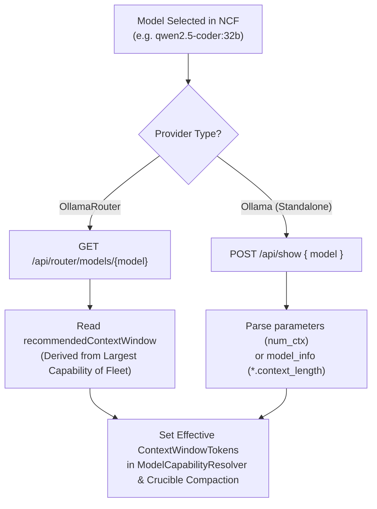

# ⚡ Step 11.33: Unified LLM Provider Architecture (Standalone Ollama vs OllamaRouter), Auto Context Window Discovery, & Dynamic Fleet Telemetry

> **Phase 11 Implementation Step (Post-MVP - Real-Project Hardening, Token Efficiency & Agent Ergonomics)**  
> *Parent Plan:* [Phase 11 Master Plan](../11_EXTEND_FEATURES.md)  
> *Project Target:* [`src/NightCodeForge.Core`](file:///c:/Users/Julien/source/repos/jetelain/NightCodeForge/src/NightCodeForge.Core), [`src/NightCodeForge.Agents`](file:///c:/Users/Julien/source/repos/jetelain/NightCodeForge/src/NightCodeForge.Agents), [`src/NightCodeForge.Infrastructure`](file:///c:/Users/Julien/source/repos/jetelain/NightCodeForge/src/NightCodeForge.Infrastructure), [`src/NightCodeForge.Web`](file:///c:/Users/Julien/source/repos/jetelain/NightCodeForge/src/NightCodeForge.Web), [`tests/NightCodeForge.Agents.Tests`](file:///c:/Users/Julien/source/repos/jetelain/NightCodeForge/tests/NightCodeForge.Agents.Tests), [`tests/NightCodeForge.Infrastructure.Tests`](file:///c:/Users/Julien/source/repos/jetelain/NightCodeForge/tests/NightCodeForge.Infrastructure.Tests)  
> *Status:* Proposed | *Target Framework:* .NET 10 (C# 13)  
> *Dependencies / OllamaRouter Backend Tasks:* [OllamaRouter Task #17: Router Identity, Health & Fleet Hardware Topology API](file:///C:/Users/Julien/source/repos/jetelain/OllamaRouter/docs/tasks/2026-10-26-router-identity-health-fleet-hardware-topology-api.md), [OllamaRouter Task #16: Model Capabilities, Dynamic Context Sizing & Routing Preview API](file:///C:/Users/Julien/source/repos/jetelain/OllamaRouter/docs/tasks/2026-10-26-model-capabilities-dynamic-context-sizing-routing-preview-api.md), [OllamaRouter Task #18: Fleet VRAM Management & Reclaim API](file:///C:/Users/Julien/source/repos/jetelain/OllamaRouter/docs/tasks/2026-10-26-fleet-vram-management-reclaim-api.md)  
> *Aligns With:* [AGENTS.md](../../../AGENTS.md), [docs/PLAN.md](../../PLAN.md)

---

## 1. Executive Summary & Motivation

### 1.1 The Standalone Ollama Principle (Zero Router Burden for Single GPUs)
Currently, NightCodeForge assumes an OllamaRouter proxy topology with three hardcoded targets (`Local`, `Remote`, `Cloud`). Target pinning selectors (`X-OllamaRouter-Target`) are displayed across agent profiles, and the gateway service queries `/monitor/api` (an endpoint designed for the terminal/HTML monitor).

However:
1. **Single-GPU Developers:** Users operating on a single workstation or laptop have no need for a reverse proxy or multi-node routing daemon. Imposing OllamaRouter on single-GPU users creates unnecessary setup complexity, port forwarding conflicts, and maintenance friction. They must be able to use **standalone Ollama directly**.
2. **Simplified Global Configuration:** Instead of sprawling per-profile configurations, global configuration must be streamlined to:
   - **Provider Selection:** `Ollama` (Direct Standalone) or `OllamaRouter` (Extensible Multi-Node Fleet).
   - **Default Model:** Model Name + Thinking Effort (e.g. `qwen2.5-coder:32b`, `Medium`).
   - **Optional Role Specialization:** An optional toggle to differentiate:
     - **Coder / Implementation Role:** Fast coding model + thinking effort for Stage 3 (`implementation`).
     - **Architect / Reviewer Role:** Deep reasoning model + thinking effort for Stage 0 (`triage`), Stage 1 (`task-review`), Stage 5 (`code-review-fix`), and interactive `ideation`.
3. **Automatic Context Window Discovery Based on Fleet Capabilities:** Context window sizes should never be manually guessed or hardcoded to static 128k fallbacks. Context capacities must be automatically read from Ollama (via Modelfile `num_ctx` and GGUF metadata) or OllamaRouter (via `recommendedContextWindow`). In a multi-node fleet, compaction `ContextWindowTokens` must be sized to the **largest capability of the fleet** (the maximum context ceiling across capable targets or cloud overflow), ensuring conversations are not compacted prematurely while high-capacity nodes (e.g. dedicated GPU servers or cloud overflow) can service extended context.
4. **Clean API Integration:** Replace scraping of legacy `/monitor/api` with dedicated, high-performance REST APIs ([OllamaRouter Task #17](file:///C:/Users/Julien/source/repos/jetelain/OllamaRouter/docs/tasks/2026-10-26-router-identity-health-fleet-hardware-topology-api.md): `GET /api/router/info`, `GET /api/router/fleet`; [OllamaRouter Task #16](file:///C:/Users/Julien/source/repos/jetelain/OllamaRouter/docs/tasks/2026-10-26-model-capabilities-dynamic-context-sizing-routing-preview-api.md): `GET /api/router/models`; [OllamaRouter Task #18](file:///C:/Users/Julien/source/repos/jetelain/OllamaRouter/docs/tasks/2026-10-26-fleet-vram-management-reclaim-api.md): `POST /api/router/vram/reclaim`), dynamically rendering arbitrary fleet topologies (Desktop, Laptop, Server 1, Server 2, Cloud Overflow).

---

## 2. Architectural Specifications

### 2.1 Provider Selection & Simplified Configuration Schema

In `LlmProviderOptions` and Global Settings:
```csharp
public enum LlmProviderType
{
    /// <summary>Direct connection to standard Ollama instance (single host GPU).</summary>
    Ollama,

    /// <summary>Connection to OllamaRouter reverse proxy (multi-node LAN fleet + cloud overflow).</summary>
    OllamaRouter
}

public class LlmProviderOptions
{
    public const string SectionName = "LlmProvider";

    public LlmProviderType ProviderType { get; set; } = LlmProviderType.OllamaRouter;
    public string Endpoint { get; set; } = "http://localhost:11434";
    public double RequestTimeoutMinutes { get; set; } = 15;

    // Unified baseline configuration
    public string DefaultModelName { get; set; } = "qwen2.5-coder:32b";
    public ThinkingEffort DefaultThinkingEffort { get; set; } = ThinkingEffort.Medium;

    // Optional role differentiation
    public bool DifferentiateRoles { get; set; } = false;

    // Coder role (Implementation stage)
    public string? CoderModelName { get; set; }
    public ThinkingEffort? CoderThinkingEffort { get; set; }

    // Architect role (Triage, Ideation, Task Review, Code Review & Fix)
    public string? ArchitectModelName { get; set; }
    public ThinkingEffort? ArchitectThinkingEffort { get; set; }
}
```

#### Provider Auto-Detection
On startup or when clicking **"Detect Provider"** in the Web UI:
1. Issue `GET /api/router/info`:
   - If HTTP 200 returned with `{ "isRouter": true }` $\rightarrow$ Provider is **OllamaRouter**.
2. If HTTP 404 or connection failed, issue `GET /api/version`:
   - If HTTP 200 returned with `{ "version": "..." }` $\rightarrow$ Provider is **Ollama**.
3. If both fail $\rightarrow$ Endpoint is offline.

---

### 2.2 Standalone Ollama Mode Operation

When `ProviderType == LlmProviderType.Ollama`:
1. **Target Pinning Suppressed:** The `X-OllamaRouter-Target` header is never attached to outbound HTTP requests (`OllamaChatClient.cs`). The target pinning dropdowns in `AgentProfilesTab.razor` are completely hidden.
2. **Clean Single-Host Inspector:** The `/settings` and `/monitoring` tabs display a streamlined single-host GPU card:
   - Host Ollama version and latency from `GET /api/version`.
   - Resident GPU models in local memory from `GET /api/ps`.
3. **Direct VRAM Reclamation:** Invoking VRAM reclamation sends `keep_alive: 0` via `POST /api/generate` for all resident models discovered from `/api/ps`, instantly freeing local GPU memory without requiring router intervention.

---

### 2.3 Automatic Context Window Discovery

Context window tokens are dynamically resolved to ensure the [CrucibleCompactionStrategy](file:///c:/Users/Julien/source/repos/jetelain/NightCodeForge/src/NightCodeForge.Agents/Inference/ModelCapabilityResolver.cs) and [SessionTranscriptService](file:///c:/Users/Julien/source/repos/jetelain/NightCodeForge/src/NightCodeForge.Agents/Transcripts/SessionTranscriptService.cs) compact conversations at the exact mathematical boundary:



#### Discovery Mechanics:
1. **OllamaRouter:** Calls `GET /api/router/models/{name}`. The router dynamically returns `recommendedContextWindow`, which represents the **largest capability across all capable nodes in the fleet** (`max(target.contextCeiling)` for capable targets, or cloud overflow ceiling).
   - **Crucible Compaction Fleet Rule:** Context compaction (`CrucibleCompactionOptions.ContextWindowTokens`) MUST be sized to the fleet's maximum context capability, not constrained to the smallest node. Because OllamaRouter dynamically routes requests exceeding smaller nodes' VRAM to higher-tier nodes (e.g. Server) or cloud overflow, sizing compaction to the largest capability ensures conversations are never compacted prematurely when the cluster has the hardware capacity to handle extended context.
2. **Standalone Ollama:** Calls `POST /api/show`:
   - Reads `parameters`: searches for `num_ctx <int>` in Modelfile.
   - If absent, reads `model_info`: searches for keys ending with `.context_length` (e.g. `qwen2.context_length: 32768`).
   - If absent, safely falls back to standard Ollama default (4,096 tokens).
3. **Caching:** Discovered capabilities are cached in memory (`IOllamaModelCatalogService`) keyed by model name and digest to prevent repeated network requests.

---

### 2.4 Dynamic Fleet Topology & Clean Gateway Service

#### Refactored `IOllamaRouterGatewayService`
```csharp
public record FleetTargetHardware(
    string? HardwareHint,
    string GpuVendor,
    IReadOnlyList<string> Devices,
    int? MaxVramMB,
    int MaxParallel);

public record FleetTargetExecution(
    int InFlightRequests,
    string? ActiveModel,
    string ContextAllocation);

public record FleetTargetStatus(
    string Name,
    string? Url,
    bool Enabled,
    string Liveness,
    long? LatencyMs,
    FleetTargetHardware Hardware,
    FleetTargetExecution Execution);

public record GatewayStatusReport(
    bool IsConnected,
    LlmProviderType ProviderType,
    string BaseUrl,
    string Version,
    IReadOnlyList<FleetTargetStatus> FleetTargets);

public interface IOllamaRouterGatewayService
{
    Task<GatewayStatusReport> GetGatewayStatusAsync(CancellationToken cancellationToken = default);
    Task<IReadOnlyList<ResidentModelInfo>> GetResidentModelsAsync(CancellationToken cancellationToken = default);
    Task<int> ResolveContextWindowAsync(string modelName, CancellationToken cancellationToken = default);
    Task<bool> ReclaimVramAsync(string? targetName = null, CancellationToken cancellationToken = default);
}
```

#### UI Presentation in Web Dashboard
1. **OllamaRouter Gateway Card (`OllamaRouterGatewayCard.razor`):**
   - Renders dynamic cards for every node in `FleetTargets` (e.g., `Desktop (16 GB - RTX 4080)`, `Server (96 GB - 4x RTX 3090)`, `Laptop (8 GB)`, `Cloud Overflow`).
   - Displays real-time latency, active model, and in-flight load per node.
2. **Cluster Monitor (`OllamaRouterClusterMonitor.razor`):**
   - Shows active fleet execution state without requiring heavy monitoring telemetry overhead.

---

## 3. Implementation Checklist & Deliverables

### Phase 1: Core Domain & Abstractions
- [ ] Add `LlmProviderType` enum (`Ollama`, `OllamaRouter`) in `NightCodeForge.Core.Domain`.
- [ ] Update `LlmProviderOptions` in `NightCodeForge.Agents.Inference` with unified baseline and role differentiation settings.
- [ ] Enhance `IOllamaRouterGatewayService` with clean `GatewayStatusReport`, `FleetTargetStatus`, and `ResolveContextWindowAsync`.

### Phase 2: Gateway Service & Discovery Engine
- [ ] Refactor `OllamaRouterGatewayService` in `NightCodeForge.Infrastructure.Inference`:
  - Consume `GET /api/router/info` and `GET /api/router/fleet` when connected to OllamaRouter.
  - Implement fallback to `GET /api/version` and `POST /api/show` when connected to standalone Ollama.
  - Implement `ResolveContextWindowAsync` using clean router model capabilities or Ollama `show`.
  - Implement `ReclaimVramAsync` calling `POST /api/router/vram/reclaim` (Router) or `POST /api/generate` `keep_alive: 0` (Ollama).
- [ ] Update `OllamaChatClient.cs`:
  - Bypass `X-OllamaRouter-Target` injection completely when `ProviderType == LlmProviderType.Ollama`.

### Phase 3: Web UI & Settings Ergonomics
- [ ] Update `Settings.razor` / `AgentProfilesTab.razor`:
  - Provider selector pill toggle (`Ollama (Single Host)` vs `OllamaRouter (Fleet)`).
  - Default Model & Thinking Effort fields.
  - Optional "Differentiate Implementation & Review Roles" checkbox:
    - Exposes Coder Model + Thinking Effort.
    - Exposes Architect Model + Thinking Effort.
  - Hide OllamaRouter Target Pinning selectors when `Ollama` is selected.
  - Auto-populate discovered context window next to model dropdown with a badge (e.g. `⚡ 49,152 tokens discovered`).
- [ ] Update `OllamaRouterGatewayCard.razor` and `OllamaRouterClusterMonitor.razor` to dynamically render arbitrary fleet targets.

### Phase 4: Automated Testing
- [ ] Unit tests for `OllamaRouterGatewayService`:
  - Connect to mocked OllamaRouter (`/api/router/*` responses).
  - Connect to mocked standalone Ollama (`/api/version` and `/api/show` responses).
- [ ] Unit tests for `OllamaChatClient`:
  - Header suppression under `Ollama` mode.
  - Header propagation under `OllamaRouter` mode.
- [ ] End-to-end component tests for Settings and Profile tabs.

---

## 4. Acceptance Criteria

1. **Standalone Ollama Verification:** When pointed to a vanilla Ollama instance without OllamaRouter, NightCodeForge connects cleanly, reports `Provider: Ollama (Single Host)`, lists resident models from `/api/ps`, hides target pinning, and automatically discovers context window size via `POST /api/show`.
2. **OllamaRouter Multi-Node Verification:** When pointed to OllamaRouter, NightCodeForge connects cleanly, reports `Provider: OllamaRouter`, queries `GET /api/router/fleet`, renders all configured fleet machines (Desktop, Laptop, Server), and routes requests with dynamic context sizing.
3. **Context Window Accuracy & Fleet Compaction Sizing:** Selecting a model (e.g. `qwen2.5-coder:32b`) dynamically retrieves its safe context window from the provider and updates `ModelCapabilityResolver` without requiring manual user input. In a multi-node fleet, `ContextWindowTokens` for compaction is sized according to the **largest capability of the fleet** (the maximum context ceiling across capable targets or cloud overflow), ensuring conversations are not compacted prematurely while high-capacity nodes (e.g. dedicated GPU servers) can handle extended context.
4. **VRAM Reclaim:** Triggering VRAM reclamation cleanly evicts models in both standalone Ollama and OllamaRouter modes.
