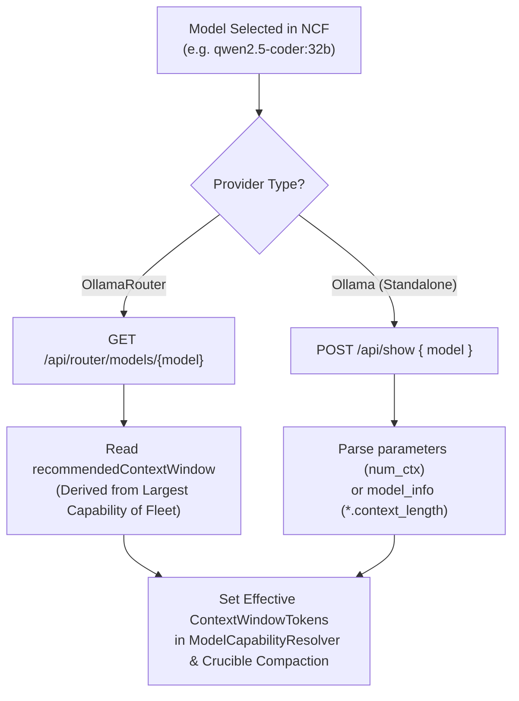

# ⚡ Step 11.33: Unified LLM Provider Architecture (Standalone Ollama vs OllamaRouter), Auto Context Window Discovery, & Dynamic Fleet Telemetry

> **Phase 11 Implementation Step (Post-MVP - Real-Project Hardening, Token Efficiency & Agent Ergonomics)**  
> *Parent Plan:* [Phase 11 Master Plan](../11_EXTEND_FEATURES.md)  
> *Project Target:* [`src/NightCodeForge.Core`](file:///c:/Users/Julien/source/repos/jetelain/NightCodeForge/src/NightCodeForge.Core), [`src/NightCodeForge.Agents`](file:///c:/Users/Julien/source/repos/jetelain/NightCodeForge/src/NightCodeForge.Agents), [`src/NightCodeForge.Infrastructure`](file:///c:/Users/Julien/source/repos/jetelain/NightCodeForge/src/NightCodeForge.Infrastructure), [`src/NightCodeForge.Web`](file:///c:/Users/Julien/source/repos/jetelain/NightCodeForge/src/NightCodeForge.Web), [`tests/NightCodeForge.Agents.Tests`](file:///c:/Users/Julien/source/repos/jetelain/NightCodeForge/tests/NightCodeForge.Agents.Tests), [`tests/NightCodeForge.Infrastructure.Tests`](file:///c:/Users/Julien/source/repos/jetelain/NightCodeForge/tests/NightCodeForge.Infrastructure.Tests)  
> *Status:* Proposed | *Target Framework:* .NET 10 (C# 13)  
> *Dependencies / OllamaRouter Backend Tasks:* [OllamaRouter Task #17: Router Identity, Health & Fleet Hardware Topology API](file:///C:/Users/Julien/source/repos/jetelain/OllamaRouter/docs/tasks/2026-10-26-router-identity-health-fleet-hardware-topology-api.md), [OllamaRouter Task #16: Model Capabilities, Dynamic Context Sizing & Routing Preview API](file:///C:/Users/Julien/source/repos/jetelain/OllamaRouter/docs/tasks/2026-10-26-model-capabilities-dynamic-context-sizing-routing-preview-api.md), [OllamaRouter Task #18: Fleet VRAM Management & Reclaim API](file:///C:/Users/Julien/source/repos/jetelain/OllamaRouter/docs/tasks/2026-10-26-fleet-vram-management-reclaim-api.md), [OllamaRouter Task #21: Session Affinity Header & 32 GB Server-Class Hardware Ceiling](file:///C:/Users/Julien/source/repos/jetelain/OllamaRouter/docs/tasks/2026-10-26-session-affinity-header-and-32gb-server-class-hardware-ceiling.md)  
> *Aligns With:* [AGENTS.md](../../../AGENTS.md), [docs/PLAN.md](../../PLAN.md)

---

## 1. Executive Summary & Motivation

### 1.1 The Standalone Ollama Principle (Zero Router Burden for Single GPUs)
Currently, NightCodeForge assumes an OllamaRouter proxy topology with three hardcoded targets (`Local`, `Remote`, `Cloud`). Target pinning selectors (`X-OllamaRouter-Target`) are displayed across agent profiles, and the gateway service queries `/monitor/api` (an endpoint designed for the terminal/HTML monitor).

However:
1. **Single-GPU Developers:** Users operating on a single workstation or laptop have no need for a reverse proxy or multi-node routing daemon. Imposing OllamaRouter on single-GPU users creates unnecessary setup complexity, port forwarding conflicts, and maintenance friction. They must be able to use **standalone Ollama directly**.
2. **Simplified Global Configuration:** Instead of sprawling per-profile configurations, global configuration must be streamlined to:
   - **Provider Selection:** `Ollama` (Direct Standalone) or `OllamaRouter` (Extensible Multi-Node Fleet).
   - **Default Model:** Model Name + Thinking Effort (e.g. `qwen2.5-coder:32b`, `Medium`).
   - **Optional Role Specialization:** An optional toggle to differentiate:
     - **Coder / Implementation Role:** Fast coding model + thinking effort for Stage 3 (`implementation`).
     - **Architect / Reviewer Role:** Deep reasoning model + thinking effort for Stage 0 (`triage`), Stage 1 (`task-review`), Stage 5 (`code-review-fix`), and interactive `ideation`.
3. **Automatic Context Window Discovery Based on Fleet Capabilities:** Context window sizes should never be manually guessed or hardcoded to static 128k fallbacks. Context capacities must be automatically read from Ollama (via Modelfile `num_ctx` and GGUF metadata) or OllamaRouter (via `recommendedContextWindow`). In a multi-node fleet, compaction `ContextWindowTokens` must be sized to the **largest capability of the fleet** (the maximum context ceiling across capable targets or cloud overflow), ensuring conversations are not compacted prematurely while high-capacity nodes (e.g. dedicated GPU servers or cloud overflow) can service extended context.
4. **Clean API Integration:** Replace scraping of legacy `/monitor/api` with dedicated, high-performance REST APIs ([OllamaRouter Task #17](file:///C:/Users/Julien/source/repos/jetelain/OllamaRouter/docs/tasks/2026-10-26-router-identity-health-fleet-hardware-topology-api.md): `GET /api/router/info`, `GET /api/router/fleet`; [OllamaRouter Task #16](file:///C:/Users/Julien/source/repos/jetelain/OllamaRouter/docs/tasks/2026-10-26-model-capabilities-dynamic-context-sizing-routing-preview-api.md): `GET /api/router/models`; [OllamaRouter Task #18](file:///C:/Users/Julien/source/repos/jetelain/OllamaRouter/docs/tasks/2026-10-26-fleet-vram-management-reclaim-api.md): `POST /api/router/vram/reclaim`), dynamically rendering arbitrary fleet topologies (Desktop 16 GB, Laptop 8 GB, AI Server 1 96 GB, AI Server 2 64 GB, Cloud Overflow).
5. **Multi-Agent KV-Cache & Session Affinity in Fleet Mode ([OllamaRouter Task #21](file:///C:/Users/Julien/source/repos/jetelain/OllamaRouter/docs/tasks/2026-10-26-session-affinity-header-and-32gb-server-class-hardware-ceiling.md)):** When multiple agents (e.g. Architect and Developer, or concurrent background workers) execute against OllamaRouter, prompts must not bounce haphazardly across capable nodes (e.g., oscillating between Desktop, AI Server 1, and AI Server 2). Because `llama.cpp` prompt prefix evaluation is cached in host memory, bouncing between nodes destroys prompt KV-cache reuse and imposes severe 10–30s re-evaluation penalties on every turn. NightCodeForge must propagate a session identifier (`X-OllamaRouter-Session-Id` derived from the active `ConversationId` or `AgentId`/`TaskId`) with every inference call to ensure each agent sticks to its assigned node and reuses prompt prefix KV cache seamlessly.

---

## 2. Architectural Specifications

### 2.1 Provider Selection & Simplified Configuration Schema

In `LlmProviderOptions` and Global Settings:
```csharp
public enum LlmProviderType
{
    /// <summary>Direct connection to standard Ollama instance (single host GPU).</summary>
    Ollama,

    /// <summary>Connection to OllamaRouter reverse proxy (multi-node LAN fleet + cloud overflow).</summary>
    OllamaRouter
}

public class LlmProviderOptions
{
    public const string SectionName = "LlmProvider";

    public LlmProviderType ProviderType { get; set; } = LlmProviderType.OllamaRouter;
    public string Endpoint { get; set; } = "http://localhost:11434";
    public double RequestTimeoutMinutes { get; set; } = 15;

    public const int DefaultContextWindowTokens = 131072;
    public const int DefaultMaxOutputTokens = 8192;

    /// <summary>Baseline context window in tokens (used as fallback when provider discovery is unavailable).</summary>
    public int ContextWindowTokens { get; set; } = DefaultContextWindowTokens;

    /// <summary>Output token budget reserved from the context window.</summary>
    public int MaxOutputTokens { get; set; } = DefaultMaxOutputTokens;

    // Unified baseline configuration (Standardized identifier replacing legacy ModelId under Clean Break Policy)
    public string DefaultModelId { get; set; } = "qwen2.5-coder:32b";
    public ThinkingEffort DefaultThinkingEffort { get; set; } = ThinkingEffort.Medium;

    // Optional role differentiation (baseline config; stage dispatch escalation governed by Step 12.5)
    public bool DifferentiateRoles { get; set; } = false;

    // Coder role (Implementation stage)
    public string? CoderModelId { get; set; }
    public ThinkingEffort? CoderThinkingEffort { get; set; }

    // Architect role (Triage, Ideation, Task Review, Code Review & Fix)
    public string? ArchitectModelId { get; set; }
    public ThinkingEffort? ArchitectThinkingEffort { get; set; }

    /// <summary>
    /// Per-model capability overrides and effort maps (e.g. Qwen 3.8 mapping "high" to "xhigh").
    /// </summary>
    public Dictionary<string, ModelCapabilityProfile> ModelProfiles { get; set; } = CreateDefaultModelProfiles();

    public static Dictionary<string, ModelCapabilityProfile> CreateDefaultModelProfiles()
    {
        ModelCapabilityProfile Qwen38() => new()
        {
            SupportedEfforts = ["low", "medium", "xhigh"],
            EffortMap = new Dictionary<string, string>(StringComparer.OrdinalIgnoreCase) { ["high"] = "xhigh" },
            DefaultEffort = "xhigh"
        };

        return new Dictionary<string, ModelCapabilityProfile>(StringComparer.OrdinalIgnoreCase)
        {
            ["qwen3.8"] = Qwen38(),
            ["qwen-3.8"] = Qwen38(),
            ["Qwen3.8-27B:latest"] = Qwen38()
        };
    }
}
```

#### Provider Auto-Detection (Encapsulated in `ILlmGatewayService.DetectProviderAsync`)
To adhere to the `AGENTS.md` presentation-logic separation rule, auto-detection logic lives strictly within `ILlmGatewayService` (or `IOllamaRouterGatewayService.DetectProviderAsync`), never directly inside Razor `@code` blocks:
On startup or when clicking **"Detect Provider"** in the Web UI:
1. Issue `GET /api/router/info` (timeout: 2s):
   - If HTTP 200 returned with `{ "isRouter": true }` $\rightarrow$ Provider is **OllamaRouter**.
2. If HTTP 404 or connection failed, issue `GET /api/version` (timeout: 2s):
   - If HTTP 200 returned with `{ "version": "..." }` $\rightarrow$ Provider is **Ollama**.
3. If both fail $\rightarrow$ Endpoint is offline (returns null/offline status, failing fast on actual inference attempts).

---

### 2.2 Standalone Ollama Mode Operation

When `ProviderType == LlmProviderType.Ollama`:
1. **Target Pinning & Session Headers Suppressed:** The `X-OllamaRouter-Target` and `X-OllamaRouter-Session-Id` headers are never attached to outbound HTTP requests (`OllamaChatClient.cs`). The target pinning dropdowns in `AgentProfilesTab.razor` are completely hidden.
2. **Clean Single-Host Inspector:** The `/settings` and `/monitoring` tabs display a streamlined single-host GPU card:
   - Host Ollama version and latency from `GET /api/version`.
   - Resident GPU models in local memory from `GET /api/ps`.
3. **Direct VRAM Reclamation:** Invoking VRAM reclamation sends `keep_alive: 0` via `POST /api/generate` for all resident models discovered from `/api/ps`, instantly freeing local GPU memory without requiring router intervention.

---

### 2.3 Automatic Context Window Discovery & 32 GB Server-Class Tiering

Context window tokens are dynamically resolved to ensure the [CrucibleCompactionStrategy](file:///c:/Users/Julien/source/repos/jetelain/NightCodeForge/src/NightCodeForge.Agents/Inference/ModelCapabilityResolver.cs) and [SessionTranscriptService](file:///c:/Users/Julien/source/repos/jetelain/NightCodeForge/src/NightCodeForge.Agents/Transcripts/SessionTranscriptService.cs) compact conversations at the exact mathematical boundary:



#### Discovery Mechanics:
1. **OllamaRouter:** Calls `GET /api/router/models/{name}`. The router dynamically returns `recommendedContextWindow`, which represents the **largest capability across all capable nodes in the fleet** (`max(target.contextCeiling)` for capable targets, or cloud overflow ceiling).
   - **Crucible Compaction Fleet Rule:** Context compaction (`CrucibleCompactionOptions.ContextWindowTokens`) MUST be sized to the fleet's maximum context capability, not constrained to the smallest node. Because OllamaRouter dynamically routes requests exceeding smaller nodes' VRAM to higher-tier nodes (e.g. Server) or cloud overflow, sizing compaction to the largest capability ensures conversations are never compacted prematurely when the cluster has the hardware capacity to handle extended context.
   - **Server-Class 32 GB Threshold ([OllamaRouter Task #21](file:///C:/Users/Julien/source/repos/jetelain/OllamaRouter/docs/tasks/2026-10-26-session-affinity-header-and-32gb-server-class-hardware-ceiling.md)):** OllamaRouter partitions target classes as:
     - **Small (< 12 GB):** Laptop (8 GB) — MoE & SmallDense offload.
     - **Desktop (12 GB – 32 GB):** Desktop (16 GB) — capped at 48k context (`49,152` tokens).
     - **Server (≥ 32 GB):** AI Server 2 (64 GB) & AI Server 1 (96 GB) — full 260k context (`262,144` tokens) and Server LargeDense role matching.
     In a fleet containing AI Server 1 or 2, `recommendedContextWindow` for `Qwen3.8-27B:latest` will correctly resolve to **262,144 tokens**.
2. **Standalone Ollama:** Calls `POST /api/show`:
   - Reads `parameters`: searches for `num_ctx <int>` in Modelfile.
   - If absent, reads `model_info`: searches for keys ending with `.context_length` (e.g. `qwen2.context_length: 32768`).
   - If absent, safely falls back to standard Ollama default (4,096 tokens).
3. **Caching & Lifecycle Integration:** Discovered capabilities are cached in memory in `ILlmModelCatalogService` keyed by `ModelId`. When an agent stage initializes or an agent profile is instantiated, the harness or stage runner calls `await gateway.ResolveContextWindowAsync(modelId, ct)` (or queries the catalog cache) and supplies the discovered integer as `explicitContextWindowTokens` to `ModelCapabilityResolver.BuildCompactionStrategy(..., explicitContextWindowTokens: discoveredTokens)`. This bridges the asynchronous discovery engine with the synchronous Crucible compaction boundary cleanly.

---

### 2.4 Dynamic Fleet Topology & Clean Gateway Service

#### Refactored `IOllamaRouterGatewayService`
```csharp
public record FleetTargetHardware(
    string? HardwareHint,
    string GpuVendor,
    IReadOnlyList<string> Devices,
    int? MaxVramMB,
    int MaxParallel);

public record FleetTargetExecution(
    int InFlightRequests,
    string? ActiveModel,
    string ContextAllocation);

public record FleetTargetStatus(
    string Name,
    string? Url,
    bool Enabled,
    string Liveness,
    long? LatencyMs,
    FleetTargetHardware Hardware,
    FleetTargetExecution Execution);

public record GatewayStatusReport(
    bool IsConnected,
    LlmProviderType ProviderType,
    string BaseUrl,
    string Version,
    IReadOnlyList<FleetTargetStatus> FleetTargets);

public interface IOllamaRouterGatewayService
{
    Task<LlmProviderType?> DetectProviderAsync(CancellationToken cancellationToken = default);
    Task<GatewayStatusReport> GetGatewayStatusAsync(CancellationToken cancellationToken = default);
    Task<IReadOnlyList<ResidentModelInfo>> GetResidentModelsAsync(CancellationToken cancellationToken = default);
    Task<int> ResolveContextWindowAsync(string modelName, CancellationToken cancellationToken = default);
    Task<bool> ReclaimVramAsync(string? targetName = null, CancellationToken cancellationToken = default);
}
```

#### UI Presentation in Web Dashboard
1. **OllamaRouter Gateway Card (`OllamaRouterGatewayCard.razor`):**
   - Renders dynamic cards for every node in `FleetTargets` (e.g., `Desktop (16 GB)`, `Laptop (8 GB)`, `Server 1 (96 GB)`, `Server 2 (64 GB)`, `Cloud Overflow`).
   - Displays real-time latency, active model, hardware tier (Desktop vs Server), and in-flight load per node.
2. **Cluster Monitor (`OllamaRouterClusterMonitor.razor`):**
   - Shows active fleet execution state without requiring heavy monitoring telemetry overhead.

---

### 2.5 Provider-Agnostic Model Catalog & Unified Chat Client Factory Abstractions

Currently, `AgentProfilesTab.razor` and `WizardStep3Environment.razor` inject `IOllamaModelCatalogService`, directly coupling the UI to Ollama-specific concepts (`OllamaModelInfo`, `Size`, `Digest`, and `/api/tags`). Furthermore, the inference client factory is named `IOllamaChatClientFactory`.

Under the **Clean Break Policy** ([AGENTS.md](../../../AGENTS.md)):
1. We replace `IOllamaModelCatalogService` with a clean, provider-agnostic abstraction in `NightCodeForge.Core.Interfaces`:
   ```csharp
   namespace NightCodeForge.Core.Interfaces;

   public record AvailableModelInfo(
       string ModelId,
       string DisplayName,
       int? ContextWindowTokens = null,
       long? SizeBytes = null,
       LlmProviderType ProviderType = LlmProviderType.Ollama,
       bool SupportsReasoning = false,
       IReadOnlyDictionary<string, object?>? Metadata = null)
   {
       /// <summary>Formatted badge for UI dropdowns (e.g. "19.8 GB" or "128k ctx").</summary>
       public string FormattedBadge => ContextWindowTokens.HasValue
           ? $"{ContextWindowTokens.Value / 1024}k ctx"
           : (SizeBytes.HasValue ? $"{SizeBytes.Value / (1024.0 * 1024 * 1024):F1} GB" : string.Empty);
   }

   public interface ILlmModelCatalogService
   {
       Task<IReadOnlyList<AvailableModelInfo>> GetAvailableModelsAsync(CancellationToken cancellationToken = default);
       Task RefreshAsync(CancellationToken cancellationToken = default);
   }
   ```
2. **Preserve `IOllamaModelPreloadService`:** `IOllamaModelPreloadService` is extracted into its own dedicated file `NightCodeForge.Core.Interfaces.IOllamaModelPreloadService.cs` so JIT model warmup capabilities (used in Phase 12 Step 12.5) remain intact.
3. **Unified Chat Client Factory (`ILlmChatClientFactory`):**
   Rename `IOllamaChatClientFactory` $\rightarrow$ `ILlmChatClientFactory` and `DefaultOllamaChatClientFactory` $\rightarrow$ `DefaultLlmChatClientFactory`. The factory signature accepts an optional `sessionId` to support affinity routing:
   ```csharp
   public interface ILlmChatClientFactory
   {
       IChatClient CreateClient(string? modelId = null, OllamaRoutingTarget routingTarget = OllamaRoutingTarget.Auto, string? sessionId = null);
       IChatClient CreateClient(AgentProfile? profile, string? sessionId = null);
   }
   ```

#### Integration with UI:
- `AgentProfilesTab.razor` injects `ILlmModelCatalogService ModelCatalogService`.
- Model selection dropdowns render `@m.DisplayName (@m.FormattedBadge)` and bind to `@m.ModelId`.
- Eliminates Ollama-specific error strings and UI leaks across agent profile configuration and workspace creation wizards.

---

### 2.6 Multi-Agent Session Affinity & KV-Cache Stickiness

In multi-agent environments where NightCodeForge runs multiple concurrent or interleaved agent workflows:
1. **Outbound Header Injection via Session-Scoped Client Caching:**
   To avoid brittle ambient `AsyncLocal` state across asynchronous agent execution boundaries, `DefaultLlmChatClientFactory` caches clients by `(modelId, routingTarget, sessionId)`:
   - Cache key: `${effectiveModel}:${routingTarget}:${sessionId ?? "none"}`.
   - When `ProviderType == LlmProviderType.OllamaRouter` and `sessionId` is present, `X-OllamaRouter-Session-Id: {sessionId}` is attached to the client's HTTP request headers.
   - **Socket Hygiene Invariant:** All `HttpClient` instances created by the factory share the underlying singleton `SocketsHttpHandler` (connection pool, TCP keepalive, DNS refresh), ensuring zero socket exhaustion risk while attaching clean, immutable headers per session.
   - **Cache Eviction:** An in-memory cache with sliding expiration (e.g. 30 minutes of inactivity) or bounded eviction ensures idle session clients are automatically reclaimed.
   - Under standalone `Ollama` mode, `X-OllamaRouter-*` headers are strictly suppressed.
2. **Router-Side Target Binding:**
   - OllamaRouter awards a `SessionAffinityBonus (+150)` in Stage 2 candidate scoring, ensuring consecutive turns from the same agent stick to the same physical node.
   - **KV-Cache Preservation:** Consecutive turns hit the node holding the prompt's pre-computed KV cache, eliminating prompt evaluation latency spikes.
   - **Isolation:** Agent 1 (e.g. Architect) naturally binds to `aiserver1` (or Desktop), while Agent 2 (e.g. Developer) binds to `aiserver2` (or Laptop), avoiding eviction contention and queueing.
3. **Resilience & Failover:**
   - If the assigned node goes offline or exceeds failure streak limits, OllamaRouter breaks the lease and rebinds the session to the next best candidate automatically. NightCodeForge remains completely decoupled from physical node management.

---

## 3. Implementation Checklist & Deliverables

### Phase 1: Core Domain & Abstractions
- [ ] Add `LlmProviderType` enum (`Ollama`, `OllamaRouter`) in `NightCodeForge.Core.Domain`.
- [ ] Update `LlmProviderOptions` in `NightCodeForge.Agents.Inference` with unified baseline (`DefaultModelId`, `DefaultThinkingEffort`), preserved `ModelProfiles`, and optional role differentiation settings.
- [ ] Extract `IOllamaModelPreloadService` into its own dedicated interface file `NightCodeForge.Core.Interfaces.IOllamaModelPreloadService.cs`.
- [ ] Introduce `AvailableModelInfo` and `ILlmModelCatalogService` in `NightCodeForge.Core.Interfaces` (replacing legacy `IOllamaModelCatalogService`).
- [ ] Rename `IOllamaChatClientFactory` $\rightarrow$ `ILlmChatClientFactory` in `NightCodeForge.Agents.Inference` supporting `sessionId` parameters.
- [ ] Enhance `IOllamaRouterGatewayService` with clean `GatewayStatusReport`, `FleetTargetStatus`, `DetectProviderAsync`, and `ResolveContextWindowAsync`.

### Phase 2: Gateway Service & Discovery Engine
- [ ] Refactor `OllamaRouterGatewayService` in `NightCodeForge.Infrastructure.Inference`:
  - Implement `DetectProviderAsync` probing `GET /api/router/info` and `GET /api/version`.
  - Consume `GET /api/router/info` and `GET /api/router/fleet` when connected to OllamaRouter.
  - Implement fallback to `GET /api/version` and `POST /api/show` when connected to standalone Ollama.
  - Implement `ResolveContextWindowAsync` using clean router model capabilities or Ollama `show`.
  - Implement `ReclaimVramAsync` calling `POST /api/router/vram/reclaim` (Router) or `POST /api/generate` `keep_alive: 0` (Ollama).
- [ ] Implement `DefaultLlmChatClientFactory` (replacing `DefaultOllamaChatClientFactory`):
  - Cache clients per `(modelId, routingTarget, sessionId)` with sliding expiration eviction.
  - Attach `X-OllamaRouter-Session-Id` header with current session ID when `ProviderType == LlmProviderType.OllamaRouter` and `sessionId != null`.
  - Share single underlying `SocketsHttpHandler` across all `HttpClient` instances to eliminate socket exhaustion.
  - Bypass `X-OllamaRouter-Target` and `X-OllamaRouter-Session-Id` injection completely when `ProviderType == LlmProviderType.Ollama`.

### Phase 3: Web UI & Settings Ergonomics
- [ ] Migrate `AgentProfilesTab.razor` and `WizardStep3Environment.razor` from `IOllamaModelCatalogService` to `ILlmModelCatalogService`, dynamically rendering `@m.DisplayName (@m.FormattedBadge)` across model selection dropdowns.
- [ ] Update `Settings.razor` / `AgentProfilesTab.razor`:
  - Provider selector pill toggle (`Ollama (Single Host)` vs `OllamaRouter (Fleet)`).
  - Default Model & Thinking Effort fields.
  - Optional "Differentiate Implementation & Review Roles" checkbox:
    - Exposes Coder Model + Thinking Effort.
    - Exposes Architect Model + Thinking Effort.
  - Hide OllamaRouter Target Pinning selectors when `Ollama` is selected.
  - Auto-populate discovered context window next to model dropdown with a badge (e.g. `⚡ 262,144 tokens discovered`).
- [ ] Update `OllamaRouterGatewayCard.razor` and `OllamaRouterClusterMonitor.razor` to dynamically render arbitrary fleet targets (Desktop, Laptop, Server 1, Server 2).

### Phase 4: Automated Testing
- [ ] Unit tests for `OllamaRouterGatewayService`:
  - Connect to mocked OllamaRouter (`/api/router/*` responses).
  - Connect to mocked standalone Ollama (`/api/version` and `/api/show` responses).
- [ ] Unit tests for `DefaultLlmChatClientFactory`:
  - Header suppression under `Ollama` mode.
  - Header propagation (`X-OllamaRouter-Session-Id`) under `OllamaRouter` mode with session-scoped caching.
- [ ] End-to-end component tests for Settings and Profile tabs.

---

## 4. Acceptance Criteria

1. **Standalone Ollama Verification:** When pointed to a vanilla Ollama instance without OllamaRouter, NightCodeForge connects cleanly, reports `Provider: Ollama (Single Host)`, lists resident models from `/api/ps`, hides target pinning, and automatically discovers context window size via `POST /api/show`.
2. **OllamaRouter Multi-Node Verification:** When pointed to OllamaRouter, NightCodeForge connects cleanly, reports `Provider: OllamaRouter`, queries `GET /api/router/fleet`, renders all configured fleet machines (Desktop 16 GB, Laptop 8 GB, Server 1 96 GB, Server 2 64 GB), and routes requests with dynamic context sizing.
3. **Context Window Accuracy & Fleet Compaction Sizing:** Selecting a model (e.g. `qwen2.5-coder:32b` or `Qwen3.8-27B:latest`) dynamically retrieves its safe context window from the provider and caches it in memory. In a multi-node fleet with Server-class nodes (≥ 32 GB), `ContextWindowTokens` for compaction is sized according to the **largest capability of the fleet** (262,144 tokens for 27B on Server), ensuring conversations are not compacted prematurely while high-capacity nodes can handle extended context.
4. **Session Affinity & KV-Cache Stickiness:** When NightCodeForge runs multiple agents concurrently against OllamaRouter, each agent transmits its distinct `X-OllamaRouter-Session-Id`. Consecutive LLM turns for Agent A stick to Agent A's node (e.g. `aiserver1`), and turns for Agent B stick to Agent B's node (e.g. `aiserver2` or `desktop`), avoiding cross-node bouncing and preserving prompt prefix KV-cache evaluation speed.
5. **VRAM Reclaim:** Triggering VRAM reclamation cleanly evicts models in both standalone Ollama and OllamaRouter modes.

---

## 5. Implementation Nuances & Gaps to Watch

1. **Service Constructor Discipline ([AGENTS.md](../../../AGENTS.md)):**
   - Both [OllamaRouterGatewayService](file:///c:/Users/Julien/source/repos/jetelain/NightCodeForge/src/NightCodeForge.Infrastructure/Inference/OllamaRouterGatewayService.cs) and [LlmModelCatalogService](file:///c:/Users/Julien/source/repos/jetelain/NightCodeForge/src/NightCodeForge.Infrastructure/Inference/LlmModelCatalogService.cs) must explicitly inject all required dependencies (`HttpClient`, `IOptions<LlmProviderOptions>`, `ILogger`, etc.) via constructors without default or optional parameters. If an endpoint or service is unavailable, fail fast rather than silently falling back to unconfigured defaults.

2. **Auto-Detection Probe Latency & Timeout Boundaries:**
   - When auto-detecting the provider (`GET /api/router/info` followed by `GET /api/version`), use a strict, short HTTP timeout (e.g. 2 seconds via a linked `CancellationTokenSource`). This ensures startup probes and the Web UI "Detect Provider" button never block or freeze the UI if an endpoint is offline or firewalled. The probe logic is strictly encapsulated in `IOllamaRouterGatewayService.DetectProviderAsync` rather than Razor component `@code`.

3. **Session ID Propagation via Client Caching with Shared Handler:**
   - To avoid mutable ambient `AsyncLocal` state across asynchronous agent execution boundaries, [ILlmChatClientFactory](file:///c:/Users/Julien/source/repos/jetelain/NightCodeForge/src/NightCodeForge.Agents/Inference/IOllamaChatClientFactory.cs) caches clients by `(modelId, routingTarget, sessionId)`. The client wraps an `HttpClient` with `X-OllamaRouter-Session-Id: {sessionId}` set in its `DefaultRequestHeaders`. All `HttpClient` instances share a single underlying `SocketsHttpHandler` to ensure TCP socket pooling, connection reuse, and zero socket exhaustion risk. Under standalone `Ollama` mode, session headers are strictly omitted.

4. **Model Profiles & Effort Mapping Retention:**
   - [LlmProviderOptions](file:///c:/Users/Julien/source/repos/jetelain/NightCodeForge/src/NightCodeForge.Agents/Inference/LlmProviderOptions.cs) retains `ModelProfiles` (e.g., mapping Qwen 3.8 requested effort `"high"` to `"xhigh"`). Dynamic context discovery replaces the static fallback `DefaultContextWindowTokens = 131072`, but effort mapping logic must be retained to ensure models with non-standard effort scales (like Qwen 3.8) receive valid parameters.

5. **In-Flight Compaction Fleet Sizing Invariant:**
   - Crucible turn compaction (`CrucibleCompactionOptions.ContextWindowTokens` in [ModelCapabilityResolver](file:///c:/Users/Julien/source/repos/jetelain/NightCodeForge/src/NightCodeForge.Agents/Inference/ModelCapabilityResolver.cs)) must be sized to `max(target.contextCeiling)` across all capable nodes in the cluster (or cloud overflow ceiling), as returned by OllamaRouter (`recommendedContextWindow`). Sizing compaction to the smallest node would trigger premature compaction, destroying reasoning context when higher-tier nodes (e.g., 64 GB or 96 GB servers) are available to handle large context windows.

6. **Boundary Division with Step 12.5 (Dual Model Roles):**
   - Step 11.33 introduces the configuration schema (`LlmProviderOptions`), Settings UI toggles, and baseline profile generation in `AgentProfile.CreateStandardGlobalProfiles`. Full dynamic runtime stage dispatching, difficulty-based escalation (escalating difficult tasks to Architect models during implementation), and deterministic stage JIT warmup (`PreloadModelAsync`) are the explicit responsibility of [Phase 12 Step 12.5](../phase-12/STEP_12_5_DUAL_MODEL_ROLE_CONFIGURATION_AND_DIFFICULTY_ESCALATION.md).

