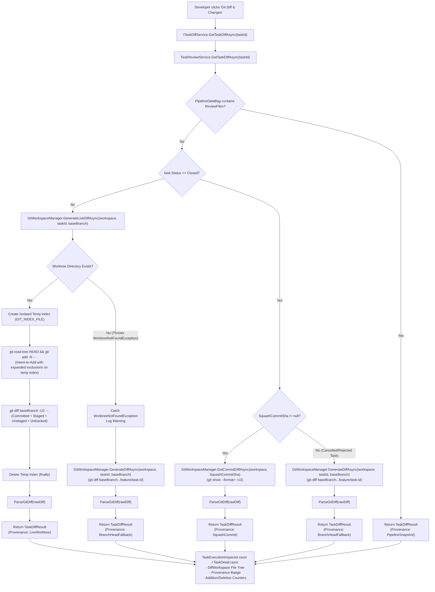

# 🔀 Step 11.34: Live Git Diff Worktree Ingestion, Untracked File Tracking & Inspector Accuracy

> **Phase 11 Implementation Step (Hardening, Developer Ergonomics & Git Worktree Observability)**  
> *Parent Plan:* [Phase 11 Master Plan](../11_EXTEND_FEATURES.md)  
> *Target Projects:* `src/NightCodeForge.Core`, `src/NightCodeForge.Infrastructure`, `src/NightCodeForge.Web`, `tests/NightCodeForge.Core.Tests`, `tests/NightCodeForge.Infrastructure.Tests`, `tests/NightCodeForge.Web.Tests`  
> *Status:* Proposed | *Target Framework:* .NET 10 (C# 13)

---

## 1. Executive Summary & Problem Statement

In NightCodeForge, developers and operators inspect the evolving codebase changes of autonomous tasks via the **Task Execution Inspector** ([TaskExecutionInspector.razor](file:///c:/Users/Julien/source/repos/jetelain/NightCodeForge/src/NightCodeForge.Web/Components/Monitoring/TaskExecutionInspector.razor)) and the **Task Detail Page** ([TaskDetail.razor](file:///c:/Users/Julien/source/repos/jetelain/NightCodeForge/src/NightCodeForge.Web/Components/Pages/TaskDetail.razor)). Within these views, the **"🔀 Git Diff & Changes"** tab provides side-by-side inspection of modified files ([DiffWorkspace.razor](file:///c:/Users/Julien/source/repos/jetelain/NightCodeForge/src/NightCodeForge.Web/Components/Review/DiffWorkspace.razor)).

However, during active task execution, human interruption, or review pauses, operators observe a misleading limitation:

> **Issue:** The diff displayed in "Git Diff & Changes" only includes changes up to the last committed WIP checkpoint on the feature branch. Staged modifications (`git add`), unstaged file edits authored during the current stage, and newly created untracked files are omitted. Furthermore, when an active worktree is clean (zero edits), the system false-falls-back to branch diffs and reports misleading state.

```
Expected: Base Branch ───► [Committed WIPs] ───► [Staged Changes] ───► [Unstaged Edits] ───► [New Untracked Files]
                                                   ▲
Actual in Inspector: Diff truncates here ─────────┘ (Silent omission of live worktree state)
```

### 1.1 Root Cause Analysis

Investigation into [TaskReviewService.cs](file:///c:/Users/Julien/source/repos/jetelain/NightCodeForge/src/NightCodeForge.Web/Services/TaskReviewService.cs), [GitWorkspaceManager.cs](file:///c:/Users/Julien/source/repos/jetelain/NightCodeForge/src/NightCodeForge.Infrastructure/Git/GitWorkspaceManager.cs), and [GitDiffConstants.cs](file:///c:/Users/Julien/source/repos/jetelain/NightCodeForge/src/NightCodeForge.Core/Domain/GitDiffConstants.cs) identifies four compounding architectural causes:

1. **Worktree Path Resolution & Silent Canonical Fallback:**
   In [TaskReviewService.LoadChangedFilesAsync](file:///c:/Users/Julien/source/repos/jetelain/NightCodeForge/src/NightCodeForge.Web/Services/TaskReviewService.cs#L176-L228):
   ```csharp
   // 2. If active (not Closed), retrieve live diff directly from the worktree
   if (string.IsNullOrWhiteSpace(rawDiff) && task.Status != TaskOverallStatus.Closed)
   {
       rawDiff = await _gitWorkspaceManager.GenerateLiveDiffAsync(workspace, task.Id, baseBranch, cancellationToken);
   }

   // 3. Fallback to branch diff
   if (string.IsNullOrWhiteSpace(rawDiff))
   {
       rawDiff = await _gitWorkspaceManager.GenerateDiffAsync(workspace, task.Id, baseBranch, cancellationToken);
   }
   ```
   When [GitWorkspaceManager.GenerateLiveDiffAsync](file:///c:/Users/Julien/source/repos/jetelain/NightCodeForge/src/NightCodeForge.Infrastructure/Git/GitWorkspaceManager.cs#L474) calls `GetWorkingPath(workspace, taskId)`, if `WorktreeDirectoryExists(wt)` evaluates to `false`, `GetWorkingPath` defaults to `GetCanonicalWorkingPath(workspace)`.
   - In the canonical repository, `baseBranch` (`main` or `develop`) is checked out. Executing `git diff baseBranch` returns an empty string (`""`).
   - Consequently, Step 2 returns empty, and execution silently falls through to Step 3: `GenerateDiffAsync(workspace, task.Id, baseBranch)`.
   - `GenerateDiffAsync` executes `git diff {baseBranch}...feature/task-{taskId} -- .` against committed Git refs in the canonical repository, completely ignoring uncommitted worktree changes.

2. **Double-Fallback & Conflation of "Clean Worktree" with "Missing Worktree":**
   - [GitWorkspaceManager.GenerateLiveDiffAsync](file:///c:/Users/Julien/source/repos/jetelain/NightCodeForge/src/NightCodeForge.Infrastructure/Git/GitWorkspaceManager.cs#L474) internally catches exceptions and falls back to `GenerateDiffAsync`. Callers therefore cannot determine whether the returned string originated from the live worktree or committed branch head refs.
   - When an active worktree exists and is clean (zero modifications), `git diff baseBranch` returns an empty string (`""`). Checking `string.IsNullOrWhiteSpace(rawDiff)` in `TaskReviewService` misinterprets this clean state as an error and triggers fallback to `GenerateDiffAsync`, corrupting diff provenance signaling.

3. **Native Git Diff Untracked File Omission:**
   Even when `GenerateLiveDiffAsync` targets the active worktree directory directly, running standard `git diff <baseBranch> -- .`:
   - Inspects committed refs and working-tree modifications to *already tracked* files.
   - **Completely ignores untracked files.** Any new source files, test suites, or configuration files created by agent tool invocations (`write_to_file`, `bash`) remain invisible in the diff until explicitly staged or indexed.

4. **Service Contract Inconsistency & Ambiguous UI State:**
   - [TaskDetail.razor](file:///c:/Users/Julien/source/repos/jetelain/NightCodeForge/src/NightCodeForge.Web/Components/Pages/TaskDetail.razor#L16) injects [ITaskDiffService](file:///c:/Users/Julien/source/repos/jetelain/NightCodeForge/src/NightCodeForge.Web/Services/ITaskDiffService.cs), whereas [TaskExecutionInspector.razor](file:///c:/Users/Julien/source/repos/jetelain/NightCodeForge/src/NightCodeForge.Web/Components/Monitoring/TaskExecutionInspector.razor#L373) bypasses it and uses `ServiceProvider.GetService<ITaskReviewService>()`.
   - The UI displays an ambiguous generic label (`Displaying live/branch worktree diff against main`) regardless of whether the diff was produced from the live worktree, a committed branch fallback, or a closed task squash commit.

---

## 2. Specification & Behavioral Requirements

### 2.1 WSL2-Native Execution Policy & Non-Destructive Live Diffing

> [!IMPORTANT]
> **Strict Policy: Run Git Natively Inside WSL2 & Use Isolated Temporary Indexes**  
> When a workspace uses an ext4 mirror (`workspace.Ext4MirrorPath`), all Git operations (`git add -N`, `git diff`, `git status`) MUST be executed directly within WSL2 using Linux paths (e.g. `/home/user/...`) via [GitCliRunner](file:///c:/Users/Julien/source/repos/jetelain/NightCodeForge/src/NightCodeForge.Infrastructure/Git/GitCliRunner.cs) (`wsl.exe -d <distro> --exec git -c core.pager=cat -C <linuxDir> ...`).  
>
> Running Windows `git.exe` against Windows UNC network paths (`\\wsl.localhost\...` or `\\wsl$\...`) is **strictly forbidden**:
> - Cross-boundary 9P network filesystem latency adds multi-second overhead per diff.
> - UNC file locking creates permission errors and spurious working tree dirty states.
> - Windows line endings (`CRLF`) vs Linux (`LF`) translation causes false diff hunks.

1. **Worktree Directory Validation:**
   - On Windows targeting WSL2, directory existence probes validate the Linux path through lightweight host-accessible UNC checks (`WorktreeDirectoryExists`), while the path passed to `IGitCliRunner.ExecuteAsync` remains the **native Linux path**.
   - `GitCliRunner.TryResolveWslTarget` recognizes the Linux path (`/home/...` or `~/.nightcodeforge/...`) and invokes `wsl.exe -d <distro> --exec git -C <linuxDir>`, keeping execution 100% on the Linux ext4 filesystem.
   - For BareHost mode on Windows or native Linux hosts, standard OS-native paths and runners apply.

2. **Comprehensive Live Diff Ingestion:**
   For any task that is not in a terminal `Closed` state with an existing `SquashCommitSha`:
   - The diff returned by `IGitWorkspaceManager.GenerateLiveDiffAsync` and `GenerateLiveDiffStatAsync` MUST encompass:
     1. All committed changes on `feature/task-{taskId}` against `baseBranch`.
     2. All staged modifications in the worktree index (`git add`).
     3. All unstaged modifications to tracked files in the worktree.
     4. All newly created, untracked files within the worktree (excluding patterns defined in `.gitignore` and `GitDiffConstants.ExclusionPathspecs`).

3. **Isolated Temporary Index (`GIT_INDEX_FILE` Non-Destructive Intent-to-Add):**
   - Running `git add -N -- .` directly on the active worktree's `.git/index` is **strictly forbidden** because mutating the worktree index causes serious side effects:
     - Autonomous agent tools executing concurrently (`git commit`, `git status`) fail on uncommitted intent-to-add entries or encounter `.git/index.lock` collisions.
     - Deleted untracked files linger in the primary index as deleted tracked files.
     - `git status --porcelain` output is distorted for the worker pipeline.
   - Instead, `IGitWorkspaceManager` MUST perform intent-to-add and diff generation against an **isolated temporary index file** via the `GIT_INDEX_FILE` environment variable (e.g. `/tmp/ncf_diff_{taskId}_{guid}.index` or `$TEMP/...`):
     ```bash
     GIT_INDEX_FILE=<tempIndex> git read-tree HEAD
     GIT_INDEX_FILE=<tempIndex> git add -N -- . ":(exclude)..."
     GIT_INDEX_FILE=<tempIndex> git diff <baseBranch> -U2 -- . ":(exclude)..."
     ```
   - The temporary index file MUST be deleted in a `finally` block immediately after diff capture.
   - This ensures diff calculation remains 100% read-only, non-destructive, and free of lock contention with running agent workflows.
   - `GitDiffConstants.ExclusionPathspecs` MUST be expanded to include build artifact directories (`bin/`, `obj/`, `.vs/`) so untracked compiler outputs are excluded even when `.gitignore` is missing or incomplete.

4. **Fail-Fast Worktree Resolution & Domain Exceptions:**
   - In accordance with the *No Silent Failures* policy, `IGitWorkspaceManager.GenerateLiveDiffAsync` and `GenerateLiveDiffStatAsync` MUST **NEVER** silently fall back to branch diffs internally.
   - If the task worktree does not exist on disk, both methods MUST throw a dedicated domain exception: `WorktreeNotFoundException(taskId, attemptedPath)`.
   - If the active worktree exists and contains zero changes, `GenerateLiveDiffAsync` returns `""`. `TaskReviewService` treats this as a valid clean state and assigns `DiffProvenance.LiveWorktree` with an empty file list.
   - Only when `WorktreeNotFoundException` is caught does `TaskReviewService` log a diagnostic `Warning`, call `GenerateDiffAsync`, and assign `DiffProvenance.BranchHeadFallback`.

---

### 2.2 Provenance & Model Contracts

1. **`DiffProvenance` Enum:**
   ```csharp
   namespace NightCodeForge.Core.Workflow;

   public enum DiffProvenance
   {
       /// <summary>Generated from the live task worktree, including uncommitted, staged, and untracked changes.</summary>
       LiveWorktree,

       /// <summary>Generated from committed branch head refs because the worktree directory was not found or was pruned.</summary>
       BranchHeadFallback,

       /// <summary>Generated from the single squashed merge commit of a closed task.</summary>
       SquashCommit,

       /// <summary>Retrieved directly from task pipeline metadata bag (e.g. synthetic test snapshots).</summary>
       PipelineSnapshot
   }
   ```

2. **Relocation of `FileDiffSummary` and `FileChangeType`:**
   - In accordance with our *Clean Break Policy*, move `FileDiffSummary` and `FileChangeType` from `NightCodeForge.Web.Services` into `NightCodeForge.Core.Workflow` (or `NightCodeForge.Core.Domain`).
   - This allows `NightCodeForge.Core` to define domain contracts without circular references to `NightCodeForge.Web`.

3. **`TaskDiffResult` DTO with Computed Metrics:**
   ```csharp
   namespace NightCodeForge.Core.Workflow;

   public record TaskDiffResult(
       IReadOnlyList<FileDiffSummary> Files,
       DiffProvenance Provenance,
       string BaseBranch,
       string? SquashCommitSha = null)
   {
       public int TotalAdditions => Files.Sum(f => f.Additions);
       public int TotalDeletions => Files.Sum(f => f.Deletions);
   }
   ```
   *Computing `TotalAdditions` and `TotalDeletions` directly from `Files` guarantees that totals can never desynchronize from the underlying file summaries.*

4. **UI Transparency & Badge Indicators:**
   In [TaskExecutionInspector.razor](file:///c:/Users/Julien/source/repos/jetelain/NightCodeForge/src/NightCodeForge.Web/Components/Monitoring/TaskExecutionInspector.razor) and [TaskDetail.razor](file:///c:/Users/Julien/source/repos/jetelain/NightCodeForge/src/NightCodeForge.Web/Components/Pages/TaskDetail.razor):
   - Replace ambiguous plain-text labels with explicit visual badges:
     - `🟢 Live Worktree (Includes Uncommitted Changes)` when `Provenance == DiffProvenance.LiveWorktree`.
     - `🟡 Branch Commits Only (Worktree Offline)` with a tooltip when `Provenance == DiffProvenance.BranchHeadFallback`.
     - `🟣 Squashed Commit (SHA: {sha})` when `Provenance == DiffProvenance.SquashCommit`.
     - `🔵 Pipeline Snapshot` when `Provenance == DiffProvenance.PipelineSnapshot`.
   - The changed file count badge on tab buttons (`🔀 Git Diff & Changes (N)`) MUST reflect the total number of modified and newly created untracked files.

---

## 3. High-Level Architecture & Workflow



---

## 4. Implementation Details

### 4.1 Core Domain Updates (`NightCodeForge.Core`)

1. **Relocate `FileDiffSummary` & `FileChangeType` to Core:**
   - Move `FileDiffSummary` and `FileChangeType` from `NightCodeForge.Web.Services` into `NightCodeForge.Core.Workflow`.
   - Update `NightCodeForge.Web` and tests to consume them from `NightCodeForge.Core.Workflow`.

2. **Exclusion Pathspecs Expansion in [GitDiffConstants.cs](file:///c:/Users/Julien/source/repos/jetelain/NightCodeForge/src/NightCodeForge.Core/Domain/GitDiffConstants.cs):**
   Expand `ExclusionPathspecs` to filter compiler directories and temporary IDE metadata:
   ```csharp
   public static readonly IReadOnlyList<string> ExclusionPathspecs =
   [
       ":(exclude)package-lock.json",
       ":(exclude)pnpm-lock.yaml",
       ":(exclude)yarn.lock",
       ":(exclude)*.Designer.cs",
       ":(exclude)*.generated.cs",
       ":(exclude)*.trx",
       ":(exclude)**/TestResults/**",
       ":(exclude)**/bin/**",
       ":(exclude)**/obj/**",
       ":(exclude)**/.vs/**"
   ];
   ```

3. **Domain Exception [WorktreeNotFoundException.cs](file:///c:/Users/Julien/source/repos/jetelain/NightCodeForge/src/NightCodeForge.Core/Exceptions/WorktreeNotFoundException.cs):**
   ```csharp
   namespace NightCodeForge.Core.Exceptions;

   public class WorktreeNotFoundException : Exception
   {
       public int TaskId { get; }
       public string AttemptedPath { get; }

       public WorktreeNotFoundException(int taskId, string attemptedPath)
           : base($"Active worktree directory for task #{taskId} was not found at '{attemptedPath}'.")
       {
           TaskId = taskId;
           AttemptedPath = attemptedPath;
       }
   }
   ```

4. **Domain Models in `NightCodeForge.Core.Workflow`:**
   Define `DiffProvenance` and `TaskDiffResult` alongside `FileDiffSummary`.

---

### 4.2 Infrastructure Layer (`NightCodeForge.Infrastructure`)

1. **Strict Non-Destructive Live Diff & Stat Generation in [GitWorkspaceManager.cs](file:///c:/Users/Julien/source/repos/jetelain/NightCodeForge/src/NightCodeForge.Infrastructure/Git/GitWorkspaceManager.cs):**
   - In both `GenerateLiveDiffAsync` and `GenerateLiveDiffStatAsync`:
     - Resolve `worktreePath` via `GetWorktreePath(workspace, taskId)`.
     - Check `WorktreeDirectoryExists(worktreePath)`. If `false`:
       - Throw `new WorktreeNotFoundException(taskId, worktreePath)`.
       - **DO NOT** fall back to `GetCanonicalWorkingPath` or `GenerateDiffAsync` internally.
     - Allocate an isolated temporary index file path (e.g. `/tmp/ncf_diff_{taskId}_{Guid}.index` in WSL/Linux or `Path.Combine(Path.GetTempPath(), ...)` on Windows).
     - Execute intent-to-add and diff generation against this isolated index to ensure 100% read-only operation:
       ```csharp
       var tempIndex = ResolveTempIndexPath(worktreePath, taskId);
       try
       {
           // 1. Initialize temp index from HEAD refs without touching .git/index
           await _gitCliRunner.ExecuteAsync(worktreePath, ["read-tree", "HEAD"], 
               environmentVariables: new Dictionary<string, string> { ["GIT_INDEX_FILE"] = tempIndex }, 
               cancellationToken: cancellationToken);

           // 2. Register untracked files into the temporary index only
           var addArgs = new List<string> { "add", "-N", "--", "." };
           addArgs.AddRange(GitDiffConstants.ExclusionPathspecs);
           await _gitCliRunner.ExecuteAsync(worktreePath, addArgs.ToArray(), 
               environmentVariables: new Dictionary<string, string> { ["GIT_INDEX_FILE"] = tempIndex }, 
               cancellationToken: cancellationToken);

           // 3. Diff comparing baseBranch with working tree via the temporary index
           string[] diffArgs = BuildDiffArgs(baseBranch, isStat: false);
           var result = await _gitCliRunner.ExecuteAsync(worktreePath, diffArgs, 
               environmentVariables: new Dictionary<string, string> { ["GIT_INDEX_FILE"] = tempIndex }, 
               cancellationToken: cancellationToken);
           return result.StandardOutput;
       }
       finally
       {
           // 4. Always clean up temporary index file
           DeleteTempIndexSafe(tempIndex);
       }
       ```
     - Mirror identical fail-fast and isolated-index semantics in `GenerateLiveDiffStatAsync(workspace, taskId, baseBranch, ...)`.
     - If an unexpected `GitCommandException` occurs during diff execution in the worktree, log a warning and let it propagate or throw a dedicated domain exception. Do not silently fall back to branch diff.

---

### 4.3 Web & Presentation Layer (`NightCodeForge.Web`)

1. **Service Contract Unification in [ITaskDiffService.cs](file:///c:/Users/Julien/source/repos/jetelain/NightCodeForge/src/NightCodeForge.Web/Services/ITaskDiffService.cs):**
   ```csharp
   public interface ITaskDiffService
   {
       Task<TaskDiffResult> GetTaskDiffAsync(int taskId, CancellationToken cancellationToken = default);
   }

   public class TaskDiffService : ITaskDiffService
   {
       private readonly ITaskReviewService _taskReviewService;

       public TaskDiffService(ITaskReviewService taskReviewService)
       {
           _taskReviewService = taskReviewService ?? throw new ArgumentNullException(nameof(taskReviewService));
       }

       public Task<TaskDiffResult> GetTaskDiffAsync(int taskId, CancellationToken cancellationToken = default)
       {
           return _taskReviewService.GetTaskDiffAsync(taskId, cancellationToken);
       }
   }
   ```

2. **[TaskReviewService.cs](file:///c:/Users/Julien/source/repos/jetelain/NightCodeForge/src/NightCodeForge.Web/Services/TaskReviewService.cs) Implementation:**
   Implement `GetTaskDiffAsync(int taskId, ...)`:
   - Load `task` and `workspace`.
   - **Case A (Pipeline Snapshot):** If `bag.TryGet<List<FileDiffSummary>>(PipelineDataBagKeys.ReviewFiles, out var bagFiles)` and `bagFiles.Count > 0`, return `new TaskDiffResult(bagFiles, DiffProvenance.PipelineSnapshot, baseBranch)`.
   - **Case B (Closed Squash Commit):** If `task.Status == TaskOverallStatus.Closed && !string.IsNullOrWhiteSpace(task.SquashCommitSha)`, call `_gitWorkspaceManager.GetCommitDiffAsync(...)` and return `new TaskDiffResult(files, DiffProvenance.SquashCommit, baseBranch, task.SquashCommitSha)`.
   - **Case B.2 (Closed Task Without Squash Commit - Cancelled/Rejected):** If `task.Status == TaskOverallStatus.Closed && string.IsNullOrWhiteSpace(task.SquashCommitSha)`, call `_gitWorkspaceManager.GenerateDiffAsync(workspace, task.Id, baseBranch, cancellationToken)` and return `new TaskDiffResult(files, DiffProvenance.BranchHeadFallback, baseBranch)`.
   - **Case C (Active Worktree):** If `task.Status != TaskOverallStatus.Closed`:
     - Try calling `_gitWorkspaceManager.GenerateLiveDiffAsync(workspace, task.Id, baseBranch, cancellationToken)`.
     - Parse diff. Return `new TaskDiffResult(files, DiffProvenance.LiveWorktree, baseBranch)`. (Even if `files` is empty, provenance remains `LiveWorktree`).
   - **Case D (Worktree Fallback on Missing Worktree):** Catch `WorktreeNotFoundException ex`:
     - `_logger.LogWarning(ex, "Live worktree missing for task #{TaskId}. Falling back to branch diff against '{BaseBranch}'.", task.Id, baseBranch);`
     - Call `_gitWorkspaceManager.GenerateDiffAsync(workspace, task.Id, baseBranch, cancellationToken)`.
     - Parse diff. Return `new TaskDiffResult(files, DiffProvenance.BranchHeadFallback, baseBranch)`.

3. **Presentation Updates in Razor Components:**
   - In [TaskExecutionInspector.razor](file:///c:/Users/Julien/source/repos/jetelain/NightCodeForge/src/NightCodeForge.Web/Components/Monitoring/TaskExecutionInspector.razor):
     - Replace `@inject IServiceProvider ServiceProvider` / `ServiceProvider.GetService<ITaskReviewService>()` with `@inject ITaskDiffService TaskDiffService`.
     - Hydrate `TaskDiffResult? _diffResult`.
     - Change tab activation guard from `if (!_diffFiles.Any())` to `if (_diffResult == null)` so that an active, clean worktree with 0 changes does not trigger redundant diff calculations on every tab switch.
     - Render provenance badge and metrics:
       ```razor
       @if (_diffResult != null)
       {
           @switch (_diffResult.Provenance)
           {
               case DiffProvenance.LiveWorktree:
                   <span class="forge-badge badge-green" title="Diff reflects active worktree including staged, unstaged, and newly created files.">
                       🟢 Live Worktree (Includes Uncommitted Changes)
                   </span>
                   break;
               case DiffProvenance.BranchHeadFallback:
                   <span class="forge-badge badge-amber" title="Worktree is currently offline or pruned. Displaying committed branch changes against base branch.">
                       🟡 Branch Head Commits Only
                   </span>
                   break;
               case DiffProvenance.SquashCommit:
                   <span class="forge-badge badge-purple" title="Task is closed. Displaying final squashed commit diff.">
                       🟣 Squashed Commit (@(_diffResult.SquashCommitSha?[..Math.Min(8, _diffResult.SquashCommitSha.Length)]))
                   </span>
                   break;
               case DiffProvenance.PipelineSnapshot:
                   <span class="forge-badge badge-blue" title="Displaying cached pipeline snapshot files.">
                       🔵 Pipeline Snapshot
                   </span>
                   break;
           }
       }
       ```
   - In [TaskDetail.razor](file:///c:/Users/Julien/source/repos/jetelain/NightCodeForge/src/NightCodeForge.Web/Components/Pages/TaskDetail.razor):
     - Consume `_diffResult = await TaskDiffService.GetTaskDiffAsync(_task.Id)`.
     - Guard reload with `if (_diffResult == null)`.
     - Render the corresponding provenance badge alongside the modified file count in the changes header.

---

## 5. Testing & Quality Gates

### 5.1 Unit Tests (`NightCodeForge.Infrastructure.Tests` & `NightCodeForge.Core.Tests`)

1. **`GenerateLiveDiffAsync_IncludesUncommittedAndUntrackedFiles`:**
   - Initialize a test Git repo with a `main` branch and a committed file `file1.txt`.
   - Create a worktree for task branch `feature/task-99`.
   - Add a commit on `feature/task-99` (`file1.txt` modified).
   - Stage an additional change in `file1.txt` (`git add`).
   - Leave an unstaged modification in `file1.txt`.
   - Author a brand new untracked file `file2.txt`.
   - Assert `GenerateLiveDiffAsync` returns diff output containing both `file1.txt` and `file2.txt` with their respective additions.

2. **`GenerateLiveDiffAsync_UsesIsolatedTempIndexWithoutMutatingWorktreeIndex`:**
   - Verify that running `GenerateLiveDiffAsync` on a worktree containing untracked files does not leave intent-to-add entries in the worktree's primary `.git/index`.
   - Assert `git status --porcelain` in the worktree continues to report untracked files as `??` rather than ` A` or ` M`.

3. **`GenerateLiveDiffAsync_RespectsExclusionPathspecs`:**
   - Create build artifact directories (`bin/Debug/net10.0/app.dll`, `obj/project.assets.json`) in the worktree without a `.gitignore`.
   - Assert `GenerateLiveDiffAsync` excludes them from the returned diff due to `GitDiffConstants.ExclusionPathspecs`.

4. **`GenerateLiveDiffAsync_ThrowsWorktreeNotFoundException_WhenWorktreeDoesNotExist`:**
   - Call `GenerateLiveDiffAsync` with a non-existent task ID.
   - Assert `WorktreeNotFoundException` is thrown with the expected `TaskId` and attempted path.

5. **`GenerateLiveDiffStatAsync_ThrowsWorktreeNotFoundException_WhenWorktreeDoesNotExist`:**
   - Call `GenerateLiveDiffStatAsync` with a non-existent task ID.
   - Assert `WorktreeNotFoundException` is thrown.

6. **`GitCliRunner_ExecutesInWslDirectlyWithoutUnc`:**
   - Verify that when given a Linux path (`/home/...`), `GitCliRunner` invokes `wsl.exe -d <distro> --exec git -c core.pager=cat -C <linuxDir>` without translating to UNC paths.

### 5.2 Service & Component Tests (`NightCodeForge.Web.Tests`)

1. **`TaskReviewServiceTests.GetTaskDiffAsync_WhenWorktreeExists_SetsLiveWorktreeProvenance`:**
   - Mock `IGitWorkspaceManager.GenerateLiveDiffAsync` returning a valid diff.
   - Verify `TaskReviewService` reports `DiffProvenance.LiveWorktree`.

2. **`TaskReviewServiceTests.GetTaskDiffAsync_WhenWorktreeClean_ReturnsEmptyWithLiveWorktreeProvenance`:**
   - Mock `IGitWorkspaceManager.GenerateLiveDiffAsync` returning `""`.
   - Verify `TaskReviewService` reports `DiffProvenance.LiveWorktree` with 0 files (and does not fall back to `GenerateDiffAsync`).

3. **`TaskReviewServiceTests.GetTaskDiffAsync_WhenWorktreeNotFound_FallsBackToBranchDiff`:**
   - Mock `IGitWorkspaceManager.GenerateLiveDiffAsync` throwing `WorktreeNotFoundException`.
   - Mock `IGitWorkspaceManager.GenerateDiffAsync` returning a valid branch diff.
   - Verify `TaskReviewService` calls `GenerateDiffAsync` and reports `DiffProvenance.BranchHeadFallback`.

4. **`TaskReviewServiceTests.GetTaskDiffAsync_WhenClosedWithSquashSha_SetsSquashCommitProvenance`:**
   - Configure a task with `Status = TaskOverallStatus.Closed` and `SquashCommitSha = "abc123"`.
   - Verify `TaskReviewService` calls `GetCommitDiffAsync` and reports `DiffProvenance.SquashCommit`.

5. **`TaskReviewServiceTests.GetTaskDiffAsync_WhenClosedWithoutSquashSha_SetsBranchHeadFallbackProvenance`:**
   - Configure a cancelled/rejected task with `Status = TaskOverallStatus.Closed` and `SquashCommitSha = null`.
   - Verify `TaskReviewService` calls `GenerateDiffAsync` and reports `DiffProvenance.BranchHeadFallback`.

6. **`TaskReviewServiceTests.GetTaskDiffAsync_WhenPipelineDataBagHasFiles_SetsPipelineSnapshotProvenance`:**
   - Set `PipelineDataBagKeys.ReviewFiles` on a task.
   - Verify `TaskReviewService` returns `DiffProvenance.PipelineSnapshot`.

7. **`TaskDiffServiceTests.GetTaskDiffAsync_DelegatesToTaskReviewService`:**
   - Verify `ITaskDiffService` delegates directly to `ITaskReviewService.GetTaskDiffAsync`.

8. **`TaskExecutionInspectorComponentTests.GitDiffTab_RendersLiveWorktreeBadge`:**
   - Verify the presence of the live worktree badge when provenance is `LiveWorktree`.

9. **`TaskDetailPageTests.ChangesTab_RendersProvenanceBadge`:**
   - Verify that the task detail changes panel renders the appropriate provenance badge based on `TaskDiffResult`.

---

## 6. Acceptance Criteria

- [ ] Inspecting "Git Diff & Changes" for an in-flight or waiting task displays all modifications made during the current stage, including staged (`git add`), unstaged edits, and newly created untracked files.
- [ ] Newly authored files appear in the diff tree as `[Added]` with green additions without requiring manual git staging.
- [ ] Live diff generation operates against an isolated temporary index (`GIT_INDEX_FILE`), leaving the active worktree's primary `.git/index` unmutated and avoiding agent `git commit` collisions.
- [ ] Active worktrees with zero modifications cleanly report 0 changed files under `DiffProvenance.LiveWorktree` without triggering false fallback to branch refs or continuous UI reloading.
- [ ] Both `IGitWorkspaceManager.GenerateLiveDiffAsync` and `GenerateLiveDiffStatAsync` throw a typed `WorktreeNotFoundException` on missing worktrees instead of silently falling back.
- [ ] Closed tasks without a `SquashCommitSha` (cancelled/rejected) cleanly fall back to branch head commits with `DiffProvenance.BranchHeadFallback`.
- [ ] All Git commands on WSL workspaces execute directly inside WSL2 via `wsl.exe --exec git -C <linuxDir>` on ext4 without using Windows UNC paths.
- [ ] `GitDiffConstants.ExclusionPathspecs` filters out `bin/`, `obj/`, `.vs/`, and lockfiles from both live diffs and intent-to-add indexing.
- [ ] Both [TaskExecutionInspector.razor](file:///c:/Users/Julien/source/repos/jetelain/NightCodeForge/src/NightCodeForge.Web/Components/Monitoring/TaskExecutionInspector.razor) and [TaskDetail.razor](file:///c:/Users/Julien/source/repos/jetelain/NightCodeForge/src/NightCodeForge.Web/Components/Pages/TaskDetail.razor) consume [ITaskDiffService](file:///c:/Users/Julien/source/repos/jetelain/NightCodeForge/src/NightCodeForge.Web/Services/ITaskDiffService.cs) and explicitly indicate diff provenance (`Live Worktree`, `Branch Head Fallback`, `Squashed Commit`, or `Pipeline Snapshot`).
- [ ] `FileDiffSummary` and `FileChangeType` are relocated to `NightCodeForge.Core.Workflow` per the Clean Break Policy.
- [ ] All existing automated tests in `NightCodeForge.Core.Tests`, `NightCodeForge.Infrastructure.Tests`, and `NightCodeForge.Web.Tests` continue to pass cleanly.

---

## 7. Implementation Nuances & Gaps to Watch

1. **Non-Destructive Temporary Index Isolation (`GIT_INDEX_FILE`):**
   - Live diffing MUST NOT run `git add -N` directly on the worktree's primary `.git/index`.
   - By directing Git to a transient index file (`GIT_INDEX_FILE`) during diff generation and deleting it in a `finally` block:
     - No lock contention on `.git/index.lock` between UI requests and agent tools.
     - Agent `git commit` commands never fail on unexpected empty intent-to-add index entries.
     - Untracked files that are subsequently deleted do not linger as phantom "deleted tracked files".
     - `git status --porcelain` remains pristine for worker agent evaluation.

2. **Terminal Closed Tasks without Squash Commit:**
   - When a task reaches a terminal `Closed` state (e.g., cancelled, rejected, or closed manually) without producing a `SquashCommitSha`, its ephemeral worktree directory may have been pruned.
   - [TaskReviewService](file:///c:/Users/Julien/source/repos/jetelain/NightCodeForge/src/NightCodeForge.Web/Services/TaskReviewService.cs) must handle this case by falling back to the task feature branch (`feature/task-{taskId}`) diff against `baseBranch` with `DiffProvenance.BranchHeadFallback` (or return an empty result if the branch has also been deleted), rather than failing the review UI.

3. **Git Exclusion Pathspec Syntax Compatibility:**
   - The intent-to-add command `git add -N -- . ":(exclude)**/bin/**"` relies on Git pathspec magic (`:(exclude)`). All modern Git releases on Linux (WSL2) support this syntax natively. When assembling CLI arguments, ensure pathspecs are passed as distinct array arguments without Windows shell quote escaping issues.

4. **Preserving Clean Worktree Semantics (No False Fallbacks):**
   - An active worktree with zero modifications produces an empty string (`""`) from `git diff`. Callers must NOT treat `string.IsNullOrWhiteSpace(rawDiff)` as an error or trigger fallback to branch refs. An empty string from an existing live worktree is a legitimate clean state that must produce `TaskDiffResult` with `DiffProvenance.LiveWorktree` and 0 changed files.

