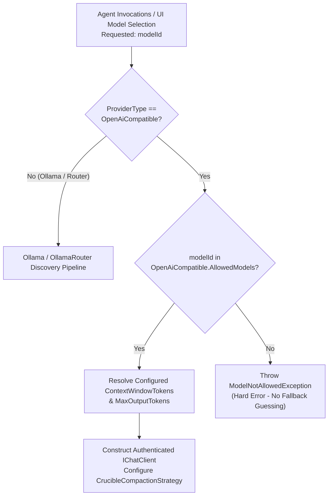

# 🌐 Step 11.35: OpenAI-Compatible LLM Provider Integration & Explicit Model Allowlist

> **Phase 11 Implementation Step (Post-MVP - Real-Project Hardening, Token Efficiency & Agent Ergonomics)**  
> *Parent Plan:* [Phase 11 Master Plan](../11_EXTEND_FEATURES.md)  
> *Target Framework:* .NET 10 (C# 13) | *Status:* Proposed  
> *Target Projects:* [`src/NightCodeForge.Core`](file:///c:/Users/Julien/source/repos/jetelain/NightCodeForge/src/NightCodeForge.Core), [`src/NightCodeForge.Agents`](file:///c:/Users/Julien/source/repos/jetelain/NightCodeForge/src/NightCodeForge.Agents), [`src/NightCodeForge.Infrastructure`](file:///c:/Users/Julien/source/repos/jetelain/NightCodeForge/src/NightCodeForge.Infrastructure), [`src/NightCodeForge.Web`](file:///c:/Users/Julien/source/repos/jetelain/NightCodeForge/src/NightCodeForge.Web), [`tests/NightCodeForge.Agents.Tests`](file:///c:/Users/Julien/source/repos/jetelain/NightCodeForge/tests/NightCodeForge.Agents.Tests), [`tests/NightCodeForge.Web.Tests`](file:///c:/Users/Julien/source/repos/jetelain/NightCodeForge/tests/NightCodeForge.Web.Tests)  
> *Dependencies:* [Step 11.33: Unified LLM Provider Architecture (Standalone Ollama vs OllamaRouter)](STEP_11_33_UNIFIED_LLM_PROVIDER_DYNAMIC_CONTEXT_AND_FLEET_INTEGRATION.md)  
> *Aligns With:* [AGENTS.md](../../../AGENTS.md), [docs/PLAN.md](../../PLAN.md)

---

> **Alignment with Step 11.33 (provider fixed at startup):** The provider is selected once at startup (`LlmProvider:ProviderType`, restart required to change). Every `if (ProviderType == ...)` snippet below illustrates the *behaviour* only; the implementation MUST be a dedicated class per provider registered by `AddNightCodeForgeInference(providerType)` / `AddNightCodeForgeAgents(providerType)` (an `OpenAiCompatible` gateway, catalog `LlmModelCatalogServiceBase` subclass and chat client factory), never a runtime condition inside shared services. Chat clients must still receive the session id (`ILlmChatClientFactory.CreateClient(..., sessionId)`).


## 1. Executive Summary & Motivation

### 1.1 The Need for OpenAI-Compatible Endpoints
Following the unified LLM provider architecture established in [Step 11.33](STEP_11_33_UNIFIED_LLM_PROVIDER_DYNAMIC_CONTEXT_AND_FLEET_INTEGRATION.md) (which decoupled NightCodeForge from mandatory OllamaRouter proxying and introduced direct standalone Ollama support), developers frequently require connectivity to inference endpoints adhering to the de facto industry standard: the **OpenAI Chat Completions API (`/v1/chat/completions`)**.

These endpoints include:
1. **Local Self-Hosted Runtimes:** vLLM, LM Studio, llama.cpp server (`llama-server`), LocalAI, Jan, TabbyAPI, and Text Generation WebUI (oobabooga).
2. **Dedicated Cloud Gateways & Aggregators:** OpenRouter, DeepSeek, Groq, Mistral AI, Together AI, Fireworks AI, Cerebras, Azure OpenAI, and official OpenAI (`api.openai.com`).
3. **Enterprise Proxies & Caching Layers:** LiteLLM, Portkey, Cloudflare AI Gateway.

### 1.2 The Context Discovery Limitation & The Model Allowlist Mandate
Unlike native Ollama instances (which expose `POST /api/show` to inspect Modelfiles and GGUF metadata) or OllamaRouter clusters (which dynamically report `recommendedContextWindow` via `GET /api/router/models/{name}`):

1. **Absence of Standard Context Discovery:** The OpenAI specification (`GET /v1/models`) standardly returns only a bare list of string model identifiers (e.g. `[ { "id": "deepseek-chat" }, { "id": "gpt-4o" } ]`). It provides **zero metadata** regarding token context limits, max output budgets, parameter scales, or reasoning capabilities.
2. **Risk of Runaway Cost & Context Clipping:** If context sizes are guessed or defaulted to arbitrary fallbacks (such as 4k or 128k), conversations will either be compacted prematurely (wasting reasoning depth and thrashing prompt state) or overflow the remote model's context ceiling (triggering HTTP 400 `context_length_exceeded` fatal errors mid-task).
3. **Billing & Safety Boundaries:** For metered cloud providers (OpenRouter, DeepSeek, OpenAI), unconstrained model selection poses severe accidental cost hazards. Maintainers require strict administrative control over which models agents are permitted to invoke.

### 1.3 Architectural Solution
NightCodeForge introduces **`LlmProviderType.OpenAiCompatible`** as a first-class inference provider:
- **Explicit Allowed Model List with Context Sizing:** Configuration mandates an explicit list of allowed model definitions. Each allowed model specifies its exact `ModelId`, its guaranteed `ContextWindowTokens`, output token ceiling, and optional reasoning/thinking capabilities.
- **Fail-Fast Allowlist Enforcement:** Agents and UI workflows are strictly constrained to the configured allowed models. Attempting to invoke an unconfigured model fails fast with a dedicated domain exception (`ModelNotAllowedException`), adhering strictly to `AGENTS.md` ("No silent failures... Avoid creating synthetic values for something that should exist in database, make a hard error").
- **Deterministic Crucible Compaction:** The `ModelCapabilityResolver` directly resolves context limits from the configured model definition, guaranteeing mathematical compaction precision without heuristics.
- **Clean Header & Protocol Hygiene:** Outbound HTTP requests use standard `Authorization: Bearer <ApiKey>` authentication, standard OpenAI streaming tool call protocols, and strictly suppress Ollama-specific headers (`X-OllamaRouter-Target`, `X-OllamaRouter-Session-Id`).

---

## 2. Architectural Specifications

### 2.1 Provider Enumeration & Extended Configuration Schema

Extend `LlmProviderType` in `NightCodeForge.Core.Domain`:

```csharp
namespace NightCodeForge.Core.Domain;

public enum LlmProviderType
{
    /// <summary>Direct connection to standard Ollama instance (single host GPU).</summary>
    Ollama,

    /// <summary>Connection to OllamaRouter reverse proxy (multi-node LAN fleet + cloud overflow).</summary>
    OllamaRouter,

    /// <summary>Connection to generic OpenAI-compatible chat completions endpoint (vLLM, LM Studio, OpenRouter, DeepSeek, OpenAI).</summary>
    OpenAiCompatible
}
```

Extend `LlmProviderOptions` in `NightCodeForge.Agents.Inference`:

```csharp
namespace NightCodeForge.Agents.Inference;

public class OpenAiAllowedModel
{
    /// <summary>
    /// Exact model identifier required by the remote endpoint (e.g. "deepseek-chat", "gpt-4o", "meta-llama/llama-3.1-70b-instruct").
    /// </summary>
    public string ModelId { get; set; } = string.Empty;

    /// <summary>
    /// Human-friendly display label rendered in UI dropdowns and badges (e.g. "DeepSeek-V3 (64k)").
    /// If null or empty, defaults to ModelId.
    /// </summary>
    public string? DisplayName { get; set; }

    /// <summary>
    /// Safe context window in tokens, used directly to size Crucible in-loop compaction.
    /// </summary>
    public int ContextWindowTokens { get; set; } = 131072;

    /// <summary>
    /// Maximum output token budget reserved from the context window (default: 8192).
    /// </summary>
    public int MaxOutputTokens { get; set; } = 8192;

    /// <summary>
    /// Indicates whether the model supports chain-of-thought or reasoning parameters (e.g. OpenAI o1/o3-mini, DeepSeek-R1).
    /// </summary>
    public bool SupportsReasoning { get; set; } = false;

    /// <summary>
    /// Default thinking effort level if reasoning is enabled (Low, Medium, High).
    /// </summary>
    public ThinkingEffort DefaultThinkingEffort { get; set; } = ThinkingEffort.Medium;
}

public class OpenAiCompatibleOptions
{
    /// <summary>
    /// Base URL of the OpenAI-compatible API (e.g. "http://localhost:1234/v1", "https://openrouter.ai/api/v1", "https://api.openai.com/v1").
    /// </summary>
    public string Endpoint { get; set; } = "https://api.openai.com/v1";

    /// <summary>
    /// Optional API key for authenticated endpoints. Can be injected via environment variable (e.g. OPENAI_API_KEY).
    /// May be omitted or empty for unauthenticated local endpoints (e.g. LM Studio, local vLLM).
    /// </summary>
    public string? ApiKey { get; set; }

    /// <summary>
    /// Optional organization identifier for multi-tenant OpenAI accounts.
    /// </summary>
    public string? OrganizationId { get; set; }

    /// <summary>
    /// Mandatory allowlist of models permitted for selection and execution, along with their context parameters.
    /// </summary>
    public List<OpenAiAllowedModel> AllowedModels { get; set; } = [];
}
```

Integration into root `LlmProviderOptions`:

```csharp
public class LlmProviderOptions
{
    public const string SectionName = "LlmProvider";

    public LlmProviderType ProviderType { get; set; } = LlmProviderType.OllamaRouter;
    public string Endpoint { get; set; } = "http://localhost:11434";
    public double RequestTimeoutMinutes { get; set; } = 15;

    // Unified baseline configuration (Standardized identifier replacing legacy ModelId under Clean Break Policy)
    public string DefaultModelId { get; set; } = "qwen2.5-coder:32b";
    public ThinkingEffort DefaultThinkingEffort { get; set; } = ThinkingEffort.Medium;

    // Optional role differentiation (Step 11.33)
    public string? CoderModelId { get; set; }
    public ThinkingEffort? CoderThinkingEffort { get; set; }
    public string? ArchitectModelId { get; set; }
    public ThinkingEffort? ArchitectThinkingEffort { get; set; }

    // OpenAI Compatible provider settings
    public OpenAiCompatibleOptions OpenAiCompatible { get; set; } = new();
}
```

### 2.1.1 Layered User Configuration Pattern (Factory Defaults vs. config/config.json Overlay)

To avoid user manual configuration editing and ensure user settings survive binary updates:
- **Factory Settings (`appsettings.json`):** Shipped directly with the binary distribution, treated as **read-only factory defaults**. Users must **never** be asked to edit `appsettings.json` directly.
- **Persistent User Overlay (`config/config.json`):** User configuration is loaded via `builder.Configuration.AddJsonFile("config/config.json", optional: true, reloadOnChange: true)`. This file resides in the persistent user directory and overlays factory settings without being overwritten by future software updates.
- **Provisioned by Step 12.18 OOBE Wizard:** Web UI configuration is not required for Step 11.35 because the initial provider selection, endpoint, API key, and allowed models allowlist are automatically populated into `config/config.json` by the [Step 12.18 OOBE Setup Wizard](../phase-12/STEP_12_18_CROSS_PLATFORM_DESKTOP_INSTALLER_AND_ENVIRONMENT_WIZARD.md) during installation:
  ```json
  // config/config.json (User Overlay)
  {
    "LlmProvider": {
      "ProviderType": "OpenAiCompatible",
      "DefaultModelId": "deepseek-chat",
      "OpenAiCompatible": {
        "Endpoint": "https://api.deepseek.com/v1",
        "ApiKey": "sk-...",
        "AllowedModels": [
          {
            "ModelId": "deepseek-chat",
            "DisplayName": "DeepSeek-V3 (64k)",
            "ContextWindowTokens": 65536,
            "MaxOutputTokens": 8192
          }
        ]
      }
    }
  }
  ```

---

### 2.2 Explicit Model Allowlist & Fail-Fast Validation



#### Validation Rules:
1. **Startup & Configuration Validation:**
   - If `ProviderType == LlmProviderType.OpenAiCompatible`:
     - `OpenAiCompatible.AllowedModels` must not be empty. If empty, the options validator records an error: `"OpenAI Compatible provider requires at least one configured allowed model with context window size."`
     - `DefaultModelId` must match a configured `ModelId` in `AllowedModels`.
     - If `DifferentiateRoles` is enabled, `CoderModelId` and `ArchitectModelId` (if specified) must match configured `ModelId`s in `AllowedModels`.
2. **Runtime Execution Verification:**
   - When `ILlmChatClientFactory` (from Step 11.33) receives a request to create a client for `modelId`:
     - If `modelId` is not found in `AllowedModels`, the factory immediately throws `ModelNotAllowedException`:
       ```csharp
       namespace NightCodeForge.Core.Exceptions;

       public class ModelNotAllowedException : InvalidOperationException
       {
           public ModelNotAllowedException(string modelId, LlmProviderType providerType)
               : base($"Model '{modelId}' is not in the allowed models configuration for provider '{providerType}'. Configure the model and its context size under Settings.")
           {
           }
       }
       ```
     - No default synthetic model or implicit context is created on the fly.

---

### 2.3 Context Window Resolution & Compaction Integration

In OpenAI-compatible mode, `ModelCapabilityResolver` resolves context capacity without network roundtrips:

```csharp
public static class ModelCapabilityResolver
{
    public static int ResolveContextWindow(LlmProviderOptions options, string? modelId)
    {
        if (options.ProviderType == LlmProviderType.OpenAiCompatible)
        {
            var effectiveId = !string.IsNullOrWhiteSpace(modelId) ? modelId : options.DefaultModelId;
            var allowed = options.OpenAiCompatible.AllowedModels
                .FirstOrDefault(m => string.Equals(m.ModelId, effectiveId, StringComparison.OrdinalIgnoreCase));

            if (allowed == null)
            {
                throw new ModelNotAllowedException(effectiveId, options.ProviderType);
            }

            return allowed.ContextWindowTokens;
        }

        // Fallback to Ollama / OllamaRouter discovery logic (Step 11.33)
        ...
    }
}
```

This guaranteed integer feeds directly into:
1. `CrucibleCompactionOptions.ContextWindowTokens` for dynamic turn compaction budgeting.
2. `SessionTranscriptService` for token audit logging.
3. Telemetry gauges in the Web UI.

---

### 2.4 Client Lifecycle, Authentication & Header Hygiene

#### Implementation Contract
The chat client for `OpenAiCompatible` is instantiated using `Microsoft.Extensions.AI.OpenAI` (wrapping the official `OpenAI` client via `AsChatClient()`) within a dedicated `OpenAiCompatibleChatClientFactory` (derived from `LlmChatClientFactoryBase`):

```csharp
public static IChatClient CreateOpenAiCompatible(
    OpenAiCompatibleOptions options,
    OpenAiAllowedModel model,
    ILogger logger,
    TimeProvider timeProvider,
    RetryPolicyOptions retryOptions,
    HttpMessageHandler innerHandler)
{
    ArgumentNullException.ThrowIfNull(options);
    ArgumentNullException.ThrowIfNull(model);

    var endpoint = string.IsNullOrWhiteSpace(options.Endpoint) ? "https://api.openai.com/v1" : options.Endpoint;
    
    var retryHandler = new TransientHttpErrorRetryHandler(
        innerHandler,
        logger,
        timeProvider,
        retryOptions);

    var httpClient = new HttpClient(retryHandler)
    {
        BaseAddress = new Uri(endpoint.TrimEnd('/') + "/"),
        Timeout = TimeSpan.FromMinutes(15)
    };

    if (!string.IsNullOrWhiteSpace(options.ApiKey))
    {
        httpClient.DefaultRequestHeaders.Authorization =
            new AuthenticationHeaderValue("Bearer", options.ApiKey);
    }

    if (!string.IsNullOrWhiteSpace(options.OrganizationId))
    {
        httpClient.DefaultRequestHeaders.Add("OpenAI-Organization", options.OrganizationId);
    }

    // Strict header hygiene: suppress OllamaRouter headers completely
    // DO NOT attach X-OllamaRouter-Target or X-OllamaRouter-Session-Id

    var clientOptions = new OpenAIClientOptions
    {
        Endpoint = new Uri(endpoint.TrimEnd('/') + "/"),
        Transport = new HttpClientPipelineTransport(httpClient)
    };

    var credential = new ApiKeyCredential(options.ApiKey ?? "no-key");
    var openAiClient = new OpenAIClient(credential, clientOptions);
    return openAiClient.GetChatClient(model.ModelId).AsChatClient();
}
```

#### Protocol Nuances:
1. **Tool / Function Calling:** Uses standard OpenAI function definitions (`tools: [{ type: "function", function: { ... } }]`) and parses `tool_calls` in streaming chunks.
2. **Standard API Conformance for Reasoning:**
   - Heterogeneous reasoning parsing hacks (such as custom regex extraction for inline `<think>` tags) are explicitly out of scope. We require a proper, compliant OpenAI API implementation (such as modern vLLM, LM Studio, or cloud endpoints) that cleanly conforms to the OpenAI chat completions specification and streaming tool calling. Where supported, `ThinkingEffort` maps to the standard top-level `reasoning_effort` parameter (`"low"`, `"medium"`, `"high"`).
3. **Telemetry & Decorators:**
   - The raw OpenAI client is wrapped with `TelemetryChatClient` (`IOperationsTelemetryService`) and `OperationsPauseGatingChatClient` (`IOperationsControlService`), preserving operations transparency and gamer pause mode parity across all providers.


---

### 2.5 Model Catalog Integration (`ILlmModelCatalogService`) for Agent Reasoning Profiles

In [Step 11.33](STEP_11_33_UNIFIED_LLM_PROVIDER_DYNAMIC_CONTEXT_AND_FLEET_INTEGRATION.md), `IOllamaModelCatalogService` was refactored into the provider-agnostic `ILlmModelCatalogService`, returning `AvailableModelInfo`.

For `LlmProviderType.OpenAiCompatible`, `ILlmModelCatalogService` implements the allowlist strategy:

```csharp
public class LlmModelCatalogService : ILlmModelCatalogService
{
    private readonly IOptions<LlmProviderOptions> _options;
    private readonly HttpClient _httpClient;
    private readonly ILogger<LlmModelCatalogService> _logger;

    public async Task<IReadOnlyList<AvailableModelInfo>> GetAvailableModelsAsync(CancellationToken cancellationToken = default)
    {
        var opts = _options.Value;

        if (opts.ProviderType == LlmProviderType.OpenAiCompatible)
        {
            // Yield strictly the models configured in the mandatory allowed models list
            return opts.OpenAiCompatible.AllowedModels.Select(m => new AvailableModelInfo(
                ModelId: m.ModelId,
                DisplayName: !string.IsNullOrWhiteSpace(m.DisplayName) ? m.DisplayName : m.ModelId,
                ContextWindowTokens: m.ContextWindowTokens,
                SizeBytes: null,
                ProviderType: LlmProviderType.OpenAiCompatible,
                SupportsReasoning: m.SupportsReasoning
            )).ToList();
        }

        // Ollama / OllamaRouter discovery via /api/tags (from Step 11.33)
        ...
    }

    public async Task RefreshAsync(CancellationToken cancellationToken = default)
    {
        // For OpenAI Compatible: can optionally probe GET /v1/models to verify remote connectivity
        ...
    }
}
```

#### Decoupling `AgentProfilesTab.razor`:
Because `AgentProfilesTab.razor` consumes `ILlmModelCatalogService`, it requires **zero provider-specific branching** to populate model dropdowns:
- When in `OpenAiCompatible` mode: `GetAvailableModelsAsync()` returns the allowed models list with their configured display names and context sizes.
- The dropdown displays entries such as `DeepSeek-V3 (64k ctx)` and `Qwen 2.5 Coder (128k ctx)`.
- If an unlisted model was previously saved on an existing profile, the UI flags it with a warning badge (`Unlisted Model - Update Required`).

---

### 2.6 Web UI & Developer Ergonomics

In `Settings.razor` (and `AgentProfilesTab.razor`):

```
+-----------------------------------------------------------------------------------+
| LLM Provider Selection:  ( ) Standalone Ollama   ( ) OllamaRouter   (*) OpenAI Compatible |
+-----------------------------------------------------------------------------------+
| Endpoint: [ https://openrouter.ai/api/v1                                      ]   |
| API Key:  [ sk-or-v1-**************************************** ] [👁️ Show]         |
| Organization (Optional): [                                                    ]   |
+-----------------------------------------------------------------------------------+
| 📋 Allowed Models & Context Sizing (Mandatory):                                   |
| + Add Allowed Model                                                               |
|-----------------------------------------------------------------------------------|
| Model Identifier          | Display Name      | Context Limit | Max Output | Actions |
|---------------------------+-------------------+---------------+------------+---------|
| deepseek/deepseek-chat    | DeepSeek-V3       | 65,536 tokens | 8,192      | [✏️] [🗑️] |
| qwen/qwen-2.5-coder-32b   | Qwen 2.5 Coder    | 131,072 tokens| 8,192      | [✏️] [🗑️] |
| openai/gpt-4o             | GPT-4o            | 128,000 tokens| 4,096      | [✏️] [🗑️] |
+-----------------------------------------------------------------------------------+
| Default Model: [ deepseek/deepseek-chat (65,536 tokens)                     v ]   |
| [ ] Differentiate Implementation & Review Roles                                   |
|     Coder Model:     [ qwen/qwen-2.5-coder-32b (131,072 tokens)             v ]   |
|     Architect Model: [ deepseek/deepseek-chat (65,536 tokens)               v ]   |
+-----------------------------------------------------------------------------------+
| [🔌 Test Connection & Verify Models]                                              |
+-----------------------------------------------------------------------------------+
```

#### UI Behavior:
1. **Dynamic Dropdowns:** When `OpenAI Compatible` is active, model selectors across the entire application (Settings, Agent Profiles, Create Task, Maintainer Modals) are strictly populated from `OpenAiCompatible.AllowedModels`.
2. **Context Window Badges:** Every model item displays its configured context window size as a visible badge (e.g. `⚡ 131,072 tokens`), providing immediate operator clarity.
3. **Quick Preset Chips in Model Editor Modal:**
   When adding or editing an allowed model, provide one-click token preset chips:
   - `32k` (32,768)
   - `64k` (65,536)
   - `128k` (131,072)
   - `200k` (200,000)
4. **Conditional Surface Rendering:**
   - Target Pinning selectors (`Local`, `Remote`, `Cloud`) are completely hidden.
   - Ollama Modelfile inspection cards and OllamaRouter dynamic cluster hardware cards are hidden.
   - **VRAM Reclaim Strictly Hidden:** In OpenAI-compatible mode, GPU VRAM Reclaim controls and actions are completely hidden from the user interface (TopNavBar, Settings, and Monitoring).

---

### 2.7 Operations Telemetry & Health Checks

1. **Connectivity Probe:** Clicking **"Test Connection & Verify Models"**:
   - Dispatches to `ILlmModelCatalogService.VerifyEndpointAsync(cancellationToken)` (strictly encapsulating HTTP transport outside Razor `@code`).
   - Sends `GET {endpoint}/models` with the Bearer token.
   - Compares remote model IDs against the configured `AllowedModels` list and returns a structured `EndpointVerificationResult(bool IsSuccess, IReadOnlyList<string> VerifiedModels, IReadOnlyList<string> MissingModels, string? WarningMessage)`.
   - Renders a green success alert highlighting validated models, or an amber warning if any configured allowed model is missing from the remote endpoint catalog.
2. **Live Telemetry Hero (`/monitoring`):**
   - Active LLM card displays `Provider: OpenAI Compatible`.
   - Displays real-time streaming tokens/sec, input context size, and output tokens.
3. **VRAM Eviction Handling & UI Suppression:**
   - In OpenAI-compatible mode, VRAM reclaim actions are not supported and are never exposed to the user in the UI.
   - Invoking global operations pause (Step 11.29) gracefully halts queue execution without triggering any remote VRAM eviction calls.

---

## 3. Implementation Checklist & Deliverables

### Phase 1: Core Domain, Schemas & Validation
- [ ] Add `Microsoft.Extensions.AI.OpenAI` package reference to `NightCodeForge.Agents.csproj`.
- [ ] Add `LlmProviderType.OpenAiCompatible` to `NightCodeForge.Core.Domain.LlmProviderType`.
- [ ] Implement `OpenAiAllowedModel` and `OpenAiCompatibleOptions` in `NightCodeForge.Agents.Inference`.
- [ ] Add `ModelNotAllowedException` in `NightCodeForge.Core.Exceptions` (inheriting from `InvalidOperationException`).
- [ ] Update `LlmProviderOptions` with `OpenAiCompatible` property and configuration validation.
- [ ] Author unit tests in `NightCodeForge.Agents.Tests` verifying allowlist validation rules and hard errors on unlisted models.

### Phase 2: Client Construction & Context Resolution
- [ ] Extend `ILlmModelCatalogService` implementation in `NightCodeForge.Infrastructure.Inference`:
  - Yield `AvailableModelInfo` entries from `OpenAiCompatible.AllowedModels`.
  - Implement `VerifyEndpointAsync` for model catalog probing and reconciliation.
- [ ] Update `ModelCapabilityResolver` to resolve context window sizes directly from `OpenAiCompatible.AllowedModels`.
- [ ] Integrate OpenAI-compatible `IChatClient` as a dedicated `OpenAiCompatibleChatClientFactory` derived from `LlmChatClientFactoryBase` (Step 11.33):
  - Configure `OpenAIClientOptions` with `HttpClientPipelineTransport(httpClient)`.
  - Outbound `Authorization: Bearer <ApiKey>` header injection.
  - Organization ID header support.
  - Strict suppression of `X-OllamaRouter-Target` and `X-OllamaRouter-Session-Id` headers.
  - Integration with `TransientHttpErrorRetryHandler`, `TelemetryChatClient`, and `OperationsPauseGatingChatClient`.
- [ ] Author unit tests for header hygiene, model allowlist matching, and retry behavior.

### Phase 3: Web UI & Settings Ergonomics
- [ ] Ensure `AgentProfilesTab.razor` populates profile model dropdowns from `ILlmModelCatalogService.GetAvailableModelsAsync()`, displaying configured allowed models when `OpenAI Compatible` is active.
- [ ] Update `Settings.razor` / `AgentProfilesTab.razor`:
  - Add `OpenAI Compatible` provider selection option.
  - Render Endpoint, API Key, and Organization ID configuration fields.
  - Build `AllowedModelsTable.razor` component supporting Add, Edit, Delete of allowed models with context presets (32k, 64k, 128k, 200k).
  - Bind Default, Coder, and Architect model selectors strictly to the allowed model list.
  - Conditionally hide OllamaRouter target pinning, cluster topology cards, and VRAM Reclaim controls.
- [ ] Wire "Test Connection & Verify Models" action to `ILlmModelCatalogService.VerifyEndpointAsync` and render verification report.
- [ ] Author bUnit / component tests for allowed models management and provider switching.

### Phase 4: Telemetry & Hardening
- [ ] Update `TelemetryChatClient` to label provider as `OpenAI Compatible` in telemetry feeds.
- [ ] Ensure VRAM Reclaim controls are completely hidden across the UI (TopNavBar, Settings, Monitoring) when in OpenAI-compatible mode.
- [ ] Run full test suite without E2E tests (`dotnet test --filter "Category!=Acceptance&Category!=E2E"`) ensuring 100% pass rate.

---

## 4. Acceptance Criteria

1. **Explicit Model Allowlist Requirement:** When `ProviderType == OpenAiCompatible`, NightCodeForge requires at least one model in `AllowedModels`. Model dropdowns across the application only display models from this list.
2. **Context Window Precision:** The context window size for crucible turn compaction is read directly from the matching entry in `AllowedModels` (e.g. 65,536 for DeepSeek-V3, 131,072 for Qwen 2.5 Coder), with zero heuristic guessing or fallbacks.
3. **Hard Error on Unlisted Models:** Invoking inference with a model ID not present in `AllowedModels` throws `ModelNotAllowedException` and fails fast without silent substitution.
4. **Header & Protocol Hygiene:** Requests sent to the OpenAI-compatible endpoint include the configured `Bearer` token (if set) and standard OpenAI chat completion JSON payloads. No `X-OllamaRouter-*` headers are transmitted.
5. **UI & Configuration Persistence:** Allowed models, their context limits, and the API key persist cleanly in configuration/storage, and the settings UI allows editing them with instant validation.
6. **Telemetry Parity:** Active inference calls to OpenAI-compatible endpoints appear in the `/monitoring` hero card with real-time tokens/sec, elapsed time, and token counts.

---

## 5. Implementation Nuances & Gaps to Watch

1. **Standard .NET AI SDK vs Custom Streaming Parser:**
   - Rather than manually implementing Server-Sent Events (SSE) stream parsing for `/v1/chat/completions`, leverage `Microsoft.Extensions.AI.OpenAI` (v10.10.0+). These packages natively handle delta token assembly, streaming tool/function calls (`tool_calls`), and reasoning chunk formatting across various OpenAI-compatible implementations.

2. **Standard API Conformance (No Heterogeneous Reasoning Hacks):**
   - Heterogeneous reasoning parsing hacks (such as custom regex extraction for inline `<think>` tags) are intentionally ignored and rejected. We strictly require a compliant OpenAI API implementation (latest versions of vLLM cleanly handle chat completions, tool calling, and reasoning natively). Where supported, `ThinkingEffort` maps directly to the standard `reasoning_effort` request parameter.

3. **Graceful Handling of `GET /v1/models` in Test Probes:**
   - The `ILlmModelCatalogService.VerifyEndpointAsync` action queries `GET /v1/models`. However, some minimal OpenAI proxy servers or local runners (such as simple llama-server instances or custom gateways) either do not implement `/v1/models` (returning 404 Not Found or 501 Not Implemented) or require different permissions.
   - If `/v1/models` fails but direct completion requests succeed, the probe should report a cautionary diagnostic (`EndpointVerificationResult.WarningMessage`) rather than treating it as a total network outage.

4. **UI Presentation Separation ([AGENTS.md](../../../AGENTS.md)):**
   - The `AllowedModelsTable.razor` component must remain purely presentational. Dynamic preset token calculations (32k, 64k, 128k, 200k), JSON serialization, allowlist validation, and endpoint verification must be handled by dedicated services (`ILlmModelCatalogService`), never in component `@code` blocks.

5. **VRAM Reclaim Completely Hidden in UI:**
   - Remote OpenAI endpoints, proxies, and cloud aggregators do not support client-managed GPU memory eviction. In OpenAI-compatible mode, VRAM Reclaim actions and buttons must NOT be exposed to the user anywhere in the UI (Settings, TopNavBar, Monitoring). When entering Global Operations Pause (Step 11.29), queues pause gracefully without attempting any VRAM eviction.


