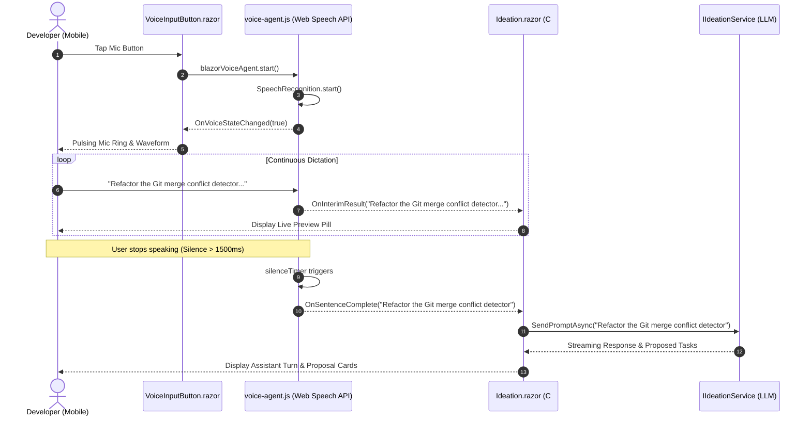

# 🎙️ Step 12.12: Voice Support, Continuous Dictation & Hands-Free Operations

> **Phase 12 Implementation Step (Extend Features - Deep Integrations & Remote Experience)** *(formerly Step 11.11)*  
> *Parent Plan:* [Phase 12 Master Plan](../12_EXTEND_FEATURES.md)  
> *Related Steps:* [Step 12.4: Ideation Quick Notes](STEP_12_4_IDEATION_QUICK_NOTES_SUGGESTIONS_AND_REFINEMENT.md) | [Step 12.8: Mobile-Responsive UI & PWA](STEP_12_8_MOBILE_RESPONSIVE_UI_AND_PWA.md) | [Step 12.16: Remote Tailscale Access](STEP_12_16_TAILSCALE_REMOTE_ACCESS.md)  
> *Source Policy:* [AGENTS.md](../../../AGENTS.md)  
> *Project Target:* `src/NightCodeForge.Web`, `tests/NightCodeForge.Web.Tests` | *Status:* Planned | *Target Framework:* .NET 10 (C# 13)

> This document is a **specification**: it states required behaviors and constraints, not implementations. Implementation choices (signatures, code structure) are left to the implementer, within the constraints of the documents.

---

## 1. Executive Objective

Enable a fluid, hands-free voice interaction experience on mobile devices and desktops via browser-native speech recognition:

1. **Native Voice Recognition via Web Speech API:**
   - Integrate continuous client-side speech-to-text through the browser's native `SpeechRecognition` / `webkitSpeechRecognition` API via a resilient Blazor JavaScript Interop bridge (`voice-agent.js`).
   - Support continuous stream listening, interim transcript feedback, and automatic silence detection (1500ms debounce) to auto-dispatch spoken prompts directly to the AI agent or capture quick notes without manual tapping.
2. **First-Class Voice Integration across Core Workflows:**
   - **Ideation Chat ([Ideation.razor](file:///c:/Users/Julien/source/repos/jetelain/NightCodeForge/src/NightCodeForge.Web/Components/Pages/Ideation.razor)):** Voice-dictate architectural ideas, questions, and feature requests directly into the LLM conversation loop.
   - **Quick Notes & Backlog Intake ([Step 12.4](file:///c:/Users/Julien/source/repos/jetelain/NightCodeForge/docs/plan/phase-12/STEP_12_4_IDEATION_QUICK_NOTES_SUGGESTIONS_AND_REFINEMENT.md)):** Instant one-tap voice memo capture saving spoken thoughts as `Suggested` tasks in the backlog.
   - **Human Question Inbox ([Inbox.razor](file:///c:/Users/Julien/source/repos/jetelain/NightCodeForge/src/NightCodeForge.Web/Components/Pages/Inbox.razor)):** Answer pending agent clarification questions on the go without typing on mobile keyboards.
3. **Ergonomic Visual Feedback:**
   - Provide a pulsing audio ring and waveform indicator component ([VoiceInputButton.razor](file:///c:/Users/Julien/source/repos/jetelain/NightCodeForge/src/NightCodeForge.Web/Components/Common/VoiceInputButton.razor)) displaying live interim text badges as the developer speaks.

*(Note: Progressive Web App installation for persistent microphone permissions is specified in [Step 12.8: Mobile-Responsive UI & PWA](file:///c:/Users/Julien/source/repos/jetelain/NightCodeForge/docs/plan/phase-12/STEP_12_8_MOBILE_RESPONSIVE_UI_AND_PWA.md). Secure HTTPS exposition required for browser microphone access is specified in [Step 12.16: Remote Tailscale Access](file:///c:/Users/Julien/source/repos/jetelain/NightCodeForge/docs/plan/phase-12/STEP_12_16_TAILSCALE_REMOTE_ACCESS.md).)*

---

## 2. Problem Statement & Motivation

### 2.1 The Friction of Mobile Keyboard Input
- Software developers often formulate ideas, review running tasks, or respond to agent questions while commuting, walking, or away from their workstation desk ([Step 12.8](file:///c:/Users/Julien/source/repos/jetelain/NightCodeForge/docs/plan/phase-12/STEP_12_8_MOBILE_RESPONSIVE_UI_AND_PWA.md)).
- Typing long technical requirements or explanatory answers on a smartphone soft keyboard is error-prone, slow, and frustrating.
- Natural speech dictation is 3–4x faster than thumb typing and matches the conversational paradigm of the Ideation agent and human clarification triage.

### 2.2 Continuous Dictation vs. Push-to-Talk
- Traditional push-to-talk requires holding down a finger while talking, preventing simultaneous interaction with the screen.
- True hands-free dictation requires intelligent silence detection: the developer taps once to start talking, the interface captures interim words in real time, and after 1.5 seconds of silence, automatically finalizes the sentence and triggers the AI submission.

---

## 3. Technical & Behavioral Specifications

### 3.1 Web Speech API Architecture & JavaScript Interop

#### A. Client-Side Script (`wwwroot/js/voice-agent.js`)
The voice integration is encapsulated in a dedicated module `window.blazorVoiceAgent` registered in [App.razor](file:///c:/Users/Julien/source/repos/jetelain/NightCodeForge/src/NightCodeForge.Web/Components/App.razor):

```javascript
window.blazorVoiceAgent = {
    recognition: null,
    dotNetHelper: null,
    silenceTimer: null,
    finalTranscript: '',
    intentionalStop: false,
    silenceDebounceMs: 1500,

    init: function (dotNetHelper, lang = (navigator.language || 'en-US'), debounceMs = 1500) {
        this.dotNetHelper = dotNetHelper;
        this.silenceDebounceMs = debounceMs;
        const SpeechRecognition = window.SpeechRecognition || window.webkitSpeechRecognition;

        if (!SpeechRecognition) {
            console.warn('[blazorVoiceAgent] Web Speech API is not supported in this browser.');
            return false;
        }

        this.recognition = new SpeechRecognition();
        this.recognition.lang = lang;
        this.recognition.continuous = true;
        this.recognition.interimResults = true;

        this.recognition.onresult = (event) => {
            let interimTranscript = '';
            for (let i = event.resultIndex; i < event.results.length; ++i) {
                if (event.results[i].isFinal) {
                    this.finalTranscript += event.results[i][0].transcript + ' ';
                } else {
                    interimTranscript += event.results[i][0].transcript;
                }
            }

            const currentFull = (this.finalTranscript + interimTranscript).trim();
            if (this.dotNetHelper) {
                this.dotNetHelper.invokeMethodAsync('OnInterimResult', currentFull);
            }

            clearTimeout(this.silenceTimer);
            this.silenceTimer = setTimeout(() => {
                if (currentFull.length > 0) {
                    this.stopAndSubmit();
                }
            }, this.silenceDebounceMs);
        };

        this.recognition.onerror = (event) => {
            console.error('[blazorVoiceAgent] Error:', event.error);
            clearTimeout(this.silenceTimer);
            if (this.dotNetHelper) {
                this.dotNetHelper.invokeMethodAsync('OnVoiceError', event.error);
            }
        };

        this.recognition.onend = () => {
            if (!this.intentionalStop) {
                // Auto-restart if browser stops recognition unexpectedly during active session
                try {
                    this.recognition.start();
                } catch (e) {
                    // Ignore already started errors
                }
            } else {
                if (this.dotNetHelper) {
                    this.dotNetHelper.invokeMethodAsync('OnVoiceStateChanged', false);
                }
            }
        };

        return true;
    },

    start: function () {
        this.finalTranscript = '';
        this.intentionalStop = false;
        clearTimeout(this.silenceTimer);
        try {
            this.recognition.start();
            if (this.dotNetHelper) {
                this.dotNetHelper.invokeMethodAsync('OnVoiceStateChanged', true);
            }
        } catch (e) {
            console.warn('[blazorVoiceAgent] Already active or failed to start:', e);
        }
    },

    stop: function () {
        this.intentionalStop = true;
        clearTimeout(this.silenceTimer);
        try {
            this.recognition.stop();
        } catch (e) { }
    },

    stopAndSubmit: function () {
        const full = this.finalTranscript.trim();
        this.stop();
        if (this.dotNetHelper && full.length > 0) {
            this.dotNetHelper.invokeMethodAsync('OnSentenceComplete', full);
        }
        this.finalTranscript = '';
    }
};
```

---

### 3.2 Visual Component: `VoiceInputButton.razor`

Provide a reusable Blazor button component rendering an interactive microphone icon with pulsing waveform feedback:

```razor
@inject IJSRuntime JS
@implements IAsyncDisposable

<div class="voice-input-container @(IsListening ? "is-listening" : "")">
    <button type="button" 
            class="forge-btn forge-btn-icon @(IsListening ? "forge-btn-danger pulse-ring" : "forge-btn-ghost")" 
            title="@(IsListening ? "Listening... (Tap to Cancel)" : "Start Voice Input")"
            @onclick="ToggleVoiceInputAsync">
        @if (IsListening)
        {
            <span class="voice-waveform-icon">🎙️</span>
        }
        else
        {
            <span>🎤</span>
        }
    </button>

    @if (IsListening && !string.IsNullOrWhiteSpace(InterimTranscript))
    {
        <div class="voice-interim-pill">
            <span class="interim-text">@InterimTranscript</span>
            <span class="listening-dots">...</span>
        </div>
    }
</div>

@code {
    [Parameter] public EventCallback<string> OnSentenceCaptured { get; set; }
    [Parameter] public EventCallback<string> OnInterimChanged { get; set; }
    [Parameter] public string Language { get; set; } = "en-US";
    [Parameter] public int SilenceDebounceMs { get; set; } = 1500;

    public bool IsListening { get; private set; }
    public string InterimTranscript { get; private set; } = string.Empty;

    private DotNetObjectReference<VoiceInputButton>? _dotNetRef;
    private bool _isInitialized;

    protected override async Task OnAfterRenderAsync(bool firstRender)
    {
        if (firstRender)
        {
            _dotNetRef = DotNetObjectReference.Create(this);
            _isInitialized = await JS.InvokeAsync<bool>("blazorVoiceAgent.init", _dotNetRef, Language, SilenceDebounceMs);
        }
    }

    public async Task ToggleVoiceInputAsync()
    {
        if (!_isInitialized) return;

        if (IsListening)
        {
            await JS.InvokeVoidAsync("blazorVoiceAgent.stop");
            IsListening = false;
            InterimTranscript = string.Empty;
        }
        else
        {
            InterimTranscript = string.Empty;
            await JS.InvokeVoidAsync("blazorVoiceAgent.start");
        }
        StateHasChanged();
    }

    [JSInvokable]
    public void OnInterimResult(string text)
    {
        InterimTranscript = text;
        OnInterimChanged.InvokeAsync(text);
        StateHasChanged();
    }

    [JSInvokable]
    public async Task OnSentenceComplete(string text)
    {
        IsListening = false;
        InterimTranscript = string.Empty;
        StateHasChanged();
        await OnSentenceCaptured.InvokeAsync(text);
    }

    [JSInvokable]
    public void OnVoiceStateChanged(bool active)
    {
        IsListening = active;
        if (!active) InterimTranscript = string.Empty;
        StateHasChanged();
    }

    [JSInvokable]
    public void OnVoiceError(string error)
    {
        IsListening = false;
        InterimTranscript = string.Empty;
        StateHasChanged();
    }

    public async ValueTask DisposeAsync()
    {
        if (IsListening)
        {
            try { await JS.InvokeVoidAsync("blazorVoiceAgent.stop"); } catch { }
        }
        _dotNetRef?.Dispose();
    }
}
```

---

### 3.3 Core Workflow Integrations

1. **Ideation Chat ([Ideation.razor](file:///c:/Users/Julien/source/repos/jetelain/NightCodeForge/src/NightCodeForge.Web/Components/Pages/Ideation.razor)):**
   - Embed `<VoiceInputButton>` directly beside the text prompt input.
   - When speech concludes (silence detected), the captured text auto-populates the input box and optionally dispatches immediately to `IIdeationService.SendPromptAsync`.
2. **Quick Notes Backlog Intake ([Step 12.4](file:///c:/Users/Julien/source/repos/jetelain/NightCodeForge/docs/plan/phase-12/STEP_12_4_IDEATION_QUICK_NOTES_SUGGESTIONS_AND_REFINEMENT.md)):**
   - In the top bar "+ Note" drawer, embed `<VoiceInputButton>`. Spoken memos are automatically transcribed and saved as `Suggested` backlog tasks.
3. **Clarifying Questions ([Inbox.razor](file:///c:/Users/Julien/source/repos/jetelain/NightCodeForge/src/NightCodeForge.Web/Components/Pages/Inbox.razor)):**
   - In [QuestionCard.razor](file:///c:/Users/Julien/source/repos/jetelain/NightCodeForge/src/NightCodeForge.Web/Components/Inbox/QuestionCard.razor), allow free-text question responses to be dictated by voice.

---

## 4. Sequence & Dataflow Architecture



---

## 5. Implementation Checklist & Deliverables

- [ ] **Client-Side Voice Script & JS Interop:**
  - [ ] Implement `wwwroot/js/voice-agent.js` with feature detection, auto-restart resilience, language configuration, and 1500ms silence timer.
  - [ ] Support graceful fallback when `SpeechRecognition` is unsupported.
  - [ ] Register `voice-agent.js` in [App.razor](file:///c:/Users/Julien/source/repos/jetelain/NightCodeForge/src/NightCodeForge.Web/Components/App.razor).
- [ ] **Blazor Component Architecture:**
  - [ ] Create `VoiceInputButton.razor` with `OnSentenceCaptured`, `OnInterimChanged`, and `IAsyncDisposable` lifecycle.
  - [ ] Add CSS keyframe pulse animation and visual transcription badge to `app.css` / `theme.css`.
  - [ ] Integrate `VoiceInputButton` into [Ideation.razor](file:///c:/Users/Julien/source/repos/jetelain/NightCodeForge/src/NightCodeForge.Web/Components/Pages/Ideation.razor) input bar with auto-submit capability.
  - [ ] Integrate voice button into Quick Note capture bar / modal ([Step 12.4](file:///c:/Users/Julien/source/repos/jetelain/NightCodeForge/docs/plan/phase-12/STEP_12_4_IDEATION_QUICK_NOTES_SUGGESTIONS_AND_REFINEMENT.md)).
  - [ ] Integrate voice button into [QuestionCard.razor](file:///c:/Users/Julien/source/repos/jetelain/NightCodeForge/src/NightCodeForge.Web/Components/Inbox/QuestionCard.razor) in [Inbox.razor](file:///c:/Users/Julien/source/repos/jetelain/NightCodeForge/src/NightCodeForge.Web/Components/Pages/Inbox.razor).
- [ ] **Testing & Quality Assurance:**
  - [ ] bUnit tests for `VoiceInputButton.razor` checking state toggles, parameter callbacks, and disposal semantics.
  - [ ] Unit tests verifying silence debounce timing logic and JS callback invocation.
