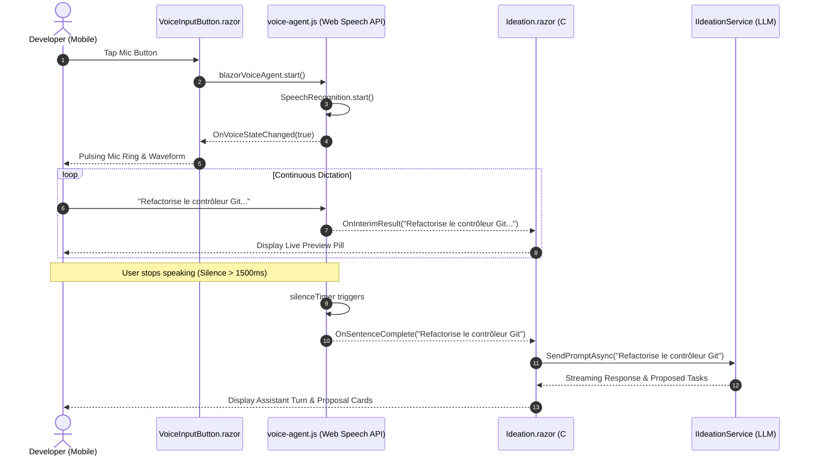
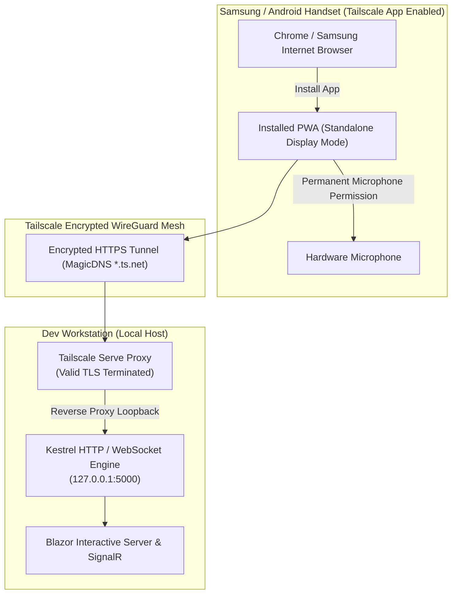

# 🎙️ Step 12.12: Voice Support, Continuous Dictation & PWA Mobile Experience

> **Phase 12 Implementation Step (Extend Features - Deep Integrations & Remote Experience)** *(formerly Step 11.11)*  
> *Parent Plan:* [Phase 12 Master Plan](../12_EXTEND_FEATURES.md)  
> *Source Policy:* [AGENTS.md](../../../AGENTS.md)  
> *Project Target:* `src/NightCodeForge.Web`, `tests/NightCodeForge.Web.Tests` | *Status:* Planned | *Target Framework:* .NET 10 (C# 13)

> This document is a **specification**: it states required behaviors and constraints, not implementations. Implementation choices (signatures, code structure) are left to the implementer, within the constraints of the documents.

---

## 1. Executive Objective

Enable a fluid, hands-free voice interaction experience on mobile devices (smartphones and tablets, particularly Android/Samsung and iOS) and transform NightCodeForge into an installable **Progressive Web App (PWA)** accessible over secure **Tailscale HTTPS**:

1. **Native Voice Recognition via Web Speech API:**
   - Integrate continuous client-side speech-to-text through the browser's native `SpeechRecognition` / `webkitSpeechRecognition` API via a resilient Blazor JavaScript Interop bridge (`voice-agent.js`).
   - Support continuous stream listening, interim transcript feedback, and automatic silence detection (1500ms debounce) to auto-dispatch spoken prompts directly to the AI agent or capture quick notes without manual tapping.
2. **First-Class Voice Integration across Core Workflows:**
   - **Ideation Chat ([Ideation.razor](file:///c:/Users/Julien/source/repos/jetelain/NightCodeForge/src/NightCodeForge.Web/Components/Pages/Ideation.razor)):** Voice-dictate architectural ideas, questions, and feature requests directly into the LLM conversation loop.
   - **Quick Notes & Backlog Intake ([Step 12.4](file:///c:/Users/Julien/source/repos/jetelain/NightCodeForge/docs/plan/phase-12/STEP_12_4_IDEATION_QUICK_NOTES_SUGGESTIONS_AND_REFINEMENT.md)):** Instant one-tap voice memo capture saving spoken thoughts as `Suggested` tasks in the backlog.
   - **Human Question Inbox ([Inbox.razor](file:///c:/Users/Julien/source/repos/jetelain/NightCodeForge/src/NightCodeForge.Web/Components/Pages/Inbox.razor)):** Answer pending agent clarification questions on the go without typing on mobile keyboards.
3. **Progressive Web App (PWA) for Permission Persistence & Fullscreen UX:**
   - Configure a Web App Manifest (`manifest.webmanifest`) and Service Worker (`service-worker.js`) in [NightCodeForge.Web](file:///c:/Users/Julien/source/repos/jetelain/NightCodeForge/src/NightCodeForge.Web/NightCodeForge.Web.csproj).
   - Enable "Add to Home Screen" on mobile devices with `standalone` display mode, eliminating browser chrome and **persistently remembering microphone permissions** across sessions.
4. **Zero-Friction Remote HTTPS via Tailscale Serve:**
   - Satisfy modern browser security policies (which strictly forbid microphone access and Service Worker registration on non-localhost insecure HTTP) by exposing Kestrel through **Tailscale Serve** (`tailscale serve https / port`).
   - Provide seamless reverse-proxying with trusted MagicDNS SSL certificates and full WebSocket pass-through for Blazor Interactive Server and SignalR telemetry.

---

## 2. Problem Statement & Motivation

### 2.1 The Friction of Mobile Keyboard Input
- Software developers often formulate ideas, review running tasks, or respond to agent questions while commuting, walking, or away from their workstation desk ([Step 12.8](file:///c:/Users/Julien/source/repos/jetelain/NightCodeForge/docs/plan/phase-12/STEP_12_8_MOBILE_RESPONSIVE_UI_AND_TAILSCALE_ACCESS.md)).
- Typing long technical requirements or explanatory answers on a smartphone soft keyboard is error-prone, slow, and frustrating.
- Natural speech dictation is 3–4x faster than thumb typing and matches the conversational paradigm of the Ideation agent and human clarification triage.

### 2.2 Android Microphone Permission Ephemerality
- In mobile Chrome/Samsung Internet, ordinary browser tabs frequently prompt the user for microphone permissions on every visit or after tab eviction.
- Installing the application as a **PWA (Progressive Web App)** grants persistent permissions: once authorized, the microphone remains permanently approved for the application standalone window, enabling an instant, frictionless walkie-talkie experience.

### 2.3 The Insecure Context Barrier (`getUserMedia` & `SpeechRecognition`)
- Modern web security standards mandate a **Secure Context** (`window.isSecureContext === true`) for:
  - `SpeechRecognition` / `webkitSpeechRecognition`
  - `navigator.mediaDevices.getUserMedia`
  - `navigator.serviceWorker.register`
- Accessing a local development server over a plain IP address or private DNS (e.g. `http://100.x.y.z:5000` or `http://my-gpu-server:5000`) silently disables the Web Speech API and blocks microphone access with `NotAllowedError` or `SecurityError`.
- Self-signed certificates require cumbersome manual root CA installations on mobile handsets.
- **Tailscale Serve** resolves this natively by issuing trusted Let's Encrypt certificates for the workstation's MagicDNS name (e.g. `https://my-workstation.tailnet-xyz.ts.net`), providing automatic HTTPS with zero certificate warnings and full WebSocket support.

---

## 3. Technical & Behavioral Specifications

### 3.1 Web Speech API Architecture & JavaScript Interop

#### A. Client-Side Script (`wwwroot/js/voice-agent.js`)
The voice integration is encapsulated in a dedicated module `window.blazorVoiceAgent` registered in [App.razor](file:///c:/Users/Julien/source/repos/jetelain/NightCodeForge/src/NightCodeForge.Web/Components/App.razor):

```javascript
window.blazorVoiceAgent = {
    recognition: null,
    dotNetHelper: null,
    silenceTimer: null,
    finalTranscript: '',
    intentionalStop: false,
    silenceDebounceMs: 1500,

    init: function (dotNetHelper, lang = 'fr-FR', debounceMs = 1500) {
        this.dotNetHelper = dotNetHelper;
        this.silenceDebounceMs = debounceMs;
        const SpeechRecognition = window.SpeechRecognition || window.webkitSpeechRecognition;

        if (!SpeechRecognition) {
            console.warn('[blazorVoiceAgent] Web Speech API is not supported in this browser.');
            return false;
        }

        this.recognition = new SpeechRecognition();
        this.recognition.lang = lang;
        this.recognition.continuous = true;
        this.recognition.interimResults = true;

        this.recognition.onresult = (event) => {
            let interimTranscript = '';
            for (let i = event.resultIndex; i < event.results.length; ++i) {
                if (event.results[i].isFinal) {
                    this.finalTranscript += event.results[i][0].transcript + ' ';
                } else {
                    interimTranscript += event.results[i][0].transcript;
                }
            }

            const currentFull = (this.finalTranscript + interimTranscript).trim();
            if (this.dotNetHelper) {
                this.dotNetHelper.invokeMethodAsync('OnInterimResult', currentFull);
            }

            clearTimeout(this.silenceTimer);
            if (this.finalTranscript.trim().length > 0) {
                this.silenceTimer = setTimeout(() => {
                    const completed = this.finalTranscript.trim();
                    this.finalTranscript = '';
                    if (this.dotNetHelper && completed.length > 0) {
                        this.dotNetHelper.invokeMethodAsync('OnSentenceComplete', completed);
                    }
                }, this.silenceDebounceMs);
            }
        };

        this.recognition.onerror = (event) => {
            // Ignore non-fatal 'no-speech' or 'aborted' events
            if (event.error !== 'no-speech' && event.error !== 'aborted') {
                console.error('[blazorVoiceAgent] Speech recognition error:', event.error);
                if (this.dotNetHelper) {
                    this.dotNetHelper.invokeMethodAsync('OnVoiceError', event.error);
                }
            }
        };

        this.recognition.onend = () => {
            // Auto-restart continuous recognition unless user explicitly tapped stop
            if (!this.intentionalStop && this.recognition) {
                try {
                    this.recognition.start();
                } catch (e) {
                    // Ignore already started errors
                }
            } else if (this.dotNetHelper) {
                this.dotNetHelper.invokeMethodAsync('OnVoiceStateChanged', false);
            }
        };

        return true;
    },

    start: function () {
        this.intentionalStop = false;
        this.finalTranscript = '';
        clearTimeout(this.silenceTimer);
        if (this.recognition) {
            try {
                this.recognition.start();
                if (this.dotNetHelper) {
                    this.dotNetHelper.invokeMethodAsync('OnVoiceStateChanged', true);
                }
            } catch (e) {
                console.warn('[blazorVoiceAgent] Already active or starting:', e);
            }
        }
    },

    stop: function () {
        this.intentionalStop = true;
        clearTimeout(this.silenceTimer);
        if (this.recognition) {
            try {
                this.recognition.stop();
            } catch (e) { }
        }
        if (this.dotNetHelper) {
            this.dotNetHelper.invokeMethodAsync('OnVoiceStateChanged', false);
        }
    },

    setLanguage: function (lang) {
        if (this.recognition) {
            this.recognition.lang = lang;
        }
    }
};
```

#### B. Key Interop Robustness Constraints
1. **Silence Debouncing:** The silence timer defaults to `1500ms`. When the speaker pauses for 1.5 seconds following a final speech fragment, `OnSentenceComplete` fires with the accumulated phrase and the buffer resets cleanly.
2. **Auto-Reconnection Resilience:** Mobile Web Speech implementations on Android Chrome may prematurely terminate recognition on intermittent silence. The `onend` handler verifies `!this.intentionalStop` and immediately calls `this.recognition.start()`, guaranteeing uninterrupted dictation.
3. **Safe Memory & Circuit Disposal:** The Blazor component manages a scoped `DotNetObjectReference`. Upon component unmount or disposal, `blazorVoiceAgent.stop()` is invoked and the reference is disposed of to eliminate memory leaks and dangling callback exceptions.

---

### 3.2 Reusable Blazor Voice Input Components

#### A. `VoiceInputButton.razor` (Microphone Action Trigger)
A compact, versatile microphone button designed for inclusion into any text bar or modal header:

```razor
@inject IJSRuntime JS
@implements IAsyncDisposable

<button type="button"
        class="voice-mic-btn @(IsListening ? "active pulse" : "") @(!IsSupported ? "disabled" : "")"
        @onclick="ToggleListeningAsync"
        title="@ButtonTooltip"
        disabled="@(!IsSupported)">
    @if (IsListening)
    {
        <span class="voice-wave-icon">🎙️</span>
    }
    else
    {
        <span class="voice-idle-icon">🎤</span>
    }
</button>
```

#### B. Component Properties & Callbacks
- `[Parameter] public EventCallback<string> OnSentenceCaptured { get; set; }`: Dispatched when a sentence is finalized by the silence timer.
- `[Parameter] public EventCallback<string> OnInterimChanged { get; set; }`: Dispatched in real time as the user speaks.
- `[Parameter] public string DefaultLanguage { get; set; } = "fr-FR"`: Default speech recognition language (configurable per user/workspace).
- `[Parameter] public int SilenceDebounceMs { get; set; } = 1500`: Inactivity window before sentence completion.
- `[Parameter] public bool AutoSubmit { get; set; } = true`: If `true`, completes and dispatches the prompt; if `false`, appends transcript to target input field for manual review.

#### C. Integration Points
1. **Ideation Chat ([Ideation.razor](file:///c:/Users/Julien/source/repos/jetelain/NightCodeForge/src/NightCodeForge.Web/Components/Pages/Ideation.razor)):**
   - Positioned on the right side of the fixed-bottom prompt input bar.
   - When listening, an animated live transcription pill floats above the input:  
     `[🎙️ "Ajoute une route API pour lister les tâches en cours..."]`
   - Upon silence timeout, automatically submits the question/instruction to `IIdeationService.SendPromptAsync(...)` without touching the screen.
2. **Quick Notes Capture ([Step 12.4](file:///c:/Users/Julien/source/repos/jetelain/NightCodeForge/docs/plan/phase-12/STEP_12_4_IDEATION_QUICK_NOTES_SUGGESTIONS_AND_REFINEMENT.md)):**
   - Embedded in the top navigation bar quick-note action modal or floating action button.
   - Dictating a spontaneous idea immediately creates a `Suggested` task in the database with the transcribed text as the title/description.
3. **Human Clarification Inbox ([QuestionCard.razor](file:///c:/Users/Julien/source/repos/jetelain/NightCodeForge/src/NightCodeForge.Web/Components/Inbox/QuestionCard.razor)):**
   - Allows speaking free-text responses to pending agent clarification questions directly from a mobile handset.

---

### 3.3 Audio UX, Visual States & Silence Indicators

To provide confident, hands-free feedback, the UI reflects real-time audio state:
1. **Idle State:** Sleek muted microphone icon (`#6b7280`).
2. **Active Listening State:** Glowing indigo/violet accent with a subtle CSS pulse animation ring (`@keyframes mic-pulse`).
3. **Voice Activity Indicator (Speaking):** Real-time interim transcript preview chip displayed in high-contrast italicized typography, updating with zero latency.
4. **Silence Countdown Indicator:** When the user stops speaking, a subtle progress bar or circular ring fills over 1.5 seconds, giving the user intuitive visual notice before the prompt is automatically committed.
5. **Unsupported / Secure Context Error State:** If the browser lacks `SpeechRecognition` or is running in an insecure non-HTTPS context, the button renders in a disabled state with a descriptive tooltip: *"Voice input requires HTTPS and a supported browser (Chrome, Edge, Safari)"*.

```css
/* Voice Microphone Styling */
.voice-mic-btn {
    display: inline-flex;
    align-items: center;
    justify-content: center;
    width: 44px;
    height: 44px;
    border-radius: 50%;
    background: var(--color-surface-2);
    border: 1px solid var(--color-border);
    cursor: pointer;
    transition: all 0.2s ease-in-out;
}

.voice-mic-btn.active.pulse {
    background: var(--color-primary);
    border-color: var(--color-primary-light);
    box-shadow: 0 0 0 0 rgba(99, 102, 241, 0.7);
    animation: mic-pulse 1.6s infinite cubic-bezier(0.66, 0, 0, 1);
}

@keyframes mic-pulse {
    to {
        box-shadow: 0 0 0 14px rgba(99, 102, 241, 0);
    }
}
```

---

### 3.4 Progressive Web App (PWA) Architecture & Permission Persistence

#### A. Web App Manifest (`wwwroot/manifest.webmanifest`)
Create the manifest file declaring application metadata, theme styling, and standalone display mode:

```json
{
  "name": "NightCodeForge",
  "short_name": "Forge",
  "description": "Autonomous AI Software Engineering Forge",
  "start_url": "/",
  "display": "standalone",
  "background_color": "#0b0f19",
  "theme_color": "#4f46e5",
  "orientation": "portrait-primary",
  "icons": [
    {
      "src": "favicon.svg",
      "sizes": "any",
      "type": "image/svg+xml",
      "purpose": "any maskable"
    },
    {
      "src": "favicon.png",
      "sizes": "512x512",
      "type": "image/png",
      "purpose": "any"
    }
  ]
}
```

#### B. Service Worker (`wwwroot/service-worker.js`)
Provide a lightweight service worker to satisfy PWA installability requirements and cache core offline assets:

```javascript
// NightCodeForge Minimal PWA Service Worker
const CACHE_NAME = 'ncf-cache-v1';
const PRECACHE_URLS = [
    '/',
    '/css/theme.css',
    '/css/app.css',
    '/js/app.js',
    '/js/voice-agent.js',
    '/favicon.svg',
    '/favicon.png',
    '/manifest.webmanifest'
];

self.addEventListener('install', (event) => {
    event.waitUntil(
        caches.open(CACHE_NAME).then((cache) => cache.addAll(PRECACHE_URLS))
    );
    self.skipWaiting();
});

self.addEventListener('activate', (event) => {
    event.waitUntil(
        caches.keys().then((keys) =>
            Promise.all(
                keys.filter((k) => k !== CACHE_NAME).map((k) => caches.delete(k))
            )
        )
    );
    self.clients.claim();
});

// Network-first strategy for dynamic Blazor Server content, falling back to cache
self.addEventListener('fetch', (event) => {
    // Exclude SignalR hub and API routes from service worker cache
    if (event.request.url.includes('/_blazor') || event.request.url.includes('/hubs/')) {
        return;
    }

    event.respondWith(
        fetch(event.request).catch(() => caches.match(event.request))
    );
});
```

#### C. Registration in [App.razor](file:///c:/Users/Julien/source/repos/jetelain/NightCodeForge/src/NightCodeForge.Web/Components/App.razor)
Add the manifest link and service worker registration script to the HTML root:

```html
<head>
    ...
    <link rel="manifest" href="manifest.webmanifest" />
    <meta name="theme-color" content="#4f46e5" />
    <meta name="apple-mobile-web-app-capable" content="yes" />
    <meta name="apple-mobile-web-app-status-bar-style" content="black-translucent" />
</head>
<body class="forge-body">
    ...
    <script src="js/voice-agent.js"></script>
    <script>
        if ('serviceWorker' in navigator && window.isSecureContext) {
            navigator.serviceWorker.register('/service-worker.js')
                .then(reg => console.log('[PWA] Service Worker registered:', reg.scope))
                .catch(err => console.warn('[PWA] Service Worker registration failed:', err));
        }
    </script>
</body>
```

---

### 3.5 Remote HTTPS Exposition via Tailscale Serve

#### A. Architecture Overview
To securely access the application from a smartphone without SSL certificate errors or security blocks:

```
[Smartphone (Android / Samsung / iOS)]
       │
       │  HTTPS (Trusted Let's Encrypt SSL via Tailscale MagicDNS)
       │  e.g. https://forge-pc.tailnet-xyz.ts.net
       ▼
[Tailscale Serve Reverse Proxy] (Running on Dev Workstation)
       │
       │  HTTP / WebSocket Loopback (127.0.0.1:5000)
       ▼
[Kestrel Server (NightCodeForge.Web)]
       │
       ├── Blazor Interactive Server (_blazor WebSockets)
       ├── SignalR Telemetry Hub (/hubs/orchestrator)
       └── PWA Static Assets & Web Speech JS Interop
```

#### B. Setup & Execution Commands
1. Ensure NightCodeForge is started and listening locally (e.g. `http://localhost:5000`).
2. Run the Tailscale Serve command from PowerShell or Bash on the development machine:
   ```powershell
   tailscale serve https / http://127.0.0.1:5000
   ```
3. To run it as a persistent background service:
   ```powershell
   tailscale serve --bg https / http://127.0.0.1:5000
   ```
4. Verify active serve status:
   ```powershell
   tailscale serve status
   ```
5. On the mobile phone connected to the same Tailnet:
   - Navigate to the MagicDNS domain: `https://<device-name>.<tailnet-domain>.ts.net`.
   - Browser displays a valid green lock SSL badge (no certificate bypass required).
   - In browser menu, select **"Add to Home Screen"** or **"Install App"**.
   - Launch NightCodeForge from the home screen: it opens in full-screen standalone mode with audio and mic capabilities permanently enabled.

---

## 4. Sequence & Dataflow Architecture

### 4.1 Voice Interaction & Silence Detection Loop


### 4.2 PWA & Tailscale HTTPS Security Handshake


---

## 5. Implementation Checklist & Deliverables

- [ ] **Client-Side Voice Script & JS Interop:**
  - [ ] Implement `wwwroot/js/voice-agent.js` with feature detection, auto-restart resilience, language configuration, and 1500ms silence timer.
  - [ ] Support graceful fallback when `SpeechRecognition` is unsupported.
  - [ ] Register `voice-agent.js` in [App.razor](file:///c:/Users/Julien/source/repos/jetelain/NightCodeForge/src/NightCodeForge.Web/Components/App.razor).
- [ ] **Blazor Component Architecture:**
  - [ ] Create `VoiceInputButton.razor` with `OnSentenceCaptured`, `OnInterimChanged`, and `IAsyncDisposable` lifecycle.
  - [ ] Add CSS keyframe pulse animation and visual transcription badge to `app.css` / `theme.css`.
  - [ ] Integrate `VoiceInputButton` into [Ideation.razor](file:///c:/Users/Julien/source/repos/jetelain/NightCodeForge/src/NightCodeForge.Web/Components/Pages/Ideation.razor) input bar with auto-submit capability.
  - [ ] Integrate voice button into Quick Note capture bar / modal ([Step 12.4](file:///c:/Users/Julien/source/repos/jetelain/NightCodeForge/docs/plan/phase-12/STEP_12_4_IDEATION_QUICK_NOTES_SUGGESTIONS_AND_REFINEMENT.md)).
  - [ ] Integrate voice button into [QuestionCard.razor](file:///c:/Users/Julien/source/repos/jetelain/NightCodeForge/src/NightCodeForge.Web/Components/Inbox/QuestionCard.razor) in [Inbox.razor](file:///c:/Users/Julien/source/repos/jetelain/NightCodeForge/src/NightCodeForge.Web/Components/Pages/Inbox.razor).
- [ ] **PWA Configuration (Blazor Web App):**
  - [ ] Create `wwwroot/manifest.webmanifest` defining `standalone` mode, colors, and application icons.
  - [ ] Implement `wwwroot/service-worker.js` with cache-first static asset strategy and SignalR/WebSocket bypass.
  - [ ] Wire manifest link, theme meta tags, and Service Worker registration in [App.razor](file:///c:/Users/Julien/source/repos/jetelain/NightCodeForge/src/NightCodeForge.Web/Components/App.razor).
- [ ] **Tailscale Serve Remote Setup & Documentation:**
  - [ ] Document `tailscale serve https / http://127.0.0.1:5000` setup workflow in `docs/` and project README.
  - [ ] Provide a convenience PowerShell/Bash helper script (`tools/serve-tailscale.ps1` or similar) to launch Tailscale Serve.
- [ ] **Testing & Quality Assurance:**
  - [ ] bUnit tests for `VoiceInputButton.razor` checking state toggles, parameter callbacks, and disposal semantics.
  - [ ] Unit tests verifying silence debounce timing logic and JS callback invocation.
  - [ ] End-to-end / Playwright verification of manifest and service worker presence.
