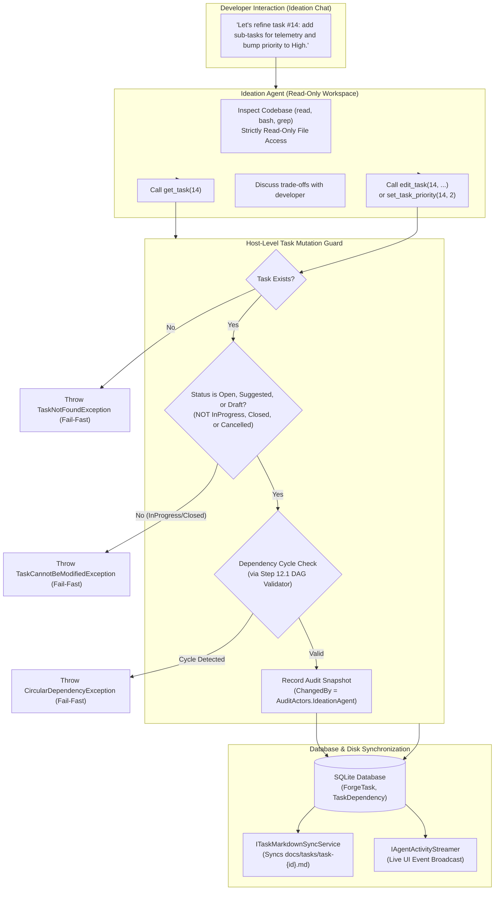

# 📋 Step 12.13: Conversational Backlog Management, Task Refinement & Scoped Mutation Tools in Ideation

> **Phase 12 Implementation Step (Extend Features - Backlog Management & Dependencies)**  
> *Parent Plan:* [Phase 12 Master Plan](../12_EXTEND_FEATURES.md)  
> *Target Components:* `src/NightCodeForge.Agents/Ideation`, `src/NightCodeForge.Agents/Tools`, `src/NightCodeForge.Core/Domain`, `src/NightCodeForge.Core/Interfaces`, `src/NightCodeForge.Core/Services`, `src/NightCodeForge.Web/Components/Ideation`, `src/NightCodeForge.Web/Components/Backlog`, `tests/NightCodeForge.Agents.Tests` | *Status:* Planned | *Target Framework:* .NET 10 (C# 13)  
> *Related Steps:* [Step 11.7 (Task State History & Audit Trail)](../phase-11/STEP_11_7_TASK_STATE_HISTORY_AND_AUDIT_TRAIL.md), [Step 12.1 (Intelligent Task Dependency Detection)](STEP_12_1_INTELLIGENT_TASK_DEPENDENCY_DETECTION.md), [Step 12.4 (Ideation Quick Notes & Suggestions)](STEP_12_4_IDEATION_QUICK_NOTES_SUGGESTIONS_AND_REFINEMENT.md)

> This document is a **specification**: it states required behaviors and constraints, not implementations. Implementation choices (signatures, code structure) are left to the implementer, within the constraints of the documents.

---

## 1. Executive Objective

In software engineering workflows, ideation is rarely a one-way street where an agent simply generates brand new task proposals from scratch. Developers frequently need to return to **existing backlog tasks** (tasks in `Suggested` or `Open` states) to:
1. **Discuss and enrich task details:** Clarify architectural decisions, add concrete sub-tasks or implementation checklists, specify edge cases, document acceptance criteria, and resolve open questions.
2. **Rework backlog priorities:** Dynamically elevate or deprioritize tasks based on shifting project goals (e.g. promote a critical bugfix to P1 and move an optimization to P4).
3. **Safely prune obsolete or duplicate tasks:** Remove or cancel tasks that are no longer relevant, with dependency validation preventing broken DAG links.

### The Read-Only Workspace Dilemma
To maintain strict system safety and prevent code corruption outside of formal workflow pipelines, the Ideation Agent operates within a **strictly read-only workspace** (`isReadOnly = true`). The agent cannot invoke file-modifying tools (`edit`, `write`) on repository source files. 

While task specifications are mirrored on disk as Markdown documents in `docs/tasks/task-{id}.md`, the agent **must not** directly edit or delete these files via filesystem commands. Furthermore, the true source of truth for task state, dependencies, and priority is the SQLite database (`ForgeTask`, `TaskDependency`).

### The Solution: Scoped Host-Level Mutation Tools
This step equips the Ideation Agent with dedicated, host-level backlog management tools:
- `get_task(task_id)`: Fetches complete task details on demand without bloating the conversational context prompt.
- `edit_task(task_id, title?, description?, priority?, depends_on_ids?, merge_mode?, base_branch?)`: Updates un-started tasks (`Suggested`, `Open`, `Draft`), performs circular dependency validation, logs audit snapshots attributed to `AuditActors.IdeationAgent`, and triggers host-level markdown disk synchronization.
- `set_task_priority(task_id, priority)` / `rework_priorities(updates)`: Updates priority tiers across one or multiple backlog items.
- `remove_task(task_id, reason)`: Safely deletes or cancels unstarted tasks with dependency cascade guards.

---

## 2. Architecture & Lifecycle Invariants



### Critical Invariants:
1. **Workspace Filesystem Read-Only Protection:**
   The agent's sandbox and file access tools remain strictly read-only. File modification tools (`edit`, `write`) remain disabled in ideation. Task mutations occur strictly through structured domain tools executing host-side database transactions and markdown sync services.
2. **Lifecycle State Guardrails:**
   - **Permitted States:** Tasks in `TaskOverallStatus.Draft`, `TaskOverallStatus.Suggested`, and `TaskOverallStatus.Open` (and not currently claimed or executing in a pipeline stage) may be edited, reprioritized, or removed.
   - **Forbidden States:** Tasks that are currently active in the pipeline (`TaskOverallStatus.InProgress`, or currently running Stage 1/2/3 in a dedicated worktree) **must never** be mutated by ideation chat. Attempting to edit an in-progress task throws a hard domain exception (`TaskCannotBeModifiedException`).
   - **Immutable History:** Tasks in terminal states (`TaskOverallStatus.Closed`, `TaskOverallStatus.Rejected`) are historically sealed and cannot be modified via ideation.
3. **Deterministic Failure & No Silent Failures:**
   Following the repository's core guidelines, looking up or modifying a non-existent task must throw `TaskNotFoundException` immediately. No synthetic default tasks or fallback records may be generated on the fly.
4. **Attribution & Audit Trail:**
   All mutations performed by the ideation agent must record an explicit entry in `TaskStateHistory` with `ChangedBy = AuditActors.IdeationAgent` and a descriptive `ChangeReason` detailing the conversational action.
5. **Bidirectional Disk Synchronization:**
   Every successful task mutation must immediately invoke `ITaskMarkdownSyncService.SyncTaskToDiskAsync`, ensuring `docs/tasks/task-{id}.md` in the repository root stays perfectly synchronized with the database.

---

## 3. Scoped Agent Tools Specification

The canonical ideation toolset is expanded to include the following four domain tools, registered in `CanonicalAIFunctionFactory` and enabled for profiles operating in `AgentMode.ReadOnly` or ideation discovery:

### 3.1 `get_task`
Inspects the full specification of any existing task in the workspace.
- **Parameters:**
  - `taskId` (integer, required): The ID of the task to retrieve.
- **Behavior:**
  - Queries `ITaskRepository.GetByIdWithDependenciesAsync(taskId)`.
  - If not found, throws `TaskNotFoundException`.
  - Returns a structured JSON summary containing: `id`, `title`, `description`, `status`, `priority`, `mergeMode`, `baseBranch`, `prerequisites` (list of dependency IDs and titles), and `dependentTaskIds`.
- **Token Efficiency:** Enables the agent to inspect specific tasks on demand without needing every task description injected into the bootstrap prompt.

### 3.2 `edit_task`
Modifies an existing un-started task's title, description, priority, dependencies, or configuration.
- **Parameters:**
  - `taskId` (integer, required): Target task ID.
  - `title` (string, optional): Updated task title.
  - `description` (string, optional): Updated Markdown specification (scope, sub-tasks, testing plan, acceptance criteria, open questions).
  - `priority` (integer, optional): Updated priority tier (`1` Critical, `2` High, `3` Normal, `4` Low, `5` Trivial).
  - `dependsOnIds` (array of integers, optional): Explicit list of prerequisite task IDs.
  - `mergeMode` (string, optional): `Automatic` or `ManualReviewRequired`.
  - `baseBranch` (string, optional): Target base branch.
- **Behavior:**
  - Verifies target task exists and is in an editable status (`Draft`, `Suggested`, or `Open` without active running execution).
  - If `dependsOnIds` is provided, executes cycle detection against `ITaskDependencyStore`. If a cycle would be introduced, throws `CircularDependencyException`.
  - Updates the `ForgeTask` record in SQLite.
  - Records an audit snapshot via `TaskStateHistoryService` with `AuditActors.IdeationAgent`.
  - Syncs the updated specification to `docs/tasks/task-{id}.md` via `ITaskMarkdownSyncService`.
  - Broadcasts an `AgentActivityEvent` to update the Blazor UI in real-time.

### 3.3 `set_task_priority` & `rework_priorities`
Allows the developer and agent to reorganize backlog scheduling and priorities conversationally.
- **Parameters (`set_task_priority`):**
  - `taskId` (integer, required): Target task ID.
  - `priority` (integer, required): Priority value between `1` (Critical) and `5` (Trivial).
- **Parameters (`rework_priorities`):**
  - `updates` (array of objects, required): Array of `{ taskId: int, priority: int }` updates.
- **Behavior:**
  - Validates priority values against the `TaskPriority` enum.
  - Updates task priority values in SQLite.
  - Re-syncs markdown files for affected tasks.
  - Returns a clear confirmation summarizing the revised priority order.

### 3.4 `remove_task`
Deletes or cancels an un-started task from the workspace.
- **Parameters:**
  - `taskId` (integer, required): Target task ID.
  - `reason` (string, optional): Rationale for removal (e.g. "Duplicate of #12", "No longer required").
- **Behavior:**
  - Verifies task exists and is not currently running or closed.
  - Checks if other active tasks depend on `taskId`. If active dependent tasks exist:
    - Fails fast with a descriptive domain error: `"Cannot delete task #{taskId} because active tasks [{dependentIds}] depend on it. Please update or remove those dependencies first."`
  - Deletes or marks `ForgeTask` as cancelled, detaches dependencies, deletes or archives `docs/tasks/task-{id}.md`, and logs audit trail.

---

## 4. Prompt Engineering & Ideation Agent Guidance

The system prompt in [IdeationService.cs](file:///c:/Users/Julien/source/repos/jetelain/NightCodeForge/src/NightCodeForge.Agents/Ideation/IdeationService.cs) is enhanced with an explicit section instructing the agent how and when to utilize these tools:

```xml
<backlog_management_guidelines>
You have first-class tools to inspect and manage existing backlog tasks directly in the database:
1. INSPECTING EXISTING TASKS:
   - When the developer refers to an existing task (e.g., "Let's review task #14"), invoke 'get_task(taskId)' to inspect its full description, scope, and dependencies.
   - Do NOT guess or hallucinate task requirements when you can read the authoritative record using 'get_task'.

2. REFINING AND ADDING DETAILS:
   - If the developer asks to add sub-tasks, clarify acceptance criteria, or adjust scope for an existing task, use 'edit_task' to update its description.
   - Keep the description structured with standard Markdown headers: ## Summary, ## Scope / Sub-tasks, ## Testing Plan, ## Acceptance Criteria.
   - Do NOT create duplicate tasks for work that should be added as sub-tasks to an existing task.

3. REWORKING PRIORITIES:
   - When the developer wants to reorder the backlog or change urgency, invoke 'set_task_priority' or 'rework_priorities'.
   - Valid priority levels: 1 = Critical, 2 = High, 3 = Normal (default), 4 = Low, 5 = Trivial.

4. REMOVING OBSOLETE TASKS:
   - If a task is rendered obsolete or identified as a duplicate, call 'remove_task' with an explicit explanation.

5. SAFETY & READ-ONLY WORKSPACE:
   - Your filesystem workspace is intentionally read-only to safeguard source code. You cannot modify code outside of formal workflow pipelines.
   - All task modifications MUST be performed using these domain tools ('edit_task', 'set_task_priority', 'remove_task'), which will automatically synchronize changes to the database and docs/tasks/.
</backlog_management_guidelines>
```

---

## 5. UI Presentation & Ergonomics

Adhering to the repository's **UI and Presentation separation** rule:
- Non-trivial validation, JSON parsing, and mutation logic are encapsulated strictly within `NightCodeForge.Core` and `NightCodeForge.Agents`.
- The Blazor UI (`Ideation.razor`, `IdeationProposalCard.razor`, `KanbanCard.razor`) receives live SignalR updates from `IAgentActivityStreamer` when tasks are edited or reprioritized.
- In the ideation chat stream, tool execution bubbles for `edit_task` and `set_task_priority` display rich, compact badges:
  - 📝 **Updated Task #14:** Title or priority change summary with link to Task Detail view.
  - 🏷️ **Reprioritized Backlog:** Dynamic chip showing previous vs new priority level.
  - 🗑️ **Removed Task #18:** Grayed-out badge indicating deletion.

---

## 6. Implementation Checklist & Deliverables

- [ ] **Domain Exceptions & Interfaces (`NightCodeForge.Core`):**
  - [ ] Define `TaskCannotBeModifiedException` for attempts to edit in-flight or closed tasks.
  - [ ] Verify `TaskNotFoundException` is thrown when task ID does not exist.
  - [ ] Add `GetByIdWithDependenciesAsync` to `ITaskRepository` if missing.
  - [ ] Add `UpdateTaskSpecificationAsync` and `BatchUpdatePrioritiesAsync` to `ITaskRepository` / `ITaskService`.
- [ ] **Agent Tools Implementation (`NightCodeForge.Agents`):**
  - [ ] Implement `get_task` tool in `CanonicalTools` and register in `CanonicalAIFunctionFactory`.
  - [ ] Implement `edit_task` tool in `CanonicalTools` supporting title, description, priority, and dependency updates.
  - [ ] Implement `set_task_priority` and `rework_priorities` tools in `CanonicalTools`.
  - [ ] Implement `remove_task` tool in `CanonicalTools` with active dependent validation.
  - [ ] Ensure all mutation tools record audit entries via `AuditActors.IdeationAgent`.
  - [ ] Ensure all mutation tools trigger `ITaskMarkdownSyncService.SyncTaskToDiskAsync`.
- [ ] **Ideation Service & Prompt Integration (`NightCodeForge.Agents/Ideation`):**
  - [ ] Enable `get_task`, `edit_task`, `set_task_priority`, and `remove_task` in `IdeationService` tool definitions.
  - [ ] Inject `<backlog_management_guidelines>` into the Ideation agent system prompt.
  - [ ] Stream real-time activity events when task mutation tools execute.
- [ ] **Web UI Updates (`NightCodeForge.Web`):**
  - [ ] Add compact presentation cards in `StageConversationViewer` / `Ideation.razor` for task mutation tool calls.
  - [ ] Refresh Kanban board and backlog views dynamically on task mutation SignalR events.
- [ ] **Automated Unit & Integration Tests (`tests/NightCodeForge.Agents.Tests`):**
  - [ ] Test `get_task`: returns full task details; throws `TaskNotFoundException` on missing ID.
  - [ ] Test `edit_task`: modifies `Open` and `Suggested` tasks; updates SQLite and calls markdown sync.
  - [ ] Test `edit_task`: fails fast with `TaskCannotBeModifiedException` when task is `InProgress` or `Closed`.
  - [ ] Test `edit_task`: fails fast with `CircularDependencyException` when a cycle is introduced.
  - [ ] Test `set_task_priority`: updates priority and syncs to disk.
  - [ ] Test `remove_task`: deletes unstarted task; fails if active dependents exist.
  - [ ] Run test suite: `dotnet test --filter "Category!=Acceptance&Category!=E2E"`.
