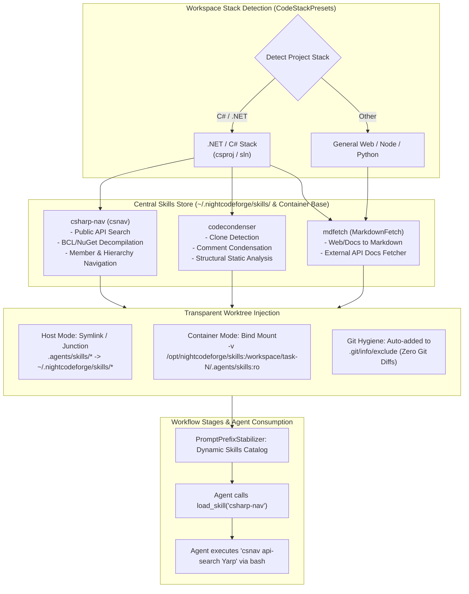

# 📦 Step 12.14: Global Skills Injection & Stack-Specific Tool Provisioning (csnav, mdfetch, codecondenser)

> **Phase 12 Implementation Step (Extend Features & Integrations - Developer Tools & Sandbox Ergonomics)**  
> *Parent Plan:* [Phase 12 Master Plan](../12_EXTEND_FEATURES.md)  
> *Project Target:* `src/NightCodeForge.Core`, `src/NightCodeForge.Infrastructure`, `src/NightCodeForge.Agents`, `src/NightCodeForge.Cli`, `tests/NightCodeForge.Core.Tests`, `tests/NightCodeForge.Agents.Tests`  
> *Status:* Proposed / Specified | *Target Framework:* .NET 10 (C# 13)  
> *Companion Tools:* [csnav (PmadCSharpNav)](https://github.com/jetelain/PmadCSharpNav), [mdfetch (MarkdownFetch)](https://github.com/jetelain/MarkdownFetch), [codecondenser (PmadCodeCondenser)](https://github.com/jetelain/PmadCodeCondenser)

---

## 1. Executive Summary & Problem Statement

During live validation on real codebases (e.g. `OllamaRouter`, `ComicGenCLI`), agents frequently encounter tasks requiring capabilities beyond basic bash and file editing:
1. **API & Signature Blindness:** Integrating with external NuGet or BCL packages (e.g., `Yarp.ReverseProxy`, `Microsoft.AspNetCore`) without symbol navigation causes agents to enter futile 45-minute decompilation loops with `strings .../lib/...dll | grep`, guessing signatures and hallucinating APIs.
2. **External Documentation Access:** Agents implementing integrations often lack current markdown documentation for external libraries, APIs, or architectural references.
3. **Structural Analysis & Duplication Hygiene:** Long-running refactoring tasks require structural clone detection and comment condensation to preserve token budgets.

To address these needs, dedicated developer tools have been authored:
* **`csnav` ([PmadCSharpNav](https://github.com/jetelain/PmadCSharpNav)):** High-performance C# navigation engine for AI agents and developers. Supports finding references, searching public APIs, exploring type hierarchies and members, and decompiling external BCL & NuGet assemblies directly to C# signatures.
* **`mdfetch` ([MarkdownFetch](https://github.com/jetelain/MarkdownFetch)):** High-fidelity documentation scraper converting web pages, technical articles, and GitHub references into clean LLM-ready markdown.
* **`codecondenser` ([PmadCodeCondenser](https://github.com/jetelain/PmadCodeCondenser)):** C# static code analysis, structural code clone detection, LLM-based verbose comment condensation, and CI incremental checking.

### The Architectural Problem: Repository Pollution vs Manual Friction
Today, agent skills in NightCodeForge are distributed per-repository into `.agents/skills/<skill-name>/` (via `ncf init` in [Step 11.13](../phase-11/STEP_11_13_PROJECT_PREPAREDNESS_AND_ONBOARDING.md)). This presents major operational drawbacks:
- Requiring repository maintainers to commit `.agents/skills/*` pollutes customer Git histories with orchestrator-specific tooling.
- Updating a skill requires running updates across every individual repository.
- Non-C# projects receive unnecessary C# tools, while C# projects miss essential navigation capabilities.

### The Solution: Global Stack-Specific Skills Injection
NightCodeForge implements a **Global Skills Injection System**:
1. Skills are maintained centrally in a global store on the host (`~/.nightcodeforge/skills/`) and embedded in the sandbox container (`/opt/nightcodeforge/skills/`).
2. Tools are provisioned based on workspace technology stack detection via `CodeStackPresets` (e.g., `.NET / C#` workspaces receive `csharp-nav`, general web projects receive `mdfetch`).
3. Skills are transparently injected into task worktrees via **symlinks (host mode)** or **read-only volume bind-mounts (container mode)** without modifying the repository's Git tracking.

---

## 2. Architecture & Workflow

### 2.1 Global Skills Injection Architecture



---

## 3. Technical Specifications

### 3.1 Stack-Specific Skill Matrix

Based on `CodeStackPresets.ResolveConfig(repositoryPath)`:

| Skill Identifier | Companion CLI | Applicable Stacks | Capabilities Provided |
| :--- | :--- | :--- | :--- |
| `csharp-nav` | `csnav` | `dotnet`, `csharp` | Assembly decompilation, NuGet/BCL public API search, symbol hierarchy, reference finder. |
| `mdfetch` | `mdfetch` | Universal (all stacks) | URL-to-markdown documentation fetcher, external library reference scraping. |
| `codecondenser` | `codecondenser` | `dotnet`, `csharp` | Structural clone detection, comment condensation, duplicate suppression. |

---

### 3.2 Tool Binaries & Container Environment

1. **Host Environment:**
   - Tools are distributed as global .NET tools or standalone binaries:
     ```bash
     dotnet tool install -g Pmad.CSharpNav
     dotnet tool install -g MarkdownFetch
     dotnet tool install -g Pmad.CodeCondenser
     ```
   - Installed globally under `~/.dotnet/tools` (which is already on host `PATH`).
2. **Container Sandbox Base Image:**
   - Pre-installed in the NightCodeForge sandbox Docker image:
     ```dockerfile
     RUN dotnet tool install -g Pmad.CSharpNav \
      && dotnet tool install -g MarkdownFetch \
      && dotnet tool install -g Pmad.CodeCondenser
     ENV PATH="${PATH}:/root/.dotnet/tools"
     ```
   - Global skill definitions (`SKILL.md`) reside in `/opt/nightcodeforge/skills/`:
     - `/opt/nightcodeforge/skills/csharp-nav/SKILL.md`
     - `/opt/nightcodeforge/skills/mdfetch/SKILL.md`
     - `/opt/nightcodeforge/skills/codecondenser/SKILL.md`

---

### 3.3 Transparent Worktree Injection Engine

In [WorkspaceProvisioningService.cs](file:///c:/Users/Julien/source/repos/jetelain/NightCodeForge/src/NightCodeForge.Web/Services/WorkspaceProvisioningService.cs) and [ContainerExecutionService.cs](file:///c:/Users/Julien/source/repos/jetelain/NightCodeForge/src/NightCodeForge.Infrastructure/Execution/ContainerExecutionService.cs):

#### 3.3.1 Host Execution Mode
1. When provisioning a task worktree `<worktree>`:
   - Identify active skills for the workspace stack.
   - For each active skill, create a directory symlink (or Windows NTFS junction):
     ```
     <worktree>/.agents/skills/<skill-name> -> ~/.nightcodeforge/skills/<skill-name>
     ```
2. **Zero Git Pollution Guarantee:**
   - Append `.agents/skills/` to `<worktree>/.git/info/exclude`.
   - Injected skills are invisible to `git status`, `git add`, and `git diff`.

#### 3.3.2 Container Sandbox Mode
1. When spinning up the task container (`EnsureContainerRunning`):
   - Mount global skills directory read-only:
     ```bash
     -v /opt/nightcodeforge/skills:/opt/nightcodeforge/skills:ro
     ```
   - If the task worktree lacks a local `.agents/skills`, map `/opt/nightcodeforge/skills` into `<worktree>/.agents/skills` or configure the harness multi-root discovery.
2. Ensure file permissions match the non-root container runner user (`-u $(id -u):$(id -g)`).

---

### 3.4 Skill Definitions & Agent Instructions

#### 3.4.1 `csharp-nav` Skill Specification
* **Trigger:** When the agent needs to inspect method signatures, search NuGet APIs, find usages, or explore type definitions.
* **Commands:**
  - `csnav api-search <query>`: Search public types and members across all solution projects and referenced NuGet packages.
  - `csnav decompile <assembly-path> --type <TypeName>`: Decompile external assembly types directly to C# interface/method signatures.
  - `csnav find-references <symbol>`: Locate all references and call sites across the solution.
  - `csnav type-hierarchy <symbol>`: View base classes, derived types, and interface implementations.
* **Rules Integration:**
  In `PromptPrefixStabilizer.cs`:
  ```text
  - C# Navigation: When inspecting external NuGet packages or BCL APIs, use 'csnav' (e.g. 'csnav decompile <dll> --type <Name>' or 'csnav api-search <term>'). Never guess signatures or inspect binary files with strings.
  ```

#### 3.4.2 `mdfetch` Skill Specification
* **Trigger:** When the agent needs external documentation, framework guides, or online API references.
* **Commands:**
  - `mdfetch <url>`: Fetches and converts web content into clean markdown, stripping ads and HTML navigation.

#### 3.4.3 `codecondenser` Skill Specification
* **Trigger:** During refactoring, code review fix, or codebase remediation to check structural clone duplication.
* **Commands:**
  - `codecondenser analyze`: Runs clone detection across solution files and reports duplication clusters.
  - `codecondenser condense`: Condenses overly verbose or redundant comments while preserving technical directives.

---

### 3.5 Skills Discovery & Harness Integration

In [SkillsService.cs](file:///c:/Users/Julien/source/repos/jetelain/NightCodeForge/src/NightCodeForge.Agents/Skills/SkillsService.cs):
1. **Multi-Root Discovery:**
   - Search path 1: `<worktree>/.agents/skills/` (project-specific overrides).
   - Search path 2: `~/.nightcodeforge/skills/` or `/opt/nightcodeforge/skills/` (global injected skills).
   - Project-local skill definitions always take precedence over global definitions of the same name.
2. **Catalog Injection:**
   - [PromptPrefixStabilizer.cs](file:///c:/Users/Julien/source/repos/jetelain/NightCodeForge/src/NightCodeForge.Agents/Optimizations/PromptPrefixStabilizer.cs) lists available global skills in the progressive disclosure catalog:
     ```text
     Available skills:
     - csharp-nav: C# navigation engine and assembly signature decompiler.
     - mdfetch: Web and documentation markdown scraper.
     - codecondenser: C# static code clone detection and comment condenser.
     ```
   - Agent loads detailed instructions only when needed via `load_skill`.

---

## 4. Verification & Testing Strategy

### 4.1 Unit Tests
1. **Stack Skill Resolution Tests:**
   - Verify that `ResolveSkillsForStack(CodeStack.DotNet)` returns `csharp-nav`, `mdfetch`, and `codecondenser`.
   - Verify that non-.NET stacks do not receive `csharp-nav`.
2. **Worktree Symlink & Git Exclusion Tests:**
   - Verify symlink/junction creation in worktree `.agents/skills`.
   - Assert `.git/info/exclude` contains `.agents/skills/` and `git status --porcelain` reports 0 untracked files.
3. **Multi-Root Skills Discovery Tests:**
   - Assert `SkillsService.GetAvailableSkillsAsync` returns both global and repository-specific skills.
   - Assert local repository skill overrides global skill with matching identifier.

### 4.2 Integration & Simulation Tests
1. **Assembly Signature Discovery Simulation:**
   - Re-run the Task 8 YARP scenario using `csnav decompile /cache/nuget/.../Yarp.ReverseProxy.dll --type IHttpForwarder`.
   - Verify that `csnav` outputs the exact C# interface and `SendAsync` signature in $< 1\text{s}$, eliminating the 44-minute `strings` loop.

---

## 5. Deliverables & Implementation Checklist

- [ ] **Global Skills Store:** Create built-in global skill definitions (`csharp-nav`, `mdfetch`, `codecondenser`) under `src/NightCodeForge.Agents/Skills/Bundled/`.
- [ ] **Stack Skill Resolver:** Add stack-based skill mapping in `src/NightCodeForge.Core/Workflow/CodeStackPresets.cs`.
- [ ] **Transparent Worktree Injection:** Implement symlink/junction creation and `.git/info/exclude` registration in `src/NightCodeForge.Web/Services/WorkspaceProvisioningService.cs`.
- [ ] **Container Volume Mounts:** Add read-only `/opt/nightcodeforge/skills` volume mount in `src/NightCodeForge.Infrastructure/Execution/ContainerExecutionService.cs` and update Dockerfile base.
- [ ] **Multi-Root Skills Discovery:** Update `src/NightCodeForge.Agents/Skills/SkillsService.cs` to search both worktree and global skills roots.
- [ ] **Prompt Rules Update:** Update `src/NightCodeForge.Agents/Optimizations/PromptPrefixStabilizer.cs` with `csnav` instructions for .NET workspaces.
- [ ] **Unit & Integration Tests:** Add comprehensive unit tests in `NightCodeForge.Agents.Tests` and `NightCodeForge.Core.Tests`.
