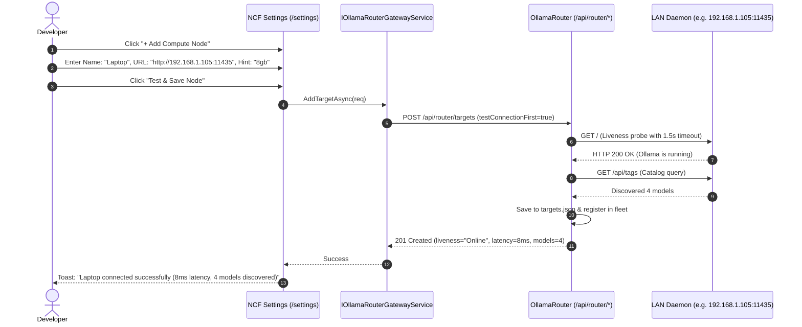

# 🌐 Step 12.15: Deep OllamaRouter Fleet Provisioning & In-App Setup

> **Phase 12 Implementation Step (Extend Features - Deep Integrations & Remote Experience)**  
> *Parent Plan:* [Phase 12 Master Plan](../12_EXTEND_FEATURES.md)  
> *Project Target:* [`src/NightCodeForge.Core`](file:///c:/Users/Julien/source/repos/jetelain/NightCodeForge/src/NightCodeForge.Core), [`src/NightCodeForge.Infrastructure`](file:///c:/Users/Julien/source/repos/jetelain/NightCodeForge/src/NightCodeForge.Infrastructure), [`src/NightCodeForge.Web`](file:///c:/Users/Julien/source/repos/jetelain/NightCodeForge/src/NightCodeForge.Web), [`tests/NightCodeForge.Web.Tests`](file:///c:/Users/Julien/source/repos/jetelain/NightCodeForge/tests/NightCodeForge.Web.Tests)  
> *Status:* Planned | *Target Framework:* .NET 10 (C# 13)  
> *Dependencies / OllamaRouter Backend Tasks:* [Step 11.33: Unified LLM Provider & Dynamic Fleet Integration](../phase-11/STEP_11_33_UNIFIED_LLM_PROVIDER_DYNAMIC_CONTEXT_AND_FLEET_INTEGRATION.md), [Step 12.5: Dual Model Role Configuration](STEP_12_5_DUAL_MODEL_ROLE_CONFIGURATION_AND_DIFFICULTY_ESCALATION.md), [OllamaRouter Task #20: Layered User Configuration](file:///C:/Users/Julien/source/repos/jetelain/OllamaRouter/docs/tasks/2026-10-26-introduce-layered-user-configuration-read-only-factory-appsettings-json-reloadable-config-config-json-user-layer.md), [OllamaRouter Task #19: Dynamic Fleet Configuration & Setup API](file:///C:/Users/Julien/source/repos/jetelain/OllamaRouter/docs/tasks/2026-10-26-dynamic-fleet-configuration-setup-api-in-app-provisioning.md)

---

## 1. Executive Summary & Objective

In **Step 11.33**, NightCodeForge established the first integration: clean discovery of router identity, dynamic context window discovery, and real-time visualization of fleet targets.

However, configuring the multi-node fleet itself—adding a colleague's laptop, connecting a new dedicated GPU server, adjusting hardware VRAM hints, or configuring cloud overflow credentials—previously required opening a terminal on the host machine and manually editing configuration files on disk. Furthermore, editing `appsettings.json` directly risked being overwritten across software updates.

Under [OllamaRouter Task #20](file:///C:/Users/Julien/source/repos/jetelain/OllamaRouter/docs/tasks/2026-10-26-introduce-layered-user-configuration-read-only-factory-appsettings-json-reloadable-config-config-json-user-layer.md), OllamaRouter establishes `appsettings.json` as read-only factory defaults and introduces a durable, reloadable **`config/config.json`** user layer beside the binary that survives application updates. Under [OllamaRouter Task #19](file:///C:/Users/Julien/source/repos/jetelain/OllamaRouter/docs/tasks/2026-10-26-dynamic-fleet-configuration-setup-api-in-app-provisioning.md), OllamaRouter exposes RESTful configuration and provisioning endpoints that persist directly into this durable user layer.

**Step 12.15 delivers Deep OllamaRouter Fleet Provisioning**:
1. **Zero-Terminal Fleet Management:** Developers can add, test, configure, and remove compute nodes across the local area network directly from the NightCodeForge Web UI (`/settings` -> OllamaRouter tab).
2. **Pre-Flight Connectivity & Latency Testing:** When adding a new compute target, NCF triggers a live pre-flight verification probe via OllamaRouter (`testConnectionFirst: true`) to confirm daemon reachability, measure network latency, discover resident models, and report firewall or port binding errors before saving.
3. **Cloud Overflow Provisioning:** Configure external cloud endpoints (Ollama Cloud, OpenRouter, DeepSeek) and manage API keys securely from the Web UI.
4. **Dynamic Context Visual Tuning:** Fine-tune KV-cache hysteresis cooldown turns, idle timeout thresholds, and quantization bucket steps visually with instant feedback.
5. **Inference Recording & Tracing Management:** Toggle request/response payload recording on disk with configurable file count limits for offline prompt evaluation, regression testing, and tokenizer calibration.
6. **Resilience & Failure Streak Protection:** Tune maximum consecutive failure thresholds (`maxConsecutiveFailures`, `consecutiveFailuresTokenTolerance`) to control when degraded or crashing nodes are quarantined and requests are failed over to cloud overflow.
7. **Cost & Token Pricing Configuration:** Configure input and output prices per 1M tokens and currency symbol to estimate 7-day cloud overflow expenditures and local hardware savings in real time.

---

## 2. Behavioral Specifications

### 2.1 Fleet Node Provisioning Lifecycle

### 2.2 Target Node Configuration Card (`OllamaRouterFleetManager.razor`)

Inside `Settings.razor` under the OllamaRouter tab:
1. **Compute Nodes Grid:**
   - Visual cards for each registered node showing IP/URL, hardware profile, status, latency badge, and in-flight load.
   - **Quick Actions per Node:**
     - **Toggle Enable/Disable:** Instantly enables or disables routing to the node via `PUT /api/router/targets/{name}`.
     - **Test Connection:** Re-runs the liveness probe and reports latency.
     - **Edit Node:** Adjusts URL, hardware hint (`8gb`, `16gb`, `96gb`), or max parallel concurrency.
     - **Remove Node:** Removes the node from active routing and disk configuration.
2. **Add Node Modal (`AddComputeNodeModal.razor`):**
   - Inputs:
     - Target Name (e.g. `Laptop`, `Server-Rack-1`).
     - Host Address & Port (e.g. `http://192.168.1.120:11435`).
     - Hardware Hint Selector:
       - `8 GB` (Laptop / Mobile GPU - restricted to MoE & Small Dense models).
       - `16 GB` (Desktop Workstation - supports Dense $\le 27\text{B}$ up to 48k context).
       - `96 GB` (Multi-GPU Server - supports full context $\le 256\text{k}$).
       - `Custom VRAM` (Specify manual MB threshold).
     - Max Parallel Requests (default: 1 for single-GPU desktop/laptop; 2–4 for multi-GPU server).
   - "Test Connection" button: runs inline validation before commit.

### 2.3 Cloud Overflow Configuration Card

1. **Cloud Overflow Toggle:** Enable/disable external fallback with one switch.
2. **Provider Selection:**
   - `Ollama Cloud` (Native ollama.com cloud proxy).
   - `OpenRouter` (Multi-provider API).
   - `Custom OpenAI-Compatible API` (Custom endpoint URL + API key).
3. **API Key Management:**
   - Secure input field (masked as `••••••••`).
   - Saved directly to OllamaRouter config via `PUT /api/router/config`.

### 2.4 Dynamic Context Fine-Tuning

Interactive tuning controls for OllamaRouter's `DynamicContext` engine:
- **Bucket Step Size:** `32,768` (Standard) | `16,384` (Fine-grained).
- **Auto-Shrink Cooldown Turns:** `3 turns` (Default) | Slider (1 to 10 turns).
- **Idle Timeout:** `60 seconds` (Default) | Slider (15 to 300 seconds).
- **Preview Matrix:** Visual table displaying what context bucket will be assigned for prompt lengths from 2,000 to 200,000 tokens.

### 2.5 Inference Recording & Tracing Card

1. **Recording Mode Toggle:** Enable/disable writing `.jsonl` manifest and raw request/response payload files to disk.
2. **Output Directory:** Configurable disk path (defaults to `%LOCALAPPDATA%\OllamaRouter\inference-requests`).
3. **Max Payload Files:** Numerical input (default: 500) specifying maximum historical payload files to retain before automatic FIFO purging.

### 2.6 Resilience & Circuit Breaker Controls

1. **Max Consecutive Failures:** Threshold (default: 3) of consecutive transport / mid-stream failures on a target node before OllamaRouter temporarily skips it and routes to healthy nodes or cloud overflow.
2. **Consecutive Failures Token Tolerance:** Window (default: 4000 tokens) defining the difference in estimated prompt tokens between adjacent requests considered part of the same retry streak.

### 2.7 Pricing & Cost Estimation Calibration

1. **Input / Prompt Price per Million:** Rate for input tokens (e.g. $0.20 / 1M tokens).
2. **Output / Completion Price per Million:** Rate for output tokens (e.g. $0.80 / 1M tokens).
3. **Currency Symbol:** Currency display symbol (`$`, `€`, `USD`).

---

## 3. Implementation Checklist & Deliverables

### Phase 1: Gateway Service Extensions in NCF
- [ ] Extend `IOllamaRouterGatewayService` with provisioning methods:
  - `Task<RouterConfigResponse> GetRouterConfigAsync(CancellationToken ct = default);`
  - `Task<UpdateRouterConfigResponse> UpdateRouterConfigAsync(UpdateRouterConfigRequest request, CancellationToken ct = default);`
  - `Task<AddTargetResponse> AddComputeTargetAsync(AddTargetRequest request, CancellationToken ct = default);`
  - `Task<UpdateTargetResponse> UpdateComputeTargetAsync(string name, UpdateTargetRequest request, CancellationToken ct = default);`
  - `Task<DeleteTargetResponse> RemoveComputeTargetAsync(string name, CancellationToken ct = default);`
- [ ] Implement methods in `OllamaRouterGatewayService` targeting OllamaRouter REST API endpoints.

### Phase 2: Web UI Components in NCF
- [ ] Create `OllamaRouterFleetManager.razor` component in `NightCodeForge.Web/Components/Settings/`.
- [ ] Create `AddComputeNodeModal.razor` with live connectivity testing.
- [ ] Create `CloudOverflowConfigCard.razor` with secure API key storage.
- [ ] Create `OllamaRouterAdvancedSettingsCard.razor` for Recording, Resilience circuit breaker thresholds, and Pricing calibration.
- [ ] Integrate into `Settings.razor` under the OllamaRouter global tab.

### Phase 3: Automated Testing
- [ ] Unit tests for `OllamaRouterGatewayService` provisioning methods with mocked HTTP responses.
- [ ] Component tests for `OllamaRouterFleetManager.razor` verifying target addition, disable toggling, and removal.
