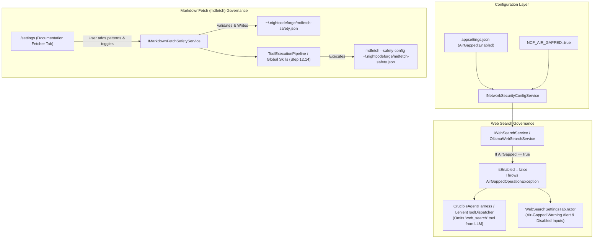

# 🛡️ Step 12.20: Air-Gapped Search Deactivation & MarkdownFetch Documentation Governance

> **Phase 12 Implementation Step (Extend Features - Deep Integrations & Remote Experience - Security & Governance)**  
> *Parent Plan:* [Phase 12 Master Plan](../12_EXTEND_FEATURES.md)  
> *Related Steps:* [Step 12.14: Global Skills Injection & Stack Tooling](STEP_12_14_GLOBAL_SKILLS_INJECTION_AND_STACK_TOOLING.md) | [Step 12.19: Air-Gapped Offline Web App Hardening](STEP_12_19_AIR_GAPPED_OFFLINE_WEB_APP_HARDENING.md) | [Step 12.21: Container Sandbox Egress Filtering & Envoy Proxy](STEP_12_21_CONTAINER_SANDBOX_EGRESS_FILTERING_AND_ENVOY_PROXY.md)  
> *Source Policy:* [AGENTS.md](../../../AGENTS.md)  
> *Project Target:* `src/NightCodeForge.Core`, `src/NightCodeForge.Web`, `tests/NightCodeForge.Core.Tests`, `tests/NightCodeForge.Web.Tests` | *Status:* Planned | *Target Framework:* .NET 10 (C# 13)

> This document is a **specification**: it states required behaviors and constraints, not implementations. Implementation choices (signatures, code structure) are left to the implementer, within the constraints of the documents.

---

## 1. Executive Objective

1. **Air-Gapped Search Deactivation (Zero Cloud Phone-Home):** Automatically deactivate external web searching when NightCodeForge is running in an air-gapped, isolated, or offline environment. Today, web search delegates to `https://ollama.com/api/web_search`. In air-gapped networks, this endpoint is unreachable or prohibited. Prevent connection timeouts, pipeline stalls, and data leakage by cleanly suppressing external search until an on-premise local search provider is configured.
2. **Unified Air-Gapped Configuration:** Expose a centralized `AirGapped` configuration model in `appsettings.json` and environment variables (`NCF_AIR_GAPPED=true`), allowing organizations to enforce air-gapped behavior across all platform subsystems with a single flag.
3. **Fail-Fast Agent & Tooling Guardrails:** Ensure `CrucibleAgentHarness` and `LenientToolDispatcher` omit `web_search` from tool sets when disabled, and fail fast with a descriptive domain exception (`AirGappedOperationException`) or user-facing notice rather than waiting for HTTP connection timeouts.
4. **Settings UX Transparency:** Update `WebSearchSettingsTab.razor` to display an informative Air-Gapped status notice, disabling cloud provider inputs and providing clear explanatory tooltips.
5. **Documentation Fetcher (`mdfetch`) Governance:** Provide a convenient in-app UI (`/settings` -> Documentation Fetcher / Network Security tab) and backend configuration pipeline for `Pmad.MarkdownFetch` (`mdfetch`), enabling teams to:
   - Configure allowed URL whitelist patterns for internal wikis, documentation servers, and API specs (e.g. `https://docs.corp.internal/*`, `http://wiki.lan/*`).
   - Guard against Server-Side Request Forgery (SSRF) and metadata theft by blocking private/loopback/cloud metadata ranges (`169.254.169.254`, `127.0.0.1`, `10.0.0.0/8`) unless explicitly permitted.
   - Generate and maintain a validated `~/.nightcodeforge/mdfetch-safety.json` configuration file, automatically consumed during skill and agent executions ([Step 12.14](STEP_12_14_GLOBAL_SKILLS_INJECTION_AND_STACK_TOOLING.md)).
6. **Strict Architectural Separation:** Comply strictly with [AGENTS.md](../../../AGENTS.md) UI and presentation rules: Razor components remain strictly presentational; all pattern validation, JSON generation, file persistence, and network checks reside in dedicated services in `NightCodeForge.Core` or `NightCodeForge.Web/Services`.

---

## 2. Problem Statement & Motivation

### 2.1 The Cloud Web Search Bottleneck in Air-Gapped Enclaves
NightCodeForge provides autonomous coding agents capable of looking up current documentation via `web_search`. Under the hood, `OllamaWebSearchService` dispatches queries to Ollama's cloud search endpoint (`https://ollama.com/api/web_search`).

In an enterprise air-gapped deployment, secure enclave, or offline laptop:
- Public internet access is nonexistent.
- Any attempt to reach `https://ollama.com` results in 20-30 second TCP SYN drops or immediate proxy firewall rejections.
- Agents attempting to verify an API signature spend minutes waiting for timeouts, causing pipeline runs to fail ungracefully.
- Furthermore, sending queries to an external cloud search endpoint violates confidentiality rules of air-gapped environments.

### 2.2 Unrestricted Web Scraping and SSRF Vulnerabilities (`mdfetch`)
Under [Step 12.14](STEP_12_14_GLOBAL_SKILLS_INJECTION_AND_STACK_TOOLING.md), developers and agents utilize `mdfetch` (`Pmad.MarkdownFetch`) to fetch documentation directly into clean markdown format for context injection.

In enterprise and air-gapped environments, developers frequently want to fetch from **internal** documentation servers (e.g., Confluence, internal Developer Portals, GitLab/GitHub Enterprise, local microservice Swagger endpoints). However, without strict whitelisting:
1. **SSRF Risks:** Untrusted code or prompt injection could instruct an agent to query cloud instance metadata endpoints (`http://169.254.169.254/latest/meta-data/`) or internal database administration ports (`http://localhost:6379`, `http://10.0.0.5:9200`).
2. **Accidental Exfiltration:** An unconstrained fetcher could be tricked into performing HTTP GET requests to external attacker-controlled endpoints encoding sensitive repository tokens or code snippets in query parameters.
3. **Lack of Friendly Governance:** Manually passing `--url-whitelist` arguments to every CLI command or editing raw JSON files is error-prone. A centralized, friendly in-app configuration UI ensures security policies are easily enforced and audited.

---

## 3. Architecture & Technical Specification



### 3.1 Air-Gapped Network Configuration Model

Add a centralized configuration section in `appsettings.json`:

```json
{
  "NetworkSecurity": {
    "AirGappedMode": false,
    "DocumentationFetcher": {
      "EnforceWhitelist": true,
      "AllowedUrlPatterns": [
        "https://docs.corp.internal/*",
        "http://wiki.lan/*",
        "http://localhost:*/docs/*"
      ],
      "BlockedCidrRanges": [
        "169.254.169.254/32",
        "127.0.0.0/8"
      ],
      "AllowPrivateIpAccess": false,
      "SanitizeMarkdown": true,
      "MaxContentLengthBytes": 2097152
    }
  }
}
```

- When `NetworkSecurity:AirGappedMode` is `true` (or environment variable `NCF_AIR_GAPPED=true` is set), the application enters strict air-gapped mode.

### 3.2 Web Search Deactivation Logic

1. **`IWebSearchService` Contract:**
   - Expose `bool IsEnabled { get; }`.
   - Expose `string? DisabledReason { get; }`.
2. **Behavior when `AirGappedMode` is active:**
   - `IsEnabled` returns `false`.
   - `DisabledReason` returns `"Web search is disabled in Air-Gapped mode (external cloud search to ollama.com is prohibited)."`.
   - Calling `SearchAsync(...)` fails fast immediately throwing `AirGappedOperationException`.
3. **Agent Harness Tool Filtering:**
   - In `CrucibleAgentHarness` (and `LenientToolDispatcher`), when registering available tools for an agent run:
     - Check `IWebSearchService.IsEnabled`.
     - If `false`, do not include the `web_search` tool definition in the prompt/tool definitions payload sent to the LLM.
     - If the LLM generates a tool call for `web_search` anyway (e.g. from prior context or model bias), the dispatcher intercepts it and returns a clean, structured refusal response: `"Error: Web search is unavailable because the system is operating in Air-Gapped mode."`.
4. **Web Search Settings UI (`WebSearchSettingsTab.razor`):**
   - When `AirGappedMode` is active:
     - Display a prominent warning alert (`AlertRole.Warning` / glassmorphism banner) at the top of the tab:
       `"🛡️ Air-Gapped Mode Active: External web search via ollama.com is currently deactivated to prevent external network traffic."`
     - Disable the provider selector, API key input, and search test button with descriptive tooltips.

### 3.3 MarkdownFetch (`mdfetch`) Security Service & Whitelist Manager

#### 3.3.1 Safety Configuration Contract (`mdfetch-safety.json`)
`Pmad.MarkdownFetch` natively supports security configurations defining allowed URL wildcards, forbidden networks, and content sanitization.

`IMarkdownFetchSafetyService` manages this configuration:

```csharp
namespace NightCodeForge.Core.Services.Security;

public record MarkdownFetchSafetyConfig
{
    public bool EnforceWhitelist { get; init; } = true;
    public List<string> AllowedUrlPatterns { get; init; } = [];
    public List<string> BlockedCidrRanges { get; init; } = ["169.254.169.254/32", "127.0.0.0/8"];
    public bool AllowPrivateIpAccess { get; init; } = false;
    public bool SanitizeMarkdown { get; init; } = true;
    public long MaxContentLengthBytes { get; init; } = 2 * 1024 * 1024; // 2 MB default
}

public interface IMarkdownFetchSafetyService
{
    Task<MarkdownFetchSafetyConfig> GetConfigAsync(CancellationToken ct = default);
    Task SaveConfigAsync(MarkdownFetchSafetyConfig config, CancellationToken ct = default);
    Task<bool> IsUrlAllowedAsync(string url, CancellationToken ct = default);
    string GetSafetyConfigFilepath();
}
```

#### 3.3.2 Whitelist Pattern Matching Invariants
- Supported wildcard patterns:
  - `https://docs.corp.internal/*` matches any subpath on `docs.corp.internal`.
  - `https://*.internal-domain.com/*` matches any subdomain.
  - `http://localhost:8080/api/*` matches exact host and port prefix.
- Hardcoded Deny Rules:
  - Cloud metadata (`http://169.254.169.254/*`) is **always denied**, even if a wildcard pattern like `http://*` is configured.
  - File schemes (`file://`, `gopher://`, `ftp://`) are rejected; only `http://` and `https://` are processed.

#### 3.3.3 Integration with CLI Invocations and Global Skills
When executing `mdfetch` (either through the agent's bash/tool runner or via the global skills pipeline in [Step 12.14](STEP_12_14_GLOBAL_SKILLS_INJECTION_AND_STACK_TOOLING.md)):
1. `IMarkdownFetchSafetyService` ensures `~/.nightcodeforge/mdfetch-safety.json` is synced to disk.
2. The command line builder appends:
   ```bash
   mdfetch --safety-config ~/.nightcodeforge/mdfetch-safety.json <url>
   ```
3. If run inside a container sandbox, the safety configuration file is mounted read-only into `/etc/nightcodeforge/mdfetch-safety.json`.

### 3.4 In-App Settings UI: Documentation Fetcher Tab

Create `src/NightCodeForge.Web/Components/Settings/MdfetchSecuritySettingsTab.razor`:
- **Allowed Patterns List:**
  - Table of current URL patterns with "Add Pattern" and "Remove" actions.
  - Interactive "Test URL" bar where developers can enter a URL to see an instant badge: `Allowed` (green) or `Blocked by Policy` (red) with reason.
- **Safety Toggles:**
  - Checkbox: "Block Cloud Metadata (169.254.169.254)" (checked and disabled by default).
  - Checkbox: "Sanitize Markdown (Strip harmful HTML tags, scripts, and invisible prompt injection payloads)".
  - Number input: "Max Content Size (KB)".
- **Presentation Separation Guarantee:**
  - The Razor component only invokes methods on `IMarkdownFetchSafetyService`.
  - Validation errors (e.g. malformed regex, invalid URI format) are calculated by the service and returned via standard result records.

---

## 4. Definition of Done (DoD) Checklist

- [ ] **Configuration & Domain Infrastructure:**
  - [ ] Add `NetworkSecurityOptions` model with `AirGappedMode` and `DocumentationFetcher` properties in `NightCodeForge.Core`.
  - [ ] Support environment variable override via `NCF_AIR_GAPPED=true`.
  - [ ] Define `AirGappedOperationException` domain exception adhering to no silent failures policy.
- [ ] **Web Search Deactivation:**
  - [ ] Update `IWebSearchService` with `IsEnabled` and `DisabledReason`.
  - [ ] Implement air-gapped checks in `OllamaWebSearchService` to return `IsEnabled = false` and fail fast on `SearchAsync`.
  - [ ] Update `CrucibleAgentHarness` and `LenientToolDispatcher` to omit `web_search` tool when disabled.
  - [ ] Update `WebSearchSettingsTab.razor` with Air-Gapped warning banner and disabled input state.
- [ ] **MarkdownFetch Governance:**
  - [ ] Implement `IMarkdownFetchSafetyService` and `MarkdownFetchSafetyService` in `NightCodeForge.Core`.
  - [ ] Implement robust URL pattern matching with mandatory cloud metadata blocking (`169.254.169.254`).
  - [ ] Implement atomic file writing for `~/.nightcodeforge/mdfetch-safety.json`.
  - [ ] Inject `--safety-config` into `mdfetch` tool execution builders.
  - [ ] Build `MdfetchSecuritySettingsTab.razor` in `NightCodeForge.Web` with pattern manager, test bar, and safety toggles.
- [ ] **Testing & Quality Assurance:**
  - [ ] Unit tests for `OllamaWebSearchService` air-gapped deactivation and exception throwing.
  - [ ] Unit tests for `MarkdownFetchSafetyService` URL pattern matching, metadata IP denial, and JSON persistence.
  - [ ] bUnit tests for `WebSearchSettingsTab` and `MdfetchSecuritySettingsTab` rendering and interaction states.
  - [ ] Verify test suite passes with `dotnet test --filter "Category!=Acceptance&Category!=E2E"`.

---

## 5. Verification & Test Matrix

| Test ID | Area | Execution | Expected Invariant |
| :--- | :--- | :--- | :--- |
| **TC-12.20-01** | AirGapped Web Search Disablement | Configure `NetworkSecurity:AirGappedMode = true` and call `OllamaWebSearchService.SearchAsync("test")` | Throws `AirGappedOperationException` immediately; zero network calls made. |
| **TC-12.20-02** | Agent Tool Dispatcher Filtering | Build agent tools in `CrucibleAgentHarness` with `AirGappedMode = true` | `web_search` is excluded from the generated tool definition list. |
| **TC-12.20-03** | Web Search Settings UI Banner | Render `WebSearchSettingsTab.razor` with `AirGappedMode = true` | Warning alert displayed; inputs disabled; save button disabled with explanation. |
| **TC-12.20-04** | mdfetch Allowed Whitelist Matching | Test URL `https://docs.corp.internal/api/v1` against pattern `https://docs.corp.internal/*` | `IsUrlAllowedAsync` returns `true`. |
| **TC-12.20-05** | mdfetch Cloud Metadata Hard-Deny | Test URL `http://169.254.169.254/latest/meta-data` even with `*` whitelist | `IsUrlAllowedAsync` returns `false` with security alert. |
| **TC-12.20-06** | mdfetch Safety Config Generation | Save modified patterns via `IMarkdownFetchSafetyService` | `~/.nightcodeforge/mdfetch-safety.json` is updated atomically with valid JSON schema. |
