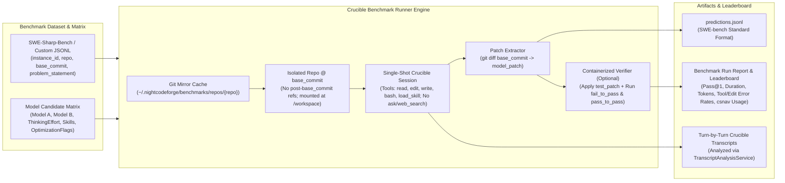

# 🏁 Step 12.23: Crucible Benchmark Runner for SWE-Sharp-Bench & Multi-Model Evaluation

> **Phase 12 Implementation Step (Extend Features - Intelligence, Benchmarking & Model Selection)**  
> *Parent Plan:* [Phase 12 Master Plan](../12_EXTEND_FEATURES.md)  
> *Related Steps:* [Step 11.33: Unified LLM Provider Architecture](../phase-11/STEP_11_33_UNIFIED_LLM_PROVIDER_DYNAMIC_CONTEXT_AND_FLEET_INTEGRATION.md) | [Step 11.35: OpenAI-Compatible LLM Provider](../phase-11/STEP_11_35_OPENAI_COMPATIBLE_LLM_PROVIDER.md) | [Step 12.5: Dual Model Role Configuration & Difficulty Escalation](STEP_12_5_DUAL_MODEL_ROLE_CONFIGURATION_AND_DIFFICULTY_ESCALATION.md) | [Step 12.14: Global Skills Injection & Stack Tooling](STEP_12_14_GLOBAL_SKILLS_INJECTION_AND_STACK_TOOLING.md) | [Step 12.22: Container Diagnostic Bash Console](STEP_12_22_CONTAINER_DIAGNOSTIC_BASH_CONSOLE.md)  
> *Source Policy:* [AGENTS.md](../../../AGENTS.md)  
> *Project Target:* `src/NightCodeForge.Core`, `src/NightCodeForge.Infrastructure`, `src/NightCodeForge.Agents`, `src/NightCodeForge.Cli`, `src/NightCodeForge.Web`, `tests/NightCodeForge.Agents.Tests`, `tests/NightCodeForge.Web.Tests` | *Status:* Planned | *Target Framework:* .NET 10 (C# 13)

> This document is a **specification**: it states required behaviors and constraints, not implementations. Implementation choices (signatures, code structure) are left to the implementer, within the constraints of the documents.

---

## 1. Executive Objective

1. **Direct Crucible Benchmark Runner (Bypassing Full Orchestrator Workflow):** Provide a dedicated benchmark execution engine that runs **SWE-Sharp-Bench** (and compatible SWE-bench / custom JSONL benchmarks) directly through the **Crucible agent loop** (`HarnessAgent` + `CanonicalTools` + `LenientToolDispatcher` + `PromptPrefixStabilizer` + `NightCodeForgeContainerExecutor`) **without invoking the 6-stage NightCodeForge workflow, SQLite `ForgeTask`/`Conversation` foreign-key state machine, human clarification (`ask`), or merge gates**.
2. **Empirical Multi-Model & Configuration Evaluation:** Enable running identical benchmark instances across a matrix of candidate LLM models (e.g., `jetelain/qwen3.6-35b-a3b`, `jetelain/qwen3.8-27b`, `jetelain/qwen3.5-9b`, `deepseek-r1`, `glm-4.5`, cloud/OpenAI-compatible baselines), quantizations, thinking effort levels, context window sizes, stack skills (`EnableStackSkills` for `csharp-nav` / `csnav` CLI & `codecondenser`), and `LocalOptimizationFlags` (`GuidedGrammarDecoding`, `DeterministicSymbolMap`, `StructuredDiagnosticExtraction`) to scientifically determine the best-suited models for NightCodeForge.
3. **First-Class SWE-Sharp-Bench & SWE-bench Compatibility:**
   - Ingest standard SWE-Sharp-Bench / SWE-bench JSON and JSONL datasets (`instance_id`, `repo`, `base_commit`, `problem_statement`, `hints_text`, `fail_to_pass`, `pass_to_pass`, `test_patch`, `patch`).
   - Emit standard `predictions.jsonl` (`instance_id`, `model_name_or_path`, `model_patch`) compatible with the official SWE-Sharp-Bench / SWE-bench evaluation harnesses.
4. **Built-In Containerized Verification (`fail_to_pass` / `pass_to_pass`):** Support self-contained evaluation inside `NightCodeForgeContainerExecutor` by applying the model's generated patch alongside the benchmark's `test_patch`, building the solution, and executing the `fail_to_pass` and `pass_to_pass` unit tests to compute resolution rates (`Pass@1`) out of the box.
5. **Deep Crucible Telemetry & Model Leaderboard:** Capture fine-grained agentic telemetry per run—resolution status, patch applicability, wall-clock duration, prompt/completion tokens, turn count, canonical tool call distribution (`read`, `edit`, `write`, `bash`, `load_skill`), companion CLI usage inside `bash` (`csnav`, `codecondenser`), `edit` search-replace failure count, `bash` / compiler / test failure counts (via `TranscriptAnalysisService`), `LenientToolDispatcher` normalization/repair count, and `PiStyleCrucibleCompactionStrategy` checkpoint count—presented in both CLI (`ncf benchmark`) and Web UI (`/benchmarks`).

---

## 2. Problem Statement & Motivation

### 2.1 Why Evaluate Models in Crucible Without the Full Workflow?
NightCodeForge's production pipeline uses a multi-stage workflow (`TaskReviewStage` $\rightarrow$ `Pre-Impl Baseline` $\rightarrow$ `ImplementationStage` $\rightarrow$ `Post-Impl Quality Gate` $\rightarrow$ `CodeReviewAndFixStage` $\rightarrow$ `Post-Review Gate`). While ideal for production software delivery, running the full 6-stage pipeline when evaluating new LLM models or quantizations has three drawbacks:
1. **Confounded Attribution:** If a task fails or succeeds after 3 stages and 2 quality-gate loopbacks, it is difficult to isolate whether the base model's raw coding and tool-calling capability in Crucible improved or if the deterministic loopback compensated for model errors.
2. **Human-in-the-Loop Blocking:** Standard benchmarks like SWE-Sharp-Bench require 100% autonomous, non-interactive execution from `problem_statement` + `base_commit` to a unified `git diff` patch (`model_patch`), with zero `ask` tool interruptions.
3. **Execution Speed & Reproducibility:** Evaluating 20–100 SWE-Sharp-Bench instances across 3–5 candidate models requires a lightweight, repeatable single-shot Crucible runner that checks out `base_commit` in an isolated workspace with no future git history leakage, runs the Crucible agent loop with `read`/`edit`/`write`/`bash` (and optional `load_skill` + companion CLIs like `csnav`), captures `git diff`, and verifies tests.

### 2.2 Finding the Optimal Model & Tooling Mix for NightCodeForge
Local and open-weight coding models evolve rapidly (Qwen 3.x MoE vs dense, DeepSeek, GLM, Llama, Devstral, etc.), and their effectiveness inside Crucible depends heavily on:
- **Tool-Calling Precision & Companion CLI Adoption:** How accurately the model invokes `edit` (exact search-and-replace blocks without corrupting indentation), `read`, `bash`, and `load_skill`, whether it effectively leverages companion CLI tools like `csnav` (`Pmad.CSharpNav` invoked via `bash` after loading `csharp-nav`) instead of blind grep/decompilation loops, and how often `LenientToolDispatcher` must repair malformed JSON or aliased parameters.
- **Context & Thinking Efficiency:** How many turns and tokens the model consumes before converging on a working fix, and how `PiStyleCrucibleCompactionStrategy` and `LocalOptimizationFlags` (`DeterministicSymbolMap`, `StructuredDiagnosticExtraction`, `GuidedGrammarDecoding`) impact solve rates.
- **Role Suitability ([Step 12.5](STEP_12_5_DUAL_MODEL_ROLE_CONFIGURATION_AND_DIFFICULTY_ESCALATION.md)):** Identifying which fast MoE model excels as the **Coder** model and which dense reasoning model excels on high-difficulty architectural bugs.

---

## 3. Architecture & Technical Specification



### 3.1 Dataset Schema (`BenchmarkInstance`)

`IBenchmarkDatasetLoader` parses `.jsonl` and `.json` files conforming to the **SWE-Sharp-Bench** / **SWE-bench** schema, with optional NightCodeForge extensions for custom local benchmarks:

```csharp
namespace NightCodeForge.Core.Benchmarking;

public record BenchmarkInstance
{
    /// <summary>
    /// Unique identifier, e.g. "dotnet__extensions-1234" or "serilog__serilog-987".
    /// </summary>
    public required string InstanceId { get; init; }

    /// <summary>
    /// GitHub repository slug ("owner/name") or local repository path / Git URL.
    /// </summary>
    public required string Repo { get; init; }

    /// <summary>
    /// Git commit SHA representing the pre-fix state of the repository.
    /// </summary>
    public required string BaseCommit { get; init; }

    /// <summary>
    /// Issue description / bug report presented to the Crucible agent.
    /// </summary>
    public required string ProblemStatement { get; init; }

    /// <summary>
    /// Optional hints or issue comment context.
    /// </summary>
    public string? HintsText { get; init; }

    /// <summary>
    /// Gold standard reference patch (used for diff comparison in UI; never shown to the agent).
    /// </summary>
    public string? GoldPatch { get; init; }

    /// <summary>
    /// Test patch adding/updating unit tests that reproduce the issue (applied only during verification).
    /// </summary>
    public string? TestPatch { get; init; }

    /// <summary>
    /// Tests that fail on BaseCommit + TestPatch and must pass after applying the model's patch.
    /// </summary>
    public IReadOnlyList<string> FailToPass { get; init; } = [];

    /// <summary>
    /// Regression tests that pass on BaseCommit and must continue passing after applying the model's patch.
    /// </summary>
    public IReadOnlyList<string> PassToPass { get; init; } = [];

    /// <summary>
    /// Optional custom build/test command override or Docker image override for the instance.
    /// </summary>
    public string? CustomContainerImage { get; init; }
    public string? CustomTestCommand { get; init; }
}
```

*JSON Deserialization Mapping:*
- Maps standard snake_case SWE-Sharp-Bench keys (`instance_id`, `repo`, `base_commit`, `problem_statement`, `hints_text`, `patch` $\rightarrow$ `GoldPatch`, `test_patch`, `fail_to_pass` [JSON array or serialized JSON string array], `pass_to_pass` [JSON array or serialized JSON string array]).

### 3.2 Model Candidate & Run Configuration (`BenchmarkRunConfiguration`)

```csharp
namespace NightCodeForge.Core.Benchmarking;

public record BenchmarkModelCandidate
{
    public required string CandidateId { get; init; }
    public required string DisplayName { get; init; }
    public required string ModelName { get; init; }
    public ThinkingEffort ThinkingEffort { get; init; } = ThinkingEffort.Medium;
    public int? ThinkingTokenBudget { get; init; }
    public int? ContextWindowTokens { get; init; }
    public double Temperature { get; init; } = 0.1;
    public int MaxTurns { get; init; } = 60;
    public int InstanceTimeoutSeconds { get; init; } = 1200; // 20 minutes default per instance
    public LocalOptimizationFlags OptimizationFlags { get; init; } = new()
    {
        GuidedGrammarDecoding = true,
        DeterministicSymbolMap = true,
        StructuredDiagnosticExtraction = true,
        JitModelPreload = false,
        SyntheticConversationPriming = false
    };

    /// <summary>
    /// When true, injects stack skills (e.g., 'csharp-nav' and 'codecondenser' via load_skill, while excluding 'mdfetch')
    /// and mounts companion CLI tools (~/.dotnet/tools containing 'csnav' and 'codecondenser') into the container sandbox.
    /// When false, omits 'load_skill' from permitted tools and does not mount ~/.dotnet/tools into the container.
    /// </summary>
    public bool EnableStackSkills { get; init; } = true;
}

public record BenchmarkRunRequest
{
    public required string SuiteName { get; init; }
    public required string DatasetPath { get; init; }
    public IReadOnlyList<string>? InstanceIdFilter { get; init; }
    public int? MaxInstances { get; init; }
    public required IReadOnlyList<BenchmarkModelCandidate> Candidates { get; init; }
    public bool IncludeHints { get; init; } = false;
    public bool VerifyWithTests { get; init; } = true;
    public ExecutionMode ExecutionMode { get; init; } = ExecutionMode.ContainerSandbox;
}
```

### 3.3 Isolated Repository Caching &Leak-Free Workspace Provisioning (`IBenchmarkWorkspaceManager`)

To avoid re-cloning multi-hundred-megabyte .NET repositories for every model and instance while **strictly preventing git history leakage** of commits after `BaseCommit`:
1. **Bare/Canonical Repository Cache (`~/.nightcodeforge/benchmarks/repos/{owner}__{repo}`):**
   - If `Repo` is an `owner/name` slug, clones from `https://github.com/{owner}/{name}.git` (or uses a local repository path if configured) once and fetches `BaseCommit`.
2. **Leak-Free Ephemeral Instance Repository (`~/.nightcodeforge/benchmarks/runs/{runId}/{candidateSlug}/{instanceId}/workspace`):**
   - A standard `git worktree` sharing the cached repository's `.git` directory would expose `refs/remotes/origin/main`, tags, and post-`BaseCommit` objects if the agent executes `git log --all` or `git show` via `bash`.
   - Instead, `IBenchmarkWorkspaceManager` initializes a standalone git repository in the instance directory and fetches **only** `BaseCommit` from the local cache repo:
     ```bash
     git init <instanceWorkspacePath>
     git -C <instanceWorkspacePath> fetch <cachedRepoPath> <BaseCommit>
     git -C <instanceWorkspacePath> checkout --detach FETCH_HEAD
     git -C <instanceWorkspacePath> remote remove origin 2>/dev/null || true
     ```
   - This guarantees:
     - Fast local hardlink/object transfer from `<cachedRepoPath>` with zero network traffic per instance.
     - Zero branches, tags, remotes, or commit objects after `BaseCommit` exist in `<instanceWorkspacePath>/.git`.
     - Zero leakage of `GoldPatch` or `TestPatch` during the agent's coding session.
     - Self-contained `.git` directory inside `<instanceWorkspacePath>` so mounting `<instanceWorkspacePath>` directly at `/workspace` inside `NightCodeForgeContainerExecutor` (`HostWorkspacePath = <instanceWorkspacePath>`, `CanonicalClonePath = null`, `DefaultWorkingDirectory = "/workspace"`) works without external worktree path rewriting.

### 3.4 Single-Shot Crucible Execution (`ICrucibleBenchmarkRunner`)

#### 3.4.1 Decoupling Crucible Execution from `ITaskRepository`
`CrucibleAgentHarness.RunStageAsync` is currently coupled to `ITaskRepository` (`Conversations` / `ConversationTurns` foreign-keyed to a persisted `ForgeTask`) and `ExecutionEnvironmentProvider.GetEnvironment(Workspace, ...)`. Per `AGENTS.md` (no synthetic database entities), benchmark runs must **not** insert fake `Workspace` or `ForgeTask` rows into the production SQLite database:
- Extract the core stateless/in-memory Crucible execution pipeline (or make persistence in `CrucibleAgentHarness` optional/pluggable via an `IConversationTurnSink` where `DatabaseConversationTurnSink` is used by workflow stages and `InMemoryBenchmarkTurnSink` is used by benchmarks).
- Reuse the exact same Crucible components: `PromptPrefixStabilizer`, `CanonicalTools`, `LenientToolDispatcher`, `ThinkingAndActivityTracingChatClient`, `PerServiceCallChatHistoryPersistingChatClient`, `LenientToolCallChatClient`, `HarnessAgent`, `ModelCapabilityResolver.BuildCompactionStrategy`, and `SessionTranscriptService`.

#### 3.4.2 Prompt Construction & Tool Gating
For each `(BenchmarkInstance, BenchmarkModelCandidate)` pair:
1. **4-Layer Stabilized Prompt Prefix (`PromptPrefixStabilizer.BuildStabilizedPrefix`):**
   - **Layer 1 (`BuildLayer1GlobalRules`):** Standard engineer role persona + `CanonicalRulesPrompt` (`<rules>`) + repository `AGENTS.md` guidelines (if present in the repo at `BaseCommit`) + `<skills>` catalog (when `EnableStackSkills == true`).
   - **Layer 2 (`BuildLayer2StagePersona`):** Autonomous benchmark stage directive inside `<stage_directives>`:
     - *"You are an autonomous Principal Software Engineer resolving a repository issue in a single non-interactive session."*
     - *"Do NOT ask questions; resolve the issue autonomously using `read`, `edit`, `write`, and `bash`."*
     - *"Verify your changes by compiling and running relevant unit tests via `bash`."*
     - *"Leave all code modifications uncommitted in the working tree (`/workspace`) so `git diff` captures your solution patch."*
   - **Layer 3 (`BuildLayer3TaskScope`):** Injects `ProblemStatement` (and `HintsText` if `IncludeHints == true`), `<environment>` with `Current Working Directory (PWD): /workspace`, and `discoveredSymbols` (when `OptimizationFlags.DeterministicSymbolMap == true`).
   - **Layer 4 (Bootstrap User Message):** Prompts the agent to inspect the repository and implement the fix.
2. **Strict Tool Whitelisting (`permittedTools`) & Skill Filtering:**
   - **Permitted Canonical Tools:** `["read", "edit", "write", "bash"]`, plus `"load_skill"` when `EnableStackSkills == true`.
   - **Strictly Excluded Canonical Tools:** `ask` (prevents human interruption), `propose_tasks`, `request_changes`, and `web_search` (prevents external web search contamination).
   - **Stack Skills & Companion CLI Isolation:**
     - When `EnableStackSkills == true`: `IWorkspaceSkillsService` is configured with `GlobalSkillsInjectionMode.ForceEnabled` and `DisabledGlobalSkillsJson = "[\"mdfetch\"]"` (so `csharp-nav` and `codecondenser` are available via `load_skill`, while `mdfetch` is disabled to prevent fetching online GitHub issues/PRs). `~/.dotnet/tools` (`csnav`, `codecondenser`) and `/workspace/skills:ro` are mounted into the container.
     - When `EnableStackSkills == false`: `load_skill` is omitted from `permittedTools`, `<skills>` is omitted from Layer 1, and `~/.dotnet/tools` is **not** mounted into the container (ensuring a true A/B comparison without `csnav`).
3. **Patch Extraction (`model_patch`):**
   - If the agent created any local commits during its session, compares against `BaseCommit` (`git diff <BaseCommit>`).
   - Stages untracked newly created source files with `git add -N` ([Step 11.34](../phase-11/STEP_11_34_LIVE_GIT_DIFF_WORKTREE_AND_UNTRACKED_FILES.md)), excludes temporary build/test artifacts (`bin/`, `obj/`, `TestResults/`, `*.trx`, `/tmp`), and extracts the clean unified diff:
     ```bash
     git diff <BaseCommit>
     ```
   - Appends the prediction line to `<runOutputDir>/<candidateSlug>/predictions.jsonl`:
     ```json
     {"instance_id": "dotnet__extensions-1234", "model_name_or_path": "jetelain/qwen3.6-35b-a3b", "model_patch": "diff --git ..."}
     ```

### 3.5 Built-In Containerized Patch Verification

When `VerifyWithTests == true` and the instance defines `TestPatch` / `FailToPass` / `PassToPass` (or `CustomTestCommand`):
1. Resets the instance workspace cleanly to `BaseCommit` (`git reset --hard <BaseCommit> && git clean -fdx`).
2. Applies `model_patch` via `git apply`. (If empty or fails to apply, records `Outcome = PatchEmpty` or `PatchApplyFailed`).
3. Applies `TestPatch` (if present in the SWE-Sharp-Bench instance) via `git apply`.
4. Executes the build and targeted test suite inside `NightCodeForgeContainerExecutor`:
   - For C# / SWE-Sharp-Bench instances, runs `dotnet build` followed by `dotnet test --no-build --filter "<FullyQualifiedName>"` for each entry in `FailToPass` and `PassToPass` (or executes `CustomTestCommand`).
5. Marks `Outcome = Resolved` (`IsResolved = true`) if and only if **all** `FailToPass` tests pass and **all** `PassToPass` tests pass.
6. Stops and removes the ephemeral benchmark container (`docker rm -f <benchmarkContainerName>`) and cleans up the instance workspace directory after saving the transcript and verification logs.

### 3.6 Telemetry & Comparative Scorecard Metrics (`BenchmarkInstanceResult` & `BenchmarkCandidateSummary`)

To provide full visibility into tool accuracy, `LenientToolDispatcher` is extended with a thread-safe repair/alias counter (`DispatcherRepairCount` tracking JSON newline/fence repairs, tool alias translations, and parameter alias normalizations), and each run's markdown transcript is analyzed via `ITranscriptAnalysisService`:

```csharp
namespace NightCodeForge.Core.Benchmarking;

public enum BenchmarkInstanceOutcome
{
    Resolved,           // Patch applied + all FailToPass & PassToPass tests passed
    UnresolvedTests,    // Patch applied + built, but one or more tests failed
    BuildFailed,        // Patch applied, but compilation failed
    PatchEmpty,         // Agent finished without producing any file changes
    PatchApplyFailed,   // Generated diff was corrupt
    TimedOut,           // Exceeded InstanceTimeoutSeconds or MaxTurns
    ExecutionError      // Infrastructure / LLM error
}

public record ToolCallTelemetryBreakdown(
    int ReadCalls,
    int EditCalls,
    int WriteCalls,
    int BashCalls,
    int LoadSkillCalls,
    int CsNavBashCalls,         // Bash commands invoking 'csnav'
    int CodeCondenserBashCalls, // Bash commands invoking 'codecondenser'
    int EditFailures,           // Search/replace mismatch failures (via TranscriptAnalysisService)
    int BashErrors,             // Non-zero bash exit codes
    int GenericToolErrors,      // Other tool execution errors
    int DispatcherRepairs,      // LenientToolDispatcher alias/JSON repair count
    int CompactionCheckpoints); // PiStyleCrucibleCompactionStrategy checkpoints

public record BenchmarkInstanceResult(
    string InstanceId,
    string CandidateId,
    string ModelName,
    BenchmarkInstanceOutcome Outcome,
    bool IsResolved,
    bool HasNonEmptyPatch,
    string ModelPatch,
    long DurationMs,
    int TurnCount,
    long PromptTokens,
    long CompletionTokens,
    long TotalTokens,
    double TokensPerSecond,
    ToolCallTelemetryBreakdown ToolTelemetry,
    string? VerificationLog,
    string? TranscriptPath);

public record BenchmarkCandidateSummary(
    string CandidateId,
    string DisplayName,
    string ModelName,
    int TotalInstances,
    int ResolvedCount,
    double ResolvedPercentage,
    int PatchGeneratedCount,
    double PatchGeneratedPercentage,
    double MeanDurationSeconds,
    double MedianDurationSeconds,
    double MeanTurns,
    long MeanTotalTokens,
    double MeanTokensPerSecond,
    double EditFailureRatePercentage,
    double ToolErrorRatePercentage,
    int TotalCsNavCalls,
    int TotalDispatcherRepairs,
    int TotalCompactionCheckpoints);
```

### 3.7 CLI (`ncf benchmark`) & Web UI (`/benchmarks`) Surfaces

#### 3.7.1 CLI Commands (`src/NightCodeForge.Cli`)
Add a `benchmark` command group to the `ncf` CLI (`NightCodeForge.Cli.csproj` is updated to reference `NightCodeForge.Agents` and `NightCodeForge.Infrastructure` so it can wire up the benchmark runner DI container directly):
- `ncf benchmark run --dataset <path.jsonl> --models <model1,model2> [--filter <id1,id2>] [--limit <N>] [--verify|--no-verify] [--skills|--no-skills] [--out <dir>]`
  - Streams live progress per instance and model to the terminal.
  - Writes `<out>/summary.md`, `<out>/results.json`, `<out>/transcripts/`, and `<out>/<candidate>/predictions.jsonl`.
- `ncf benchmark report <resultsDir>`
  - Prints a formatted Markdown/ASCII comparative leaderboard table comparing all evaluated models.

#### 3.7.2 Web UI Page (`/benchmarks` - `Benchmarks.razor`)
Add a dedicated **🏁 Model Benchmarks** page in `NightCodeForge.Web` (under `System` in `NavMenu.razor`):
1. **New Benchmark Run Launcher:**
   - Select dataset file path (`.jsonl` / `.json`) or pick a subset of `instance_id`s.
   - Multi-select candidate models from discovered Ollama / OllamaRouter / OpenAI-compatible catalog (`IOllamaModelCatalogService` / `ILlmGatewayService`), with per-candidate toggles for `ThinkingEffort`, `EnableStackSkills` (`csharp-nav` / `csnav` & `codecondenser`), and `LocalOptimizationFlags`.
   - Enqueues the benchmark job on the single-worker inference queue (`llm-inference`) so it never collides with active task executions for GPU VRAM.
2. **Model Leaderboard & Comparison Matrix:**
   - Side-by-side comparison table across models showing **Pass@1 (`% Resolved`)**, **Patch Generation %**, **Avg Duration**, **Avg Turns**, **Avg Tokens**, **Tokens/s**, **Edit Failure %**, **`csnav` Calls**, and **Dispatcher Repairs**.
3. **Per-Instance Drill-Down & Diff Comparator:**
   - Matrix grid (`Instances` $\times$ `Models`) with color-coded outcome badges (`✅ Resolved`, `❌ Tests Failed`, `⚠️ Build Failed`, `⭕ Empty Patch`, `⏱️ Timeout`).
   - Clicking any cell opens a drawer showing:
     - **Model Patch vs. Gold Patch** side-by-side diff (`DiffViewer.razor`).
     - **Verification Test Output** (`FailToPass` / `PassToPass` results).
     - **Full Crucible Reasoning & Tool Trace** (`TranscriptViewer` / markdown transcript).

---

## 4. Definition of Done (DoD) Checklist

- [ ] **Core Domain & Dataset Ingestion:**
  - [ ] Define `BenchmarkInstance`, `BenchmarkModelCandidate`, `BenchmarkRunRequest`, `BenchmarkInstanceResult`, `ToolCallTelemetryBreakdown`, and `BenchmarkCandidateSummary` in `NightCodeForge.Core.Benchmarking`.
  - [ ] Implement `IBenchmarkDatasetLoader` supporting SWE-Sharp-Bench and SWE-bench `.jsonl` / `.json` datasets (`instance_id`, `repo`, `base_commit`, `problem_statement`, `hints_text`, `patch`, `test_patch`, `fail_to_pass`, `pass_to_pass`).
- [ ] **Isolated Leak-Free Workspace & Single-Shot Crucible Runner:**
  - [ ] Implement `IBenchmarkWorkspaceManager` managing cached canonical clones (`~/.nightcodeforge/benchmarks/repos/`) and leak-free ephemeral instance repositories fetched strictly to `BaseCommit` (no post-`BaseCommit` refs/commits).
  - [ ] Decouple Crucible's single-session execution loop from `ITaskRepository` so benchmark sessions execute without requiring persisted `Workspace`/`ForgeTask` rows in SQLite.
  - [ ] Implement `ICrucibleBenchmarkRunner` executing single-shot autonomous coding sessions with `read`, `edit`, `write`, `bash`, and optional `load_skill` (`csharp-nav`, `codecondenser`, excluding `mdfetch`), while strictly excluding `ask`, `propose_tasks`, `request_changes`, and `web_search`.
  - [ ] Gate container mounting of `~/.dotnet/tools` (`csnav`, `codecondenser`) and `/workspace/skills:ro` on `EnableStackSkills` to support clean A/B benchmarking with and without stack skills.
  - [ ] Implement clean `model_patch` extraction (`git diff <BaseCommit>` with untracked file intent-to-add and build artifact exclusion) and standard `predictions.jsonl` export.
  - [ ] Implement built-in containerized patch verification applying `model_patch` + `test_patch` and running `FailToPass` and `PassToPass` tests inside `NightCodeForgeContainerExecutor`.
  - [ ] Add repair/normalization counter to `LenientToolDispatcher`, integrate `ITranscriptAnalysisService` + `bash` command inspection (`csnav` / `codecondenser` invocations) to populate `ToolCallTelemetryBreakdown`, and generate `BenchmarkCandidateSummary` leaderboards.
- [ ] **CLI & Web UI Integration:**
  - [ ] Update `NightCodeForge.Cli.csproj` references and add `ncf benchmark run` and `ncf benchmark report` commands to `NightCodeForge.Cli`.
  - [ ] Create `src/NightCodeForge.Web/Components/Pages/Benchmarks.razor` (and backing presentation service `IBenchmarkDashboardService` per `AGENTS.md`) with run configuration, live progress, Model Leaderboard table, and per-instance `Model Patch vs. Gold Patch` diff & transcript inspector.
  - [ ] Add `🏁 Benchmarks` navigation link to `NavMenu.razor`.
- [ ] **Automated Testing:**
  - [ ] Unit tests for `BenchmarkDatasetLoader` parsing SWE-Sharp-Bench JSONL records (including serialized JSON string arrays for `fail_to_pass` / `pass_to_pass`).
  - [ ] Unit tests for `CrucibleBenchmarkRunner` with mocked `IChatClient` and `IExecutionEnvironment` verifying tool filtering (no `ask`, `propose_tasks`, `request_changes`, or `web_search`), `EnableStackSkills` gating (`load_skill` + `csnav` telemetry), `predictions.jsonl` output, verification flow, and scorecard aggregation.
  - [ ] bUnit tests for `Benchmarks.razor` verifying leaderboard rendering and instance drill-down.
  - [ ] Verify all non-E2E tests pass via `dotnet test --filter "Category!=Acceptance&Category!=E2E"`.

---

## 5. Verification & Test Matrix

| Test ID | Scenario | Method | Expected Outcome |
| :--- | :--- | :--- | :--- |
| **TC-12.23-01** | SWE-Sharp-Bench JSONL Parsing | Load sample SWE-Sharp-Bench `.jsonl` via `BenchmarkDatasetLoader` | Correctly parses `InstanceId`, `Repo`, `BaseCommit`, `ProblemStatement`, `TestPatch`, `GoldPatch`, `FailToPass`, and `PassToPass`. |
| **TC-12.23-02** | Non-Interactive Tool & Skill Gating | Inspect registered tools & skills when `EnableStackSkills` is `true` vs `false` | Always includes `read`, `edit`, `write`, `bash` and excludes `ask`, `propose_tasks`, `request_changes`, `web_search`, and `mdfetch`. Includes `load_skill` and mounts `~/.dotnet/tools` (`csnav`) only when `EnableStackSkills == true`. |
| **TC-12.23-03** | Zero Post-`BaseCommit` Git Leakage | Provision instance workspace at `BaseCommit` when cache repo has newer commits | `git log --all` and `git tag` inside the instance workspace show no commits or refs after `BaseCommit`. |
| **TC-12.23-04** | Standard `predictions.jsonl` Generation | Run benchmark instance with a mock model that edits `Foo.cs` and runs `csnav` via `bash` | Produces valid `predictions.jsonl` line with exact `instance_id`, `model_name_or_path`, unified git diff in `model_patch`, and increments `CsNavBashCalls`. |
| **TC-12.23-05** | Containerized `FailToPass` Verification | Run verification on a synthetic C# repo with a failing test in `TestPatch` and a valid fix in `model_patch` | Applies `model_patch` + `TestPatch`, runs `dotnet test --filter`, and marks `Outcome = Resolved` (`IsResolved = true`). |
| **TC-12.23-06** | Multi-Model Leaderboard Aggregation | Run 2 candidate models across 3 instances (one model resolving 2/3, the other 1/3) | Computes accurate `ResolvedPercentage`, `MeanDurationSeconds`, `MeanTurns`, `MeanTotalTokens`, `EditFailureRatePercentage`, and `TotalCsNavCalls` per candidate. |
