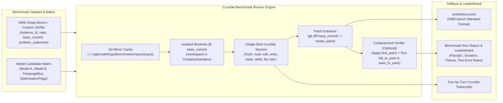

# 🏁 Step 12.23: Crucible Benchmark Runner for SWE-Sharp-Bench & Multi-Model Evaluation

> **Phase 12 Implementation Step (Extend Features - Intelligence, Benchmarking & Model Selection)**  
> *Parent Plan:* [Phase 12 Master Plan](../12_EXTEND_FEATURES.md)  
> *Related Steps:* [Step 11.33: Unified LLM Provider Architecture](../phase-11/STEP_11_33_UNIFIED_LLM_PROVIDER_DYNAMIC_CONTEXT_AND_FLEET_INTEGRATION.md) | [Step 11.35: OpenAI-Compatible LLM Provider](../phase-11/STEP_11_35_OPENAI_COMPATIBLE_LLM_PROVIDER.md) | [Step 12.5: Dual Model Role Configuration & Difficulty Escalation](STEP_12_5_DUAL_MODEL_ROLE_CONFIGURATION_AND_DIFFICULTY_ESCALATION.md) | [Step 12.14: Global Skills Injection & Stack Tooling](STEP_12_14_GLOBAL_SKILLS_INJECTION_AND_STACK_TOOLING.md) | [Step 12.22: Container Diagnostic Bash Console](STEP_12_22_CONTAINER_DIAGNOSTIC_BASH_CONSOLE.md)  
> *Source Policy:* [AGENTS.md](../../../AGENTS.md)  
> *Project Target:* `src/NightCodeForge.Core`, `src/NightCodeForge.Infrastructure`, `src/NightCodeForge.Agents`, `src/NightCodeForge.Cli`, `src/NightCodeForge.Web`, `tests/NightCodeForge.Agents.Tests`, `tests/NightCodeForge.Web.Tests` | *Status:* Planned | *Target Framework:* .NET 10 (C# 13)

> This document is a **specification**: it states required behaviors and constraints, not implementations. Implementation choices (signatures, code structure) are left to the implementer, within the constraints of the documents.

---

## 1. Executive Objective

1. **Direct Crucible Benchmark Runner (Bypassing Full Orchestrator Workflow):** Provide a dedicated benchmark execution engine that runs **SWE-Sharp-Bench** (and compatible SWE-bench / custom JSONL benchmarks) directly inside **Crucible (`CrucibleAgentHarness`)** and `ContainerSandbox` **without invoking the full 6-stage NightCodeForge workflow, database task state machine, human clarification (`ask`), or merge gates**.
2. **Empirical Multi-Model & Configuration Evaluation:** Enable running identical benchmark instances across a matrix of candidate LLM models (e.g., `jetelain/qwen3.6-35b-a3b`, `jetelain/qwen3.8-27b`, `jetelain/qwen3.5-9b`, `deepseek-r1`, `glm-4.5`, cloud/OpenAI-compatible baselines), quantizations, thinking effort levels, context sizes, and `LocalOptimizationFlags` (e.g., with vs. without `csnav` or context compaction) to scientifically determine the best-suited models for NightCodeForge.
3. **First-Class SWE-Sharp-Bench & SWE-bench Compatibility:**
   - Ingest standard SWE-Sharp-Bench / SWE-bench JSON and JSONL datasets (`instance_id`, `repo`, `base_commit`, `problem_statement`, `hints_text`, `fail_to_pass`, `pass_to_pass`, `test_patch`, `patch`).
   - Emit standard `predictions.jsonl` (`instance_id`, `model_name_or_path`, `model_patch`) compatible with the official SWE-Sharp-Bench / SWE-bench evaluation harnesses.
4. **Built-In Containerized Verification (`fail_to_pass` / `pass_to_pass`):** Support self-contained evaluation inside `NightCodeForgeContainerExecutor` by applying the model's generated patch alongside the benchmark's `test_patch`, building the solution, and executing the `fail_to_pass` and `pass_to_pass` unit tests to compute resolution rates (`Pass@1`) out of the box.
5. **Deep Crucible Telemetry & Model Leaderboard:** Capture fine-grained agentic telemetry per run—resolution status, patch applicability, wall-clock duration, prompt/completion tokens, turn count, tool call distribution (`read`, `edit`, `write`, `bash`, `csnav`), `edit` search-replace failure rate, `LenientToolDispatcher` repair count, and degenerate loop interventions—presented in both CLI (`ncf benchmark`) and Web UI (`/benchmarks`).

---

## 2. Problem Statement & Motivation

### 2.1 Why Evaluate Models in Crucible Without the Full Workflow?
NightCodeForge's production pipeline uses a multi-stage workflow (`TaskReviewStage` $\rightarrow$ `Pre-Impl Baseline` $\rightarrow$ `ImplementationStage` $\rightarrow$ `Post-Impl Quality Gate` $\rightarrow$ `CodeReviewAndFixStage` $\rightarrow$ `Post-Review Gate`). While ideal for production software delivery, running the full 6-stage pipeline when evaluating new LLM models or quantizations has three drawbacks:
1. **Confounded Attribution:** If a task fails or succeeds after 3 stages and 2 quality-gate loopbacks, it is difficult to isolate whether the base model's raw coding and tool-calling capability in Crucible improved or if the deterministic loopback compensated for model errors.
2. **Human-in-the-Loop Blocking:** Standard benchmarks like SWE-Sharp-Bench require 100% autonomous, non-interactive execution from `problem_statement` + `base_commit` to a unified `git diff` patch (`model_patch`), with zero `ask` tool interruptions.
3. **Execution Speed & Reproducibility:** Evaluating 20–100 SWE-Sharp-Bench instances across 3–5 candidate models requires a lightweight, repeatable single-shot Crucible runner that checks out `base_commit` in a clean worktree, runs the Crucible agent loop with `read`/`edit`/`write`/`bash` (and stack skills like `csnav`), captures `git diff`, and verifies tests.

### 2.2 Finding the Optimal Model & Tooling Mix for NightCodeForge
Local and open-weight coding models evolve rapidly (Qwen 3.x MoE vs dense, DeepSeek, GLM, Llama, Devstral, etc.), and their effectiveness inside Crucible depends heavily on:
- **Tool-Calling Precision:** How accurately the model invokes `edit` (exact search-and-replace blocks without corrupting indentation), `read`, `bash`, and `csnav` (`PmadCSharpNav`), and how often `LenientToolDispatcher` must repair malformed JSON or aliased parameters.
- **Context & Thinking Efficiency:** How many turns and tokens the model consumes before converging on a working fix, and whether `ThinkingTraceCompaction` or `ToolResultCompaction` degrades or improves solve rates.
- **Role Suitability ([Step 12.5](STEP_12_5_DUAL_MODEL_ROLE_CONFIGURATION_AND_DIFFICULTY_ESCALATION.md)):** Identifying which fast MoE model excels as the **Coder** model and which dense reasoning model excels on high-difficulty architectural bugs.

---

## 3. Architecture & Technical Specification



### 3.1 Dataset Schema (`BenchmarkInstance`)

`IBenchmarkDatasetLoader` parses `.jsonl` and `.json` files conforming to the **SWE-Sharp-Bench** / **SWE-bench** schema, with optional NightCodeForge extensions for custom local benchmarks:

```csharp
namespace NightCodeForge.Core.Benchmarking;

public record BenchmarkInstance
{
    /// <summary>
    /// Unique identifier, e.g. "dotnet__extensions-1234" or "serilog__serilog-987".
    /// </summary>
    public required string InstanceId { get; init; }

    /// <summary>
    /// GitHub repository slug ("owner/name") or local repository path / Git URL.
    /// </summary>
    public required string Repo { get; init; }

    /// <summary>
    /// Git commit SHA representing the pre-fix state of the repository.
    /// </summary>
    public required string BaseCommit { get; init; }

    /// <summary>
    /// Issue description / bug report presented to the Crucible agent.
    /// </summary>
    public required string ProblemStatement { get; init; }

    /// <summary>
    /// Optional hints or issue comment context.
    /// </summary>
    public string? HintsText { get; init; }

    /// <summary>
    /// Gold standard reference patch (used for diff comparison in UI; never shown to the agent).
    /// </summary>
    public string? GoldPatch { get; init; }

    /// <summary>
    /// Test patch adding/updating unit tests that reproduce the issue (applied only during verification).
    /// </summary>
    public string? TestPatch { get; init; }

    /// <summary>
    /// Tests that fail on BaseCommit + TestPatch and must pass after applying the model's patch.
    /// </summary>
    public IReadOnlyList<string> FailToPass { get; init; } = [];

    /// <summary>
    /// Regression tests that pass on BaseCommit and must continue passing after applying the model's patch.
    /// </summary>
    public IReadOnlyList<string> PassToPass { get; init; } = [];

    /// <summary>
    /// Optional custom build/test command override or Docker image override for the instance.
    /// </summary>
    public string? CustomContainerImage { get; init; }
    public string? CustomTestCommand { get; init; }
}
```

*JSON Deserialization Mapping:*
- Maps standard snake_case SWE-Sharp-Bench keys (`instance_id`, `repo`, `base_commit`, `problem_statement`, `hints_text`, `patch`, `test_patch`, `fail_to_pass` [JSON array or serialized JSON string array], `pass_to_pass` [JSON array or serialized JSON string array]).

### 3.2 Model Candidate & Run Configuration (`BenchmarkRunConfiguration`)

```csharp
namespace NightCodeForge.Core.Benchmarking;

public record BenchmarkModelCandidate
{
    public required string CandidateId { get; init; }
    public required string DisplayName { get; init; }
    public required string ModelName { get; init; }
    public ThinkingEffort ThinkingEffort { get; init; } = ThinkingEffort.Medium;
    public int? ThinkingTokenBudget { get; init; }
    public double Temperature { get; init; } = 0.1;
    public int MaxTurns { get; init; } = 60;
    public int InstanceTimeoutSeconds { get; init; } = 1200; // 20 minutes default per instance
    public LocalOptimizationFlags OptimizationFlags { get; init; } = new();
    public bool EnableStackSkills { get; init; } = true; // e.g. csnav, codecondenser
}

public record BenchmarkRunRequest
{
    public required string SuiteName { get; init; }
    public required string DatasetPath { get; init; }
    public IReadOnlyList<string>? InstanceIdFilter { get; init; }
    public int? MaxInstances { get; init; }
    public required IReadOnlyList<BenchmarkModelCandidate> Candidates { get; init; }
    public bool IncludeHints { get; init; } = false;
    public bool VerifyWithTests { get; init; } = true;
    public ExecutionMode ExecutionMode { get; init; } = ExecutionMode.ContainerSandbox;
}
```

### 3.3 Isolated Repository Caching & Worktree Provisioning (`IBenchmarkWorkspaceManager`)

To avoid re-cloning multi-hundred-megabyte .NET repositories for every model and instance:
1. **Bare/Canonical Repository Cache (`~/.nightcodeforge/benchmarks/repos/{owner}__{repo}`):**
   - If `Repo` is a `owner/name` slug, clones from `https://github.com/{owner}/{name}.git` (or uses a local mirror path if configured) once and fetches `BaseCommit`.
2. **Ephemeral Instance Worktree (`~/.nightcodeforge/benchmarks/runs/{runId}/{candidateSlug}/{instanceId}`):**
   - Creates a detached Git worktree at `BaseCommit`:
     ```bash
     git worktree add --detach <worktreePath> <BaseCommit>
     ```
   - Rewrites relative worktree `.git` pointers ([Step 11.22](../phase-11/STEP_11_22_CONTAINER_GIT_WORKTREE_RELATIVE_PATHS.md)) so the worktree functions seamlessly inside `ContainerSandbox` with `/workspace` mounted RW and `/clone` mounted RO (`/clone/.git` RW).
   - Ensures zero leakage of `GoldPatch` or `TestPatch` during the agent's coding session (additionally runs `git rev-list` / `git tag` reflog scrubbing or blocks git log inspection of commits after `BaseCommit`).

### 3.4 Single-Shot Crucible Execution (`ICrucibleBenchmarkRunner`)

For each `(BenchmarkInstance, BenchmarkModelCandidate)` pair:
1. **System & Bootstrap Prompt Construction:**
   - Uses Crucible's static 4-layer prompt hierarchy:
     - **Layer 1 (Core Engineer Persona):** Autonomous software engineer resolving a repository issue in a single session.
     - **Layer 2 (Tooling & Stack Guidelines):** Standard canonical tool rules (`read`, `edit`, `write`, `bash`), EditorConfig compliance, and stack-specific skills (`csnav` for C# symbol navigation when `EnableStackSkills == true`).
     - **Layer 3 (Benchmark Task Context):** Injects `ProblemStatement` (and `HintsText` if `IncludeHints == true`), working directory `/workspace`, and explicit instructions:
       - *"Do NOT ask questions; resolve the issue autonomously."*
       - *"Verify your changes by compiling and running relevant unit tests via `bash`."*
       - *"Leave all code modifications uncommitted in the working tree so `git diff` captures your solution patch."*
2. **Strict Tool Whitelisting:**
   - **Included:** `read`, `edit`, `write`, `bash`, and skill tools (`load_skill`, `read_skill_resource`, `run_skill_script`) when `EnableStackSkills == true`.
   - **Excluded:** `ask` (omitted so the model cannot pause for human input), `propose_tasks`, and `web_search` (omitted to guarantee zero external search contamination and air-gapped reproducibility).
3. **Patch Extraction (`model_patch`):**
   - If the agent accidentally created a local commit during its session, compares against `BaseCommit` (`git diff <BaseCommit>`).
   - Stages untracked newly created source files with `git add -N` ([Step 11.34](../phase-11/STEP_11_34_LIVE_GIT_DIFF_WORKTREE_AND_UNTRACKED_FILES.md)), excludes temporary build/test artifacts (`bin/`, `obj/`, `TestResults/`, `*.trx`), and extracts the clean unified diff:
     ```bash
     git diff <BaseCommit>
     ```
   - Appends the prediction line to `<runOutputDir>/<candidateSlug>/predictions.jsonl`:
     ```json
     {"instance_id": "dotnet__extensions-1234", "model_name_or_path": "jetelain/qwen3.6-35b-a3b", "model_patch": "diff --git ..."}
     ```

### 3.5 Built-In Containerized Patch Verification

When `VerifyWithTests == true` and the instance defines `TestPatch` / `FailToPass` / `PassToPass` (or `CustomTestCommand`):
1. Resets the worktree cleanly to `BaseCommit` (`git reset --hard <BaseCommit> && git clean -fdx`).
2. Applies `model_patch` via `git apply`. (If empty or fails to apply, records `VerificationStatus = PatchEmpty` or `PatchApplyFailed`).
3. Applies `TestPatch` (if present in the SWE-Sharp-Bench instance) via `git apply`.
4. Executes the build and targeted test suite inside the container sandbox:
   - For C# / SWE-Sharp-Bench instances, runs `dotnet test --filter "<FullyQualifiedName>"` for each entry in `FailToPass` and `PassToPass` (or executes `CustomTestCommand`).
5. Marks `Resolved = true` if and only if **all** `FailToPass` tests pass and **all** `PassToPass` tests pass.
6. Tears down the ephemeral container (`CleanupTaskContainerAsync`) and worktree after capturing all logs and transcripts.

### 3.6 Telemetry & Comparative Scorecard Metrics (`BenchmarkInstanceResult` & `BenchmarkCandidateSummary`)

```csharp
namespace NightCodeForge.Core.Benchmarking;

public enum BenchmarkInstanceOutcome
{
    Resolved,           // Patch applied + all FailToPass & PassToPass tests passed
    UnresolvedTests,    // Patch applied + built, but one or more tests failed
    BuildFailed,        // Patch applied, but compilation failed
    PatchEmpty,         // Agent finished without producing any file changes
    PatchApplyFailed,   // Generated diff was corrupt
    TimedOut,           // Exceeded InstanceTimeoutSeconds or MaxTurns
    ExecutionError      // Infrastructure / LLM error
}

public record ToolCallTelemetryBreakdown(
    int ReadCalls,
    int EditCalls,
    int WriteCalls,
    int BashCalls,
    int SkillCalls,
    int FailedToolCalls,
    int DispatcherRepairs,
    int LoopBreakerInterventions,
    int CompactionPasses);

public record BenchmarkInstanceResult(
    string InstanceId,
    string CandidateId,
    string ModelName,
    BenchmarkInstanceOutcome Outcome,
    bool IsResolved,
    bool HasNonEmptyPatch,
    string ModelPatch,
    long DurationMs,
    int TurnCount,
    long PromptTokens,
    long CompletionTokens,
    long TotalTokens,
    double TokensPerSecond,
    ToolCallTelemetryBreakdown ToolTelemetry,
    string? VerificationLog,
    string? TranscriptPath);

public record BenchmarkCandidateSummary(
    string CandidateId,
    string DisplayName,
    string ModelName,
    int TotalInstances,
    int ResolvedCount,
    double ResolvedPercentage,
    int PatchGeneratedCount,
    double PatchGeneratedPercentage,
    double MeanDurationSeconds,
    double MedianDurationSeconds,
    double MeanTurns,
    long MeanTotalTokens,
    double MeanTokensPerSecond,
    double ToolErrorRatePercentage,
    int TotalDispatcherRepairs,
    int TotalLoopInterventions);
```

### 3.7 CLI (`ncf benchmark`) & Web UI (`/benchmarks`) Surfaces

#### 3.7.1 CLI Commands (`src/NightCodeForge.Cli`)
Add a `benchmark` command group to the `ncf` CLI:
- `ncf benchmark run --dataset <path.jsonl> --models <model1,model2> [--filter <id1,id2>] [--limit <N>] [--verify|--no-verify] [--skills|--no-skills] [--out <dir>]`
  - Streams live progress per instance and model to the terminal.
  - Writes `<out>/summary.md`, `<out>/results.json`, and `<out>/<candidate>/predictions.jsonl`.
- `ncf benchmark report <resultsDir>`
  - Prints a formatted Markdown/ASCII comparative leaderboard table comparing all evaluated models.

#### 3.7.2 Web UI Page (`/benchmarks` - `Benchmarks.razor`)
Add a dedicated **🏁 Model Benchmarks** page in `NightCodeForge.Web` (under `System` in `NavMenu.razor`):
1. **New Benchmark Run Launcher:**
   - Select dataset file path (`.jsonl` / `.json`) or pick a subset of `instance_id`s.
   - Multi-select candidate models from discovered Ollama / OllamaRouter / OpenAI-compatible catalog (`IOllamaModelCatalogService` / `ILlmGatewayService`), with per-candidate toggles for `ThinkingEffort`, `EnableStackSkills` (`csnav`), and `LocalOptimizationFlags`.
   - Enqueues the benchmark job on the single-worker inference queue (`llm-inference`) so it never collides with active task executions for GPU VRAM.
2. **Model Leaderboard & Comparison Matrix:**
   - Side-by-side comparison table across models showing **Pass@1 (`% Resolved`)**, **Patch Generation %**, **Avg Duration**, **Avg Turns**, **Avg Tokens**, **Tokens/s**, **Tool Error %**, and **Dispatcher Repairs**.
3. **Per-Instance Drill-Down & Diff Comparator:**
   - Matrix grid (`Instances` $\times$ `Models`) with color-coded outcome badges (`✅ Resolved`, `❌ Tests Failed`, `⚠️ Build Failed`, `⭕ Empty Patch`, `⏱️ Timeout`).
   - Clicking any cell opens a drawer showing:
     - **Model Patch vs. Gold Patch** side-by-side diff (`DiffViewer.razor`).
     - **Verification Test Output** (`FailToPass` / `PassToPass` results).
     - **Full Crucible Reasoning & Tool Trace** (`StageConversationViewer.razor` / transcript viewer).

---

## 4. Definition of Done (DoD) Checklist

- [ ] **Core Domain & Dataset Ingestion:**
  - [ ] Define `BenchmarkInstance`, `BenchmarkModelCandidate`, `BenchmarkRunRequest`, `BenchmarkInstanceResult`, and `BenchmarkCandidateSummary` in `NightCodeForge.Core.Benchmarking`.
  - [ ] Implement `IBenchmarkDatasetLoader` supporting SWE-Sharp-Bench and SWE-bench `.jsonl` / `.json` datasets (`instance_id`, `repo`, `base_commit`, `problem_statement`, `hints_text`, `patch`, `test_patch`, `fail_to_pass`, `pass_to_pass`).
- [ ] **Isolated Workspace & Single-Shot Crucible Runner:**
  - [ ] Implement `IBenchmarkWorkspaceManager` managing cached bare/canonical clones (`~/.nightcodeforge/benchmarks/repos/`) and ephemeral detached worktrees at `BaseCommit`.
  - [ ] Implement `ICrucibleBenchmarkRunner` executing single-shot autonomous coding sessions in `CrucibleAgentHarness` with `read`, `edit`, `write`, `bash`, and optional stack skills (`csnav`), while strictly excluding `ask`, `propose_tasks`, and `web_search`.
  - [ ] Implement clean `model_patch` extraction (`git diff <BaseCommit>` with untracked file intent-to-add and build artifact exclusion) and standard `predictions.jsonl` export.
  - [ ] Implement built-in containerized patch verification applying `model_patch` + `test_patch` and running `FailToPass` and `PassToPass` tests inside `NightCodeForgeContainerExecutor`.
  - [ ] Record detailed per-instance tool telemetry (`ToolCallTelemetryBreakdown`) and generate `BenchmarkCandidateSummary` leaderboards.
- [ ] **CLI & Web UI Integration:**
  - [ ] Add `ncf benchmark run` and `ncf benchmark report` commands to `NightCodeForge.Cli`.
  - [ ] Create `src/NightCodeForge.Web/Components/Pages/Benchmarks.razor` (and backing presentation service `IBenchmarkDashboardService` per `AGENTS.md`) with run configuration, live progress, Model Leaderboard table, and per-instance `Model Patch vs. Gold Patch` diff & transcript inspector.
  - [ ] Add `🏁 Benchmarks` navigation link to `NavMenu.razor`.
- [ ] **Automated Testing:**
  - [ ] Unit tests for `BenchmarkDatasetLoader` parsing SWE-Sharp-Bench JSONL records (including serialized JSON string arrays for `fail_to_pass` / `pass_to_pass`).
  - [ ] Unit tests for `CrucibleBenchmarkRunner` with mocked `IChatClient` and `IExecutionEnvironment` verifying tool filtering (no `ask` or `web_search`), `predictions.jsonl` output, verification flow, and scorecard aggregation.
  - [ ] bUnit tests for `Benchmarks.razor` verifying leaderboard rendering and instance drill-down.
  - [ ] Verify all non-E2E tests pass via `dotnet test --filter "Category!=Acceptance&Category!=E2E"`.

---

## 5. Verification & Test Matrix

| Test ID | Scenario | Method | Expected Outcome |
| :--- | :--- | :--- | :--- |
| **TC-12.23-01** | SWE-Sharp-Bench JSONL Parsing | Load sample SWE-Sharp-Bench `.jsonl` via `BenchmarkDatasetLoader` | Correctly parses `InstanceId`, `Repo`, `BaseCommit`, `ProblemStatement`, `TestPatch`, `GoldPatch`, `FailToPass`, and `PassToPass`. |
| **TC-12.23-02** | Non-Interactive Tool Gating | Inspect registered tools in a `CrucibleBenchmarkRunner` session | Contains `read`, `edit`, `write`, `bash` (and skills if enabled); strictly excludes `ask`, `propose_tasks`, and `web_search`. |
| **TC-12.23-03** | Standard `predictions.jsonl` Generation | Run benchmark instance with a mock model that edits `Foo.cs` | Produces valid `predictions.jsonl` line with exact `instance_id`, `model_name_or_path`, and unified git diff in `model_patch`. |
| **TC-12.23-04** | Containerized `FailToPass` Verification | Run verification on a synthetic C# repo with a failing test in `TestPatch` and a valid fix in `model_patch` | Applies `model_patch` + `TestPatch`, runs `dotnet test --filter`, and marks `Outcome = Resolved` (`IsResolved = true`). |
| **TC-12.23-05** | Multi-Model Leaderboard Aggregation | Run 2 candidate models across 3 instances (one model resolving 2/3, the other 1/3) | Computes accurate `ResolvedPercentage`, `MeanDurationSeconds`, `MeanTurns`, `MeanTotalTokens`, and `ToolErrorRatePercentage` per candidate. |

