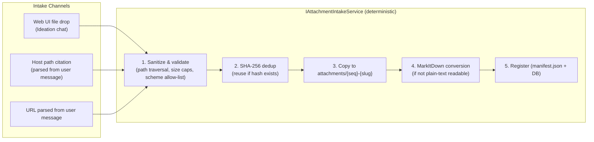

# 📎 Step 12.2: Task Attachments & Context Documents (POCs, External Docs, URL Captures)

> **Phase 12 Implementation Step (Extend Features - Backlog Management & Dependencies)** *(formerly Step 11.16)*  
> *Parent Plan:* [Phase 12 Master Plan](../12_EXTEND_FEATURES.md)  
> *Target Components:* `src/NightCodeForge.Core` (Domain, Interfaces, Repositories, Services), `src/NightCodeForge.Agents/Ideation`, `src/NightCodeForge.Agents/Tools`, `src/NightCodeForge.Web/Components/Ideation`, `src/NightCodeForge.Web/Components/Pages`, `src/NightCodeForge.Infrastructure/Data` | *Status:* Planned | *Target Framework:* .NET 10 (C# 13)  
> *Related Steps:* [Step 11.2 (Task Creation Page)](../phase-11/STEP_11_2_TASK_CREATION_PAGE_AND_MERGE_MODE.md), [Step 12.4 (Ideation Quick Notes & Refinement)](STEP_12_4_IDEATION_QUICK_NOTES_SUGGESTIONS_AND_REFINEMENT.md)

> This document is a **specification**: it states required behaviors and constraints, not implementations. Implementation choices (signatures, code structure) are left to the implementer, within the constraints of the documents.

---

## 1. Executive Objective

When designing tasks, developers regularly need to ground the agent in **prior work and external context**: a proof-of-concept script, an API specification PDF, an architecture doc, a competitor feature page, a standards RFC. Today this context lives in the developer's head, in chat history, or scattered on disk — invisible to the ideation agent and lost to the three workflow agents (Stage 1 Task Review, Implementation, Code Review & Fix).

This step introduces a first-class **workspace-level Attachments store**:

1. **Dedicated attachments directory** per workspace, a sibling of the canonical clone and the task worktrees at `~/.nightcodeforge/wks/{workspaceId}/attachments/` — always available, **read-only for all agents**, and **outside the repository** (never committed to any branch or worktree).
2. **Intake channels in Ideation:**
   - **File drop** in the Ideation chat (Web UI upload).
   - **Host filesystem path citation** in the user message (e.g. `C:\dev\poc\router-spikes.md`) — automatically copied into the attachments directory.
   - **URL parsing** in the user message — external pages are downloaded, converted to markdown, and stored with provenance metadata.
3. **Automatic markdown companions via Pmad.Markitdown:** any file that is not easily readable as plain text (PDF, Office docs, HTML, images with OCR, …) gets a companion `*.md` generated using the [`Pmad.Markitdown`](https://www.nuget.org/packages/Pmad.Markitdown) .NET library, so every attachment has an agent-consumable text form.
4. **Agent consumption:** the ideation agent can list, read, and **cite attachments in proposed tasks**; workflow stage agents (Stage 1 Review, Implementation, Code Review) can read the attachments linked to their task when they need the original context.
5. **Reusability:** an attachment is a workspace-level, content-addressed artifact. It can be linked from multiple tasks and reused across future ideation chats without re-uploading (SHA-256 deduplication).
6. **Manual usage:** the Task Creation page (`/tasks/new`, Step 11.2) lets users attach existing workspace attachments to a task without any ideation chat.

---

## 2. Storage Layout & Registry

### 2.1 Directory Layout
```
~/.nightcodeforge/wks/{workspaceId}/
├── .git/                          # canonical clone (main)
├── *.cs, ...                      # checked-out files
├── attachments/                   # NEW — workspace attachments store (read-only for agents)
│   ├── manifest.json              # NEW — machine-readable attachment registry
│   ├── 001-poc-router-spikes.md   # plain-text file (copied as-is)
│   ├── 002-openai-api-spec.pdf    # binary original (kept for provenance)
│   ├── 002-openai-api-spec.md     # MarkItDown companion (agent-consumable)
│   └── 003-rfc-9110.html.md       # URL capture (markdown only, URL in frontmatter)
└── task-{taskId}/                 # ephemeral ForgeTask worktrees (unchanged)
```

**Invariants:**
- The attachments directory is **sibling to the clone and worktrees**, resolved through the existing workspace path resolver (`IWorkspacePathResolver`). It is **not** inside any git working tree, so no branch, worktree, or mirror sync can ever commit it.
- **Read-only for agents:** no agent tool exposes write/delete on this directory. The only mutation channel is the intake pipeline (uploads, copies, URL captures) via the Web UI / API.
- **Content addressing:** file name = `{seq:000}-{slug}.{ext}` (or `{slug}.md` for URL captures); the registry stores the **SHA-256** of the content. Re-intaking identical content (same hash) does not create a duplicate — it reuses the existing attachment.
- **Manifest:** `manifest.json` is the single source of truth on disk (survives database loss, is human-readable). The database mirrors it (see §2.2) for querying/linking.

### 2.2 Database Registry
New EF Core table `TaskAttachments` (mirrors `manifest.json`):

| Column | Description |
| :--- | :--- |
| `Id` | integer PK (the `{seq}` in the file name) |
| `WorkspaceId` | owning workspace |
| `Title` | display title (original file name or page `<title>`) |
| `Slug` | kebab-case identifier |
| `RelativePath` | path inside `attachments/` (e.g. `002-openai-api-spec.pdf`) |
| `MarkdownPath` | companion markdown path, or same as `RelativePath` for plain text |
| `SourceKind` | enum: `FileDrop` \| `HostPath` \| `UrlCapture` |
| `SourceRef` | original host path or source URL |
| `Sha256` | content hash of the primary artifact |
| `SizeBytes` | size of the primary artifact |
| `CreatedAt` | UTC timestamp |

New EF Core table `TaskAttachmentLinks` (join `TaskId` × `TaskAttachmentId`, unique per pair) — a task may have many attachments; an attachment may serve many tasks.

> Per repository policy, no synthetic attachment is ever fabricated: reading a missing/corrupt attachment is a hard error (dedicated domain exception), never a silently generated placeholder.

---

## 3. Intake Pipeline (Deterministic Service)

A dedicated `IAttachmentIntakeService` (parsing, hashing, conversion, storage — kept out of Razor `@code` blocks per the UI/presentation separation policy) handles all intake:



### 3.1 Channel 1: File Drop (Web UI)
- Drop zone in the Ideation chat (and on `/tasks/new` for direct creation).
- Uploaded bytes go through the same intake pipeline as host paths.

### 3.2 Channel 2: Host Filesystem Path Citation
- The intake parser extracts absolute/relative host paths from the user message (regex over `C:\...`, `\\server\share`, `/home/...`, `~/...`).
- Each cited path is validated to exist, copied (not moved) into the attachments directory, then registered.
- **Fail fast:** a cited path that does not exist produces an explicit activity-stream error naming the path — never a silent skip.

### 3.3 Channel 3: URL Capture
- `http(s)` URLs found in the user message are fetched and converted to markdown via MarkItDown.
- The stored markdown carries provenance frontmatter:
  ```markdown
  ---
  source: https://example.com/spec
  capturedAt: 2026-10-20T12:00:00Z
  title: Example API Specification
  ---
  ```
- **Security constraints (hard requirements):**
  - Only `http` and `https` schemes; `file://`, `ftp://`, etc. are rejected.
  - Local/loopback/private-network targets are rejected (SSRF guard) unless an explicit workspace opt-in allows internal-network captures.
  - Download size cap (constant, not magic number) and a fetch timeout; over-limit content is a hard error.
  - No network access for agents themselves — captures happen server-side in the intake pipeline only.

### 3.4 Pmad.Markitdown Conversion Rules
- Files with a plain-text, agent-readable extension (`.md`, `.txt`, `.cs`, `.py`, `.json`, `.yaml`, …) are stored as-is; their `MarkdownPath` equals `RelativePath`.
- All other formats (PDF, DOCX, PPTX, XLSX, HTML, images with OCR support, …) go through the [`Pmad.Markitdown`](https://www.nuget.org/packages/Pmad.Markitdown) NuGet package; the **original binary is kept** alongside the generated `*.md` companion for provenance.
- Conversion failure is a hard error reported to the user with the file name — the file is still stored (so the user can inspect/retry) but flagged `conversionFailed` in the registry; agents must never see a half-converted companion as if it were complete.

---

## 4. Agent Consumption

### 4.1 Ideation Agent
- The ideation system prompt (built by the existing context assembly in [IdeationService](file:///c:/Users/Julien/source/repos/jetelain/NightCodeForge/src/NightCodeForge.Agents/Ideation/IdeationService.cs)) gains an **attachments digest** when the workspace has attachments: a compact list of `{id, title, kind, source, markdownPath}` — progressive disclosure, not full content injection.
- New read-only tools for the ideation agent:
  - `list_attachments` — full registry listing for the current workspace.
  - `read_attachment(attachmentId)` — returns the markdown companion content (truncated with an explicit continuation handle for very large docs).
- When proposing tasks, the agent **cites attachments** in the task description using the stable reference `@attachment:{id} {Title}` (e.g. *"Design the routing table per @attachment:2 OpenAI API Specification"*). The `propose_tasks` payload carries the linked attachment IDs; the intake service materializes `TaskAttachmentLinks` in the same transaction as task creation (no synthetic links — unknown IDs are a hard error).

### 4.2 Workflow Stage Agents (Stage 1 Review, Implementation, Code Review & Fix)
- The stage context (via `PipelineDataBag` / prompt template rendering) injects the **task's linked attachments digest** — the same compact `{id, title, markdownPath}` list — so stage agents know the prior POC / external doc exists without it bloating every prompt.
- Stage agents reuse the same `list_attachments` / `read_attachment` tools (scoped to the workspace) when a task description cites `@attachment:{id}` or when the digest reveals a relevant spec.
- Because the attachments directory lives outside the clone and worktrees, agents read it via the tools (which resolve through the workspace path resolver, including WSL2 UNC mapping) — **no agent tool receives a free-form path into this directory**.

### 4.3 Read-Only Enforcement
- `read_attachment` resolves `attachmentId` → registry → path and **validates the resolved path stays inside the attachments directory** (path traversal defense in depth) before reading.
- No write/delete/edit tool exposes the attachments directory. Removal is a user-only, Web-UI operation (see §5.4), which deletes files + registry row + task links atomically.

---

## 5. Web UI

### 5.1 Ideation Chat
- **Drop zone / attach button** on the chat composer (file drop → intake pipeline).
- After a user message, cited host paths and captured URLs surface as **attachment chips** in the conversation with status (stored / converting / failed) so the user sees what was ingested.
- A collapsible **"Workspace Attachments"** panel lists all attachments (title, kind, source, date) with a "link to this conversation" affordance.

### 5.2 Proposal Cards & Task Creation
- Proposed task cards display their linked attachments as chips (clickable → preview the markdown companion).
- `/tasks/new` (Step 11.2) gains an **Attachments picker**: select existing workspace attachments to link to the new task; new files can also be dropped directly at creation time.

### 5.3 Attachment Preview
- A detail drawer renders the markdown companion (rendered), the source metadata (kind, source ref, SHA-256, size, capturedAt), and the list of tasks currently linking the attachment.

### 5.4 Management
- Delete (user-only) with a confirmation showing which tasks would lose the link (links are removed, tasks are not blocked — a task whose attachment was deleted shows a "missing attachment" badge and the domain error surfaces if an agent requests it).
- Re-download/re-convert is **not** supported: content is immutable by hash; to change an attachment, add a new one.

---

## 6. Security & Robustness Constraints

| Concern | Constraint |
| :--- | :--- |
| Path traversal | Cited host paths and all resolved attachment paths are validated; resolved targets must stay inside `attachments/` on read. |
| SSRF | URL captures restricted to `http/https`, loopback/private ranges rejected without explicit opt-in. |
| Resource exhaustion | Max file size (upload & download), max attachment count per workspace, and fetch timeout are named constants. |
| Immutability | Stored content is never mutated; same-hash re-intake reuses the existing artifact (deduplication). |
| No silent failures | Missing file at citation, failed download, failed conversion, unknown attachment ID → explicit domain exceptions / activity-stream errors, never fabricated content. |
| Cross-OS | Path resolution uses the workspace path resolver so host, WSL2-UNC, and container contexts resolve identically. |

---

## 7. Implementation Checklist & Deliverables

- [ ] **Domain & Persistence:**
  - [ ] `TaskAttachment` + `TaskAttachmentLink` entities, `TaskAttachmentSourceKind` enum, `AttachmentNotFoundException` (and sibling domain exceptions) in `NightCodeForge.Core`.
  - [ ] EF Core tables + migration; repository interface with content-hash dedup query.
  - [ ] `manifest.json` writer/reader kept in sync with the database (disk is source of truth on read conflicts).
- [ ] **Intake Service:**
  - [ ] `IAttachmentIntakeService`: host-path parser (user message), URL parser, sanitization, SHA-256 dedup, copy-to-store, Pmad.Markitdown conversion with companion files, registry update.
  - [ ] `Pmad.Markitdown` NuGet integration; plain-text passthrough extension list as a constant.
  - [ ] Security guards: path traversal validation, SSRF allow-list, size/count/timeout constants.
- [ ] **Agent Integration:**
  - [ ] Attachments digest injected into the ideation system prompt when the workspace has attachments.
  - [ ] `list_attachments` / `read_attachment` read-only tools registered for ideation and the three workflow stage agents (workspace-scoped, traversal-validated).
  - [ ] `@attachment:{id}` citation convention: parsed from task descriptions into `TaskAttachmentLinks` on task creation (hard error on unknown IDs); linked digest injected into stage prompts via `PipelineDataBag`.
- [ ] **Web UI:**
  - [ ] Ideation chat drop zone + attachment chips with intake status.
  - [ ] "Workspace Attachments" panel; preview drawer (rendered markdown + metadata + linked tasks).
  - [ ] Attachments picker on `/tasks/new`; chips on proposal cards.
  - [ ] User-only delete with link-impact confirmation.
- [ ] **Tests:**
  - [ ] Unit tests: intake pipeline (dedup by hash, companion generation via Pmad.Markitdown fixtures, path-traversal rejection, SSRF rejection, size caps), registry/manifest synchronization.
  - [ ] Unit tests: `@attachment:{id}` parsing, unknown-ID hard error, digest rendering.
  - [ ] Integration test: end-to-end intake (file drop + URL capture) → ideation cites attachment → task created with link → stage agent reads attachment.
  - [ ] UI tests: drop zone, chips, picker on `/tasks/new`, preview drawer, delete flow.
