# 🎨 Step 12.3: Conversational UI Unification, Review Room & Task Detail Ergonomics, Inspector Grouping & Running State Hygiene

> **Phase 12 Implementation Step (Extend Features - Developer Ergonomics & UI Polish)** *(formerly Step 11.19)*  
> *Parent Plan:* [Phase 12 Master Plan](../12_EXTEND_FEATURES.md)  
> *Project Target:* `src/NightCodeForge.Web/Components/Inbox`, `src/NightCodeForge.Web/Components/Monitoring`, `src/NightCodeForge.Web/Components/Pages`, `src/NightCodeForge.Web/Components/Review`, `src/NightCodeForge.Web/Components/Backlog`, `src/NightCodeForge.Web/Services`  
> *Status:* Planned | *Target Framework:* .NET 10 (C# 13)

---

## 1. Executive Summary & Problem Statement

User feedback across real-world project trials highlighted key UX inconsistencies, state tracking friction, and review/inspection ergonomics gaps across the Blazor web application:

1. **Question Inbox vs. Task Inspector Clarification UI Divergence:**
   The Question Inbox (`/inbox` via `QuestionCard.razor`) and the Task Execution Inspector (`AgentQuestionTurnCard.razor`) implemented two divergent visual designs and interaction models for the exact same human-in-the-loop clarification workflow. `AgentQuestionTurnCard` provides a significantly cleaner experience (pulsing "Waiting for Answer" badge, suggested option chips, inline response area, and clear resolution state), whereas `QuestionCard` relies on bulky legacy styling.  
   *Resolution:* Unify the clarification UI by reusing `AgentQuestionTurnCard` across both the Question Inbox and Task Inspector, wrapping it in an inbox-friendly task/workspace header badge.

2. **Pipeline Stepper False "Pending" State for Running Stages:**
   In `TaskExecutionInspector.razor`, when a task is actively executing (e.g. stage "ForgeTask Review" with conversation status `Running`), the stepper erroneously displayed `Pending` instead of `Running` (with active pulse animation). The conversation viewer below correctly showed `Running`.  
   *Root Cause:* `TaskExecutionInspector.razor` passed `Conversations` and `CurrentStageId` to `PipelineStepper`, but omitted `CurrentStageStatus` (defaulting it to `null`). While `Conversations` initially updated the stage status to `Running`, subsequent logic in `PipelineStepper.OnParametersSet` evaluated `CurrentStageStatus ?? StageExecutionStatus.Pending`, invoking `ApplyStageTransition(CurrentStageId, StageExecutionStatus.Pending)` and overwriting the stage status back to `Pending`.  
   *Resolution:* Fix stage status resolution in `PipelineStepper` and `TaskExecutionInspector` so running tasks (`TaskOverallStatus.InProgress` or active conversation `StageExecutionStatus.Running`) maintain authoritative `Running` status without being clobbered by fallback defaults.

3. **Inconsistent Conversation Density (Ideation Chat vs. Task Inspector):**
   The Ideation Chat (`Ideation.razor`) and Task Inspector (`StageConversationViewer.razor`) both present agent-human conversations, but their presentation is radically disjointed. Ideation Chat is compact, sleek, and highly readable with user/agent avatar chips, inline collapsible reasoning traces (`<details class="think-trace">`), and collapsible tool execution pills (`<details class="tool-trace">`). In contrast, `StageConversationViewer` uses large cards with heavy padding that force excessive vertical scrolling.  
   *Resolution:* Unify the conversation presentation style across both pages: port the compact bubble layout, avatar gutter, inline reasoning collapsible summaries, and tool summary pills to `StageConversationViewer`, standardizing on a cohesive conversation design language.

4. **Review Room File List Stickiness & Navigation Links:**
   In `/review` (`Review.razor`), the changed files tree scrolls out of view when reviewing large file diffs, forcing maintainers to scroll all the way back to the top to switch files. Furthermore, maintainers in the review room lacked direct links to view the task execution inspector and the task details page.  
   *Resolution:* Make `.file-tree` sticky (`position: sticky; top: 1rem; max-height: calc(100vh - 2rem); overflow-y: auto;`) and add prominent header buttons linking to both `🔍 Task Inspector` (`/inspector/{TaskId}`) and `📄 Task Details` (`/tasks/{TaskId}`).

5. **Review Room File Path Truncation in Left Panel (Missing Tree View):**
   In `/review` (`Review.razor`), the changed files in the left sidebar are rendered as flat strings (`file.Path`) with `overflow: hidden; text-overflow: ellipsis; white-space: nowrap;`. Because real-world projects contain deeply nested paths (e.g. `src/NightCodeForge.Web/Components/Pages/Review.razor`), the 240px–300px sidebar cuts off the path trailing characters, completely hiding the actual filename and extension. Maintainers cannot identify which file they are selecting without hovering or clicking.  
   *Resolution:* Rework the flat file list into an interactive Hierarchical Tree View. Group changed files by directory structure, collapse single-child intermediate directory chains (e.g. `src/NightCodeForge.Web/` as a single folder node), render directories as collapsible nodes, and present the leaf file name prominently so the filename is **always fully visible**. Adhering to the UI/presentation separation rule, extract tree-building, sorting, and path-compression logic into a dedicated `ReviewFileTreeBuilder` helper class in `NightCodeForge.Web.Services` rather than placing non-trivial logic in Razor `@code` blocks.

6. **Plain Text Code in Diff Viewer (Missing Syntax Highlighting):**
   In `DiffViewer.razor`, both Side-by-Side and Unified diff views display code lines as plain, unformatted monospaced text inside table cells. Reviewing diffs across diverse project languages (C#, TypeScript, JavaScript, Python, JSON, XML, Markdown, Shell) is cognitively taxing without visual distinctions for keywords, strings, comments, types, and numbers.  
   *Resolution:* Implement a lightweight, zero-dependency server-side syntax highlighting service (`ISyntaxHighlightingService` / `SimpleSyntaxHighlighter`) in `NightCodeForge.Web.Services`. The service performs deterministic lexical tokenization per line based on file extension, wrapping tokens in standard CSS spans (`tok-keyword`, `tok-string`, `tok-comment`, `tok-type`, `tok-number`, `tok-punct`) with full HTML entity encoding for safety. `DiffViewer.razor` calls the highlighter to render formatted code lines while maintaining diff row background highlights, character-level diff spans, and inline commenting capability.

7. **In-Flight Task Display in Live Operations Telemetry:**
   In `/monitoring` (`ActiveOperationsHero.razor`), the operations hero prominently highlights live LLM calls and live shell commands, but omits high-level task context. Maintainers observing running GPU inference cannot immediately see which specific task is in flight, its title, active stage, and worker queue.  
   *Resolution:* Embed an **In-Flight Task Card** in `ActiveOperationsHero.razor` displaying the currently running task (Task #ID, Title, Current Stage, Worker Queue, Priority, and direct links to `/inspector/{id}` and `/tasks/{id}`), or a clean "Worker Idle" state when no task is executing.

8. **Task Inspector Grouped Dropdown by Status:**
   In `/inspector` (`TaskExecutionInspector.razor` / `TaskInspector.razor`), selecting a task from a flat list of 20+ items becomes cumbersome. Maintainers struggle to locate active vs queued vs blocked tasks.  
   *Resolution:* Group the task dropdown using structured `<optgroup>` sections:
     - 🚀 **Running** (actively executing a stage)
     - ⏳ **In Flight (Waiting for Slot)** (queued in DevQueue/Hangfire awaiting GPU inference)
     - 💬 **Waiting for Human** (`IsWaitingForHuman == true`, pending clarification)
     - ✅ **Closed** (merged or closed tasks)  
   Tasks are sorted by Priority ASC, then Last Active / CreatedAt DESC within each group. In accordance with UI separation rules, task classification and grouping logic is encapsulated in `TaskInspectorGroupingHelper` in `NightCodeForge.Web.Services`.

9. **Review Room Pending Reviews Filter (Exclude Merged/Closed Tasks):**
   In `/review` (`Review.razor`), the task selector dropdown and pending review queries currently include already merged or closed tasks (`Status == Closed`), cluttering the list and causing confusion over which tasks still require maintainer review.  
   *Resolution:* Update `TaskReviewService.GetPendingReviewsAsync` and `Review.razor` to strictly filter out closed and merged tasks. The review room only presents tasks in reviewable pending states (`Status == Ready`, or reviewable non-closed statuses).

10. **Task Detail Page Diff Tab & Review Action Button:**
    Maintainers viewing `/tasks/{id}` (`TaskDetail.razor`) cannot inspect code changes or diffs without navigating away to the review room; once a task is merged, there is no way to inspect what changes it introduced on the task page itself. Furthermore, when a task is waiting for manual review (`Status == Ready`), there is no prominent action button to navigate directly to the review room.  
    *Resolution:* Add a dedicated **"Changes" (Diff) tab** in `TaskDetail.razor` that embeds `DiffViewer.razor` (powered by `ITaskDiffService` for both in-progress worktree diffs and committed squash diffs for closed tasks). When `task.Status == TaskOverallStatus.Ready`, display a prominent primary header button `🔍 Open in Review Room` navigating to `/review?taskId={task.Id}`.

11. **Kanban Active Running Visual Distinction:**
    In `KanbanBoard.razor` and `KanbanCard.razor`, tasks in the "In-Flight" column appear identical whether they are actively executing on the GPU or merely queued waiting for an inference slot. In contrast, the DAG view (`DependencyGraph.razor`) provides a clean visual indicator for running nodes.  
    *Resolution:* Add an explicit running indicator badge (`● Running` with pulse glow animation and active stage badge) and glowing border accent on `KanbanCard.razor` whenever `task.Status == TaskOverallStatus.InProgress`, mirroring the clean visual indicator from the DAG view.

---

## 2. Architecture & Component Reuse Model

```mermaid
flowchart TD
    subgraph ClarificationAndConversations ["Conversational UI & Inbox"]
        TurnCard["AgentQuestionTurnCard.razor<br/>- Pulsing Status Badge<br/>- Suggested Option Chips<br/>- Answer Input Box<br/>- Answered Resolution State"]
        InboxHeader["Task & Workspace Context Header<br/>(Task #Id, Title, Stage, Time)"]
        InboxHeader --> TurnCard
        TurnCard --> InboxView["Question Inbox (/inbox)"]
        TurnCard --> InspectorView["Task Inspector (/inspector)"]
        TurnCard --> IdeationView["Ideation Chat (/ideation)"]

        AvatarGutter["Avatar Column (👤 / 🤖 / ⚙️)"] --> Bubble["Compact Bubble Body"]
        Bubble --> ThinkTrace["Inline Collapsible Reasoning (&lt;details class='think-trace'&gt;)"]
        Bubble --> ToolTrace["Collapsible Tool Pill (&lt;details class='tool-trace'&gt;)"]
        Bubble --> StageViewer["StageConversationViewer.razor"]
    end

    subgraph InspectorAndReview ["Task Inspector & Review Ergonomics"]
        TaskGrouping["TaskInspectorGroupingHelper<br/>- Running<br/>- In Flight (Waiting for Slot)<br/>- Waiting for Human<br/>- Closed"] --> InspectorDropdown["TaskExecutionInspector.razor (&lt;optgroup&gt;)"]
        
        ReviewFilter["TaskReviewService.GetPendingReviewsAsync<br/>(Exclude Closed / Merged)"] --> ReviewDropdown["Review.razor Pending List"]
        ReviewDropdown --> StickyTree["Sticky File Tree with Collapsible Nodes"]
        ReviewDropdown --> InspectorLink["Link to /inspector/{id} & /tasks/{id}"]
    end

    subgraph DiffAndTaskDetail ["Diff Viewer & Task Detail Integration"]
        DiffSvc["ITaskDiffService<br/>(Worktree Diff or Squash Commit Diff)"] --> DiffViewer["DiffViewer.razor<br/>- Syntax Highlighting<br/>- Side-by-Side & Unified"]
        DiffViewer --> ReviewPage["Review.razor"]
        DiffViewer --> TaskDetailPage["TaskDetail.razor ('Changes' Tab)"]
        TaskDetailPage --> ReviewBtn["'Open in Review Room' Button (if Ready)"]
    end

    subgraph TelemetryAndKanban ["Live Telemetry & Kanban Running State"]
        ActiveTaskTracker["OperationsTelemetryService / TaskOrchestrator<br/>(Current In-Flight Task)"] --> TelemetryHero["ActiveOperationsHero.razor<br/>(In-Flight Task Card)"]
        RunningBadge["Active Running Badge & Pulse<br/>(Mirroring DAG View)"] --> KanbanCard["KanbanCard.razor"]
    end
```



---

## 3. Detailed Specifications

### 3.1 Unified Clarification Card in Question Inbox
1. Enhance `AgentQuestionTurnCard.razor` to support optional external task header metadata:
   - `TaskId` (int?)
   - `TaskTitle` (string?)
   - `WorkspaceName` (string?)
   - `StageId` (string?)
   - `AskedAt` (DateTime?)
2. When external task context is provided, render a top metadata bar with clickable link to `/inspector/{TaskId}`, stage badge, workspace badge, and formatted timestamp.
3. Replace bulky custom card markup in `Inbox.razor` / `QuestionCard.razor` with `AgentQuestionTurnCard`.

### 3.2 Pipeline Stepper Status Resolution
1. Update `TaskExecutionInspector.razor` to explicitly pass `CurrentStageStatus`:
   ```razor
   <PipelineStepper TaskId="@_selectedTaskId"
                    CurrentStageId="@_currentStageId"
                    CurrentStageStatus="@_currentStageStatus"
                    Conversations="@_conversations" />
   ```
2. In `PipelineStepper.razor`, determine stage running state authoritatively: if `OverallStatus == TaskOverallStatus.InProgress` and stage matches `CurrentStageId`, status is `Running` (active pulse spinner).
3. Do not fall back to `Pending` when active stage conversation exists.

### 3.3 Compact Conversation Bubble Architecture
1. Port the compact bubble layout, avatar gutter (`👤 User`, `🤖 Assistant`, `⚙️ System / Harness`), inline reasoning collapsible summaries (`<details class="think-trace">`), and tool summary pills (`<details class="tool-trace">`) from `Ideation.razor` into `StageConversationViewer.razor`.
2. Standardize conversation spacing, typography, and scroll behavior across Ideation and Task Inspector.

### 3.4 Review Room Ergonomics, Tree View & Syntax Highlighting
1. **Sticky File Tree:**
   Style `.file-tree` in `Review.razor` with sticky positioning:
   ```css
   .file-tree {
       position: sticky;
       top: 1rem;
       max-height: calc(100vh - 2rem);
       overflow-y: auto;
   }
   ```
2. **Navigation Header Links:**
   In `Review.razor` header bar, add direct navigation buttons:
   - `🔍 Task Inspector` (`/inspector/{_snapshot.TaskId}`)
   - `📄 Task Details` (`/tasks/{_snapshot.TaskId}`)
3. **Pending Reviews Filter (Exclude Merged/Closed):**
   Update `TaskReviewService.GetPendingReviewsAsync` and `Review.razor` to strictly filter out tasks where `Status == TaskOverallStatus.Closed`. The review room dropdown and pending queue only display tasks requiring maintainer review.
4. **Hierarchical Directory Tree View:**
   - Extract `ReviewFileTreeBuilder` into `src/NightCodeForge.Web/Services/ReviewFileTreeBuilder.cs`.
   - Build a `ReviewFileTreeNode` tree with folder grouping, single-child directory compression (e.g. `src/NightCodeForge.Web/Components`), and prominent leaf filename display preventing truncation.
   - Update `Review.razor` left panel to render collapsible directory nodes and file items with add/delete line badges.
5. **Simple Syntax Highlighting:**
   - Implement `ISyntaxHighlightingService` / `SimpleSyntaxHighlighter` in `src/NightCodeForge.Web/Services/` tokenizing C#, TS/JS, Python, JSON, XML, Shell, and Markdown.
   - Wrap tokens in safe HTML spans (`tok-keyword`, `tok-type`, `tok-string`, `tok-comment`, `tok-number`, `tok-punct`) with `HtmlEncoder.Default.Encode()`.
   - Integrate with `DiffViewer.razor` across Side-by-Side and Unified views.

### 3.5 Task Inspector Grouped Dropdown
1. Extract `TaskInspectorGroupingHelper` into `src/NightCodeForge.Web/Services/TaskInspectorGroupingHelper.cs`:
   - Categorizes tasks into four distinct groups:
     1. 🚀 **Running** (`task.Status == TaskOverallStatus.InProgress`)
     2. ⏳ **In Flight (Waiting for Slot)** (`task.HasExecutionRun == true` or queued in DevQueue, but not actively running or blocked)
     3. 💬 **Waiting for Human** (`task.IsWaitingForHuman == true`)
     4. ✅ **Closed** (`task.Status == TaskOverallStatus.Closed`)
   - Orders items by Priority ASC (1 to 5) then Last Active DESC within each group.
2. Update `TaskExecutionInspector.razor` / `TaskInspector.razor` task selector to render semantic `<optgroup label="...">` elements.

### 3.6 Task Detail Page Diff Tab & Review Action Button
1. In `src/NightCodeForge.Web/Services/`, create `ITaskDiffService` / `TaskDiffService` to retrieve file changes and diffs:
   - For in-flight / ready tasks: retrieve diff from the task's Git worktree against the base branch.
   - For closed / merged tasks: retrieve diff from the merged squash commit (`git diff BaseBranch~1..BaseBranch` or task branch commit hash recorded in `ForgeTask.PipelineDataJson`).
2. In `TaskDetail.razor`:
   - Add a "Changes" (Diff) tab alongside the "Overview" and "History" tabs.
   - Embed `DiffViewer.razor` inside the Changes tab, allowing maintainers to inspect the exact code modifications delivered by the task anytime.
   - When `task.Status == TaskOverallStatus.Ready`, render a prominent header button: `🔍 Open in Review Room` linking to `/review?taskId={task.Id}`.

### 3.7 Live Operations Telemetry: In-Flight Task Card
1. Extend `IOperationsTelemetryService` to track `ActiveTaskSummary`:
   - `TaskId` (int)
   - `TaskTitle` (string)
   - `CurrentStageId` (string)
   - `Priority` (int)
   - `QueueName` (string)
   - `StartedAt` (DateTime)
2. In `ActiveOperationsHero.razor` (and `/monitoring`), render an **In-Flight Task Banner / Card**:
   - Displays task ID, title, active stage, and priority badge.
   - Provides direct links: `🔍 Inspector` (`/inspector/{TaskId}`) and `📄 Details` (`/tasks/{TaskId}`).
   - Renders a clean "GPU Queue Idle — No active task executing" message when no task is running.

### 3.8 Kanban Active Running Visual Distinction
1. In `KanbanCard.razor` and `KanbanBoard.razor`:
   - Add an active running visual treatment whenever `task.Status == TaskOverallStatus.InProgress`:
     - Animated pulsing indicator badge: `<span class="badge-running"><span class="pulse-dot"></span> Running</span>`
     - Glowing border accent matching the active running node styling in the DAG view (`DependencyGraph.razor`).
     - Display current running stage name (e.g. `Stage: Implementation`).
   - Clearly separates actively executing tasks from idle tasks waiting in the "In-Flight" or "Open" columns.

---

## 4. Verification & Testing Strategy

1. **Unit & Component Tests (`NightCodeForge.Web.Tests`):**
   - `ReviewFileTreeBuilderTests`: folder grouping, single-child compression, alphabetical sorting, filename visibility.
   - `SyntaxHighlightingServiceTests`: tokenization across C#, TS, Python, JSON, XML, Shell, and HTML escaping safety.
   - `TaskInspectorGroupingHelperTests`: proper categorization into Running, In Flight, Waiting for Human, and Closed groups; priority sorting.
   - `TaskReviewServiceTests`: verify `GetPendingReviewsAsync` strictly excludes closed/merged tasks.
   - `TaskDiffServiceTests`: worktree diff retrieval for active tasks, squash commit diff retrieval for closed tasks.
   - `KanbanCardTests`: verify running badge and pulse styling render when `Status == InProgress`.
   - `ActiveOperationsHeroTests`: verify in-flight task card renders with task metadata and links.

2. **Manual Acceptance:**
   - Open `/monitoring` while a task executes: verify the in-flight task card displays task #ID, title, current stage, and links.
   - Open `/inspector`: verify the task dropdown is cleanly organized into `<optgroup>` sections (Running, Waiting for Slot, Waiting for Human, Closed).
   - Open `/review`: verify closed/merged tasks do not appear in the pending reviews list; verify sticky file tree; verify `📄 Task Details` header link.
   - Open `/tasks/{id}`: verify the "Changes" tab renders diffs for both active and closed tasks, and verify the `🔍 Open in Review Room` button appears when `Status == Ready`.
   - Open `/backlog`: verify the Kanban board displays a clear, pulsing `● Running` badge on the actively executing task, matching the DAG view.
