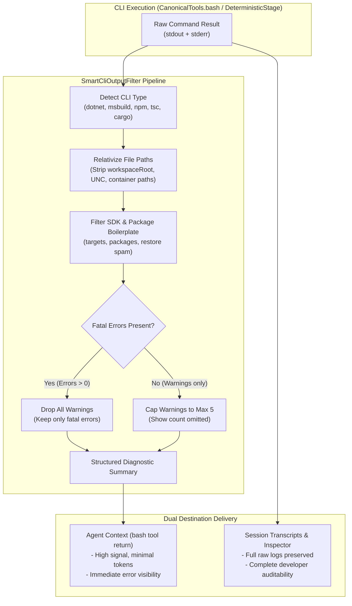
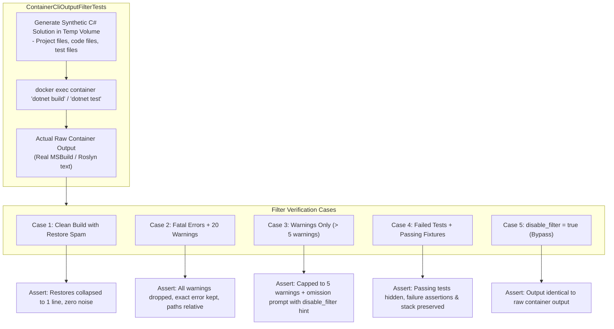

# 🧹 Step 12.6: Smart CLI & Build Tool Output Filtering (Context Compression & Noise Reduction)

> **Phase 12 Implementation Step (Extend Features - Intelligence & Quality Gates)** *(formerly Step 11.3)*  
> *Parent Plan:* [Phase 12 Master Plan](../12_EXTEND_FEATURES.md)  
> *Project Target:* `src/NightCodeForge.Agents/Tools/Filtering`, `src/NightCodeForge.Agents/Optimizations`, `src/NightCodeForge.Agents/Tools`, `tests/NightCodeForge.Agents.Tests` | *Status:* Planned

---

## 1. Executive Objective

Significantly improve LLM reasoning efficiency and token economy by applying **smart, semantic output filters** to verbose CLI tools (e.g., `dotnet build`, `msbuild`, `dotnet test`, `tsc`, `cargo`, `npm`) executed via the `bash` canonical tool or deterministic quality gate stages:

1. **Path Relativization & Normalization:**
   - Strip long absolute host, WSL2 (`/home/.../wks/{id}/...`), and container (`/workspace/...`) file paths, converting them into concise, workspace-relative paths (e.g., `src/Core/Workflow.cs(45,12)`).
   - Strip trailing project path annotations (e.g., ` [C:\Users\...\src\Project.csproj]`).

2. **Noise & SDK Internal Suppression:**
   - Strip internal SDK boilerplate (e.g., `C:\Program Files\dotnet\sdk\10.0.100\Microsoft.Common.CurrentVersion.targets(123,4)`).
   - Collapse verbose package restore lines (`Restored /workspace/... (in 320 ms)`) and CLI copyright banners into a 1-line summary.

3. **Intelligent Warning Management:**
   - **Suppress Warnings When Errors Exist:** If compilation or test execution fails with fatal errors, drop compiler warnings completely from the agent's prompt response (`"⚠️ 18 warnings suppressed because fatal compilation errors are present."`).
   - **Warning Cap & Deduplication:** When no errors exist, cap warnings to top $N$ (e.g. 5) most relevant instances with an overflow counter (`"... and 37 additional warnings omitted"`).

4. **Context vs Audit Telemetry Separation:**
   - The **compact, high-signal** filtered output is returned to the LLM agent via `bash` tool call response.
   - The **full, raw, untruncated** output is preserved in disk session transcripts and SQLite execution logs for developer inspection in the Task Inspector and terminal streams.

5. **Agent Control & Filter Bypass Parameter:**
   - The `bash` tool schema provides an optional parameter `disable_filter: bool = false` (or `raw_output: bool = false`).
   - If an agent explicitly requires uncompressed output (e.g. deep assembly binding diagnostics, raw stack dumps, or inspecting build targets), passing `disable_filter: true` bypasses filtering entirely and returns full raw CLI text.

---

## 2. Problem Statement & Motivation

A standard `dotnet build` or `msbuild` invocation on a multi-project solution often outputs 2,000 to 10,000 tokens of raw console logs:
- Hundreds of lines of package asset resolution and restore notices.
- Deep nested file paths repeated on every warning/error line.
- Dozens of non-fatal warnings (e.g. CS1591 XML doc warnings, obsolete warnings) that bury the actual fatal error (`CS0246: The type or namespace could not be found`).
- For local LLMs (e.g. Qwen 2.5 Coder 32B, DeepSeek R1 14B) with 16k–32k context windows, a single verbose build command can consume 30% to 50% of the working context, causing "lost in the middle" syndrome and hallucinations.

---

## 3. Architecture & Filter Pipeline



---

## 4. Technical Design Specifications

### 4.1 Filter Abstraction (`ICliOutputFilter`)

```csharp
namespace NightCodeForge.Agents.Tools.Filtering;

public interface ICliOutputFilter
{
    /// <summary>
    /// Checks whether this filter applies to the executed command line.
    /// </summary>
    bool CanHandle(string command);

    /// <summary>
    /// Transforms raw CLI stdout/stderr into a compact, high-signal representation for the LLM.
    /// </summary>
    string FilterOutput(string rawOutput, string workspaceRoot, CommandFilterOptions options);
}

public record CommandFilterOptions(
    int MaxWarnings = 5,
    bool RelativizePaths = true,
    bool SuppressWarningsOnErrors = true,
    bool StripSdkInternalLocations = true);
```

---

### 4.2 DotNet & MSBuild Filter Implementation (`DotNetCliOutputFilter`)

#### 1. Path Relativization Regex & Normalization
Replaces:
`C:\Users\Julien\source\repos\jetelain\NightCodeForge\src\Core\Workflow.cs(45,12): error CS0246... [C:\...\Core.csproj]`
With:
`src/Core/Workflow.cs(45,12): error CS0246: ...`

- Replaces backslashes with normalized forward slashes for relative file paths.
- Strips trailing ` [.../*.csproj]` project annotations.
- Strips `/workspace/task-{id}/` container prefixes and `\\wsl.localhost\...` UNC prefixes.

#### 2. SDK Targets & Boilerplate Stripping
- Identifies and collapses lines matching:
  - `Microsoft.NET.Sdk...`
  - `Microsoft.Common.CurrentVersion.targets`
  - `Determining projects to restore...`
  - `All projects are up-to-date for restore.`
  - Copyright notices and ASCII banners.

#### 3. Warning Policy Enforcement
- If `error CS...` count > 0:
  - Drops all `warning CS...` lines.
  - Inserts: `[⚠️ Suppressed {count} compiler warnings to focus on {errorCount} fatal errors.]`
- If error count == 0 and warning count > `MaxWarnings`:
  - Retains first 5 unique warnings.
  - Inserts: `[... and {count - 5} additional warnings omitted. Run with disable_filter=true for complete list.]`

---

### 4.3 Integration into `CanonicalTools.bash` & Tool Schema

In [CanonicalTools.cs](file:///c:/Users/Julien/source/repos/jetelain/NightCodeForge/src/NightCodeForge.Agents/Tools/CanonicalTools.cs):

```csharp
public async Task<string> BashAsync(
    string command,
    int? timeout = null,
    string? workingDirectory = null,
    bool? disableFilter = null,
    CancellationToken cancellationToken = default)
{
    // ... command execution ...
    var rawOutput = FormatRawOutput(res);

    // Record full raw output in SessionTranscript / Activity feed (always uncompressed for audit)
    _transcriptService?.RecordToolExecution(taskId, "bash", command, rawOutput);

    // Apply smart filter unless agent explicitly disabled it
    if (disableFilter != true && _flags?.SmartCliOutputFiltering == true)
    {
        var filter = _cliFilterRegistry.GetFilter(command);
        if (filter != null)
        {
            return filter.FilterOutput(rawOutput, _workspaceRoot, new CommandFilterOptions());
        }
    }

    return rawOutput;
}
```

> **Design Constraint (per AGENTS.md):** In `CanonicalTools`, `ICliOutputFilterRegistry` must be a required constructor dependency (no optional constructor parameters or fallback nulling). All callers and test suites must explicitly provide the dependency or test mock.

In [CanonicalAIFunctionFactory.cs](file:///c:/Users/Julien/source/repos/jetelain/NightCodeForge/src/NightCodeForge.Agents/Tools/CanonicalAIFunctionFactory.cs):

```csharp
AIFunctionFactory.Create(
    ([Description("Shell command line to execute")] string command,
     [Description("Timeout in seconds")] int? timeout = null,
     [Description("Working directory relative to repo root")] string? working_directory = null,
     [Description("Optional. Set to true to bypass smart output filtering and receive raw, uncompressed CLI output")] bool? disable_filter = null,
     CancellationToken ct = default) => tools.BashAsync(command, timeout, working_directory, disableFilter: disable_filter, ct),
    "bash",
    "Executes a bash or shell command within the workspace sandbox.")
```

---

## 5. Token Savings Benchmark Targets

| Command Scenario | Raw Token Count | Filtered Token Count | Compression Ratio |
| :--- | :--- | :--- | :--- |
| `dotnet build` with 1 compile error + 45 warnings | ~3,200 tokens | ~120 tokens | **96% reduction** |
| `dotnet test` with 2 failing tests + 15 projects | ~4,500 tokens | ~250 tokens | **94% reduction** |
| Successful `dotnet build` with restore noise | ~1,800 tokens | ~40 tokens (`"Build succeeded in 2.1s"`) | **97% reduction** |

---

## 6. Containerized Synthetic Test Fixtures & Real CLI Validation

To ensure filtering accuracy against actual, unmocked compiler behaviors, the integration test suite runs synthetic .NET test projects **inside a real Docker container** (using the workspace container sandbox or `mcr.microsoft.com/dotnet/sdk:10.0`):



### Synthetic Cases Matrix

| Case ID | Scenario Setup in Container | Expected Filtered Output |
| :--- | :--- | :--- |
| **`Case_CleanBuild`** | 3-project solution restoring external NuGet packages (`xunit`, `Microsoft.Extensions.Logging`). | Single summary line (`✅ Build succeeded in X.Xs`), zero restore noise, zero copyright banners. |
| **`Case_FatalErrorsAndWarnings`** | C# code with 2 fatal compile errors (`CS0246`, `CS0103`) and 15 warnings (`CS0168`, `CS0618`, `CS1591`). | Fatal error diagnostics preserved with clean relative paths (`src/Domain/Order.cs(24,12)`); all 15 warnings suppressed: `[⚠️ Suppressed 15 compiler warnings to focus on 2 fatal errors.]`. |
| **`Case_WarningsOnlyExceedingCap`** | C# code with 12 compiler warnings (unused vars, obsolete APIs) and 0 errors. | First 5 warnings rendered with relative paths, followed by: `[... and 7 additional warnings omitted. Run with disable_filter=true for complete list.]`. |
| **`Case_FailedTestSuite`** | Test project with 8 passing unit tests and 2 failing assertions (`Assert.Equal("foo", "bar")`). | Passing test noise omitted; failed tests rendered with failure name, assertion message, and relative stack trace lines. |
| **`Case_DisableFilterBypass`** | Invocation with `disable_filter: true`. | Exact bit-for-bit verbatim container stdout/stderr returned, verifying complete bypass. |

---

## 7. Implementation Checklist & Deliverables

- [ ] **Core Abstractions:**
  - Create `ICliOutputFilter` and `CommandFilterOptions` in `NightCodeForge.Agents.Tools.Filtering`.
  - Add `SmartCliOutputFiltering` toggle to [LocalOptimizationFlags](file:///c:/Users/Julien/source/repos/jetelain/NightCodeForge/src/NightCodeForge.Core/Domain/LocalOptimizationFlags.cs).
- [ ] **DotNet / MSBuild Filter:**
  - Implement `DotNetCliOutputFilter` with path relativization, warning suppression, and SDK line pruning.
  - Implement test runner filter collapsing passing test fixtures and highlighting failed assertions with stack traces.
- [ ] **Extensibility for Other Toolchains:**
  - Implement stub/extensibility points for `NodeTscCliFilter` (TypeScript / npm) and `CargoCliFilter` (Rust).
- [ ] **Harness & Tool Integration:**
  - Wire filter pipeline into `CanonicalTools.BashAsync` and expose `disable_filter` parameter in `CanonicalAIFunctionFactory`.
  - Wire filter pipeline into `DeterministicBuildStage` and `DeterministicTestStage` diagnostic formatting.
- [ ] **Containerized Synthetic Test Suite:**
  - Implement `ContainerCliOutputFilterTests` creating temporary containerized C# projects.
  - Verify all 5 synthetic cases (`Case_CleanBuild`, `Case_FatalErrorsAndWarnings`, `Case_WarningsOnlyExceedingCap`, `Case_FailedTestSuite`, `Case_DisableFilterBypass`) against real container CLI outputs.
  - Benchmark and assert token reduction targets (> 90% reduction on verbose builds).

