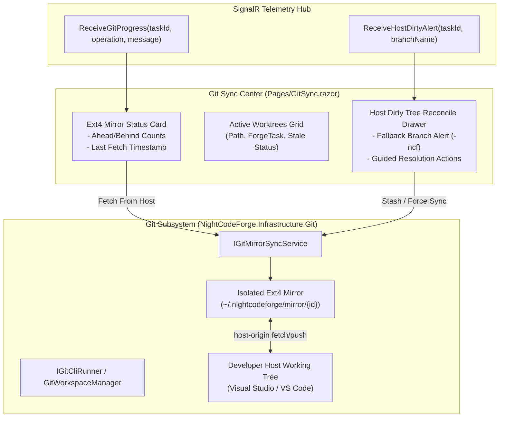

# 🌿 Step 5.11: Git Ext4 Mirror, Worktree Lifecycle & Host Dirty Tree Reconciler

> **Phase 5 Implementation Step**  
> *Parent Plan:* [Phase 5 Master Plan](../05_BLAZOR_WEB_UI_AND_TELEMETRY.md) | *Preceding Step:* [Step 5.10: Untrusted Intake & Triage](STEP_5_10_UNTRUSTED_INTAKE_AND_TRIAGE.md) | *Next Step:* [Step 5.12: Dev-Queue & Concurrency Locks](STEP_5_12_DEV_QUEUE_AND_LOCK_INSPECTOR.md)  
> *Project Target:* `src/NightCodeForge.Web/Components/GitSync` & `Pages/GitSync.razor` | *Status:* Ready for Implementation

---

## 1. Executive Objective

Provide a real-time Git synchronization management center that monitors the isolated Ext4 Git mirror repository (`~/.nightcodeforge/mirror/{workspaceId}`), inspects active task worktrees, handles host repository synchronization (`host-origin`), and provides an interactive resolution drawer whenever a **dirty developer host working tree** triggers an `updateInstead` push rejection alert.

### Core Capabilities:
1. **Ext4 Mirror & Remote Tracking Inspector:**
   - Displays mirror path, host origin path (`/mnt/...` on Windows or native Unix path), tracking branches, and commit divergence (ahead/behind counts).
   - "Fetch from Host" action invoking `IGitMirrorSyncService.FetchFromHostAsync`.
2. **Reactive Host Dirty Alert Drawer (`ReceiveHostDirtyAlert`):**
   - When Forge attempts to push branch updates or squash-merges back to the developer host via `receive.denyCurrentBranch updateInstead`, Git rejects the push if the developer has uncommitted edits to tracked files on their host IDE.
   - SignalR broadcasts `ReceiveHostDirtyAlert(taskId, branchName)`, opening a reactive alert drawer.
3. **Interactive Dirty Tree Reconciler & Rescue Branch Handler:**
   - Visualizes the automatic fallback: Forge automatically diverted the push to the rescue branch:
     ```text
     feature/task-{id}-ncf   or   {baseBranch}-ncf
     ```
   - Interactive Guided Actions:
     - **Inspect Divergence:** Side-by-side DiffPlex view between the host working tree and the `-ncf` rescue branch.
     - **Stash Host & Fast-Forward:** Stashes developer's uncommitted edits on host and fast-forwards the branch.
     - **Force Sync:** Reconciles host branch with the verified mirror branch.
     - **Manual Merge Guidance:** Copies the exact `git merge feature/task-{id}-ncf` command to clipboard for developers to run in VS Code or Terminal.
4. **Worktree Lifecycle & Pruning Console:**
   - Visualizes all active agent worktrees under `~/.nightcodeforge/wks/{workspaceId}/task-{id}`.
   - Prunes stale or closed worktrees to reclaim disk space.

---

## 2. Architecture & Data Flow



---

## 3. Data Contracts & Models

### 3.1 Backend Service Contracts (`NightCodeForge.Core.Interfaces.IGitMirrorSyncService`)

```csharp
namespace NightCodeForge.Core.Interfaces;

public record GitSyncResult(
    bool Success,
    bool FallbackUsed,
    string BranchPushed,
    string? WarningMessage);

public interface IGitMirrorSyncService
{
    Task ConfigureHostRepositoryAsync(string hostRepoPath, CancellationToken cancellationToken = default);
    Task<string> InitializeMirrorAsync(Workspace workspace, string mirrorDirectory, CancellationToken cancellationToken = default);
    Task FetchFromHostAsync(string mirrorRepoPath, string baseBranch, CancellationToken cancellationToken = default);
    Task<GitSyncResult> PushToHostAsync(string mirrorRepoPath, int taskId, CancellationToken cancellationToken = default);
    Task<GitSyncResult> PushBaseBranchToHostAsync(string mirrorRepoPath, string baseBranch, CancellationToken cancellationToken = default);
}
```

### 3.2 Git Sync UI View Models (`Services/GitSyncViewModels.cs`)

```csharp
namespace NightCodeForge.Web.Services;

public record MirrorStatusSnapshot(
    int WorkspaceId,
    string MirrorPath,
    string HostOriginPath,
    string BaseBranch,
    int CommitsAhead,
    int CommitsBehind,
    DateTime? LastFetchedAt,
    bool IsHostDirty);

public record WorktreeSnapshot(
    string Path,
    int TaskId,
    string BranchName,
    bool IsActive,
    DateTime CreatedAt);
```

---

## 4. Component Specification & Implementation

### 4.1 Page Layout: `Pages/GitSync.razor`

```razor
@page "/git-sync"
@using NightCodeForge.Core.Domain
@using NightCodeForge.Core.Interfaces
@using NightCodeForge.Web.Services
@inject IGitMirrorSyncService MirrorSyncService
@inject OrchestratorHubClientConnection HubConnection
@inject WorkspaceStateService WorkspaceState
@inject ToastService ToastService

<div class="gitsync-container">
    <div class="d-flex justify-content-between align-items-center mb-4">
        <div>
            <h2>🌿 Git Mirror, Worktrees & Host Sync</h2>
            <p class="text-secondary">Inspect isolated Ext4 Git mirrors, monitor host-origin synchronization, and reconcile dirty tree alerts.</p>
        </div>
        <button class="btn btn-primary" @onclick="FetchLatestFromHostAsync" disabled="_isFetching">
            @(_isFetching ? "Fetching..." : "🔄 Fetch from Host")
        </button>
    </div>

    <!-- Reactive Dirty Tree Warning Banner (Shows when alert is active) -->
    @if (_activeDirtyAlert != null)
    {
        <div class="dirty-alert-banner card-surface p-4 mb-4 border-warning">
            <div class="d-flex justify-content-between align-items-center">
                <div class="d-flex align-items-center gap-3">
                    <span class="fs-1">⚠️</span>
                    <div>
                        <h4 class="text-warning mb-1">Developer Host Working Tree is Dirty!</h4>
                        <p class="mb-0 text-secondary">
                            Forge could not push directly to <code>@_activeDirtyAlert.BranchName</code> because uncommitted edits were detected on your host machine.
                            Changes have been safely secured on fallback rescue branch: <strong><code>@(_activeDirtyAlert.BranchName)-ncf</code></strong>.
                        </p>
                    </div>
                </div>
                <button class="btn btn-warning" @onclick="OpenReconcileDrawer">
                    🛠️ Resolve & Reconcile ➔
                </button>
            </div>
        </div>
    }

    <div class="row g-4">
        <!-- 1. Ext4 Mirror Details Card -->
        <div class="col-md-6">
            <div class="card-surface p-4 h-100">
                <h4>Ext4 Mirror Repository</h4>
                <div class="mirror-meta font-mono mt-3">
                    <div class="meta-row">
                        <span class="meta-label">Mirror Path:</span>
                        <code class="meta-val">@_status?.MirrorPath</code>
                    </div>
                    <div class="meta-row">
                        <span class="meta-label">Host Origin:</span>
                        <code class="meta-val">@_status?.HostOriginPath</code>
                    </div>
                    <div class="meta-row">
                        <span class="meta-label">Base Branch:</span>
                        <code class="meta-val">@_status?.BaseBranch</code>
                    </div>
                    <div class="meta-row">
                        <span class="meta-label">Divergence:</span>
                        <span class="badge-tag">Ahead: @_status?.CommitsAhead</span>
                        <span class="badge-tag">Behind: @_status?.CommitsBehind</span>
                    </div>
                </div>
            </div>
        </div>

        <!-- 2. Active ForgeTask Worktrees Card -->
        <div class="col-md-6">
            <div class="card-surface p-4 h-100">
                <div class="d-flex justify-content-between align-items-center mb-3">
                    <h4>Active Agent Worktrees (@_worktrees.Count)</h4>
                    <button class="btn btn-sm btn-secondary" @onclick="PruneStaleWorktreesAsync">🧹 Prune Stale</button>
                </div>
                <div class="worktree-list font-mono">
                    @foreach (var wt in _worktrees)
                    {
                        <div class="worktree-item p-2 mb-2 card-glass d-flex justify-content-between align-items-center">
                            <div>
                                <span class="badge-tag">ForgeTask #@wt.TaskId</span>
                                <code>@wt.BranchName</code>
                            </div>
                            <span class="badge-status @(wt.IsActive ? "running" : "idle")">
                                @(wt.IsActive ? "ACTIVE" : "IDLE")
                            </span>
                        </div>
                    }
                </div>
            </div>
        </div>
    </div>
</div>

<!-- Reconcile Drawer Modal -->
@if (_showReconcileDrawer && _activeDirtyAlert != null)
{
    <HostDirtyReconcileDrawer
        Alert="_activeDirtyAlert"
        OnResolved="HandleDirtyAlertResolved"
        OnClosed="() => _showReconcileDrawer = false" />
}

@code {
    private MirrorStatusSnapshot? _status;
    private List<WorktreeSnapshot> _worktrees = new();
    private HostDirtyAlertEvent? _activeDirtyAlert;
    private bool _showReconcileDrawer;
    private bool _isFetching;

    public record HostDirtyAlertEvent(int TaskId, string BranchName, DateTime Timestamp);

    protected override void OnInitialized()
    {
        HubConnection.OnHostDirtyAlertReceived += HandleHostDirtyAlert;
    }

    private void HandleHostDirtyAlert(int taskId, string branchName)
    {
        _activeDirtyAlert = new HostDirtyAlertEvent(taskId, branchName, DateTime.UtcNow);
        ToastService.Show("Host Dirty Alert", $"Push diverted to {branchName}-ncf due to uncommitted host edits.", ToastLevel.Warning);
        InvokeAsync(StateHasChanged);
    }

    private async Task FetchLatestFromHostAsync()
    {
        var ws = WorkspaceState.ActiveWorkspace;
        if (ws == null) return;

        _isFetching = true;
        try
        {
            await MirrorSyncService.FetchFromHostAsync(ws.Ext4MirrorPath ?? string.Empty, ws.DefaultBaseBranch ?? "main");
            ToastService.Show("Fetch Complete", "Mirror updated with latest host commits.", ToastLevel.Success);
        }
        finally
        {
            _isFetching = false;
        }
    }

    private void OpenReconcileDrawer() => _showReconcileDrawer = true;

    private void HandleDirtyAlertResolved()
    {
        _activeDirtyAlert = null;
        _showReconcileDrawer = false;
        ToastService.Show("Reconciliation Complete", "Host working tree synchronized.", ToastLevel.Success);
    }

    private async Task PruneStaleWorktreesAsync()
    {
        await Task.Delay(500);
        ToastService.Show("Prune Complete", "Stale worktrees cleaned.", ToastLevel.Info);
    }
}
```

### 4.2 Reconcile Drawer Component: `Components/GitSync/HostDirtyReconcileDrawer.razor`

```razor
@using NightCodeForge.Web.Services
@inject ToastService ToastService

<div class="forge-modal-backdrop">
    <div class="forge-modal card-glass modal-lg">
        <div class="modal-header">
            <h3>🛠️ Reconcile Dirty Host Working Tree</h3>
            <button class="btn-icon" @onclick="Close">✕</button>
        </div>

        <div class="modal-body">
            <div class="alert alert-warning">
                <strong>Why did this happen?</strong>
                <p class="mb-0">
                    Your local working tree on the host has uncommitted edits to tracked files.
                    Git refuses to update the checked-out branch (<code>@Alert.BranchName</code>) via <code>receive.denyCurrentBranch updateInstead</code> to avoid overwriting your work.
                </p>
            </div>

            <div class="rescue-branch-card card-surface p-3 mb-4">
                <h5>Fallback Rescue Branch Pushed:</h5>
                <code class="font-mono text-indigo fs-5">@Alert.BranchName-ncf</code>
                <p class="text-muted small mt-1 mb-0">Your Forge changes are 100% safe and verified on this branch.</p>
            </div>

            <h4>Choose Reconciliation Strategy:</h4>
            <div class="strategies-grid d-flex flex-column gap-3 mt-3">
                <div class="strategy-card card-surface p-3">
                    <strong>1. Fast-Forward Host (Recommended if host edits are safe to stash)</strong>
                    <p class="text-muted small">Runs <code>git stash</code> on host, checks out <code>@Alert.BranchName</code>, and merges the <code>-ncf</code> rescue branch.</p>
                    <button class="btn btn-sm btn-primary mt-2" @onclick="ExecuteStashAndMergeAsync">Stash Host Edits & Fast-Forward ➔</button>
                </div>

                <div class="strategy-card card-surface p-3">
                    <strong>2. Manual Merge in Terminal / VS Code</strong>
                    <p class="text-muted small">Run this command in your host terminal:</p>
                    <div class="d-flex align-items-center gap-2 mt-2">
                        <code class="p-2 font-mono flex-grow-1 bg-dark">git merge @Alert.BranchName-ncf</code>
                        <button class="btn btn-sm btn-secondary" @onclick="CopyCommandToClipboard">Copy</button>
                    </div>
                </div>

                <div class="strategy-card card-surface p-3">
                    <strong>3. Keep Separate & Dismiss Alert</strong>
                    <p class="text-muted small">Acknowledge the alert. The rescue branch will remain available on host-origin.</p>
                    <button class="btn btn-sm btn-secondary mt-2" @onclick="DismissAlert">Dismiss Alert</button>
                </div>
            </div>
        </div>

        <div class="modal-footer">
            <button class="btn btn-secondary" @onclick="Close">Close</button>
        </div>
    </div>
</div>

@code {
    [Parameter] public GitSync.HostDirtyAlertEvent Alert { get; set; } = null!;
    [Parameter] public EventCallback OnResolved { get; set; }
    [Parameter] public EventCallback OnClosed { get; set; }

    private async Task ExecuteStashAndMergeAsync()
    {
        await Task.Delay(1000);
        await OnResolved.InvokeAsync();
    }

    private void CopyCommandToClipboard()
    {
        ToastService.Show("Copied", $"Command copied: git merge {Alert.BranchName}-ncf", ToastLevel.Info);
    }

    private async Task DismissAlert()
    {
        await OnResolved.InvokeAsync();
    }

    private async Task Close()
    {
        await OnClosed.InvokeAsync();
    }
}
```

---

## 5. Verification & Test Plan

1. **Host Dirty Alert Triggering:**
   - Simulate `ReceiveHostDirtyAlert(10, "feature/task-10")`.
   - Verify banner immediately displays in yellow with branch name and `-ncf` rescue indicator.
   - Verify toast alert appears in the bottom right corner.
2. **Reconcile Drawer Actions:**
   - Click "Resolve & Reconcile": drawer opens smoothly.
   - Verify copy command copies `git merge feature/task-10-ncf`.
   - Execute Stash & Merge: resolves alert and dismisses modal.
3. **Fetch from Host:**
   - Click "Fetch from Host": executes `FetchFromHostAsync` and refreshes commit ahead/behind counters.

---

## 6. Definition of Done (DoD) Checklist

- [ ] `Pages/GitSync.razor` created with Ext4 mirror details card and worktree list.
- [ ] Reactive subscription to SignalR `ReceiveHostDirtyAlert` alert stream.
- [ ] `HostDirtyReconcileDrawer.razor` component created with guided resolution strategies.
- [ ] Fallback branch (`-ncf`) visualization and copyable terminal merge command.
- [ ] "Fetch from Host" action integrated with `IGitMirrorSyncService.FetchFromHostAsync`.
- [ ] Component unit tests verify alert dispatch and reconciliation actions.
