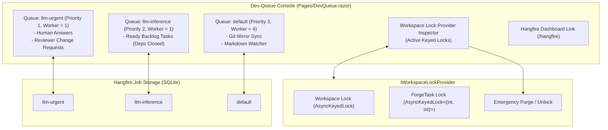

# ⏱️ Step 5.12: Dev-Queue Management, Concurrency Locks & Hangfire Dashboard

> **Phase 5 Implementation Step**  
> *Parent Plan:* [Phase 5 Master Plan](../05_BLAZOR_WEB_UI_AND_TELEMETRY.md) | *Preceding Step:* [Step 5.11: Git Mirror & Host Sync](STEP_5_11_GIT_MIRROR_AND_HOST_SYNC.md) | *Next Phase:* [Phase 6: End-to-End Hardening](../06_END_TO_END_TESTING_AND_HARDENING.md)  
> *Project Target:* `src/NightCodeForge.Web/Components/DevQueue` & `Pages/DevQueue.razor` | *Status:* Ready for Implementation

---

## 1. Executive Objective

Provide an operations control center for inspecting and managing the sequential GPU dev-queue (`WorkerCount = 1`), monitoring active concurrency locks across workspaces, and providing deep observability into Hangfire background job queues.

Because local LLM development is physically constrained to a single GPU, queue prioritization and mutual exclusion are mission-critical. This component exposes the real-time queue states, allows developers to cancel runaway jobs or reprioritize tasks, inspects active locks held by `IWorkspaceLockProvider`, and provides emergency lock-purging tools to recover from unexpected external crashes.

### Core Capabilities:
1. **Dev-Queue Depths & Scheduling Inspector:**
   - **`llm-urgent` (Priority 1, WorkerCount = 1):** Real-time list of resumed human-in-the-loop answers and reviewer change requests awaiting immediate GPU reasoning.
   - **`llm-inference` (Priority 2, WorkerCount = 1):** Main execution queue for ready backlog tasks whose prerequisite DAG dependencies are `Closed`.
   - **`default` (Priority 3, WorkerCount = 4):** Utility jobs (Git fetches, markdown sync, cache cleanup).
2. **Queue Control Actions:**
   - **Prioritize Task:** Move a task from `llm-inference` to the head of `llm-urgent`.
   - **Cancel Running Job:** Gracefully abort a running LLM inference task without corrupting Git state.
   - **Requeue Failed Job:** Retry a failed task with zero retries default.
3. **Workspace Concurrency & Lock Provider Inspector (`IWorkspaceLockProvider`):**
   - Active locks grid showing: Workspace ID, ForgeTask ID, Lock Type (`WorkspaceLock` vs. `TaskLock`), Acquired At, and Holder Task.
   - Prevents `.git/index.lock` collisions between user UI actions and background workers.
   - **Emergency Lock Release Action:** Purges orphaned locks resulting from unexpected process terminations.
4. **Hangfire Dashboard Integration:**
   - Configures and exposes the native Hangfire Dashboard (`/hangfire`) with a dedicated tab and seamless UI navigation.

---

## 2. Architecture & Queue Scheduling



---

## 3. Data Contracts & Models

### 3.1 Lock Provider Contract (`NightCodeForge.Core.Interfaces.IWorkspaceLockProvider`)

```csharp
namespace NightCodeForge.Core.Interfaces;

public interface IWorkspaceLockProvider
{
    Task<IDisposable> AcquireLockAsync(int workspaceId, CancellationToken cancellationToken = default);
    Task<IDisposable> AcquireTaskLockAsync(int workspaceId, int taskId, CancellationToken cancellationToken = default);
    bool TryAcquireLock(int workspaceId, out IDisposable? lockReleaser);
    bool TryAcquireTaskLock(int workspaceId, int taskId, out IDisposable? lockReleaser);
}
```

### 3.2 Queue & Lock View Models (`Services/DevQueueViewModels.cs`)

```csharp
namespace NightCodeForge.Web.Services;

public record QueuedJobItem(
    string JobId,
    string QueueName,
    int TaskId,
    string TaskTitle,
    string StageId,
    DateTime EnqueuedAt,
    string Status);

public record ActiveLockSnapshot(
    int WorkspaceId,
    int? TaskId,
    string LockType, // "WorkspaceExclusive" or "TaskExclusive"
    DateTime AcquiredAt,
    TimeSpan DurationHeld);
```

---

## 4. Component Specification & Implementation

### 4.1 Page Layout: `Pages/DevQueue.razor`

```razor
@page "/dev-queue"
@using NightCodeForge.Core.Interfaces
@using NightCodeForge.Web.Services
@inject IWorkspaceLockProvider LockProvider
@inject ToastService ToastService

<div class="devqueue-container">
    <div class="d-flex justify-content-between align-items-center mb-4">
        <div>
            <h2>⏱️ Dev-Queue & Concurrency Operations</h2>
            <p class="text-secondary">
                Monitor the sequential GPU inference queue (<code>WorkerCount = 1</code>), manage task priority, and inspect active workspace locks.
            </p>
        </div>
        <div class="d-flex gap-2">
            <a href="/hangfire" target="_blank" class="btn btn-secondary">
                📊 Open Hangfire Dashboard ↗
            </a>
            <button class="btn btn-primary" @onclick="RefreshQueueStateAsync">
                🔄 Refresh
            </button>
        </div>
    </div>

    <!-- Queue Status Summary Cards -->
    <div class="row g-4 mb-4">
        <div class="col-md-4">
            <div class="card-surface p-4 border-indigo">
                <div class="d-flex justify-content-between">
                    <h5>🚨 llm-urgent (Priority 1)</h5>
                    <span class="badge-gpu">Worker: 1</span>
                </div>
                <div class="queue-metric mt-3">
                    <span class="fs-1 font-mono text-indigo">@_urgentJobs.Count</span>
                    <span class="text-muted ms-2">tasks waiting</span>
                </div>
                <small class="text-secondary">Resumed human clarifications & reviewer revision requests.</small>
            </div>
        </div>

        <div class="col-md-4">
            <div class="card-surface p-4">
                <div class="d-flex justify-content-between">
                    <h5>📋 llm-inference (Priority 2)</h5>
                    <span class="badge-gpu">Worker: 1</span>
                </div>
                <div class="queue-metric mt-3">
                    <span class="fs-1 font-mono">@_inferenceJobs.Count</span>
                    <span class="text-muted ms-2">tasks waiting</span>
                </div>
                <small class="text-secondary">Ready backlog tasks with all DAG prerequisites closed.</small>
            </div>
        </div>

        <div class="col-md-4">
            <div class="card-surface p-4">
                <div class="d-flex justify-content-between">
                    <h5>⚙️ default (Utility)</h5>
                    <span class="badge-cpu">Workers: 4</span>
                </div>
                <div class="queue-metric mt-3">
                    <span class="fs-1 font-mono">@_utilityJobs.Count</span>
                    <span class="text-muted ms-2">jobs</span>
                </div>
                <small class="text-secondary">Git mirror synchronization, markdown file indexing.</small>
            </div>
        </div>
    </div>

    <!-- Active Concurrency Locks Grid -->
    <div class="card-surface p-4 mb-4">
        <div class="d-flex justify-content-between align-items-center mb-3">
            <h4>🔒 Active Workspace Locks (IWorkspaceLockProvider)</h4>
            <span class="text-muted small">Protects against <code>.git/index.lock</code> race conditions</span>
        </div>

        @if (_activeLocks.Count == 0)
        {
            <div class="p-4 text-center text-muted">No active locks held. All workspaces are free for operations.</div>
        }
        else
        {
            <table class="table-dark font-mono">
                <thead>
                    <tr>
                        <th>Workspace</th>
                        <th>Target ForgeTask</th>
                        <th>Lock Type</th>
                        <th>Duration Held</th>
                        <th>Action</th>
                    </tr>
                </thead>
                <tbody>
                    @foreach (var lockItem in _activeLocks)
                    {
                        <tr>
                            <td>Workspace #@lockItem.WorkspaceId</td>
                            <td>@(lockItem.TaskId.HasValue ? $"ForgeTask #{lockItem.TaskId}" : "All Workspace Tasks")</td>
                            <td><span class="badge-tag">@lockItem.LockType</span></td>
                            <td>@lockItem.DurationHeld.ToString(@"mm\:ss")</td>
                            <td>
                                <button class="btn btn-sm btn-danger-outline" @onclick="() => EmergencyReleaseLock(lockItem)">
                                    ⚡ Emergency Release
                                </button>
                            </td>
                        </tr>
                    }
                </tbody>
            </table>
        }
    </div>

    <!-- Active Inference Queue Table -->
    <div class="card-surface p-4">
        <h4>Sequential GPU Queue Schedule</h4>
        <div class="queue-table-container font-mono mt-3">
            <table class="table-dark">
                <thead>
                    <tr>
                        <th>Priority</th>
                        <th>Queue</th>
                        <th>ForgeTask</th>
                        <th>Stage</th>
                        <th>Enqueued</th>
                        <th>Actions</th>
                    </tr>
                </thead>
                <tbody>
                    @foreach (var job in AllQueuedJobs)
                    {
                        <tr>
                            <td>
                                @if (job.QueueName == "llm-urgent")
                                {
                                    <span class="badge-status running">URGENT</span>
                                }
                                else
                                {
                                    <span class="badge-tag">NORMAL</span>
                                }
                            </td>
                            <td><code>@job.QueueName</code></td>
                            <td><a href="/monitoring/@job.TaskId">#@job.TaskId: @job.TaskTitle</a></td>
                            <td>@job.StageId</td>
                            <td>@job.EnqueuedAt.ToString("HH:mm:ss")</td>
                            <td>
                                @if (job.QueueName != "llm-urgent")
                                {
                                    <button class="btn btn-sm btn-outline-indigo me-2" @onclick="() => PromoteToUrgent(job)">
                                        ⬆️ Prioritize
                                    </button>
                                }
                                <button class="btn btn-sm btn-secondary" @onclick="() => CancelJob(job)">
                                    ✕ Cancel
                                </button>
                            </td>
                        </tr>
                    }
                </tbody>
            </table>
        </div>
    </div>
</div>

@code {
    private List<QueuedJobItem> _urgentJobs = new();
    private List<QueuedJobItem> _inferenceJobs = new();
    private List<QueuedJobItem> _utilityJobs = new();
    private List<ActiveLockSnapshot> _activeLocks = new();

    private IEnumerable<QueuedJobItem> AllQueuedJobs => _urgentJobs.Concat(_inferenceJobs);

    protected override async Task OnInitializedAsync()
    {
        await RefreshQueueStateAsync();
    }

    private async Task RefreshQueueStateAsync()
    {
        // Load Hangfire queue depths and active locks
        await Task.CompletedTask;
    }

    private void PromoteToUrgent(QueuedJobItem job)
    {
        ToastService.Show("Prioritized", $"ForgeTask #{job.TaskId} moved to head of llm-urgent.", ToastLevel.Success);
    }

    private void CancelJob(QueuedJobItem job)
    {
        ToastService.Show("Job Cancelled", $"Execution cancelled for ForgeTask #{job.TaskId}.", ToastLevel.Warning);
    }

    private void EmergencyReleaseLock(ActiveLockSnapshot lockItem)
    {
        ToastService.Show("Lock Released", $"Emergency unlock executed for Workspace #{lockItem.WorkspaceId}.", ToastLevel.Warning);
    }
}
```

---

## 5. Hangfire Dashboard Mapping in `Program.cs`

In `NightCodeForge.Web/Program.cs`:
```csharp
using Hangfire;

// Configure Hangfire Dashboard with local requests allowed
app.UseHangfireDashboard("/hangfire", new DashboardOptions
{
    DashboardTitle = "NightCodeForge Dev-Queue Monitor",
    DarkModeEnabled = true,
    Authorization = new[] { new HangfireLocalRequestsOnlyAuthorizationFilter() }
});
```

---

## 6. Verification & Test Plan

1. **Queue Prioritization Tests:**
   - Enqueue two jobs: one to `llm-inference` and one to `llm-urgent`.
   - Verify `llm-urgent` executes first on the single worker.
   - Click "Prioritize": verify task moves from `llm-inference` to `llm-urgent`.
2. **Lock Inspector Tests:**
   - Acquire lock via `IWorkspaceLockProvider.AcquireLockAsync(workspaceId)`.
   - Verify lock displays in table with duration counter.
   - Release lock: table updates to empty state.
3. **Hangfire Dashboard Accessibility:**
   - Navigate to `/hangfire`: verify Hangfire UI loads with dark mode enabled.

---

## 7. Definition of Done (DoD) Checklist

- [ ] `Pages/DevQueue.razor` created with queue metric cards and active task tables.
- [ ] Active locks grid visualizes locks from `IWorkspaceLockProvider`.
- [ ] Emergency lock release mechanism implemented.
- [ ] Task prioritization (move to `llm-urgent`) and cancellation buttons implemented.
- [ ] Hangfire dashboard mounted at `/hangfire` in `Program.cs`.
- [ ] Component unit tests verify queue filtering and lock display.
