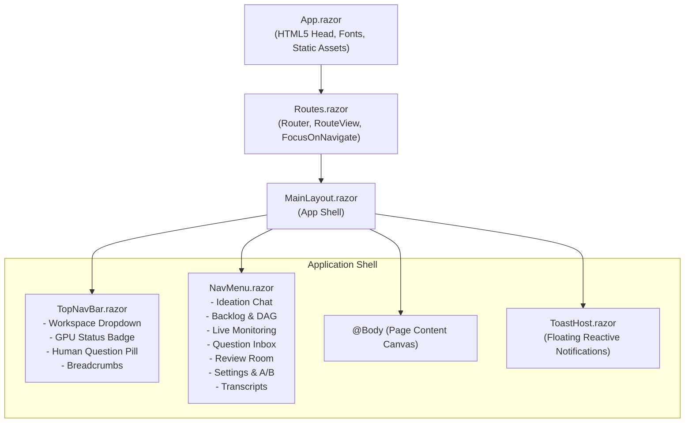

# 🎨 Step 5.1: Design System, CSS Architecture & Modern Obsidian/Indigo Layout

> **Phase 5 Implementation Step**  
> *Parent Plan:* [Phase 5 Master Plan](../05_BLAZOR_WEB_UI_AND_TELEMETRY.md) | *Next Step:* [Step 5.2: SignalR Telemetry Infrastructure](STEP_5_2_SIGNALR_TELEMETRY_INFRASTRUCTURE.md)  
> *Project Target:* `src/NightCodeForge.Web` | *Status:* Completed

---

## 1. Executive Objective

Establish a world-class, developer-grade design system and responsive application shell for the NightCodeForge Blazor UI (`InteractiveServer`).

### Key Design Principles:
1. **Pure Vanilla CSS Architecture:** Zero TailwindCSS or external heavy CSS frameworks. All styles are driven by well-structured CSS Custom Properties (CSS variables) organized into tokens for colors, typography, elevations, spacing, and micro-interactions.
2. **Obsidian & Indigo Dark Theme:** Deep obsidian surfaces (`#0f1117`, `#181b24`, `#202433`) paired with vibrant indigo (`#6366f1`), teal (`#14b8a6`), amber (`#f59e0b`), and crimson (`#ef4444`) accents.
3. **Modern Developer Typography:** Clean geometric sans-serif (`Inter`) for UI elements, paired with ligature-enabled monospaced font (`JetBrains Mono`) for logs, diffs, hashes, and code blocks.
4. **Reactive App Shell:**
   - Sticky top navigation bar featuring:
     - Global **Workspace Selector** dropdown with persistent state.
     - Global **GPU Worker Status Indicator** (`Idle`, `Running [Stage]`, `Interrupted`, `Blocked`).
     - Dynamic **Breadcrumb Trail** reflecting the active workspace and page.
     - Global pending question notification pill with counter.
   - Collapsible left sidebar navigation (`NavMenu.razor`) with active route indicators, stage count badges, and keyboard shortcuts.
   - Responsive main content area with glassmorphic cards and subtle elevation transitions.
   - Global Toast Notification Host for asynchronous alerts and worker state changes.

---

## 2. Component Hierarchy & Flow



---

## 3. Data Contracts & State Management

### 3.1 Workspace State Container (`Services/WorkspaceStateService.cs`)

Manages the currently active workspace across all Blazor components and pages without redundant database queries.

```csharp
namespace NightCodeForge.Web.Services;

public class WorkspaceStateService
{
    private int? _activeWorkspaceId;
    private Workspace? _activeWorkspace;

    public int? ActiveWorkspaceId => _activeWorkspaceId;
    public Workspace? ActiveWorkspace => _activeWorkspace;

    public event Action? OnWorkspaceChanged;

    public void SetActiveWorkspace(Workspace workspace)
    {
        ArgumentNullException.ThrowIfNull(workspace);
        _activeWorkspaceId = workspace.Id;
        _activeWorkspace = workspace;
        OnWorkspaceChanged?.Invoke();
    }

    public void ClearActiveWorkspace()
    {
        _activeWorkspaceId = null;
        _activeWorkspace = null;
        OnWorkspaceChanged?.Invoke();
    }
}
```

### 3.2 Global Worker Telemetry State (`Services/WorkerStateService.cs`)

Tracks the global GPU worker status, current active task, stage ID, and human-in-the-loop pending count.

```csharp
namespace NightCodeForge.Web.Services;

public enum WorkerExecutionStatus
{
    Idle,
    Running,
    WaitingForHuman,
    Blocked
}

public record WorkerStatusSnapshot(
    WorkerExecutionStatus Status,
    int? ActiveTaskId,
    string? ActiveTaskTitle,
    string? StageId,
    string? StageKind,
    string HardwareTarget,
    int PendingQuestionCount);

public class WorkerStateService
{
    private WorkerStatusSnapshot _current = new(
        WorkerExecutionStatus.Idle,
        null,
        null,
        null,
        null,
        "Local GPU",
        0);

    public WorkerStatusSnapshot Current => _current;

    public event Action? OnWorkerStateChanged;

    public void UpdateStatus(WorkerStatusSnapshot snapshot)
    {
        _current = snapshot;
        OnWorkerStateChanged?.Invoke();
    }

    public void UpdatePendingQuestions(int count)
    {
        _current = _current with { PendingQuestionCount = count };
        OnWorkerStateChanged?.Invoke();
    }
}
```

### 3.3 Toast Notification Service (`Services/ToastService.cs`)

```csharp
namespace NightCodeForge.Web.Services;

public enum ToastLevel { Info, Success, Warning, Error }

public record ToastMessage(Guid Id, string Title, string Message, ToastLevel Level, DateTime Timestamp);

public class ToastService
{
    private readonly List<ToastMessage> _toasts = new();
    public IReadOnlyList<ToastMessage> Toasts => _toasts;

    public event Action? OnToastsChanged;

    public void Show(string title, string message, ToastLevel level = ToastLevel.Info)
    {
        var toast = new ToastMessage(Guid.NewGuid(), title, message, level, DateTime.UtcNow);
        _toasts.Add(toast);
        OnToastsChanged?.Invoke();

        _ = Task.Run(async () =>
        {
            await Task.Delay(5000);
            Remove(toast.Id);
        });
    }

    public void Remove(Guid id)
    {
        _toasts.RemoveAll(t => t.Id == id);
        OnToastsChanged?.Invoke();
    }
}
```

---

## 4. Implementation Steps & File Modifications

### Step 4.1: Design Tokens & Base CSS (`wwwroot/css/theme.css` & `wwwroot/css/app.css`)

Create `wwwroot/css/theme.css` containing the complete obsidian/indigo design token hierarchy:

```css
:root {
    /* Obsidian Surface Elevations */
    --bg-canvas: #0b0d13;
    --bg-primary: #0f1117;
    --bg-surface: #181b24;
    --bg-card: #202433;
    --bg-card-hover: #272c3d;
    --bg-input: #12141c;
    --bg-glass: rgba(24, 27, 36, 0.75);

    /* Borders & Outlines */
    --border-subtle: #2d3345;
    --border-focus: #6366f1;
    --border-accent: rgba(99, 102, 241, 0.35);

    /* Text & Content Hierarchy */
    --text-primary: #f8fafc;
    --text-secondary: #94a3b8;
    --text-muted: #64748b;
    --text-inverse: #0f1117;

    /* Accent Palette */
    --accent-indigo: #6366f1;
    --accent-indigo-hover: #4f46e5;
    --accent-teal: #14b8a6;
    --accent-teal-hover: #0d9488;
    --accent-amber: #f59e0b;
    --accent-amber-hover: #d97706;
    --accent-crimson: #ef4444;
    --accent-crimson-hover: #dc2626;
    --accent-purple: #a855f7;

    /* Stage Differentiation */
    --badge-agentic-bg: rgba(99, 102, 241, 0.15);
    --badge-agentic-border: #6366f1;
    --badge-agentic-text: #a5b4fc;
    --badge-deterministic-bg: rgba(20, 184, 166, 0.15);
    --badge-deterministic-border: #14b8a6;
    --badge-deterministic-text: #5eead4;

    /* Statuses */
    --status-idle: #64748b;
    --status-running: #6366f1;
    --status-waiting: #f59e0b;
    --status-success: #10b981;
    --status-error: #ef4444;

    /* Typography */
    --font-sans: 'Inter', -apple-system, BlinkMacSystemFont, 'Segoe UI', Roboto, sans-serif;
    --font-mono: 'JetBrains Mono', 'Fira Code', Menlo, Consolas, monospace;

    /* Shadows & Glassmorphism */
    --shadow-sm: 0 1px 2px 0 rgba(0, 0, 0, 0.3);
    --shadow-md: 0 4px 6px -1px rgba(0, 0, 0, 0.4), 0 2px 4px -2px rgba(0, 0, 0, 0.4);
    --shadow-lg: 0 10px 15px -3px rgba(0, 0, 0, 0.5), 0 4px 6px -4px rgba(0, 0, 0, 0.5);
    --glass-backdrop: blur(12px);

    /* Radii */
    --radius-sm: 4px;
    --radius-md: 8px;
    --radius-lg: 12px;
    --radius-xl: 16px;
    --radius-full: 9999px;

    /* Transitions */
    --transition-fast: 150ms cubic-bezier(0.4, 0, 0.2, 1);
    --transition-normal: 250ms cubic-bezier(0.4, 0, 0.2, 1);
}
```

### Step 4.2: Update `Components/App.razor`

Inject Google Fonts (`Inter` and `JetBrains Mono`) and reference `theme.css` and `app.css`.

```html
<!DOCTYPE html>
<html lang="en">
<head>
    <meta charset="utf-8" />
    <meta name="viewport" content="width=device-width, initial-scale=1.0" />
    <base href="/" />
    <link rel="preconnect" href="https://fonts.googleapis.com">
    <link rel="preconnect" href="https://fonts.gstatic.com" crossorigin>
    <link href="https://fonts.googleapis.com/css2?family=Inter:wght@300;400;500;600;700&family=JetBrains+Mono:wght@400;500;600&display=swap" rel="stylesheet">
    <link rel="stylesheet" href="css/theme.css" />
    <link rel="stylesheet" href="css/app.css" />
    <link rel="icon" type="image/svg+xml" href="favicon.svg" />
    <HeadOutlet />
</head>
<body class="forge-body">
    <Routes />
    <script src="_framework/blazor.web.js"></script>
</body>
</html>
```

### Step 4.3: Top Navigation Bar (`Components/Layout/TopNavBar.razor`)

Renders the obsidian glassmorphic header containing:
- Workspace selector `<select>` with instant dispatch to `WorkspaceStateService`.
- Reactive GPU inference status badge:
  - If `Idle`: muted grey dot + "GPU Idle"
  - If `Running`: pulsating indigo dot + "Running: [StageKind] - ForgeTask #{TaskId} ([HardwareTarget])"
  - If `WaitingForHuman`: pulsating amber dot + "Waiting for Clarification"
- Question Inbox shortcut pill showing count of pending questions with link to `/inbox`.
- Active breadcrumbs showing `Workspace > Section > ForgeTask`.

### Step 4.4: Left Navigation Menu (`Components/Layout/NavMenu.razor`)

Renders the collapsible sidebar with clear navigation links:
1. `💡 Ideation Chat` (`/ideation`)
2. `📋 Backlog & DAG` (`/backlog`)
3. `⚡ Live Telemetry` (`/monitoring`)
4. `📬 Question Inbox` (`/inbox`) - with pending question counter badge
5. `🔍 Review Room` (`/review`)
6. `⚙️ Settings & A/B` (`/settings`)
7. `📜 Transcripts & AI` (`/transcripts`)

### Step 4.5: Main Application Shell (`Components/Layout/MainLayout.razor`)

Composes `TopNavBar`, `NavMenu`, dynamic `@Body`, and floating `ToastHost`. Handles clean layout grid:
```css
.forge-layout {
    display: grid;
    grid-template-columns: 240px 1fr;
    grid-template-rows: 64px 1fr;
    height: 100vh;
    overflow: hidden;
}
```

### Step 4.6: Toast Notification Host (`Components/Layout/ToastHost.razor`)

Subscribes to `ToastService.OnToastsChanged` and renders animated floating cards in the bottom-right corner with dismiss buttons and color-coded level badges.

---

## 5. Verification & Test Plan

1. **Workspace State Scenarios:**
   - Switching workspace in `TopNavBar` updates `WorkspaceStateService.ActiveWorkspaceId`.
   - All subcomponents re-render with the new workspace context.
   - If no workspaces exist in DB, a "Create Workspace" modal or welcome prompt is shown.
2. **Worker Indicator Scenarios:**
   - Simulate state change from `Idle` to `Running` with stage "ImplementationStage" -> Top bar updates without page reload.
   - Simulate `PendingQuestionCount = 2` -> Amber badge on TopNavBar and sidebar Question Inbox increments.
3. **Responsive Layout Scenarios:**
   - Sidebar collapses to compact icon rail on screens `< 1024px`.
   - Main content scrollbar is styled to match dark theme without layout jumping.
4. **Toast Notification Scenarios:**
   - Multiple toasts stack cleanly with auto-dismiss after 5 seconds.

---

## 6. Definition of Done (DoD) Checklist

- [x] `theme.css` created with complete CSS variable token specification.
- [x] `app.css` updated with dark theme reset, typography, cards, badges, and layout grid.
- [x] `App.razor` loads Google Fonts (`Inter`, `JetBrains Mono`) and theme stylesheets.
- [x] `WorkspaceStateService` implemented and registered in DI (`AddScoped`).
- [x] `WorkerStateService` implemented and registered in DI (`AddSingleton`).
- [x] `ToastService` implemented and registered in DI (`AddScoped`).
- [x] `TopNavBar.razor` renders workspace selector, breadcrumbs, question counter pill, and pulsing worker badge.
- [x] `NavMenu.razor` provides clean routing to all 7 core pages.
- [x] `MainLayout.razor` and `ToastHost.razor` integrated with zero layout jumping.
- [x] Unit tests for `WorkspaceStateService`, `WorkerStateService`, and `ToastService`.
