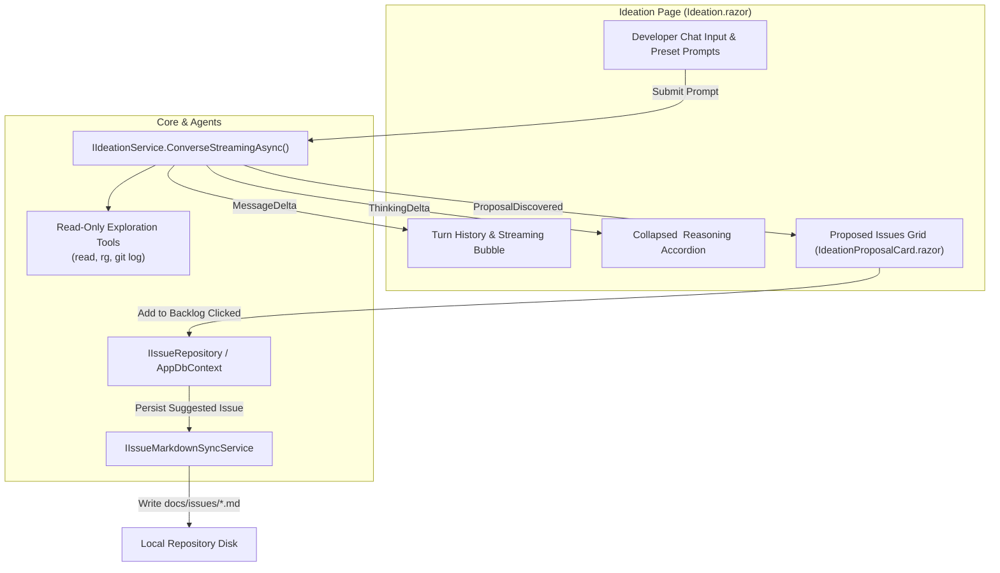

# 💡 Step 5.3: Interactive Ideation & Codebase Discovery Chat

> **Phase 5 Implementation Step**  
> *Parent Plan:* [Phase 5 Master Plan](../05_BLAZOR_WEB_UI_AND_TELEMETRY.md) | *Preceding Step:* [Step 5.2: SignalR Telemetry](STEP_5_2_SIGNALR_TELEMETRY_INFRASTRUCTURE.md) | *Next Step:* [Step 5.4: Backlog & Visual DAG](STEP_5_4_BACKLOG_AND_VISUAL_DAG.md)  
> *Project Target:* `src/NightCodeForge.Web/Components/Ideation` & `Pages/Ideation.razor` | *Status:* Ready for Implementation

---

## 1. Executive Objective

Provide an interactive conversational environment where developers brainstorm, explore architectural questions, discover potential bugs/optimizations, and generate structured backlog proposals backed by `IIdeationService`.

### Core Capabilities:
1. **Streaming Chat Interface:** Real-time token streaming separating model cognitive deliberation (`<think>...</think>`) into an expandable "Reasoning Trace" accordion, with final conversational responses rendered in formatted markdown.
2. **Context-Aware Exploration:** Agent interacts with the codebase via read-only tools (`read`, `bash`, `web_search`) without mutating any files on disk.
3. **Interactive Issue Proposal Cards:** As the agent discovers backlog opportunities or invokes `propose_issues`, proposals render as interactive cards with in-place editable fields (Title, Description/Scope, Priority, Dependencies).
4. **One-Click Backlog Ingestion:** Ingesting an issue creates an entity in `AppDbContext` with initial `Status = IssueOverallStatus.Suggested`, links dependencies in `IssueDependency`, triggers `IIssueMarkdownSyncService` to write `docs/issues/*.md`, and transitions the proposal card to a confirmed state with a direct link to the Backlog.

---

## 2. Architecture & Data Flow



---

## 3. Component Specification & Layout

### 3.1 Page Route & View: `Pages/Ideation.razor`
- **Route:** `@page "/ideation"`
- **Layout Split:**
  - **Left Pane (60%):** Conversational chat transcript, system instructions selector, quick prompt chips ("Explore Architecture", "Find Dead Code", "Propose Tech Debt Issues", "Plan New Feature"), and chat input box with Send/Cancel buttons.
  - **Right Pane (40%):** "Discovered Proposals" panel displaying active `IdeationProposalCard` components generated during the session.

### 3.2 Proposal Card Component: `Components/Ideation/IdeationProposalCard.razor`
- Displays:
  - **Editable Title:** `<input class="form-control-dark" @bind="Proposal.Title" />`
  - **Priority Selector:** 1 (Low) to 5 (Critical) dropdown.
  - **Editable Description / Scope:** Multi-line markdown preview/edit toggle.
  - **Dependency Multi-Select:** Dropdown listing existing workspace issues with checkboxes to wire prerequisite `DependsOnIssueId`.
  - **Actions:**
    - `[➕ Add to Backlog]` Button: Dispatches creation command.
    - `[🗑️ Dismiss]` Button: Removes proposal from session.
- **Added State:**
  - Once added, the button disables and displays: `✅ Added as Issue #12 (Suggested) - View in Backlog ➔`.

---

## 4. Implementation Steps & Code Patterns

### Step 4.1: Ideation Session State (`Services/IdeationSessionState.cs`)

Manages chat turns, current stream buffers, and accumulated proposals:

```csharp
namespace NightCodeForge.Web.Services;

public record ChatMessage(string Role, string Content, string? ThinkingTrace = null, DateTime? Timestamp = null);

public class IdeationSessionState
{
    public List<ChatMessage> Messages { get; } = new();
    public List<IdeationProposalViewModel> Proposals { get; } = new();
    public bool IsGenerating { get; set; }
    public string CurrentThinkingBuffer { get; set; } = string.Empty;
    public string CurrentMessageBuffer { get; set; } = string.Empty;

    public void Reset()
    {
        Messages.Clear();
        Proposals.Clear();
        CurrentThinkingBuffer = string.Empty;
        CurrentMessageBuffer = string.Empty;
        IsGenerating = false;
    }
}

public class IdeationProposalViewModel
{
    public Guid ClientId { get; } = Guid.NewGuid();
    public string Title { get; set; } = string.Empty;
    public string Description { get; set; } = string.Empty;
    public int Priority { get; set; } = 1;
    public List<int> SelectedDependencyIds { get; set; } = new();
    public bool IsAdded { get; set; }
    public int? CreatedIssueId { get; set; }
}
```

### Step 4.2: Streaming Interaction Loop in `Ideation.razor`

```csharp
@inject IIdeationService IdeationService
@inject WorkspaceStateService WorkspaceState
@inject IIssueRepository IssueRepository
@inject IIssueMarkdownSyncService MarkdownSync
@inject ToastService ToastService

@code {
    private string _userInput = string.Empty;
    private CancellationTokenSource? _cts;

    private async Task SendMessageAsync()
    {
        if (string.IsNullOrWhiteSpace(_userInput) || WorkspaceState.ActiveWorkspace == null)
            return;

        var prompt = _userInput.Trim();
        _userInput = string.Empty;
        Session.Messages.Add(new ChatMessage("user", prompt, Timestamp: DateTime.UtcNow));
        Session.IsGenerating = true;
        Session.CurrentThinkingBuffer = string.Empty;
        Session.CurrentMessageBuffer = string.Empty;

        _cts = new CancellationTokenSource();

        try
        {
            var history = Session.Messages
                .Select(m => (m.Role, m.Content))
                .ToList();

            await foreach (var update in IdeationService.ConverseStreamingAsync(
                WorkspaceState.ActiveWorkspace,
                prompt,
                history,
                customSystemPrompt: null,
                cancellationToken: _cts.Token))
            {
                switch (update.Kind)
                {
                    case IdeationStreamUpdateKind.ThinkingDelta:
                        Session.CurrentThinkingBuffer += update.TextDelta;
                        StateHasChanged();
                        break;

                    case IdeationStreamUpdateKind.MessageDelta:
                        Session.CurrentMessageBuffer += update.TextDelta;
                        StateHasChanged();
                        break;

                    case IdeationStreamUpdateKind.ProposalDiscovered when update.Proposal != null:
                        Session.Proposals.Add(new IdeationProposalViewModel
                        {
                            Title = update.Proposal.Title,
                            Description = update.Proposal.Description,
                            Priority = update.Proposal.Priority
                        });
                        ToastService.Show("New Proposal Discovered", update.Proposal.Title, ToastLevel.Info);
                        StateHasChanged();
                        break;
                }
            }

            Session.Messages.Add(new ChatMessage(
                "assistant",
                Session.CurrentMessageBuffer,
                Session.CurrentThinkingBuffer,
                DateTime.UtcNow));
        }
        catch (OperationCanceledException)
        {
            ToastService.Show("Generation Cancelled", "Exploration agent stopped.", ToastLevel.Warning);
        }
        finally
        {
            Session.IsGenerating = false;
            Session.CurrentThinkingBuffer = string.Empty;
            Session.CurrentMessageBuffer = string.Empty;
            StateHasChanged();
        }
    }
}
```

### Step 4.3: Ingest Proposal into Backlog

```csharp
private async Task AddProposalToBacklogAsync(IdeationProposalViewModel proposal)
{
    var workspace = WorkspaceState.ActiveWorkspace;
    if (workspace == null) return;

    var newIssue = new Issue
    {
        WorkspaceId = workspace.Id,
        Title = proposal.Title,
        Description = proposal.Description,
        Status = IssueOverallStatus.Suggested,
        Priority = proposal.Priority,
        MergeMode = MergeMode.ManualReviewRequired,
        BaseBranch = workspace.DefaultBaseBranch,
        CreatedAt = DateTime.UtcNow
    };

    var created = await IssueRepository.CreateAsync(newIssue, proposal.SelectedDependencyIds);
    created.FeatureBranch = $"feature/issue-{created.Id}";
    await IssueRepository.UpdateAsync(created);

    // Sync markdown issue file to docs/issues/
    if (!string.IsNullOrWhiteSpace(workspace.RepositoryPath) && Directory.Exists(workspace.RepositoryPath))
    {
        await MarkdownSync.SyncIssueToMarkdownAsync(workspace.RepositoryPath, created);
    }

    proposal.IsAdded = true;
    proposal.CreatedIssueId = created.Id;
    ToastService.Show("Added to Backlog", $"Issue #{created.Id} created with status Suggested.", ToastLevel.Success);
}
```

---

## 5. Verification & Test Plan

1. **Streaming & Deliberation UI Tests:**
   - Verify thinking tokens stream into collapsed accordion without jumping main chat scroll.
   - Verify message markdown renders headers, code snippets, and bullet lists cleanly.
2. **Proposal Ingestion Tests:**
   - Click "Add to Backlog":
     - Verify domain `Issue` is created in SQLite with `Status = IssueOverallStatus.Suggested`.
     - Verify `IssueDependency` records correspond to selected check-boxes.
     - Verify file `docs/issues/issue-XX-....md` is generated on disk with valid YAML frontmatter.
   - Verify duplicate addition is prevented (button disabled).
3. **Workspace Isolation:**
   - Verify chat turns and proposals clear/reload when switching active workspace in `TopNavBar`.

---

## 6. Definition of Done (DoD) Checklist

- [ ] `Pages/Ideation.razor` created with 2-pane responsive layout.
- [ ] `IdeationProposalCard.razor` component implemented with in-place editable fields.
- [ ] Collapsible thinking accordion `<details class="think-trace">` handles high-frequency `<think>` streaming.
- [ ] Integration with `IIdeationService.ConverseStreamingAsync` complete with cancellation support.
- [ ] Ingestion logic creates `IssueOverallStatus.Suggested` and writes `docs/issues/` markdown file.
- [ ] Dependency selector populates existing issues for linking.
- [ ] Unit & bUnit tests verifying streaming and issue creation dispatch.
