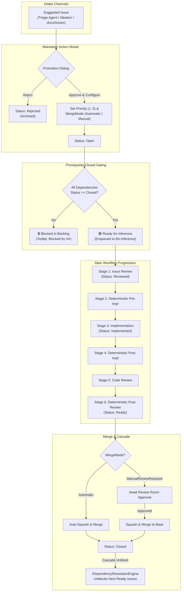

# 📋 Step 5.4: Backlog Management, Maintainer Promotion & Visual Dependency DAG

> **Phase 5 Implementation Step**  
> *Parent Plan:* [Phase 5 Master Plan](../05_BLAZOR_WEB_UI_AND_TELEMETRY.md) | *Preceding Step:* [Step 5.3: Ideation Chat](STEP_5_3_IDEATION_AND_DISCOVERY_CHAT.md) | *Next Step:* [Step 5.5: Monitoring Console](STEP_5_5_MONITORING_CONSOLE_AND_GAUGES.md)  
> *Project Target:* `src/NightCodeForge.Web/Components/Backlog` & `Pages/Backlog.razor` | *Status:* Ready for Implementation

---

## 1. Executive Objective

Provide a responsive, visual project management center that visualizes the complete lifecycle of issues (`Suggested` $\rightarrow$ `Open` $\rightarrow$ `Reviewed` $\rightarrow$ `Implemented` $\rightarrow$ `Ready` $\rightarrow$ `Closed`), empowers maintainers to triage and promote proposed items, and renders the Directed Acyclic Graph (DAG) with cycle-prevention and prerequisite closed gating rules.

### Core Capabilities:
1. **Dual Visualization Modes:**
   - **Kanban Column Board:** Fast drag-and-drop or list view grouping issues into lifecycle buckets: `Suggested (Triage)` $\rightarrow$ `Open (Ready / Blocked)` $\rightarrow$ `In-Flight (Reviewed / Implemented)` $\rightarrow$ `Ready for Review` $\rightarrow$ `Closed (Archived)`.
   - **Visual DAG Graph View:** Interactive SVG node-edge network mapping prerequisite relationships (`A` $\rightarrow$ `B`), highlighting critical execution paths and cycle-safe dependency trees.
2. **Maintainer Promotion Modal (`Suggested` $\rightarrow$ `Open` / `Rejected`):**
   - Action dialog for newly ingested intake/ideation issues.
   - Maintainer configures:
     - **Priority:** Level 1 (Normal) to 5 (Urgent).
     - **MergeMode:** `Automatic` (auto-squash and merge upon passing all deterministic gates) vs. `ManualReviewRequired` (awaits developer approval and visual diff review in Review Room).
   - Promotes via `IIssueOrchestrator.PromoteSuggestedIssueAsync`. If all dependencies are already `Closed`, automatically enqueues to `llm-inference`.
   - Rejection sets `Status = Rejected`, archiving the issue cleanly.
3. **Execution Readiness & Prerequisite Closed Gating:**
   - Visual lock indicator on `Open` issues showing blocking prerequisites.
   - Strict readiness enforcement: An issue enters the inference queue if and only if `Status == Open` AND every prerequisite issue has reached `Status == Closed`.
4. **Interactive Dependency Linking & Instant Cycle Prevention:**
   - Dependency editor modal allows wiring prerequisites.
   - Validates candidate graphs through `IDependencyResolutionEngine.HasCycle`, blocking circular dependencies (`A -> B -> A`) before saving to SQLite.

---

## 2. Lifecycle & DAG Dependency Flow



---

## 3. Component Specification & File Structure

```text
src/NightCodeForge.Web/
├── Pages/
│   └── Backlog.razor                        # Main Backlog page with View Switcher (Kanban / DAG)
└── Components/
    └── Backlog/
        ├── KanbanBoard.razor                # Lifecycle column swimlanes
        ├── KanbanCard.razor                 # Issue card with badges, priority & waiting indicators
        ├── DagVisualizer.razor              # SVG DAG graph with topological layout
        ├── MaintainerPromotionModal.razor   # Triage promotion dialog (Priority & MergeMode)
        ├── DependencyLinkingModal.razor     # Prerequisite connector with cycle detection
        └── IssueDetailDrawer.razor          # Quick drawer preview of description and logs
```

---

## 4. Implementation Details

### Step 4.1: Maintainer Promotion Modal (`MaintainerPromotionModal.razor`)

Handles promoting issues from `Suggested` to `Open` or `Rejected`:

```razor
@using NightCodeForge.Core.Domain
@using NightCodeForge.Core.Workflow
@inject IIssueOrchestrator IssueOrchestrator
@inject ToastService ToastService

@if (IsOpen && TargetIssue != null)
{
    <div class="forge-modal-backdrop">
        <div class="forge-modal card-glass">
            <div class="modal-header">
                <h3>Promote Issue #@TargetIssue.Id: @TargetIssue.Title</h3>
                <button class="btn-icon" @onclick="Close">✕</button>
            </div>
            <div class="modal-body">
                <p class="text-secondary">@TargetIssue.Description</p>

                <div class="form-group mb-3">
                    <label>Priority (1 = Normal, 5 = Critical Urgent)</label>
                    <select class="form-control-dark" @bind="_selectedPriority">
                        <option value="1">1 - Low / Standard</option>
                        <option value="2">2 - Normal</option>
                        <option value="3">3 - High</option>
                        <option value="4">4 - Very High</option>
                        <option value="5">5 - Critical / Urgent</option>
                    </select>
                </div>

                <div class="form-group mb-4">
                    <label>Merge Mode</label>
                    <select class="form-control-dark" @bind="_selectedMergeMode">
                        <option value="@MergeMode.Automatic">Automatic (Auto-merge upon passing all gates)</option>
                        <option value="@MergeMode.ManualReviewRequired">ManualReviewRequired (Requires human diff review in Review Room)</option>
                    </select>
                    <small class="text-muted">Automatic mode is recommended for deterministic fixes and test additions.</small>
                </div>
            </div>
            <div class="modal-footer">
                <button class="btn btn-danger-outline" @onclick="RejectAsync">Reject Issue</button>
                <button class="btn btn-secondary" @onclick="Close">Cancel</button>
                <button class="btn btn-primary" @onclick="PromoteAsync">Promote to Open & Enqueue</button>
            </div>
        </div>
    </div>
}

@code {
    [Parameter] public bool IsOpen { get; set; }
    [Parameter] public Issue? TargetIssue { get; set; }
    [Parameter] public EventCallback OnClosed { get; set; }

    private int _selectedPriority = 1;
    private MergeMode _selectedMergeMode = MergeMode.Automatic;

    private async Task PromoteAsync()
    {
        if (TargetIssue == null) return;

        await IssueOrchestrator.PromoteSuggestedIssueAsync(
            TargetIssue.Id,
            IssueOverallStatus.Open,
            _selectedPriority,
            _selectedMergeMode);

        ToastService.Show("Issue Promoted", $"Issue #{TargetIssue.Id} is now Open with Priority {_selectedPriority}.", ToastLevel.Success);
        await Close();
    }

    private async Task RejectAsync()
    {
        if (TargetIssue == null) return;

        await IssueOrchestrator.PromoteSuggestedIssueAsync(
            TargetIssue.Id,
            IssueOverallStatus.Rejected,
            _selectedPriority,
            _selectedMergeMode);

        ToastService.Show("Issue Rejected", $"Issue #{TargetIssue.Id} was archived.", ToastLevel.Warning);
        await Close();
    }

    private async Task Close()
    {
        IsOpen = false;
        await OnClosed.InvokeAsync();
    }
}
```

### Step 4.2: Dependency Cycle Detection Modal (`DependencyLinkingModal.razor`)

Uses `IDependencyResolutionEngine` to prevent loops before saving:

```csharp
@inject IDependencyResolutionEngine DependencyEngine
@inject IIssueRepository IssueRepository
@inject ToastService ToastService

@code {
    private async Task SaveDependenciesAsync()
    {
        if (TargetIssue == null) return;

        // Build candidate dependency list
        var candidatePairs = AllDependencies
            .Where(d => d.IssueId != TargetIssue.Id)
            .Select(d => (d.IssueId, d.DependsOnIssueId))
            .ToList();

        foreach (var depId in _selectedPrereqIds)
        {
            candidatePairs.Add((TargetIssue.Id, depId));
        }

        // Validate cycle
        if (DependencyEngine.HasCycle(TargetIssue.WorkspaceId, candidatePairs))
        {
            _errorMessage = "Circular dependency detected! This configuration would create a deadlock.";
            return;
        }

        await IssueRepository.UpdateAsync(TargetIssue, _selectedPrereqIds);
        ToastService.Show("Dependencies Updated", $"Dependencies updated for Issue #{TargetIssue.Id}.", ToastLevel.Success);
        await Close();
    }
}
```

### Step 4.3: Visual DAG Graph Component (`DagVisualizer.razor`)

Renders nodes and arrows using pure SVG:
- Computes topological ranks via `IDependencyResolutionEngine.GetTopologicalOrder`.
- Assigns column levels $X = \text{Rank} \times 240\text{px}$, $Y = \text{Index} \times 120\text{px}$.
- Renders curved Bézier SVG paths:
  ```html
  <path d="M @(sourceX) @(sourceY) C @(sourceX + 60) @(sourceY), @(targetX - 60) @(targetY), @(targetX) @(targetY)"
        class="dag-edge @(isCompleted ? "edge-completed" : "edge-pending")" />
  ```
- Node styling shows status colors:
  - Yellow: `Suggested`
  - Blue: `Open` (Padlock icon if blocked by prerequisites)
  - Purple: `Reviewed` / `Implemented`
  - Teal: `Ready`
  - Emerald Green: `Closed`
  - Red / Amber: `Waiting for Human` pulse badge

---

## 5. Verification & Test Plan

1. **Maintainer Promotion Action Tests:**
   - Call `PromoteSuggestedIssueAsync` from modal:
     - Verify issue status updates from `Suggested` to `Open`.
     - Verify `Priority` and `MergeMode` are persisted in SQLite.
     - If all dependencies are `Closed`, verify issue is immediately enqueued to `llm-inference`.
   - Reject action:
     - Verify issue status updates to `Rejected` and is excluded from execution queues.
2. **Prerequisite Gating Tests:**
   - Issue B depends on Issue A.
   - While Issue A is `Open`, Issue B shows `🔒 Blocked by #A`.
   - When Issue A transitions to `Closed`, Issue B automatically changes to `🟢 Ready for Inference` and enqueues to Hangfire.
3. **Cycle Prevention Tests:**
   - Attempt to link Issue A $\rightarrow$ Issue B and Issue B $\rightarrow$ Issue A.
   - Verify modal blocks submission and displays: *"Circular dependency detected! This configuration would create a deadlock."*
4. **SignalR Real-Time Backlog Updates:**
   - When background worker advances stage or status, Kanban cards update their badges without full page reload.

---

## 6. Definition of Done (DoD) Checklist

- [ ] `Pages/Backlog.razor` created with view toggle (Kanban vs. DAG Graph).
- [ ] `KanbanBoard.razor` renders all lifecycle columns with proper count badges.
- [ ] `KanbanCard.razor` displays status badges, priority indicator, and `Waiting for Human` pill.
- [ ] `MaintainerPromotionModal.razor` allows setting `Priority`, `MergeMode`, and promoting/rejecting `Suggested` issues.
- [ ] `DagVisualizer.razor` renders SVG dependency edges and nodes with topological ordering.
- [ ] Prerequisite `Closed` gating rule visually indicated with lock icon and blocked tooltip.
- [ ] `DependencyLinkingModal.razor` validates cycle freedom via `IDependencyResolutionEngine.HasCycle`.
- [ ] bUnit component tests verify modal actions and dependency validation.
