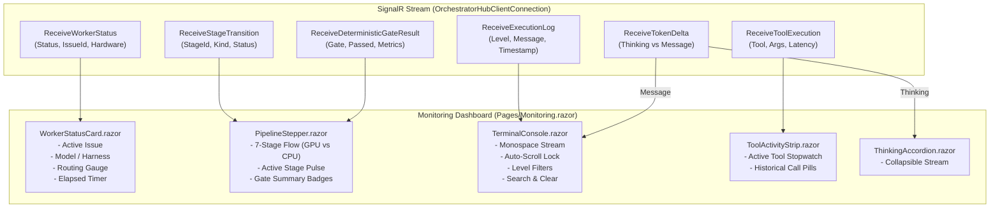

# ⚡ Step 5.5: Live Monitoring Console, 7-Step Pipeline & Telemetry Gauges

> **Phase 5 Implementation Step**  
> *Parent Plan:* [Phase 5 Master Plan](../05_BLAZOR_WEB_UI_AND_TELEMETRY.md) | *Preceding Step:* [Step 5.4: Backlog & Visual DAG](STEP_5_4_BACKLOG_AND_VISUAL_DAG.md) | *Next Step:* [Step 5.6: Human-in-the-Loop Question Inbox](STEP_5_6_HUMAN_IN_THE_LOOP_INBOX.md)  
> *Project Target:* `src/NightCodeForge.Web/Components/Monitoring` & `Pages/Monitoring.razor` | *Status:* Ready for Implementation

---

## 1. Executive Objective

Provide a high-frequency, low-latency live observability dashboard that monitors the autonomous engine in real time. It renders the exact 7-stage workflow pipeline, differentiates agentic GPU inference from deterministic CPU quality gate executions, displays hardware routing gauges, and streams live terminal logs, tool executions, and model thought traces.

### Core Capabilities:
1. **Active Worker Telemetry Card:**
   - Real-time status indicator (`Idle`, `Running`, `WaitingForHuman`, `Blocked`).
   - Active issue title, ID, feature branch name, and elapsed execution stopwatch (`00:03:14`).
   - Active Harness (`Crucible`, `PiRpc`, `Acp`), Model (`qwen2.5-coder:32b`), and hardware routing target (`Fast Local GPU`, `Remote Server`, `Cloud Overflow via OllamaRouter`).
2. **7-Step Visual Pipeline Stepper:**
   - Visual sequence rendering the full workflow:
     1. `Issue Review` (Agentic GPU - Indigo)
     2. `Pre-Implementation Verification` (Deterministic CPU - Teal)
     3. `Implementation` (Agentic GPU - Indigo)
     4. `Post-Implementation Verification & Ratchets` (Deterministic CPU - Teal)
     5. `Code Review & Direct Fixes` (Agentic GPU - Indigo)
     6. `Post-Review Verification` (Deterministic CPU - Teal)
     7. `Merge Resolution Gate` (Squash & Merge)
   - Visual cues clearly distinguishing Agentic (GPU) stages from Deterministic (CPU) stages.
   - Stage indicators: `Pending`, `Running` (pulsing glow), `Passed`, `Failed / Loopback`, `WaitingForHuman`.
3. **Live Streaming Terminal Console:**
   - Monospace terminal stream with ANSI color rendering.
   - Pinned auto-scroll toggle (pauses auto-scroll when developer scrolls up to inspect history).
   - Log level filters (`All`, `Debug`, `Info`, `Warning`, `Error`) and search filter.
   - Clear and Export (`.txt`) log actions.
4. **Live Tool Call Activity Strip:**
   - Visual badges for active tool invocations (`read`, `write`, `edit`, `bash`, `ask`, `web_search`) with real-time latency stopwatches.
5. **Live Reasoning Accordion (`<think>`):**
   - Expandable stream showing agent deliberation tokens before tool calls occur.

---

## 2. Architecture & Data Flow



---

## 3. 7-Step Pipeline Stage Definitions

The stepper visualizes the 7 distinct stages defined across Phase 1, Phase 3, and Phase 4B:

| Stage # | Stage Name | Category | Primary Execution Type | Key Activity |
| :---: | :--- | :--- | :--- | :--- |
| **1** | **Issue Review** | Agentic | GPU Inference (LLM) | Analyzes scope, ambiguities, asks human clarifying questions if needed. |
| **2** | **Pre-Impl Baseline** | Deterministic | CPU Verification (0 GPU) | Runs baseline build, test suite, and coverage scan on clean base branch. |
| **3** | **Implementation** | Agentic | GPU Inference (LLM) | Modifies source files, runs compilation checks, executes tests. |
| **4** | **Post-Impl Gates** | Deterministic | CPU Verification (0 GPU) | Differential test check, coverage delta ($\Delta \ge 0\%$), compiler warning ratchet ($\Delta \le 0$). |
| **5** | **Code Review** | Agentic | GPU Inference (LLM) | Gap analysis, style enforcement, automated fixes for lint/compiler issues. |
| **6** | **Post-Review Verification** | Deterministic | CPU Verification (0 GPU) | Re-validates build and test suite after reviewer fixes. Sets status to `Ready`. |
| **7** | **Merge Resolution** | Gate | Git Subsystem | Auto-squashes or awaits human approval; cascades DAG unblocking. |

---

## 4. Component Implementation Specifications

### Step 4.1: Pipeline Stepper (`Components/Monitoring/PipelineStepper.razor`)

```razor
<div class="pipeline-stepper-container card-surface">
    <div class="pipeline-stepper">
        @foreach (var stage in Stages)
        {
            <div class="step-item @GetStepClass(stage)">
                <div class="step-header">
                    <span class="step-badge @(stage.IsAgentic ? "badge-gpu" : "badge-cpu")">
                        @(stage.IsAgentic ? "⚡ GPU" : "⚙️ CPU")
                    </span>
                    <span class="step-index">#@stage.Order</span>
                </div>
                <div class="step-icon-circle">
                    @if (stage.Status == "Running")
                    {
                        <div class="spinner-pulse"></div>
                    }
                    else if (stage.Status == "Completed")
                    {
                        <span>✓</span>
                    }
                    else if (stage.Status == "Failed")
                    {
                        <span>✕</span>
                    }
                    else if (stage.Status == "WaitingForHuman")
                    {
                        <span>✋</span>
                    }
                    else
                    {
                        <span>@stage.Order</span>
                    }
                </div>
                <div class="step-title">@stage.Name</div>
                <div class="step-status">@stage.StatusText</div>
            </div>
            @if (stage.Order < 7)
            {
                <div class="step-connector @(stage.Status == "Completed" ? "connector-completed" : "")"></div>
            }
        }
    </div>
</div>

@code {
    [Parameter] public int IssueId { get; set; }
    [Parameter] public string? CurrentStageId { get; set; }
    [Parameter] public string? CurrentStageStatus { get; set; }

    public record StageDefinition(int Order, string Id, string Name, bool IsAgentic, string Status, string StatusText);

    private List<StageDefinition> Stages = new();

    protected override void OnParametersSet()
    {
        InitializeStages();
    }

    private void InitializeStages()
    {
        // 1. IssueReview (Agentic)
        // 2. PreImplementation (Deterministic)
        // 3. Implementation (Agentic)
        // 4. PostImplementation (Deterministic)
        // 5. CodeReview (Agentic)
        // 6. PostReview (Deterministic)
        // 7. MergeGate (Gate)
    }

    private string GetStepClass(StageDefinition stage)
    {
        if (stage.Status == "Running") return "step-active";
        if (stage.Status == "Completed") return "step-completed";
        if (stage.Status == "Failed") return "step-failed";
        if (stage.Status == "WaitingForHuman") return "step-waiting";
        return "step-pending";
    }
}
```

### Step 4.2: Real-Time Terminal Console (`Components/Monitoring/TerminalConsole.razor`)

```razor
<div class="terminal-container card-surface">
    <div class="terminal-toolbar">
        <div class="terminal-title">
            <span class="terminal-dot red"></span>
            <span class="terminal-dot yellow"></span>
            <span class="terminal-dot green"></span>
            <span class="terminal-heading">Terminal Console & Execution Stream</span>
        </div>
        <div class="terminal-actions">
            <select class="form-control-dark-sm" @bind="_selectedLevel">
                <option value="All">All Levels</option>
                <option value="Information">Info</option>
                <option value="Warning">Warning</option>
                <option value="Error">Error</option>
            </select>
            <button class="btn btn-sm btn-secondary" @onclick="ToggleAutoScroll">
                @(_autoScroll ? "🔒 Auto-Scroll ON" : "🔓 Auto-Scroll OFF")
            </button>
            <button class="btn btn-sm btn-secondary" @onclick="ClearLogs">Clear</button>
            <button class="btn btn-sm btn-secondary" @onclick="ExportLogsAsync">Export</button>
        </div>
    </div>

    <div class="terminal-body font-mono" @ref="_terminalBodyRef" @onscroll="HandleScroll">
        @foreach (var log in FilteredLogs)
        {
            <div class="log-line log-@log.Level.ToLower()">
                <span class="log-ts">[@log.Timestamp.ToString("HH:mm:ss.fff")]</span>
                <span class="log-stage">[@log.StageId]</span>
                <span class="log-level">[@log.Level]</span>
                <span class="log-message">@log.Message</span>
            </div>
        }
    </div>
</div>
```

---

## 5. Verification & Test Plan

1. **Pipeline Stepper Updates:**
   - Simulate `ReceiveStageTransition(issueId, "ImplementationStage", "Agentic", "Running")`:
     - Stage 3 displays pulsing indigo glow with `badge-gpu`.
     - Connector from Stage 2 to Stage 3 lights up.
   - Simulate `ReceiveDeterministicGateResult(issueId, "CoverageGate", true, "+1.4% Coverage")`:
     - Stage 4 shows green checkmark with metrics summary pill.
2. **Terminal Stream Performance:**
   - Ingest 500 log lines per second via SignalR:
     - Verify smooth UI rendering without thread freezing.
     - Auto-scroll pins to bottom when enabled; preserves scroll offset when scrolled up.
3. **Tool Call Latency Indicator:**
   - Ingest `ReceiveToolExecution(issueId, "bash", "dotnet test", "Running", null)`:
     - Floating tool call pill displays active elapsed stopwatch.
   - Ingest `ReceiveToolExecution(..., "Completed", 1450)`:
     - Pill transitions to completed state with `1.45s` duration badge.
4. **Human Interruption Transition:**
   - When agent executes `ask`, worker status updates to `WaitingForHuman`, stepper highlights stage in amber, and navigation bar shows pending question notification.

---

## 6. Definition of Done (DoD) Checklist

- [ ] `Pages/Monitoring.razor` created with real-time issue listener.
- [ ] `WorkerStatusCard.razor` displays active worker state, elapsed stopwatch, and hardware routing gauge.
- [ ] `PipelineStepper.razor` renders all 7 pipeline stages with distinct GPU/CPU badges and status icons.
- [ ] `TerminalConsole.razor` renders high-frequency log streams with level filtering, auto-scroll toggle, and clear/export actions.
- [ ] `ToolActivityStrip.razor` renders real-time tool invocation pills and duration timers.
- [ ] `ThinkingAccordion.razor` separates and streams reasoning tokens (`<think>`).
- [ ] Components cleanly wire to `OrchestratorHubClientConnection` events.
