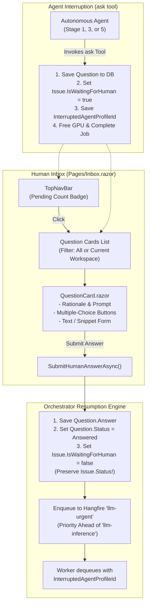

# 📬 Step 5.6: Human-in-the-Loop Question Inbox & Status-Preserving Resumption

> **Phase 5 Implementation Step**  
> *Parent Plan:* [Phase 5 Master Plan](../05_BLAZOR_WEB_UI_AND_TELEMETRY.md) | *Preceding Step:* [Step 5.5: Monitoring Console](STEP_5_5_MONITORING_CONSOLE_AND_GAUGES.md) | *Next Step:* [Step 5.7: Review Room & Merge Gates](STEP_5_7_REVIEW_ROOM_AND_MERGE_GATES.md)  
> *Project Target:* `src/NightCodeForge.Web/Components/Inbox` & `Pages/Inbox.razor` | *Status:* Ready for Implementation

---

## 1. Executive Objective

Provide a consolidated developer inbox for reviewing and answering human clarification questions initiated by autonomous agents via the canonical `ask` tool. 

### Core Capabilities:
1. **Consolidated Pending Questions Feed:** Aggregates all unanswered questions (`question.Status == QuestionStatus.Pending`) across all workspaces or filtered by active workspace, with instant navigation from the global top-bar pill.
2. **Rich Contextual Question Card:**
   - Displays issue link, workspace name, current workflow stage context badge (`Issue Review`, `Implementation`, `Code Review`).
   - Displays prompt question, agent's detailed rationale, and interrupted agent profile identifier (`question.AgentProfileId`).
3. **Versatile Answer Modalities:**
   - **Multiple-Choice Buttons:** If the agent provided predefined choices in `question.OptionsJson`, renders one-click selectable answer pills.
   - **Freeform Clarification Box:** Multi-line markdown editor for detailed instructions.
   - **Code Snippet Insert:** Formatted code block inserter for providing exact function signatures or patches.
4. **Status-Preserving Resumption Workflow:**
   - Submitting an answer invokes `IIssueOrchestrator.SubmitHumanAnswerAsync(questionId, answer)`.
   - Backend persists the answer, marks `Question.Status = Answered`, and clears `issue.IsWaitingForHuman = false` **without mutating `issue.Status`** (preserving the exact milestone `Open`, `Reviewed`, or `Implemented`).
   - Immediately enqueues the issue to the **`llm-urgent`** queue (`WorkerCount = 1`), taking priority over general backlog inference tasks, resuming with the exact original `InterruptedAgentProfileId`.

---

## 2. Interruption & Resumption Architecture



---

## 3. Data Contracts & Model Mapping

```csharp
namespace NightCodeForge.Core.Domain;

public class Question
{
    public int Id { get; set; }
    public int IssueId { get; set; }
    public Issue? Issue { get; set; }
    public string StageId { get; set; } = string.Empty;
    public string? AgentProfileId { get; set; }
    public string Prompt { get; set; } = string.Empty;
    public string Rationale { get; set; } = string.Empty;
    public string? OptionsJson { get; set; } // JSON array of string choices
    public string? Answer { get; set; }
    public QuestionStatus Status { get; set; } = QuestionStatus.Pending;
    public DateTime CreatedAt { get; set; } = DateTime.UtcNow;
    public DateTime? AnsweredAt { get; set; }
}
```

---

## 4. Component Specification & Implementation

### 4.1 Page View: `Pages/Inbox.razor`

```razor
@page "/inbox"
@using NightCodeForge.Core.Domain
@using NightCodeForge.Core.Repositories
@using NightCodeForge.Core.Workflow
@inject IIssueRepository IssueRepository
@inject WorkspaceStateService WorkspaceState
@inject ToastService ToastService

<div class="inbox-container">
    <div class="inbox-header mb-4">
        <div>
            <h2>📬 Question Inbox</h2>
            <p class="text-secondary">Questions requiring human clarification before autonomous execution can proceed.</p>
        </div>
        <div class="inbox-filter">
            <label class="checkbox-inline">
                <input type="checkbox" @bind="_filterCurrentWorkspaceOnly" @bind:after="LoadQuestionsAsync" />
                Filter to Active Workspace Only
            </label>
        </div>
    </div>

    @if (_isLoading)
    {
        <div class="loading-spinner">Loading questions...</div>
    }
    else if (_pendingQuestions.Count == 0)
    {
        <div class="empty-inbox card-surface text-center p-5">
            <span class="empty-icon">🎉</span>
            <h3>All clear! No questions pending.</h3>
            <p class="text-muted">Agents are progressing autonomously without any human blockers.</p>
        </div>
    }
    else
    {
        <div class="question-grid">
            @foreach (var question in _pendingQuestions)
            {
                <QuestionCard Question="question" OnAnswerSubmitted="HandleAnswerSubmitted" />
            }
        </div>
    }
</div>
```

### 4.2 Question Card Component: `Components/Inbox/QuestionCard.razor`

```razor
@using System.Text.Json
@using NightCodeForge.Core.Domain
@using NightCodeForge.Core.Workflow
@inject IIssueOrchestrator IssueOrchestrator
@inject ToastService ToastService

<div class="question-card card-surface mb-4">
    <div class="question-card-header">
        <div class="header-left">
            <span class="badge-stage">@Question.StageId</span>
            <span class="badge-profile">🤖 @(Question.AgentProfileId ?? "Default Profile")</span>
            <a href="/monitoring/@Question.IssueId" class="issue-link">
                Issue #@Question.IssueId: @Question.Issue?.Title
            </a>
        </div>
        <span class="timestamp">@Question.CreatedAt.ToString("g")</span>
    </div>

    <div class="question-card-body">
        <div class="prompt-box">
            <h4>@Question.Prompt</h4>
            @if (!string.IsNullOrWhiteSpace(Question.Rationale))
            {
                <div class="rationale-text text-secondary">
                    <strong>Context / Rationale:</strong> @Question.Rationale
                </div>
            }
        </div>

        @if (Options.Any())
        {
            <div class="options-container mb-3">
                <label class="form-label text-muted">Suggested Options:</label>
                <div class="option-buttons">
                    @foreach (var opt in Options)
                    {
                        <button class="btn btn-outline-indigo @(_selectedAnswer == opt ? "active" : "")"
                                @onclick="() => SelectOption(opt)">
                            @opt
                        </button>
                    }
                </div>
            </div>
        }

        <div class="form-group mb-3">
            <label class="form-label">Your Response / Clarification:</label>
            <textarea class="form-control-dark font-sans" rows="3"
                      placeholder="Type your answer, guidance, or decision here..."
                      @bind="_answerText"></textarea>
        </div>
    </div>

    <div class="question-card-footer">
        <div class="text-muted small">
            ⚡ Submitting will immediately enqueue to <code>llm-urgent</code> with the original agent profile.
        </div>
        <button class="btn btn-primary" disabled="@(string.IsNullOrWhiteSpace(EffectiveAnswer) || _isSubmitting)"
                @onclick="SubmitAnswerAsync">
            @if (_isSubmitting)
            {
                <span>Submitting...</span>
            }
            else
            {
                <span>Submit & Resume Issue ➔</span>
            }
        </button>
    </div>
</div>

@code {
    [Parameter] public Question Question { get; set; } = null!;
    [Parameter] public EventCallback<int> OnAnswerSubmitted { get; set; }

    private string _answerText = string.Empty;
    private string? _selectedAnswer;
    private bool _isSubmitting;

    private List<string> Options => string.IsNullOrWhiteSpace(Question.OptionsJson)
        ? new()
        : JsonSerializer.Deserialize<List<string>>(Question.OptionsJson) ?? new();

    private string EffectiveAnswer => !string.IsNullOrWhiteSpace(_answerText)
        ? _answerText
        : _selectedAnswer ?? string.Empty;

    private void SelectOption(string option)
    {
        _selectedAnswer = option;
        _answerText = option;
    }

    private async Task SubmitAnswerAsync()
    {
        if (string.IsNullOrWhiteSpace(EffectiveAnswer)) return;

        _isSubmitting = true;
        try
        {
            await IssueOrchestrator.SubmitHumanAnswerAsync(Question.Id, EffectiveAnswer);
            ToastService.Show("Clarification Submitted", $"Issue #{Question.IssueId} resumed on llm-urgent queue.", ToastLevel.Success);
            await OnAnswerSubmitted.InvokeAsync(Question.Id);
        }
        finally
        {
            _isSubmitting = false;
        }
    }
}
```

---

## 5. Verification & Test Plan

1. **Status-Preserving Resumption Tests:**
   - Arrange: Issue in `Status = IssueOverallStatus.Implemented`, `IsWaitingForHuman = true`.
   - Act: Submit answer via `QuestionCard.razor`.
   - Assert:
     - `Question.Status` is `QuestionStatus.Answered`.
     - `Issue.IsWaitingForHuman` is `false`.
     - `Issue.Status` remains `IssueOverallStatus.Implemented` (NOT reset to `Open`!).
     - Issue is queued to Hangfire queue `llm-urgent`.
2. **Multiple-Choice Selection Tests:**
   - Question has `OptionsJson = "[\"Option A: SQLite\", \"Option B: PostgreSQL\"]"`.
   - Verify two buttons render; clicking "Option A" populates text area.
3. **Workspace Filtering Tests:**
   - Verify toggle filters questions to active workspace only, or shows all questions across workspaces.
4. **Reactive Top-Bar Pill Synchronization:**
   - Answering a question decrements the badge counter in `TopNavBar` and `NavMenu` without page refresh.

---

## 6. Definition of Done (DoD) Checklist

- [ ] `Pages/Inbox.razor` created with workspace filter toggle and empty state illustrations.
- [ ] `QuestionCard.razor` component created with prompt, rationale, stage badges, and agent profile name.
- [ ] Multiple-choice button selection and freeform markdown textarea support implemented.
- [ ] Submitting answers invokes `IIssueOrchestrator.SubmitHumanAnswerAsync`.
- [ ] Verification confirms `issue.Status` is preserved exactly and task is enqueued to `llm-urgent`.
- [ ] Reactive badge counters update in `TopNavBar` and `NavMenu`.
- [ ] bUnit component tests verify submission and validation flows.
