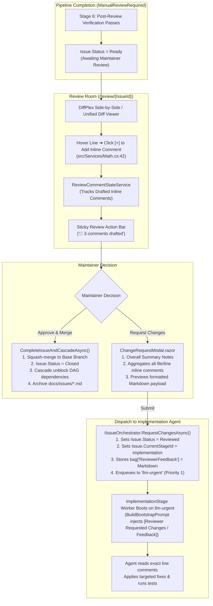

# 🔍 Step 5.7: Review Room, Inline Code Review & Dual Merge Gate Resolution

> **Phase 5 Implementation Step**  
> *Parent Plan:* [Phase 5 Master Plan](../05_BLAZOR_WEB_UI_AND_TELEMETRY.md) | *Preceding Step:* [Step 5.6: Human-in-the-Loop Inbox](STEP_5_6_HUMAN_IN_THE_LOOP_INBOX.md) | *Next Step:* [Step 5.8: Settings, Host SDKs & A/B Testing](STEP_5_8_SETTINGS_HOST_SDKS_AND_AB_TESTING.md)  
> *Project Target:* `src/NightCodeForge.Web/Components/Review` & `Pages/Review.razor` | *Status:* Ready for Implementation

---

## 1. Executive Objective

Provide an enterprise-grade code review environment where maintainers inspect noise-filtered Git diffs, evaluate deterministic quality gate outcomes, add **inline line-by-line code review comments**, and execute merge resolutions under both `Automatic` and `ManualReviewRequired` merge modes.

When `MergeMode == MergeMode.ManualReviewRequired`, the issue pauses in `Status = IssueOverallStatus.Ready` after Stage 6. The maintainer can:
1. Conduct an interactive code review directly in the Web UI.
2. Annotate specific lines of code in the diff viewer with targeted change requests.
3. Submit the review, which automatically aggregates all inline comments and general revision notes into a structured payload and dispatches it via `IIssueOrchestrator.RequestChangesAsync`.
4. The orchestrator routes the issue directly back to **Stage 3 (`ImplementationStage`)**, injects the reviewer comments into the agent's prompt context, and enqueues to the **`llm-urgent`** queue with top priority.

---

## 2. Review & Change Request Workflow



---

## 3. Data Contracts & Models

### 3.1 Inline Diff Comment Models (`Services/ReviewCommentModels.cs`)

```csharp
namespace NightCodeForge.Web.Services;

public record InlineDiffComment(
    Guid Id,
    string FilePath,
    int LineNumber,
    string LineContent,
    string CommentText,
    DateTime CreatedAt);

public class ReviewCommentStateService
{
    private readonly List<InlineDiffComment> _comments = new();

    public IReadOnlyList<InlineDiffComment> Comments => _comments;
    public int CommentCount => _comments.Count;

    public event Action? OnCommentsChanged;

    public void AddComment(string filePath, int lineNumber, string lineContent, string commentText)
    {
        var comment = new InlineDiffComment(
            Guid.NewGuid(),
            filePath,
            lineNumber,
            lineContent,
            commentText.Trim(),
            DateTime.UtcNow);

        _comments.Add(comment);
        OnCommentsChanged?.Invoke();
    }

    public void RemoveComment(Guid id)
    {
        _comments.RemoveAll(c => c.Id == id);
        OnCommentsChanged?.Invoke();
    }

    public void Clear()
    {
        _comments.Clear();
        OnCommentsChanged?.Invoke();
    }

    /// <summary>
    /// Compiles overall notes and inline line comments into structured Markdown for the implementation agent.
    /// </summary>
    public string FormatAggregatedFeedback(string? generalNotes)
    {
        var sb = new System.Text.StringBuilder();

        if (!string.IsNullOrWhiteSpace(generalNotes))
        {
            sb.AppendLine("### Reviewer Overall Instructions:");
            sb.AppendLine(generalNotes.Trim());
            sb.AppendLine();
        }

        if (_comments.Any())
        {
            sb.AppendLine("### Inline Code Review Comments:");
            var grouped = _comments.GroupBy(c => c.FilePath);

            foreach (var group in grouped)
            {
                sb.AppendLine($"#### File: `{group.Key}`");
                foreach (var comment in group.OrderBy(c => c.LineNumber))
                {
                    sb.AppendLine($"- **Line {comment.LineNumber}**:");
                    sb.AppendLine($"  > `{comment.LineContent.Trim()}`");
                    sb.AppendLine($"  *Reviewer Comment:* {comment.CommentText}");
                    sb.AppendLine();
                }
            }
        }

        return sb.ToString().Trim();
    }
}
```

### 3.2 Diff Models (`Services/GitDiffModels.cs`)

```csharp
namespace NightCodeForge.Web.Services;

public enum FileChangeType { Modified, Added, Deleted, Renamed }

public record FileDiffSummary(
    string Path,
    FileChangeType ChangeType,
    int Additions,
    int Deletions,
    string OldContent,
    string NewContent);

public record IssueReviewSnapshot(
    int IssueId,
    string Title,
    string FeatureBranch,
    string BaseBranch,
    MergeMode MergeMode,
    IssueOverallStatus Status,
    IReadOnlyList<FileDiffSummary> Files,
    QualityGateMetrics GateMetrics);

public record QualityGateMetrics(
    double BaselineCoverage,
    double CurrentCoverage,
    double CoverageDelta,
    int BaselineWarnings,
    int CurrentWarnings,
    int WarningDelta,
    int TotalTests,
    int PassedTests,
    int FailedTests,
    int DurationMs);
```

---

## 4. Component Specification & Implementation

### 4.1 Page Layout: `Pages/Review.razor`

```razor
@page "/review"
@page "/review/{IssueId:int}"
@using NightCodeForge.Core.Domain
@using NightCodeForge.Core.Workflow
@using NightCodeForge.Web.Services
@inject IIssueOrchestrator IssueOrchestrator
@inject IIssueRepository IssueRepository
@inject IGitWorkspaceManager GitWorkspaceManager
@inject ReviewCommentStateService CommentState
@inject ToastService ToastService

<div class="review-room-container">
    @if (_snapshot == null)
    {
        <div class="card-surface p-5 text-center">Loading review snapshot...</div>
    }
    else
    {
        <!-- 1. Header & Quality Gate Summary Strip -->
        <div class="review-header card-surface mb-3">
            <div class="d-flex justify-content-between align-items-center">
                <div>
                    <h2>Review: Issue #@_snapshot.IssueId - @_snapshot.Title</h2>
                    <span class="badge-branch"><code>@_snapshot.FeatureBranch</code> ➔ <code>@_snapshot.BaseBranch</code></span>
                    <span class="badge-mode">Mode: @_snapshot.MergeMode</span>
                    <span class="badge-status @GetStatusBadgeClass(_snapshot.Status)">Status: @_snapshot.Status</span>
                </div>
                <div class="review-actions">
                    @if (_snapshot.MergeMode == MergeMode.Automatic && _snapshot.Status == IssueOverallStatus.Closed)
                    {
                        <span class="badge-success-large">✅ Auto-Merged to @_snapshot.BaseBranch</span>
                    }
                    else if (_snapshot.Status == IssueOverallStatus.Ready || _snapshot.Status == IssueOverallStatus.Implemented)
                    {
                        <button class="btn btn-warning-outline me-2" @onclick="OpenChangeRequestModal">
                            📝 Request Changes @(CommentState.CommentCount > 0 ? $"({CommentState.CommentCount})" : "")
                        </button>
                        <button class="btn btn-success" @onclick="OpenApproveModal">
                            🚀 Approve & Merge
                        </button>
                    }
                </div>
            </div>

            <!-- Deterministic Quality Gate Metrics Cards -->
            <div class="gate-metrics-grid mt-3">
                <div class="gate-card @(_snapshot.GateMetrics.CoverageDelta >= 0 ? "gate-pass" : "gate-fail")">
                    <span class="gate-title">Code Coverage</span>
                    <span class="gate-value">@_snapshot.GateMetrics.CurrentCoverage.ToString("F1")%</span>
                    <span class="gate-delta @(_snapshot.GateMetrics.CoverageDelta >= 0 ? "delta-positive" : "delta-negative")">
                        @(_snapshot.GateMetrics.CoverageDelta >= 0 ? "+" : "")@_snapshot.GateMetrics.CoverageDelta.ToString("F1")%
                    </span>
                </div>

                <div class="gate-card @(_snapshot.GateMetrics.WarningDelta <= 0 ? "gate-pass" : "gate-fail")">
                    <span class="gate-title">Compiler Warnings</span>
                    <span class="gate-value">@_snapshot.GateMetrics.CurrentWarnings</span>
                    <span class="gate-delta @(_snapshot.GateMetrics.WarningDelta <= 0 ? "delta-positive" : "delta-negative")">
                        @(_snapshot.GateMetrics.WarningDelta > 0 ? "+" : "")@_snapshot.GateMetrics.WarningDelta
                    </span>
                </div>

                <div class="gate-card @(_snapshot.GateMetrics.FailedTests == 0 ? "gate-pass" : "gate-fail")">
                    <span class="gate-title">Test Suite</span>
                    <span class="gate-value">@_snapshot.GateMetrics.PassedTests / @_snapshot.GateMetrics.TotalTests</span>
                    <span class="gate-delta text-muted">@(_snapshot.GateMetrics.DurationMs)ms</span>
                </div>
            </div>
        </div>

        <!-- 2. Diff Navigation & DiffPlex Canvas -->
        <div class="diff-workspace-grid">
            <div class="file-tree card-surface">
                <h4>Changed Files (@_snapshot.Files.Count)</h4>
                <ul class="file-list">
                    @foreach (var file in _snapshot.Files)
                    {
                        <li class="file-item @(_selectedFile?.Path == file.Path ? "active" : "")"
                            @onclick="() => SelectFile(file)">
                            <span class="file-type badge-@file.ChangeType.ToString().ToLower()">
                                @file.ChangeType.ToString()[0]
                            </span>
                            <span class="file-path">@file.Path</span>
                            <span class="file-counts">+@file.Additions -@file.Deletions</span>
                        </li>
                    }
                </ul>
            </div>

            <div class="diff-viewer-panel card-surface">
                @if (_selectedFile != null)
                {
                    <DiffViewer File="_selectedFile" />
                }
            </div>
        </div>
    }
</div>

@if (_showChangeRequestModal && _snapshot != null)
{
    <ChangeRequestModal
        IssueId="_snapshot.IssueId"
        OnSubmitted="HandleChangesRequestedAsync"
        OnClosed="() => _showChangeRequestModal = false" />
}

@if (_showApproveModal && _snapshot != null)
{
    <ApproveMergeModal
        IssueId="_snapshot.IssueId"
        BaseBranch="_snapshot.BaseBranch"
        OnApproved="HandleApprovedAsync"
        OnClosed="() => _showApproveModal = false" />
}
```

### 4.2 Interactive Diff Viewer with Inline Comments (`Components/Review/DiffViewer.razor`)

Enables adding comments directly on any diff line:

```razor
@using DiffPlex
@using DiffPlex.DiffBuilder
@using DiffPlex.DiffBuilder.Model
@using NightCodeForge.Web.Services
@inject ReviewCommentStateService CommentState

<div class="diff-pane font-mono">
    <div class="diff-controls mb-2 d-flex justify-content-between align-items-center">
        <span class="text-secondary"><code>@File.Path</code></span>
        <div class="btn-group">
            <button class="btn btn-sm @(_isSideBySide ? "btn-primary" : "btn-secondary")" @onclick="() => _isSideBySide = true">
                Side-by-Side
            </button>
            <button class="btn btn-sm @(!_isSideBySide ? "btn-primary" : "btn-secondary")" @onclick="() => _isSideBySide = false">
                Unified
            </button>
        </div>
    </div>

    <table class="diff-table">
        <tbody>
            @foreach (var line in _model.Lines)
            {
                var lineNum = line.NewLineNumber ?? line.OldLineNumber ?? 0;
                var commentsOnLine = CommentState.Comments
                    .Where(c => c.FilePath == File.Path && c.LineNumber == lineNum)
                    .ToList();

                <tr class="diff-row @GetLineTypeClass(line.Type)">
                    <!-- Add Comment Hover Action -->
                    <td class="diff-action-cell">
                        @if (line.Type != ChangeType.Unchanged || lineNum > 0)
                        {
                            <button class="btn-add-comment" title="Add review comment on line @lineNum"
                                    @onclick="() => ToggleCommentBox(lineNum, line.NewText ?? line.OldText ?? string.Empty)">
                                ➕
                            </button>
                        }
                    </td>
                    <td class="diff-num old-num">@line.OldLineNumber</td>
                    <td class="diff-num new-num">@line.NewLineNumber</td>
                    <td class="diff-text">@line.NewText ?? line.OldText</td>
                </tr>

                <!-- Inline Comment Thread Box -->
                @if (commentsOnLine.Any() || _activeInputLine == lineNum)
                {
                    <tr class="diff-comment-row">
                        <td colspan="4">
                            <div class="inline-comment-thread p-3 card-glass font-sans">
                                @foreach (var comment in commentsOnLine)
                                {
                                    <div class="comment-bubble mb-2">
                                        <div class="comment-meta d-flex justify-content-between">
                                            <strong>Reviewer Note</strong>
                                            <button class="btn-icon text-muted" @onclick="() => CommentState.RemoveComment(comment.Id)">✕</button>
                                        </div>
                                        <div class="comment-text">@comment.CommentText</div>
                                    </div>
                                }

                                @if (_activeInputLine == lineNum)
                                {
                                    <div class="comment-input-box mt-2">
                                        <textarea class="form-control-dark font-sans" rows="2"
                                                  placeholder="Type your review comment or instruction for the implementation agent..."
                                                  @bind="_newCommentText"></textarea>
                                        <div class="d-flex justify-content-end gap-2 mt-2">
                                            <button class="btn btn-sm btn-secondary" @onclick="() => _activeInputLine = null">Cancel</button>
                                            <button class="btn btn-sm btn-primary" @onclick="() => SaveComment(lineNum, line.NewText ?? line.OldText ?? string.Empty)">
                                                Save Comment
                                            </button>
                                        </div>
                                    </div>
                                }
                            </div>
                        </td>
                    </tr>
                }
            }
        </tbody>
    </table>
</div>

@code {
    [Parameter] public FileDiffSummary File { get; set; } = null!;

    private bool _isSideBySide = true;
    private SideBySideDiffModel _model = null!;
    private int? _activeInputLine;
    private string _newCommentText = string.Empty;

    protected override void OnParametersSet()
    {
        var differ = new Differ();
        var builder = new SideBySideDiffBuilder(differ);
        _model = builder.BuildDiffModel(File.OldContent ?? string.Empty, File.NewContent ?? string.Empty);
    }

    private void ToggleCommentBox(int lineNum, string lineText)
    {
        _activeInputLine = lineNum;
        _newCommentText = string.Empty;
    }

    private void SaveComment(int lineNum, string lineText)
    {
        if (string.IsNullOrWhiteSpace(_newCommentText)) return;

        CommentState.AddComment(File.Path, lineNum, lineText, _newCommentText);
        _activeInputLine = null;
        _newCommentText = string.Empty;
    }

    private string GetLineTypeClass(ChangeType type) => type switch
    {
        ChangeType.Inserted => "line-inserted",
        ChangeType.Deleted => "line-deleted",
        ChangeType.Modified => "line-modified",
        _ => "line-unchanged"
    };
}
```

### 4.3 Change Request Aggregation Modal (`Components/Review/ChangeRequestModal.razor`)

Aggregates all inline comments and overall notes into the `ReviewerFeedback` payload:

```razor
@using NightCodeForge.Core.Workflow
@using NightCodeForge.Web.Services
@inject IIssueOrchestrator IssueOrchestrator
@inject ReviewCommentStateService CommentState
@inject ToastService ToastService

<div class="forge-modal-backdrop">
    <div class="forge-modal card-glass modal-lg">
        <div class="modal-header">
            <h3>📝 Request Changes for Issue #@IssueId</h3>
            <button class="btn-icon" @onclick="Close">✕</button>
        </div>

        <div class="modal-body font-sans">
            <p class="text-secondary">
                Submitting this review will route Issue #@IssueId back to <strong>Stage 3 (ImplementationStage)</strong>
                and enqueue it to <strong><code>llm-urgent</code></strong> with top priority.
            </p>

            <div class="form-group mb-3">
                <label>Overall Review Notes / Instructions</label>
                <textarea class="form-control-dark" rows="3"
                          placeholder="Summarize the core requirements or missing aspects..."
                          @bind="_generalNotes"></textarea>
            </div>

            <!-- Inline Comments Summary -->
            <div class="inline-comments-summary card-surface p-3 mb-3">
                <div class="d-flex justify-content-between align-items-center mb-2">
                    <h5>Inline Code Comments (@CommentState.CommentCount)</h5>
                    <button class="btn btn-sm btn-secondary" @onclick="CommentState.Clear">Clear All</button>
                </div>

                @if (CommentState.CommentCount == 0)
                {
                    <p class="text-muted small mb-0">No inline comments added. You can add comments by clicking [+] on any diff line.</p>
                }
                else
                {
                    <ul class="comments-preview-list">
                        @foreach (var c in CommentState.Comments)
                        {
                            <li class="mb-2">
                                <code>@c.FilePath:@c.LineNumber</code>
                                <span class="text-secondary ms-2">@c.CommentText</span>
                            </li>
                        }
                    </ul>
                }
            </div>

            <!-- Formatted Markdown Preview Dispatched to Agent -->
            <div class="payload-preview card-surface p-3">
                <label class="text-muted small">Agent Feedback Payload Preview:</label>
                <pre class="font-mono text-sm mb-0">@CommentState.FormatAggregatedFeedback(_generalNotes)</pre>
            </div>
        </div>

        <div class="modal-footer">
            <button class="btn btn-secondary" @onclick="Close">Cancel</button>
            <button class="btn btn-warning" disabled="_isSubmitting" @onclick="SubmitChangeRequestAsync">
                @if (_isSubmitting)
                {
                    <span>Dispatching to llm-urgent...</span>
                }
                else
                {
                    <span>🚀 Submit Review & Dispatch to Agent</span>
                }
            </button>
        </div>
    </div>
</div>

@code {
    [Parameter] public int IssueId { get; set; }
    [Parameter] public EventCallback OnSubmitted { get; set; }
    [Parameter] public EventCallback OnClosed { get; set; }

    private string _generalNotes = string.Empty;
    private bool _isSubmitting;

    private async Task SubmitChangeRequestAsync()
    {
        var feedback = CommentState.FormatAggregatedFeedback(_generalNotes);
        if (string.IsNullOrWhiteSpace(feedback))
        {
            ToastService.Show("Validation Error", "Please provide general notes or at least one inline comment.", ToastLevel.Warning);
            return;
        }

        _isSubmitting = true;
        try
        {
            await IssueOrchestrator.RequestChangesAsync(IssueId, feedback);
            CommentState.Clear();
            ToastService.Show("Changes Requested", $"Issue #{IssueId} routed to ImplementationStage on llm-urgent.", ToastLevel.Success);
            await OnSubmitted.InvokeAsync();
        }
        finally
        {
            _isSubmitting = false;
        }
    }

    private async Task Close()
    {
        await OnClosed.InvokeAsync();
    }
}
```

---

## 5. Verification & Test Plan

1. **Inline Code Commenting Tests:**
   - Click `[+]` on line 42 of `MathService.cs`: verify inline textarea opens below line 42.
   - Enter *"Add guard check"* and save: verify comment bubble displays and comment counter updates to 1.
2. **Aggregated Feedback Formatting Tests:**
   - Verify `FormatAggregatedFeedback` generates structured Markdown with file paths, line numbers, code snippets, and review notes.
3. **Change Request Rework Dispatch:**
   - Submit change request:
     - Verify `IIssueOrchestrator.RequestChangesAsync` is invoked.
     - Verify `bag["ReviewerFeedback"]` contains the formatted markdown.
     - Verify `Issue.Status` transitions to `Reviewed` and `CurrentStageId` is `implementation`.
     - Verify issue is enqueued to `llm-urgent`.
4. **Approve & Merge Tests:**
   - When satisfied, clicking "Approve & Merge" calls `CompleteIssueAndCascadeAsync`, squashing commits into base branch and closing the issue.

---

## 6. Definition of Done (DoD) Checklist

- [ ] `ReviewCommentStateService` implemented to manage drafted inline line comments.
- [ ] `DiffViewer.razor` includes hover `[+]` button to open inline comment thread on any diff line.
- [ ] Review header displays dynamic comment counter badge.
- [ ] `ChangeRequestModal.razor` aggregates inline comments + general notes into formatted Markdown.
- [ ] Dispatches to `IIssueOrchestrator.RequestChangesAsync` and routes to `ImplementationStage` on `llm-urgent`.
- [ ] Implementation agent receives the structured line-by-line feedback in its bootstrap prompt context.
- [ ] Approve & Merge modal completes issue, squashes commits, and cascades DAG unblocking.
- [ ] Component unit tests verify inline comment persistence and feedback compilation.
