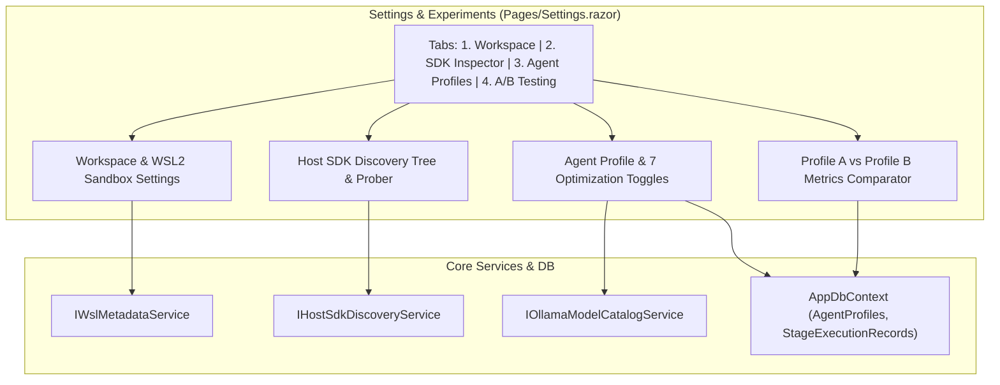

# ⚙️ Step 5.8: Settings, Execution Sandboxing, Host SDK Inspector & A/B Testing

> **Phase 5 Implementation Step**  
> *Parent Plan:* [Phase 5 Master Plan](../05_BLAZOR_WEB_UI_AND_TELEMETRY.md) | *Preceding Step:* [Step 5.7: Review Room & Merge Gates](STEP_5_7_REVIEW_ROOM_AND_MERGE_GATES.md) | *Next Step:* [Step 5.9: Transcripts & AI Diagnostics](STEP_5_9_TRANSCRIPTS_AND_AI_DIAGNOSTICS.md)  
> *Project Target:* `src/NightCodeForge.Web/Components/Settings` & `Pages/Settings.razor` | *Status:* Ready for Implementation

---

## 1. Executive Objective

Provide an enterprise-grade administration and experimentation console for managing workspace repositories, inspecting host execution sandboxes and SDK discoveries, configuring agent profiles with the 7 local LLM optimization toggles, and evaluating empirical performance metrics via the A/B Testing Comparator.

### Core Capabilities:
1. **Workspace & Sandboxing Configuration:**
   - Workspace repository paths, target base branches (`main`/`master`), and execution modes (`BareHost`, `WslDirect`, `ContainerSandbox`).
   - **Windows WSL2 Readiness Card:** Probes WSL2 status via `IWslMetadataService`, discovers available distributions, and warns if WSL2 is uninitialized (`wsl --install`).
   - Container package cache mount paths (`~/.nuget/packages`, `~/.npm`, `~/.cache/uv`).
2. **Host SDK Discovery Inspector:**
   - Interactive viewer for `IHostSdkDiscoveryService`:
     - Discovered read-only SDK mount paths for container sandboxes (e.g. `/usr/share/dotnet`, `/usr/lib/jvm`).
     - Discovered environment variables (`DOTNET_ROOT`, `JAVA_HOME`, `ANDROID_HOME`).
     - Discovered tool command paths (`which dotnet`, `node`, `python3`, `cargo`).
     - One-click "Re-probe Host SDKs" cache busting action.
3. **Agent Profile Editor & 7 Local LLM Optimization Toggles:**
   - Configure Harness (`Crucible`, `PiRpc`, `Acp`), Model (dynamically autocompleted from `IOllamaModelCatalogService`), Thinking Effort (`None`, `Low`, `Medium`, `High`, `CustomBudget`), Token Budget, and Temperature.
   - Configure `SandboxSecurityTier`: `Standard` vs. `RestrictedReadOnly` (for Stage 0 untrusted intake triage).
   - Configure `PermittedTools` whitelist.
   - Reactive toggle switches for all 7 `LocalOptimizationFlags`:
     1. `ThinkingTraceCompaction`
     2. `LoopCircuitBreaker`
     3. `GuidedGrammarDecoding`
     4. `DeterministicSymbolMap`
     5. `StructuredDiagnosticExtraction`
     6. `PrefixStabilization`
     7. `JitModelPreload`
4. **A/B Testing Metrics Comparator:**
   - Evaluates empirical performance differences between Profile A and Profile B across historical `StageExecutionRecord` data:
     - Prompt tokens consumed & completion tokens.
     - Total execution duration (ms).
     - First-attempt test pass rate (%).
     - Runaway loops caught by circuit breaker.

---

## 2. Architecture & Data Flow



---

## 3. Data Contracts & Models

```csharp
namespace NightCodeForge.Core.Domain;

public record ABComparisonMetrics(
    string ProfileId,
    string ProfileName,
    int TotalRuns,
    double AvgPromptTokens,
    double AvgDurationMs,
    double FirstAttemptPassRatePercent,
    int LoopCircuitBreakerTriggerCount);
```

---

## 4. Component Implementation Specifications

### 4.1 Page Layout: `Pages/Settings.razor`

```razor
@page "/settings"
@using NightCodeForge.Core.Domain
@using NightCodeForge.Core.Interfaces
@inject IHostSdkDiscoveryService SdkDiscoveryService
@inject IOllamaModelCatalogService ModelCatalogService
@inject IWslMetadataService WslService
@inject WorkspaceStateService WorkspaceState
@inject ToastService ToastService

<div class="settings-container">
    <div class="settings-header mb-4">
        <h2>⚙️ Configuration & Analytics</h2>
        <p class="text-secondary">Manage workspace execution environments, host toolchains, agent reasoning profiles, and A/B test local LLM optimizations.</p>
    </div>

    <div class="settings-tabs mb-4">
        <button class="tab-btn @(_activeTab == "workspace" ? "active" : "")" @onclick='() => _activeTab = "workspace"'>
            🏢 Workspace & Sandboxing
        </button>
        <button class="tab-btn @(_activeTab == "sdks" ? "active" : "")" @onclick='() => _activeTab = "sdks"'>
            🔍 Host SDK Inspector
        </button>
        <button class="tab-btn @(_activeTab == "profiles" ? "active" : "")" @onclick='() => _activeTab = "profiles"'>
            🤖 Agent Profiles (7 Optimizations)
        </button>
        <button class="tab-btn @(_activeTab == "abtesting" ? "active" : "")" @onclick='() => _activeTab = "abtesting"'>
            📊 A/B Testing Comparator
        </button>
    </div>

    <div class="settings-content">
        @switch (_activeTab)
        {
            case "workspace":
                <WorkspaceSettingsTab />
                break;
            case "sdks":
                <HostSdkInspectorTab />
                break;
            case "profiles":
                <AgentProfilesTab />
                break;
            case "abtesting":
                <ABTestingComparatorTab />
                break;
        }
    </div>
</div>
```

### 4.2 Host SDK Inspector Tab (`Components/Settings/HostSdkInspectorTab.razor`)

```razor
@using NightCodeForge.Core.Interfaces
@inject IHostSdkDiscoveryService SdkDiscoveryService
@inject ToastService ToastService

<div class="card-surface p-4">
    <div class="d-flex justify-content-between align-items-center mb-3">
        <div>
            <h3>Host SDK & Toolchain Discovery</h3>
            <p class="text-secondary">Probed SDK directories, environment variables, and command binaries on the host system (WSL2 or Bare Unix).</p>
        </div>
        <button class="btn btn-primary" @onclick="RefreshSdksAsync" disabled="_isProbing">
            @(_isProbing ? "Probing Host..." : "🔄 Re-probe Host SDKs")
        </button>
    </div>

    @if (_details != null)
    {
        <div class="sdk-grid">
            <!-- 1. Read-Only Mount Paths for Containers -->
            <div class="sdk-section">
                <h4>📁 Container Read-Only Mount Paths (@_details.MountPaths.Count)</h4>
                <ul class="path-list font-mono">
                    @foreach (var path in _details.MountPaths)
                    {
                        <li class="path-item">
                            <span class="badge-mount">RO</span>
                            <code>@path</code>
                        </li>
                    }
                </ul>
            </div>

            <!-- 2. Discovered Tool Command Binaries -->
            <div class="sdk-section">
                <h4>⚡ Discovered Command Binaries</h4>
                <table class="table-dark font-mono">
                    <thead>
                        <tr><th>Tool</th><th>Resolved Binary Path</th></tr>
                    </thead>
                    <tbody>
                        @foreach (var (tool, path) in _details.CommandPaths)
                        {
                            <tr>
                                <td><strong>@tool</strong></td>
                                <td><code>@path</code></td>
                            </tr>
                        }
                    </tbody>
                </table>
            </div>

            <!-- 3. Environment Variables -->
            <div class="sdk-section">
                <h4>🌐 Environment Variables</h4>
                <table class="table-dark font-mono">
                    <thead>
                        <tr><th>Variable</th><th>Value</th></tr>
                    </thead>
                    <tbody>
                        @foreach (var (key, val) in _details.EnvironmentVariables)
                        {
                            <tr>
                                <td><strong>@key</strong></td>
                                <td><code>@val</code></td>
                            </tr>
                        }
                    </tbody>
                </table>
            </div>
        </div>
    }
</div>

@code {
    private HostSdkDiscoveryDetails? _details;
    private bool _isProbing;

    protected override async Task OnInitializedAsync()
    {
        await LoadSdkDetailsAsync();
    }

    private async Task LoadSdkDetailsAsync()
    {
        _details = await SdkDiscoveryService.DiscoverSdkDetailsAsync();
    }

    private async Task RefreshSdksAsync()
    {
        _isProbing = true;
        try
        {
            SdkDiscoveryService.ClearCache();
            _details = await SdkDiscoveryService.DiscoverSdkDetailsAsync();
            ToastService.Show("SDK Probing Completed", $"Discovered {_details.MountPaths.Count} mount paths.", ToastLevel.Success);
        }
        finally
        {
            _isProbing = false;
        }
    }
}
```

### 4.3 Agent Profile Editor Tab (`Components/Settings/AgentProfilesTab.razor`)

Provides switches for the 7 local LLM optimization toggles:

```razor
<div class="optimization-toggles-grid card-surface p-4 mt-4">
    <h4>⚡ Local LLM Optimization Flags</h4>
    <p class="text-secondary">Empirical optimizations designed for local high-context reasoning models (e.g. Qwen2.5-Coder).</p>

    <div class="toggle-row">
        <label class="switch">
            <input type="checkbox" @bind="Profile.OptimizationFlags.ThinkingTraceCompaction" />
            <span class="slider round"></span>
        </label>
        <div class="toggle-label">
            <strong>Thinking Trace Compaction</strong>
            <small class="text-muted">Prunes bulky <code>&lt;think&gt;</code> blocks from prior conversational turns to prevent context rot.</small>
        </div>
    </div>

    <div class="toggle-row">
        <label class="switch">
            <input type="checkbox" @bind="Profile.OptimizationFlags.LoopCircuitBreaker" />
            <span class="slider round"></span>
        </label>
        <div class="toggle-label">
            <strong>Loop Circuit Breaker</strong>
            <small class="text-muted">Detects repeated identical tool calls and interrupts runaway loops before consuming token limits.</small>
        </div>
    </div>

    <div class="toggle-row">
        <label class="switch">
            <input type="checkbox" @bind="Profile.OptimizationFlags.GuidedGrammarDecoding" />
            <span class="slider round"></span>
        </label>
        <div class="toggle-label">
            <strong>Guided Grammar Decoding</strong>
            <small class="text-muted">Constrains Ollama/vLLM token generation to valid JSON schema for tool calls.</small>
        </div>
    </div>

    <div class="toggle-row">
        <label class="switch">
            <input type="checkbox" @bind="Profile.OptimizationFlags.DeterministicSymbolMap" />
            <span class="slider round"></span>
        </label>
        <div class="toggle-label">
            <strong>Deterministic Symbol Map</strong>
            <small class="text-muted">Pre-indexes workspace classes/methods to eliminate redundant grep queries.</small>
        </div>
    </div>

    <div class="toggle-row">
        <label class="switch">
            <input type="checkbox" @bind="Profile.OptimizationFlags.StructuredDiagnosticExtraction" />
            <span class="slider round"></span>
        </label>
        <div class="toggle-label">
            <strong>Structured Diagnostic Extraction</strong>
            <small class="text-muted">Extracts compiler errors into structured JSON with file, line, and code diagnostics.</small>
        </div>
    </div>

    <div class="toggle-row">
        <label class="switch">
            <input type="checkbox" @bind="Profile.OptimizationFlags.PrefixStabilization" />
            <span class="slider round"></span>
        </label>
        <div class="toggle-label">
            <strong>Prefix Stabilization</strong>
            <small class="text-muted">Fixes prompt prefix ordering to maximize KV cache hit rates in Ollama / llama.cpp.</small>
        </div>
    </div>

    <div class="toggle-row">
        <label class="switch">
            <input type="checkbox" @bind="Profile.OptimizationFlags.JitModelPreload" />
            <span class="slider round"></span>
        </label>
        <div class="toggle-label">
            <strong>JIT Model Preload</strong>
            <small class="text-muted">Preloads the target model into VRAM during deterministic stages to hide PCIe swap latency.</small>
        </div>
    </div>
</div>
```

### 4.4 A/B Testing Comparator Tab (`Components/Settings/ABTestingComparatorTab.razor`)

Compares Profile A vs Profile B from SQLite `StageExecutionRecords`:

```razor
<div class="card-surface p-4">
    <h3>A/B Testing & Optimization Comparator</h3>
    <div class="d-flex gap-4 mb-4">
        <div>
            <label>Profile A (Baseline)</label>
            <select class="form-control-dark" @bind="_selectedProfileAId" @bind:after="ComputeComparison">
                @foreach (var p in Profiles) { <option value="@p.Id">@p.Name</option> }
            </select>
        </div>
        <div>
            <label>Profile B (Experimental)</label>
            <select class="form-control-dark" @bind="_selectedProfileBId" @bind:after="ComputeComparison">
                @foreach (var p in Profiles) { <option value="@p.Id">@p.Name</option> }
            </select>
        </div>
    </div>

    <table class="table-dark">
        <thead>
            <tr>
                <th>Metric</th>
                <th>Profile A (Baseline)</th>
                <th>Profile B (Experimental)</th>
                <th>Delta</th>
            </tr>
        </thead>
        <tbody>
            <tr>
                <td>Avg Prompt Tokens</td>
                <td>@MetricsA.AvgPromptTokens.ToString("N0")</td>
                <td>@MetricsB.AvgPromptTokens.ToString("N0")</td>
                <td class="@(MetricsB.AvgPromptTokens < MetricsA.AvgPromptTokens ? "text-success" : "text-danger")">
                    @(((MetricsB.AvgPromptTokens - MetricsA.AvgPromptTokens) / MetricsA.AvgPromptTokens * 100).ToString("F1"))%
                </td>
            </tr>
            <tr>
                <td>Avg Duration (ms)</td>
                <td>@MetricsA.AvgDurationMs.ToString("N0")ms</td>
                <td>@MetricsB.AvgDurationMs.ToString("N0")ms</td>
                <td class="@(MetricsB.AvgDurationMs < MetricsA.AvgDurationMs ? "text-success" : "text-danger")">
                    @(((MetricsB.AvgDurationMs - MetricsA.AvgDurationMs) / MetricsA.AvgDurationMs * 100).ToString("F1"))%
                </td>
            </tr>
            <tr>
                <td>First-Attempt Test Pass Rate</td>
                <td>@MetricsA.FirstAttemptPassRatePercent.ToString("F1")%</td>
                <td>@MetricsB.FirstAttemptPassRatePercent.ToString("F1")%</td>
                <td class="@(MetricsB.FirstAttemptPassRatePercent >= MetricsA.FirstAttemptPassRatePercent ? "text-success" : "text-danger")">
                    @((MetricsB.FirstAttemptPassRatePercent - MetricsA.FirstAttemptPassRatePercent).ToString("+0.0;-0.0"))%
                </td>
            </tr>
        </tbody>
    </table>
</div>
```

---

## 5. Verification & Test Plan

1. **Host SDK Prober Tests:**
   - Click "Re-probe Host SDKs":
     - Prober executes asynchronously without blocking the UI.
     - Probed mount paths (`/usr/share/dotnet`, `/usr/lib/jvm`) populate cleanly.
2. **Optimization Toggle Persistence Tests:**
   - Toggle `PrefixStabilization` and `LoopCircuitBreaker`.
   - Save profile; verify JSON column in SQLite updates.
3. **A/B Testing Calculation Tests:**
   - Select Profile A and Profile B:
     - Verify token averages and execution durations compute correctly from `StageExecutionRecords`.
     - Verify percentage deltas highlight green for reductions in tokens and time.

---

## 6. Definition of Done (DoD) Checklist

- [ ] `Pages/Settings.razor` created with 4 distinct tab views.
- [ ] `WorkspaceSettingsTab.razor` allows editing workspace path, base branch, and execution mode.
- [ ] WSL2 readiness card detects WSL2 availability and lists distros.
- [ ] `HostSdkInspectorTab.razor` displays probed mounts, env vars, and binaries from `IHostSdkDiscoveryService`.
- [ ] `AgentProfilesTab.razor` allows editing models, thinking budget, security tier, and all 7 `LocalOptimizationFlags`.
- [ ] `ABTestingComparatorTab.razor` computes and displays side-by-side performance metrics.
- [ ] Unit tests verify A/B metric aggregation logic.
