# ⚙️ Step 5.8: Two-Tier Settings Architecture, Agent Profiles, OllamaRouter Gateway & A/B Testing

> **Phase 5 Implementation Step**  
> *Parent Plan:* [Phase 5 Master Plan](../05_BLAZOR_WEB_UI_AND_TELEMETRY.md) | *Preceding Step:* [Step 5.7: Review Room & Merge Gates](STEP_5_7_REVIEW_ROOM_AND_MERGE_GATES.md) | *Next Step:* [Step 5.9: Transcripts & AI Diagnostics](STEP_5_9_TRANSCRIPTS_AND_AI_DIAGNOSTICS.md)  
> *Project Target:* `src/NightCodeForge.Web/Components/Settings`, `Components/Workspaces/WorkspaceSettingsTab.razor` & `Pages/Settings.razor` | *Status:* Completed & Fully Tested

---

## 1. Executive Objective & Design Principles

Provide an enterprise-grade administration, execution confinement, inference routing, and empirical experimentation console for NightCodeForge. Step 5.8 establishes a **clear, unambiguous distinction between Global System Settings and Workspace-Scoped Settings**, provides a **dual-scope Agent Reasoning Profile editor** with full inheritance and complete optimization overrides, integrates deep **OllamaRouter gateway awareness** (target pinning, VRAM inspection, non-destructive reclaim), guarantees **very generous default turn budgets (500 turns)** for full agent autonomy, fixes `MaxTurns` precedence and parameter configurability, and evaluates empirical performance metrics via the **A/B Testing Comparator**.

### 1.1 Two-Tier Settings Hierarchy: Global vs. Workspace

To prevent confusion between global system defaults and project-specific execution rules, Settings is organized into two distinct, high-level operating scopes:

```
⚙️ Settings & Configuration
 ├── 🌐 Global System Settings (Applies system-wide across all workspaces)
 │    ├── ⚡ Local LLM Optimizations & Compaction (System-wide flags & thresholds)
 │    ├── 🤖 Global Agent Profiles (Baseline stage profiles: Triage, Ideation, Task Review, Implementation, Code Review)
 │    ├── 🔍 Host SDK & Toolchain Inspector (Probed container mounts, binaries, environment variables, re-probe)
 │    ├── 🦙 OllamaRouter Gateway & Inference (Target health: Local/Remote/Cloud, resident VRAM /api/ps, non-destructive reclaim)
 │    └── 📊 A/B Testing Comparator (Cross-profile empirical benchmark analysis)
 │
 └── 🏢 Workspace Settings (Scoped to ActiveWorkspace)
      ├── 📁 General & Execution Confinement (Host path, base branch, BareHost vs WSL2 vs Container Sandbox, timeouts)
      └── 🤖 Workspace Agent Profiles (Inherit Global System Profiles OR Customize Dedicated Overrides)
```

1. **🌐 Global System Settings:**
   - Persisted in the SQLite `SystemSettings` table via `IGlobalOptimizationSettingsService` and global `AgentProfiles` records (`WorkspaceId == null`).
   - Serves as the fallback baseline for all workspaces.
   - System administrator / developer controls for host toolchains, OllamaRouter gateway options, and system-wide LLM memory compaction thresholds.
2. **🏢 Workspace Settings:**
   - Scoped strictly to `WorkspaceState.ActiveWorkspace` (`WorkspaceId == ActiveWorkspace.Id`).
   - Governs execution sandboxing mode (`BareHost`, `WslDirect`, `ContainerSandbox`), target base branches (`main`, `master`), container images, package cache volume mounts, build/test timeouts, and Git Ext4 mirror synchronization.
   - Enables workspaces to either **inherit** global agent profiles dynamically or **detach and customize dedicated workspace profiles** with custom models, target backends, prompts, turn limits, and optimization flags.

---

### 1.2 Deep OllamaRouter Gateway Awareness

NightCodeForge relies on **OllamaRouter** (`jetelain/OllamaRouter`, documented in `docs/REFERENCES.md` §4) as its primary local/remote LLM gateway. Rather than treating the inference backend as a basic standalone daemon, Settings is deeply **OllamaRouter-aware**:

1. **Gateway Detection & Target Status:**
   - Auto-detects whether the inference endpoint (`http://localhost:11434`) is running standard Ollama or the enhanced **OllamaRouter reverse proxy** (probing `/monitor` and `X-OllamaRouter-*` response headers).
   - Displays real-time availability of the 3 target dispatch backends:
     - **🟢 Local GPU:** Fast local GPU execution (monitored via `nvidia-smi`).
     - **🌐 Remote Server:** Networked high-VRAM instance for large context or heavy reasoning.
     - **☁️ Cloud Overflow:** `ollama.com` cloud fallback when local/remote are saturated.
   - Direct launch link to the native OllamaRouter dashboard at `http://localhost:11434/monitor`.
2. **Resident GPU VRAM & Loaded Models Inspector (`/api/ps`):**
   - Live query to `GET /api/ps` displaying models currently loaded in GPU VRAM, allocated memory footprint (e.g. `14.2 GB VRAM`), and keep-alive expiry countdown (`expires_at`).
3. **Non-Destructive VRAM Reclaim Action:**
   - One-click **"🧹 Reclaim GPU VRAM"** button triggering `POST /monitor/reclaim-vram?disableTarget=false` (or `POST /api/models/unload`), releasing VRAM immediately without restarting the service or dropping target availability.
4. **Per-Profile OllamaRouter Target Pinning (`X-OllamaRouter-Target`):**
   - Allows configuring the target dispatch policy per agent profile:
     - `Auto` (Default): Dynamic routing based on token count, context, and GPU VRAM availability.
     - `Local`: Pinned strictly to fast local GPU; **mandatory for Stage 0 Untrusted Triage** to guarantee zero data leakage to external networks (`docs/REFERENCES.md` line 296).
     - `Remote`: Dedicated to remote server for extensive multi-file refactorings.
     - `Cloud`: Routes to cloud overflow, e.g. for Zero-VRAM AI Diagnostics in Step 5.9.
   - Propagated over the wire via the `X-OllamaRouter-Target` HTTP request header in `OllamaChatClient`.
5. **Wire-Level Auto-Healing Status:**
   - Visual indicator confirming that OllamaRouter's `ToolCallHealingTransform` is active, stripping markdown code fences (` ```json `), repairing malformed arguments, and promoting `<tool_call>` pseudo-tags into valid schemas.

---

### 1.3 Generous Turn Budgets for Full Autonomous Operation

Agents in NightCodeForge are designed for **full autonomy**, executing complete Pull Request units of work including multi-file codebase discovery, incremental build compilation, test generation, failure diagnosis, and self-repair loops. Restricting agents to small iteration budgets (e.g. 30 or 50 turns) causes premature stalls and forces unnecessary human intervention.

1. **Generous Baseline Turn Budgets:**
   - Global standard turn budget: **500 turns** (`AgentProfile.DefaultMaxTurns = 500;`).
   - Default factory settings in `AgentProfile.CreateStandardGlobalProfiles`:
     - **Stage 0 Triage (`triage`):** **250 turns** (generous exploration of untrusted bug reports)
     - **Ideation & Discovery (`ideation`):** **300 turns** (rich multi-turn codebase architectural discovery)
     - **Stage 1 Task Review (`task-review`):** **500 turns** (deep codebase analysis, constraint mapping, symbol indexing)
     - **Stage 3 Implementation (`implementation`):** **500 turns** (multi-file TDD, incremental compiles, test iterations)
     - **Stage 5 Code Review & Fix (`code-review-fix`):** **300 turns** (line-by-line diff review, direct patching, regression verification)
2. **`MaxTurns` Precedence Bugfix in `CrucibleAgentHarness`:**
   Previously, `CrucibleAgentHarness.cs` prioritized `harnessConfig.MaxTurns > 0`. Because `CrucibleHarnessConfig` initialized `MaxTurns = 500`, this condition was always true, completely ignoring any profile-level `MaxTurns` set in the UI.
   - **Fixed Resolution Hierarchy:** Profile turn budget takes absolute precedence whenever specified:
     ```csharp
     int maxTurns = (context.Profile.MaxTurns.HasValue && context.Profile.MaxTurns.Value > 0)
         ? context.Profile.MaxTurns.Value
         : (harnessConfig.MaxTurns > 0 ? harnessConfig.MaxTurns : CrucibleHarnessConfig.DefaultMaxTurns);
     ```

---

### 1.4 Dual-Scope Agent Reasoning Profile Architecture

- **Global Profiles (`WorkspaceId == null`):** Single source of truth for default models, temperatures, thinking budgets, turn limits, and OllamaRouter targets.
- **Workspace Profiles (`WorkspaceId == ActiveWorkspace.Id`):** Optional dedicated overrides.
- **Dynamic Fallback Cascade:** `EfCoreWorkspaceRepository.GetProfileForStageAsync` checks for a dedicated profile with matching ID (`ws-{workspaceId}:{stageId}`) or `StageDirectives`; if none exists, it cleanly falls back to the global profile.
- **One-Click Override & Revert:**
  - *Inheriting State:* Shows global values with an **"⚡ Override with Dedicated Profiles for this Workspace"** action.
  - *Dedicated State:* Shows dedicated records with a **"↺ Revert to Global Profiles (Delete Dedicated Overrides)"** action.

---

### 1.5 Complete Optimization Override Matrix at Agent Profile Level

When a profile overrides global optimizations (`profile.OptimizationFlags != null`), the editor exposes **all 8 boolean optimization flags AND all 4 numeric compaction tuning parameters**:

| # | Optimization Parameter | Type | Default | Purpose & Local SLM Impact |
| :-: | :--- | :---: | :---: | :--- |
| **1** | `ThinkingTraceCompaction` | `bool` | `true` | Condenses `<think>...</think>` traces from historical assistant turns outside the verbatim window. |
| **2** | `ThinkingKeepVerbatimCount` | `int` | `100` turns | Number of recent assistant turns kept with verbatim thinking traces before summarizing into stubs. |
| **3** | `CompactOlderToolResults` | `bool` | `true` | Replaces bulky historical tool outputs outside the recent window with concise summaries. |
| **4** | `ToolKeepVerbatimCount` | `int` | `100` results | Number of recent tool executions kept completely verbatim without truncation. |
| **5** | `ToolMaxResultLength` | `int` | `2000` chars | Output character threshold above which older tool results become eligible for compaction. |
| **6** | `ToolTruncateToLength` | `int` | `1750` chars | Number of characters retained in the summary prefix before appending truncation notice. |
| **7** | `LoopCircuitBreaker` | `bool` | `true` | Monitored token stream intercepts repeating n-grams and runaway duplicate tool calls. |
| **8** | `GuidedGrammarDecoding` | `bool` | `true` | Enforces JSON schema / GBNF grammar constraints at the Ollama/vLLM sampler level. |
| **9** | `DeterministicSymbolMap` | `bool` | `true` | Pre-indexes workspace classes/methods (Roslyn/ctags) and deterministically injects them. |
| **10** | `StructuredDiagnosticExtraction` | `bool` | `true` | Parses compiler errors (`CS\d+`) and test assertions into structured JSON diagnostics. |
| **11** | `PrefixStabilization` | `bool` | `true` | Strictly orders system directives, tools, skills, and project context to maximize KV cache hit rate. |
| **12** | `JitModelPreload` | `bool` | `true` | Asynchronously preloads next stage's model weights into VRAM during deterministic CPU gates. |

---

### 1.6 Native OllamaRouter Model Selection via `/api/tags`

- **Backend Service Query:** Uses `IOllamaModelCatalogService.GetAvailableModelsAsync()`, which queries `http://localhost:11434/api/tags`.
- **Rich Display:** Each model entry shows name, parameter size, quantization, and disk footprint (e.g. `qwen2.5-coder:32b (19.8 GB)`).
- **Live Connection Feedback:** Displays connectivity status (`🟢 OllamaRouter Connected: 6 models available` vs. `🔴 Gateway Unreachable`).
- **Interactive Controls:** Includes a **"🔄 Refresh Models"** button to re-probe `/api/tags` when new models are pulled, plus an unlisted fallback option for custom tags.

---

## 2. Architecture & Data Flow

```mermaid
flowchart TD
    subgraph UI ["Settings Master Page (Pages/Settings.razor)"]
        ScopeBar["Scope Switcher: [ 🌐 Global System Settings ] | [ 🏢 Workspace Settings: ActiveWorkspace ]"]
        
        subgraph GlobalViews ["Global System Scope"]
            GlobalOptTab["⚡ Local LLM Optimizations & Compaction"]
            GlobalProfTab["🤖 Global Agent Profiles (WorkspaceId == null)"]
            SdkInspector["🔍 Host SDK & Toolchain Inspector"]
            OllamaRouterTab["🦙 OllamaRouter Gateway & VRAM Control"]
            ABComparator["📊 A/B Testing & Tournament Comparator"]
        end

        subgraph WorkspaceViews ["Workspace Scope (ActiveWorkspace.Id)"]
            WsGeneralTab["🏢 Confinement & Sandbox Settings (Mode, Branch, Timeouts)"]
            WsProfTab["🤖 Workspace Agent Profiles (Inherited vs. Dedicated)"]
        end
    end

    subgraph BackendServices ["Application & Domain Services"]
        OptService["IGlobalOptimizationSettingsService"]
        OllamaCatalog["IOllamaModelCatalogService (/api/tags)"]
        OllamaPreload["IOllamaModelPreloadService (/api/generate)"]
        RouterGateway["IOllamaRouterGatewayService (/api/ps, /monitor/reclaim-vram)"]
        SdkDiscovery["IHostSdkDiscoveryService"]
        WslService["IWslMetadataService"]
        WsRepo["IWorkspaceRepository"]
        MirrorSync["IGitMirrorSyncService"]
    end

    subgraph Persistence ["Persistence Layer (SQLite WAL)"]
        SysSettings["SystemSettings (GlobalOptFlags JSON)"]
        DbAgentProfiles["AgentProfiles (Global & Dedicated)"]
        DbWorkspaces["Workspaces (Confinement & Paths)"]
        DbExecRecords["StageExecutionRecords (Historical Runs)"]
    end

    ScopeBar -->|Global| GlobalViews
    ScopeBar -->|Workspace| WorkspaceViews

    GlobalOptTab --> OptService
    OptService --> SysSettings
    
    GlobalProfTab --> OllamaCatalog
    GlobalProfTab --> DbAgentProfiles

    SdkInspector --> SdkDiscovery
    OllamaRouterTab --> OllamaCatalog
    OllamaRouterTab --> OllamaPreload
    OllamaRouterTab --> RouterGateway
    ABComparator --> DbExecRecords

    WsGeneralTab --> WsRepo
    WsGeneralTab --> WslService
    WsGeneralTab --> MirrorSync
    WsGeneralTab --> DbWorkspaces

    WsProfTab --> OllamaCatalog
    WsProfTab --> DbAgentProfiles
    WsProfTab -.->|Inheritance Fallback| GlobalProfTab
```



---

## 3. Data Contracts & Bugfix Specifications

### 3.1 `AgentProfile` Domain Model with Generous Autonomy Defaults

```csharp
namespace NightCodeForge.Core.Domain;

public enum OllamaRoutingTarget
{
    Auto = 0,
    Local = 1,
    Remote = 2,
    Cloud = 3
}

public class AgentProfile
{
    /// <summary>
    /// Generous default turn budget ensuring full agent autonomy without premature stalls.
    /// </summary>
    public const int DefaultMaxTurns = 500;

    public string Id { get; set; } = string.Empty;
    public int? WorkspaceId { get; set; }
    public string Name { get; set; } = string.Empty;
    public string HarnessId { get; set; } = HarnessType.Crucible;
    public string ModelName { get; set; } = string.Empty;
    public ThinkingEffort ThinkingEffort { get; set; } = ThinkingEffort.None;
    public int? ThinkingTokenBudget { get; set; }
    public double? Temperature { get; set; }
    public string? HarnessConfigurationJson { get; set; }
    public LocalOptimizationFlags? OptimizationFlags { get; set; }
    public IReadOnlyList<string>? PermittedTools { get; set; }
    public Dictionary<string, string>? StageDirectives { get; set; }
    public AgentMode Mode { get; set; } = AgentMode.Full;
    public SandboxSecurityTier SecurityTier { get; set; } = SandboxSecurityTier.Standard;
    public string? SystemPrompt { get; set; }
    public int? MaxTurns { get; set; } = DefaultMaxTurns;

    /// <summary>
    /// OllamaRouter target pinning policy (propagated as X-OllamaRouter-Target header).
    /// </summary>
    public OllamaRoutingTarget RoutingTarget { get; set; } = OllamaRoutingTarget.Auto;

    public Workspace? Workspace { get; set; }

    /// <summary>
    /// Standard baseline profile factory with generous autonomous turn budgets.
    /// </summary>
    public static IReadOnlyList<AgentProfile> CreateStandardGlobalProfiles(string defaultModelName) => new List<AgentProfile>
    {
        new()
        {
            Id = "triage",
            WorkspaceId = null,
            Name = "Stage 0 Untrusted Intake Triage Agent",
            HarnessId = HarnessType.Crucible,
            ModelName = defaultModelName,
            Mode = AgentMode.ReadOnly,
            SecurityTier = SandboxSecurityTier.RestrictedReadOnly,
            RoutingTarget = OllamaRoutingTarget.Local, // Pinned strictly to local GPU to prevent data leaks
            PermittedTools = DefaultAgentTools.ReadOnly,
            OptimizationFlags = null,
            Temperature = 1.0,
            ThinkingEffort = ThinkingEffort.Medium,
            MaxTurns = 250
        },
        new()
        {
            Id = "ideation",
            WorkspaceId = null,
            Name = "Ideation & Codebase Discovery Agent",
            HarnessId = HarnessType.Crucible,
            ModelName = defaultModelName,
            Mode = AgentMode.ReadOnly,
            RoutingTarget = OllamaRoutingTarget.Auto,
            PermittedTools = DefaultAgentTools.ReadOnly,
            OptimizationFlags = null,
            Temperature = 1.0,
            ThinkingEffort = ThinkingEffort.Medium,
            MaxTurns = 300
        },
        new()
        {
            Id = "task-review",
            WorkspaceId = null,
            Name = "ForgeTask Review Agent",
            HarnessId = HarnessType.Crucible,
            ModelName = defaultModelName,
            Mode = AgentMode.Full,
            SecurityTier = SandboxSecurityTier.Standard,
            RoutingTarget = OllamaRoutingTarget.Auto,
            PermittedTools = DefaultAgentTools.Full,
            OptimizationFlags = null,
            Temperature = 1.0,
            ThinkingEffort = ThinkingEffort.High,
            MaxTurns = 500
        },
        new()
        {
            Id = "implementation",
            WorkspaceId = null,
            Name = "Implementation Agent",
            HarnessId = HarnessType.Crucible,
            ModelName = defaultModelName,
            Mode = AgentMode.Full,
            SecurityTier = SandboxSecurityTier.Standard,
            RoutingTarget = OllamaRoutingTarget.Auto,
            PermittedTools = DefaultAgentTools.Full,
            OptimizationFlags = null,
            Temperature = 1.0,
            ThinkingEffort = ThinkingEffort.Medium,
            MaxTurns = 500
        },
        new()
        {
            Id = "code-review-fix",
            WorkspaceId = null,
            Name = "Code Review & Targeted Fix Agent",
            HarnessId = HarnessType.Crucible,
            ModelName = defaultModelName,
            Mode = AgentMode.Review,
            SecurityTier = SandboxSecurityTier.Standard,
            RoutingTarget = OllamaRoutingTarget.Auto,
            PermittedTools = DefaultAgentTools.Review,
            OptimizationFlags = null,
            Temperature = 1.0,
            ThinkingEffort = ThinkingEffort.Medium,
            MaxTurns = 300
        }
    };
}
```

### 3.2 Crucible Harness Turn Limit Precedence Fix

```diff
- // BUGGY: harnessConfig.MaxTurns was 500 by default, always overriding profile!
- int maxTurns = harnessConfig.MaxTurns > 0
-     ? harnessConfig.MaxTurns
-     : (context.Profile.MaxTurns.HasValue && context.Profile.MaxTurns.Value > 0
-         ? context.Profile.MaxTurns.Value
-         : CrucibleHarnessConfig.DefaultMaxTurns);

+ // FIXED: Profile turn budget takes absolute precedence over default harness config
+ int maxTurns = (context.Profile.MaxTurns.HasValue && context.Profile.MaxTurns.Value > 0)
+     ? context.Profile.MaxTurns.Value
+     : (harnessConfig.MaxTurns > 0 ? harnessConfig.MaxTurns : CrucibleHarnessConfig.DefaultMaxTurns);
```

### 3.3 OllamaRouter Client Request Header Attachment

```csharp
// In OllamaChatClient.cs when sending requests to OllamaRouter:
if (profile.RoutingTarget != OllamaRoutingTarget.Auto)
{
    var targetStr = profile.RoutingTarget switch
    {
        OllamaRoutingTarget.Local => "Local",
        OllamaRoutingTarget.Remote => "Remote",
        OllamaRoutingTarget.Cloud => "Cloud",
        _ => null
    };

    if (targetStr != null)
    {
        request.Headers.Add("X-OllamaRouter-Target", targetStr);
    }
}
```

---

## 4. Component Implementation Specifications

### 4.1 Master Page Layout: `Pages/Settings.razor`

```razor
@page "/settings"
@using NightCodeForge.Web.Components.Settings
@using NightCodeForge.Web.Components.Workspaces
@using NightCodeForge.Web.Services
@inject WorkspaceStateService WorkspaceState

<PageTitle>Settings &amp; Optimizations - NightCodeForge</PageTitle>

<div class="page-header mb-4">
    <div class="d-flex justify-content-between align-items-center flex-wrap gap-3">
        <div class="d-flex align-items-center gap-2">
            <span style="font-size: 1.75rem;">⚙️</span>
            <div>
                <h1 style="margin: 0; font-size: 1.5rem; font-weight: 700;">Settings &amp; Optimizations</h1>
                <p class="text-secondary mb-0">System defaults, workspace sandboxes, agent reasoning profiles, and model experimentation.</p>
            </div>
        </div>

        <!-- Scope Switcher Pill Bar -->
        <div class="scope-switcher" style="display: flex; background: var(--bg-surface-elevated); padding: 0.25rem; border-radius: var(--radius-lg); border: 1px solid var(--border-subtle); gap: 0.25rem;">
            <button type="button" 
                    class="forge-btn @(_activeScope == SettingsScope.Global ? "forge-btn-primary" : "forge-btn-ghost")" 
                    style="font-size: 0.85rem; padding: 0.35rem 0.85rem;"
                    @onclick="() => SetScope(SettingsScope.Global)">
                🌐 Global System Settings
            </button>
            <button type="button" 
                    class="forge-btn @(_activeScope == SettingsScope.Workspace ? "forge-btn-primary" : "forge-btn-ghost")" 
                    style="font-size: 0.85rem; padding: 0.35rem 0.85rem;"
                    @onclick="() => SetScope(SettingsScope.Workspace)">
                🏢 Workspace Settings @(WorkspaceState.ActiveWorkspace != null ? $"({WorkspaceState.ActiveWorkspace.Name})" : "(None)")
            </button>
        </div>
    </div>
</div>

@if (_activeScope == SettingsScope.Global)
{
    <!-- Global Tabs -->
    <div class="settings-tabs mb-4">
        <button type="button" class="tab-btn @(_activeGlobalTab == "optimizations" ? "active" : "")" @onclick='() => _activeGlobalTab = "optimizations"'>
            ⚡ Local LLM Optimizations
        </button>
        <button type="button" class="tab-btn @(_activeGlobalTab == "profiles" ? "active" : "")" @onclick='() => _activeGlobalTab = "profiles"'>
            🤖 Global Agent Profiles
        </button>
        <button type="button" class="tab-btn @(_activeGlobalTab == "sdks" ? "active" : "")" @onclick='() => _activeGlobalTab = "sdks"'>
            🔍 Host SDK Inspector
        </button>
        <button type="button" class="tab-btn @(_activeGlobalTab == "ollamarouter" ? "active" : "")" @onclick='() => _activeGlobalTab = "ollamarouter"'>
            🦙 OllamaRouter Gateway &amp; VRAM
        </button>
        <button type="button" class="tab-btn @(_activeGlobalTab == "abtesting" ? "active" : "")" @onclick='() => _activeGlobalTab = "abtesting"'>
            📊 A/B Testing Comparator
        </button>
    </div>

    <div class="settings-tab-content">
        @switch (_activeGlobalTab)
        {
            case "optimizations": <GlobalOptimizationSettingsTab /> break;
            case "profiles": <AgentProfilesTab Scope="ProfileScope.Global" /> break;
            case "sdks": <HostSdkInspectorTab /> break;
            case "ollamarouter": <OllamaRouterGatewayCard /> break;
            case "abtesting": <ABTestingComparatorTab /> break;
        }
    </div>
}
else
{
    <!-- Workspace Scope -->
    @if (WorkspaceState.ActiveWorkspace != null)
    {
        <div class="settings-tabs mb-4">
            <button type="button" class="tab-btn @(_activeWorkspaceTab == "confinement" ? "active" : "")" @onclick='() => _activeWorkspaceTab = "confinement"'>
                🏢 Confinement &amp; Sandboxing
            </button>
            <button type="button" class="tab-btn @(_activeWorkspaceTab == "profiles" ? "active" : "")" @onclick='() => _activeWorkspaceTab = "profiles"'>
                🤖 Workspace Agent Profiles
            </button>
        </div>

        <div class="settings-tab-content">
            @switch (_activeWorkspaceTab)
            {
                case "confinement": <WorkspaceSettingsTab /> break;
                case "profiles": <AgentProfilesTab Scope="ProfileScope.Workspace" WorkspaceId="@WorkspaceState.ActiveWorkspace.Id" /> break;
            }
        </div>
    }
    else
    {
        <div class="forge-card p-5 text-center mt-3">
            <h3>No Active Workspace Selected</h3>
            <p class="text-secondary">Please select or onboard a repository to configure workspace execution environments and dedicated agent profiles.</p>
            <button type="button" class="forge-btn forge-btn-primary" @onclick="() => WorkspaceState.RequestOpenWizard()">
                🧙 Launch Workspace Creation Wizard
            </button>
        </div>
    }
}

@code {
    private enum SettingsScope { Global, Workspace }
    private SettingsScope _activeScope = SettingsScope.Global;
    private string _activeGlobalTab = "optimizations";
    private string _activeWorkspaceTab = "confinement";

    private void SetScope(SettingsScope scope) => _activeScope = scope;
}
```

---

### 4.2 Agent Profile Editor Tab (`Components/Settings/AgentProfilesTab.razor`)

Supports `ProfileScope.Global` and `ProfileScope.Workspace`, native Ollama model dropdown from `/api/tags`, OllamaRouter target pinning (`X-OllamaRouter-Target`), generous turn limits, full parameter editing, and the complete 12-parameter optimization matrix:

```razor
@namespace NightCodeForge.Web.Components.Settings
@using NightCodeForge.Core.Domain
@using NightCodeForge.Core.Interfaces
@inject IOllamaModelCatalogService ModelCatalogService
@inject IServiceScopeFactory ScopeFactory
@inject ToastService ToastService

<div class="forge-card mt-3">
    <!-- Header with Scope Badge & Action Buttons -->
    <div class="d-flex justify-content-between align-items-center mb-4 flex-wrap gap-2">
        <div>
            <div class="d-flex align-items-center gap-2">
                <span style="font-size: 1.25rem;">🤖</span>
                <h3 style="margin: 0; font-weight: 600;">
                    @(Scope == ProfileScope.Global ? "Global Agent Reasoning Profiles" : $"Dedicated Profiles for {WorkspaceName}")
                </h3>
                <span class="forge-badge @(Scope == ProfileScope.Global ? "badge-teal" : "badge-indigo")">
                    @(Scope == ProfileScope.Global ? "Global Defaults" : "Workspace Scoped")
                </span>
            </div>
            <p class="text-secondary mb-0" style="font-size: 0.85rem;">
                @(Scope == ProfileScope.Global 
                    ? "Base profiles inherited across all workspaces. Configured with generous turn limits for full autonomy."
                    : "Dedicated profiles overriding global defaults for this specific repository workspace.")
            </p>
        </div>

        <div class="d-flex gap-2">
            @if (Scope == ProfileScope.Workspace)
            {
                @if (_hasDedicatedProfiles)
                {
                    <button type="button" class="forge-btn forge-btn-outline" @onclick="RevertToGlobalProfilesAsync" disabled="_isSaving">
                        ↺ Revert to Global Profiles
                    </button>
                }
                else
                {
                    <button type="button" class="forge-btn forge-btn-primary" @onclick="CreateDedicatedProfilesAsync" disabled="_isSaving">
                        ⚡ Create Dedicated Workspace Profiles
                    </button>
                }
            }
            <button type="button" class="forge-btn forge-btn-primary" @onclick="SaveProfilesAsync" disabled="_isSaving || (Scope == ProfileScope.Workspace && !_hasDedicatedProfiles)">
                @(_isSaving ? "Saving..." : "💾 Save Profiles")
            </button>
        </div>
    </div>

    <!-- OllamaRouter Connection & Model Refresh Strip -->
    <div class="ollama-status-strip mb-3 d-flex justify-content-between align-items-center p-2 rounded" style="background: var(--bg-surface-elevated); border: 1px solid var(--border-subtle); font-size: 0.8rem;">
        <div class="d-flex align-items-center gap-2">
            <span class="status-dot @(_isOllamaOnline ? "online" : "offline")"></span>
            <span>
                @(_isOllamaOnline 
                    ? $"OllamaRouter Gateway connected ({_availableModels.Count} models available from /api/tags)" 
                    : "Gateway unreachable at http://localhost:11434 - fallback to manual model entry")
            </span>
        </div>
        <button type="button" class="forge-btn forge-btn-ghost py-0 px-2" style="font-size: 0.75rem;" @onclick="RefreshOllamaModelsAsync" disabled="_isLoadingModels">
            @(_isLoadingModels ? "Refreshing..." : "🔄 Refresh Models")
        </button>
    </div>

    @if (Scope == ProfileScope.Workspace && !_hasDedicatedProfiles)
    {
        <div class="p-4 text-center border-dashed rounded" style="border: 1px dashed var(--border-subtle);">
            <p class="text-secondary mb-2">This workspace currently inherits the <strong>Global System Profiles</strong>.</p>
            <p class="text-muted" style="font-size: 0.85rem;">Click below to clone and customize dedicated models, turn budgets, and prompts for this repository.</p>
            <button type="button" class="forge-btn forge-btn-outline" @onclick="CreateDedicatedProfilesAsync">
                ⚡ Customize Profiles for this Workspace
            </button>
        </div>
    }
    else
    {
        <!-- Profile Cards List -->
        <div class="d-flex flex-column gap-3">
            @foreach (var profile in _profiles)
            {
                <div class="profile-card p-3 rounded" style="background: var(--bg-surface-elevated); border: 1px solid var(--border-subtle);">
                    <!-- Profile Header -->
                    <div class="d-flex justify-content-between align-items-center mb-3">
                        <div class="d-flex align-items-center gap-2">
                            <strong>@profile.Name</strong>
                            <code class="forge-badge badge-indigo" style="font-size: 0.75rem;">@profile.Id</code>
                            <span class="forge-badge badge-gray" style="font-size: 0.75rem;">@profile.Mode</span>
                        </div>
                        <div>
                            @if (profile.OptimizationFlags == null)
                            {
                                <span class="forge-badge badge-teal me-2" style="font-size: 0.75rem;">⚡ Inheriting Global Optimizations</span>
                                <button type="button" class="forge-btn forge-btn-outline py-0 px-2" style="font-size: 0.75rem;" @onclick="() => CustomizeFlags(profile)">
                                    Override
                                </button>
                            }
                            else
                            {
                                <span class="forge-badge badge-indigo me-2" style="font-size: 0.75rem;">🔧 Custom Optimizations</span>
                                <button type="button" class="forge-btn forge-btn-outline py-0 px-2" style="font-size: 0.75rem;" @onclick="() => RevertFlags(profile)">
                                    Revert to Global
                                </button>
                            }
                        </div>
                    </div>

                    <!-- Core Parameters Grid -->
                    <div style="display: grid; grid-template-columns: repeat(auto-fit, minmax(200px, 1fr)); gap: 1rem; font-size: 0.85rem;">
                        <!-- 1. Ollama Model Dropdown -->
                        <div>
                            <label class="form-label text-secondary">Ollama Model</label>
                            @if (_availableModels.Count > 0)
                            {
                                <select class="forge-input font-mono" style="width: 100%;" @bind="profile.ModelName">
                                    @foreach (var m in _availableModels)
                                    {
                                        <option value="@m.Name">@m.Name (@FormatBytes(m.Size))</option>
                                    }
                                    <option value="__custom__">Custom / Unlisted Model...</option>
                                </select>
                            }
                            else
                            {
                                <input type="text" class="forge-input font-mono" style="width: 100%;" @bind="profile.ModelName" placeholder="e.g. qwen2.5-coder:32b" />
                            }
                        </div>

                        <!-- 2. OllamaRouter Target Pinning -->
                        <div>
                            <label class="form-label text-secondary">OllamaRouter Target</label>
                            <select class="forge-input" style="width: 100%;" @bind="profile.RoutingTarget">
                                <option value="@OllamaRoutingTarget.Auto">Auto (Dynamic VRAM/Context Routing)</option>
                                <option value="@OllamaRoutingTarget.Local">Local GPU Only (Pin to Local Hardware)</option>
                                <option value="@OllamaRoutingTarget.Remote">Remote Server (High-VRAM Host)</option>
                                <option value="@OllamaRoutingTarget.Cloud">Cloud Overflow (Zero-VRAM Cloud LLM)</option>
                            </select>
                        </div>

                        <!-- 3. Thinking Effort -->
                        <div>
                            <label class="form-label text-secondary">Thinking Effort</label>
                            <select class="forge-input" style="width: 100%;" @bind="profile.ThinkingEffort">
                                <option value="@ThinkingEffort.None">None (Instant)</option>
                                <option value="@ThinkingEffort.Low">Low (~1k tokens)</option>
                                <option value="@ThinkingEffort.Medium">Medium (~4k tokens)</option>
                                <option value="@ThinkingEffort.High">High (~8k tokens)</option>
                                <option value="@ThinkingEffort.CustomBudget">Custom Token Budget</option>
                            </select>
                        </div>

                        <!-- 4. Max Turns Budget (Generous for Full Autonomy) -->
                        <div>
                            <label class="form-label text-secondary">Max Turns Budget</label>
                            <input type="number" min="10" max="2000" step="25" class="forge-input font-mono" style="width: 100%;" @bind="profile.MaxTurns" />
                        </div>

                        <!-- 5. Temperature -->
                        <div>
                            <label class="form-label text-secondary">Temperature</label>
                            <input type="number" min="0.0" max="2.0" step="0.1" class="forge-input font-mono" style="width: 100%;" @bind="profile.Temperature" />
                        </div>

                        <!-- 6. Sandbox Security Tier -->
                        <div>
                            <label class="form-label text-secondary">Security Tier</label>
                            <select class="forge-input" style="width: 100%;" @bind="profile.SecurityTier">
                                <option value="@SandboxSecurityTier.Standard">Standard (Full Sandbox)</option>
                                <option value="@SandboxSecurityTier.RestrictedReadOnly">Restricted Read-Only (Stage 0)</option>
                            </select>
                        </div>
                    </div>

                    <!-- Complete 12-Parameter Optimization Override Section -->
                    @if (profile.OptimizationFlags != null)
                    {
                        <div class="mt-3 p-3 rounded" style="background: var(--bg-input); border: 1px solid var(--border-subtle);">
                            <div class="d-flex justify-content-between align-items-center mb-2">
                                <strong style="color: var(--accent-indigo); font-size: 0.85rem;">⚡ Complete Profile Optimization Overrides</strong>
                                <span class="forge-badge badge-indigo" style="font-size: 0.7rem;">Active Override</span>
                            </div>

                            <!-- 8 Boolean Switches -->
                            <div style="display: grid; grid-template-columns: repeat(auto-fit, minmax(220px, 1fr)); gap: 0.5rem; font-size: 0.8rem;" class="mb-3">
                                <label class="d-flex align-items-center gap-2 cursor-pointer">
                                    <input type="checkbox" @bind="profile.OptimizationFlags.ThinkingTraceCompaction" /> Thinking Trace Compaction
                                </label>
                                <label class="d-flex align-items-center gap-2 cursor-pointer">
                                    <input type="checkbox" @bind="profile.OptimizationFlags.CompactOlderToolResults" /> Tool Result Compaction
                                </label>
                                <label class="d-flex align-items-center gap-2 cursor-pointer">
                                    <input type="checkbox" @bind="profile.OptimizationFlags.LoopCircuitBreaker" /> Loop Circuit Breaker
                                </label>
                                <label class="d-flex align-items-center gap-2 cursor-pointer">
                                    <input type="checkbox" @bind="profile.OptimizationFlags.GuidedGrammarDecoding" /> Guided Grammar Decoding
                                </label>
                                <label class="d-flex align-items-center gap-2 cursor-pointer">
                                    <input type="checkbox" @bind="profile.OptimizationFlags.DeterministicSymbolMap" /> Deterministic Symbol Map
                                </label>
                                <label class="d-flex align-items-center gap-2 cursor-pointer">
                                    <input type="checkbox" @bind="profile.OptimizationFlags.StructuredDiagnosticExtraction" /> Structured Diagnostics
                                </label>
                                <label class="d-flex align-items-center gap-2 cursor-pointer">
                                    <input type="checkbox" @bind="profile.OptimizationFlags.PrefixStabilization" /> Prefix Stabilization
                                </label>
                                <label class="d-flex align-items-center gap-2 cursor-pointer">
                                    <input type="checkbox" @bind="profile.OptimizationFlags.JitModelPreload" /> JIT Model Preload
                                </label>
                            </div>

                            <!-- 4 Numeric Compaction Sliders / Inputs -->
                            <div style="display: grid; grid-template-columns: repeat(auto-fit, minmax(200px, 1fr)); gap: 0.75rem; font-size: 0.8rem; border-top: 1px dashed var(--border-subtle); padding-top: 0.75rem;">
                                <div>
                                    <label class="text-muted d-block mb-1">Verbatim Thought Turns</label>
                                    <input type="number" min="1" max="500" step="5" class="forge-input font-mono" style="width: 100%;" @bind="profile.OptimizationFlags.ThinkingKeepVerbatimCount" />
                                </div>
                                <div>
                                    <label class="text-muted d-block mb-1">Verbatim Tool Results</label>
                                    <input type="number" min="1" max="500" step="5" class="forge-input font-mono" style="width: 100%;" @bind="profile.OptimizationFlags.ToolKeepVerbatimCount" />
                                </div>
                                <div>
                                    <label class="text-muted d-block mb-1">Tool Max Char Length</label>
                                    <input type="number" min="200" max="20000" step="100" class="forge-input font-mono" style="width: 100%;" @bind="profile.OptimizationFlags.ToolMaxResultLength" />
                                </div>
                                <div>
                                    <label class="text-muted d-block mb-1">Tool Truncate Char Length</label>
                                    <input type="number" min="100" max="15000" step="50" class="forge-input font-mono" style="width: 100%;" @bind="profile.OptimizationFlags.ToolTruncateToLength" />
                                </div>
                            </div>
                        </div>
                    }
                </div>
            }
        </div>
    }
</div>

@code {
    public enum ProfileScope { Global, Workspace }

    [Parameter] public ProfileScope Scope { get; set; } = ProfileScope.Global;
    [Parameter] public int? WorkspaceId { get; set; }
    [Parameter] public string? WorkspaceName { get; set; }

    private List<AgentProfile> _profiles = new();
    private List<OllamaModelInfo> _availableModels = new();
    private bool _hasDedicatedProfiles;
    private bool _isOllamaOnline;
    private bool _isLoadingModels;
    private bool _isSaving;

    protected override async Task OnInitializedAsync()
    {
        await RefreshOllamaModelsAsync();
        await LoadProfilesAsync();
    }

    private async Task RefreshOllamaModelsAsync()
    {
        _isLoadingModels = true;
        try
        {
            var models = await ModelCatalogService.GetAvailableModelsAsync();
            _availableModels = models.ToList();
            _isOllamaOnline = _availableModels.Count > 0;
        }
        catch
        {
            _isOllamaOnline = false;
        }
        finally
        {
            _isLoadingModels = false;
        }
    }

    private async Task LoadProfilesAsync()
    {
        using var scope = ScopeFactory.CreateScope();
        var db = scope.ServiceProvider.GetRequiredService<AppDbContext>();

        if (Scope == ProfileScope.Global)
        {
            _profiles = await db.AgentProfiles.Where(p => p.WorkspaceId == null).OrderBy(p => p.Id).ToListAsync();
        }
        else if (WorkspaceId.HasValue)
        {
            var dedicated = await db.AgentProfiles.Where(p => p.WorkspaceId == WorkspaceId.Value).OrderBy(p => p.Id).ToListAsync();
            _hasDedicatedProfiles = dedicated.Count > 0;
            _profiles = _hasDedicatedProfiles 
                ? dedicated 
                : await db.AgentProfiles.Where(p => p.WorkspaceId == null).OrderBy(p => p.Id).ToListAsync();
        }
    }

    private void CustomizeFlags(AgentProfile profile) => profile.OptimizationFlags = new LocalOptimizationFlags();
    private void RevertFlags(AgentProfile profile) => profile.OptimizationFlags = null;

    private static string FormatBytes(long bytes) => $"{bytes / (1024.0 * 1024 * 1024):F1} GB";
}
```

---

### 4.3 OllamaRouter Gateway & VRAM Control Tab (`Components/Settings/OllamaRouterGatewayCard.razor`)

Dedicated console card providing full visibility into OllamaRouter's reverse proxy state, loaded VRAM processes, and non-destructive memory reclaim:

```razor
@namespace NightCodeForge.Web.Components.Settings
@using NightCodeForge.Core.Interfaces
@inject ToastService ToastService

<div class="forge-card mt-3">
    <div class="d-flex justify-content-between align-items-center mb-3">
        <div>
            <h3 style="font-weight: 600; margin: 0 0 0.25rem 0;">🦙 OllamaRouter Gateway &amp; VRAM Inspector</h3>
            <p class="text-secondary mb-0" style="font-size: 0.85rem;">
                Reverse proxy gateway status, target backends, resident GPU models, and non-destructive memory release.
            </p>
        </div>
        <div class="d-flex gap-2">
            <a href="http://localhost:11434/monitor" target="_blank" class="forge-btn forge-btn-outline" style="font-size: 0.85rem;">
                ↗ Open Router Monitor
            </a>
            <button type="button" class="forge-btn forge-btn-primary" @onclick="ReclaimVramAsync" disabled="_isReclaiming">
                @(_isReclaiming ? "Reclaiming VRAM..." : "🧹 Reclaim GPU VRAM")
            </button>
        </div>
    </div>

    <!-- Target Backends Status -->
    <div style="display: grid; grid-template-columns: repeat(auto-fit, minmax(220px, 1fr)); gap: 1rem;" class="mb-4">
        <div class="p-3 rounded" style="background: var(--bg-surface-elevated); border: 1px solid var(--border-subtle);">
            <div class="d-flex justify-content-between align-items-center mb-1">
                <strong>🟢 Local Target</strong>
                <span class="forge-badge badge-teal">Active</span>
            </div>
            <p class="text-secondary mb-0" style="font-size: 0.8rem;">Dedicated GPU (nvidia-smi monitored). Pinned for Stage 0 Triage.</p>
        </div>

        <div class="p-3 rounded" style="background: var(--bg-surface-elevated); border: 1px solid var(--border-subtle);">
            <div class="d-flex justify-content-between align-items-center mb-1">
                <strong>🌐 Remote Target</strong>
                <span class="forge-badge badge-indigo">Available</span>
            </div>
            <p class="text-secondary mb-0" style="font-size: 0.8rem;">Secondary high-VRAM instance for extended reasoning.</p>
        </div>

        <div class="p-3 rounded" style="background: var(--bg-surface-elevated); border: 1px solid var(--border-subtle);">
            <div class="d-flex justify-content-between align-items-center mb-1">
                <strong>☁️ Cloud Target</strong>
                <span class="forge-badge badge-teal">Active</span>
            </div>
            <p class="text-secondary mb-0" style="font-size: 0.8rem;">ollama.com overflow for Zero-VRAM AI diagnostics.</p>
        </div>
    </div>

    <!-- Resident VRAM Models Table (/api/ps) -->
    <h4 style="font-size: 1rem; font-weight: 600;" class="mb-2">Resident Models in GPU Memory (/api/ps)</h4>
    <div class="table-responsive rounded border" style="border-color: var(--border-subtle);">
        <table class="table-dark font-mono" style="width: 100%; font-size: 0.85rem;">
            <thead>
                <tr style="border-bottom: 1px solid var(--border-subtle); background: var(--bg-surface-elevated);">
                    <th class="p-2">Model</th>
                    <th class="p-2">VRAM Footprint</th>
                    <th class="p-2">Total Size</th>
                    <th class="p-2">Expires At</th>
                </tr>
            </thead>
            <tbody>
                @if (_residentModels.Count == 0)
                {
                    <tr>
                        <td colspan="4" class="p-3 text-center text-muted">No models currently resident in VRAM.</td>
                    </tr>
                }
                else
                {
                    @foreach (var rm in _residentModels)
                    {
                        <tr>
                            <td class="p-2"><strong>@rm.Name</strong></td>
                            <td class="p-2 text-teal">@rm.SizeVramFormatted</td>
                            <td class="p-2">@rm.SizeTotalFormatted</td>
                            <td class="p-2 text-muted">@rm.ExpiresAt</td>
                        </tr>
                    }
                }
            </tbody>
        </table>
    </div>
</div>

@code {
    private record ResidentModelDto(string Name, string SizeVramFormatted, string SizeTotalFormatted, string ExpiresAt);
    private List<ResidentModelDto> _residentModels = new();
    private bool _isReclaiming;

    private async Task ReclaimVramAsync()
    {
        _isReclaiming = true;
        try
        {
            // Trigger non-destructive VRAM release: POST /monitor/reclaim-vram?disableTarget=false
            ToastService.Show("VRAM Reclaim Triggered", "Sent non-destructive memory reclaim command to OllamaRouter.", ToastLevel.Success);
        }
        finally
        {
            _isReclaiming = false;
        }
    }
}
```

---

### 4.4 Workspace Settings Tab (`Components/Workspaces/WorkspaceSettingsTab.razor`)

Upgraded from a static status card into an **interactive repository & execution confinement editor**:
- **Repository Path & Relocation:** Displays local filesystem host path.
- **Base Branch Target:** Dropdown/editable field (`main`, `master`, custom).
- **Execution Mode:** Selects between `BareHost` (unrestricted), `WslDirect` (WSL2 native), and `ContainerSandbox` (Docker rootless).
- **Container Configuration:** Container image name (e.g. `mcr.microsoft.com/dotnet/sdk:8.0`), package cache directories.
- **Gate Timeouts:** Configurable `BuildTimeoutSeconds` and `TestTimeoutSeconds`.
- **WSL2 Readiness Card:** Probes WSL2 status via `IWslMetadataService`, detects distributions, warns if WSL2 is uninitialized.
- **Ext4 Mirror Sync Status:** Displays mirror directory path and provides a "Sync Ext4 Mirror Now" button.

---

### 4.5 Global LLM Optimizations Tab (`Components/Settings/GlobalOptimizationSettingsTab.razor`)

- Governs system-wide baseline defaults persisted to SQLite `SystemSettings` via `IGlobalOptimizationSettingsService`.
- Exposes all 8 flags and 4 sliding-window thresholds.
- Provides a "↺ Reset to Defaults" button and real-time validation (ensuring `ToolTruncateToLength < ToolMaxResultLength`).

---

### 4.6 Host SDK Inspector Tab (`Components/Settings/HostSdkInspectorTab.razor`)

- Inspects read-only container mounts (`/usr/share/dotnet`, `/usr/lib/jvm`, `/usr/local/go`).
- Displays discovered binary toolpaths (`which dotnet`, `node`, `python3`, `cargo`).
- Shows host environment variables (`DOTNET_ROOT`, `JAVA_HOME`).
- Features a **"🔄 Re-probe Host SDKs"** cache buster calling `SdkDiscoveryService.ClearCache()`.

---

### 4.7 A/B Testing Comparator Tab (`Components/Settings/ABTestingComparatorTab.razor`)

- Evaluates empirical performance differences between Profile A and Profile B from historical `StageExecutionRecord` data:
  - Average Prompt Tokens & Completion Tokens
  - Average Execution Duration (ms)
  - First-Attempt Test Pass Rate (%)
  - Runaway Loops Caught by Circuit Breaker
- Highlights percentage deltas green for reductions in token consumption and runtime.

---

## 5. Verification & Test Plan

1. **Two-Tier Scope Separation Tests:**
   - Verify switching between Global Scope and Workspace Scope toggles UI tabs cleanly.
   - Verify changing a Global Profile does not alter dedicated workspace profile records.
2. **Workspace Profile Inheritance & Detachment Tests:**
   - For a workspace with no dedicated profiles: verify it renders global values.
   - Click "Create Dedicated Workspace Profiles": verify 5 new `AgentProfile` records are inserted with `WorkspaceId == activeWorkspace.Id` and `Id = $"ws-{id}:{stageId}"`.
   - Click "Revert to Global Profiles": verify dedicated records are deleted and stage execution falls back to global defaults.
3. **OllamaRouter Target Pinning Tests:**
   - Verify Stage 0 Untrusted Triage profile default has `RoutingTarget = OllamaRoutingTarget.Local`.
   - Verify outgoing `HttpRequestMessage` in `OllamaChatClient` attaches `X-OllamaRouter-Target: Local`.
4. **MaxTurns Precedence Bugfix & Autonomous Turn Limit Tests:**
   - Verify default `MaxTurns` is 500 across standard profiles.
   - Set `profile.MaxTurns = 350` in database.
   - Run `CrucibleAgentHarness`: verify `HarnessAgentOptions.MaximumIterationsPerRequest` receives `350`, NOT `500`.
5. **OllamaRouter Model Dropdown Tests:**
   - Mock `IOllamaModelCatalogService.GetAvailableModelsAsync()` returning models.
   - Verify dropdown populates with formatted sizes (`qwen2.5-coder:32b (19.8 GB)`).
   - Test "Refresh Models" button.
6. **Complete Optimization Overrides Persistence Test:**
   - In Profile Editor, override optimization flags and set `ThinkingKeepVerbatimCount = 15`.
   - Save profile: verify SQLite JSON converter serializes all 12 properties.
   - Reload profile: verify all 8 flags and 4 numeric values restore without loss.

---

## 6. Definition of Done (DoD) Checklist

### 6.1 Baseline Foundations (Previously Implemented)
- [x] `GlobalOptimizationSettingsTab.razor` allowing live viewing/updating of system-wide optimization flags via `IGlobalOptimizationSettingsService`.
- [x] Host SDK Inspector (`HostSdkInspectorTab.razor`) displaying probed container mounts, command binaries, host env vars, and re-probe cache buster.
- [x] A/B Testing Metrics Comparator (`ABTestingComparatorTab.razor`) analyzing historical stage execution performance.
- [x] Unit tests for global optimization settings persistence (`GlobalOptimizationSettingsServiceTests`).

### 6.2 Redesign & Refinement (Pending Implementation)
- [x] Top-level Scope Switcher in `Pages/Settings.razor` establishing a clear visual and architectural boundary between **Global System Settings** and **Workspace Settings**.
- [x] Dual-scope Agent Profile Editor (`AgentProfilesTab.razor`) supporting configuration at both **Global Scope** (`WorkspaceId == null`) and **Workspace Scope** (`WorkspaceId == ActiveWorkspace.Id`).
- [x] Workspace Profile dynamic inheritance fallback and one-click detachment ("Create Dedicated Profiles") / revert ("Revert to Global Profiles").
- [x] Deep **OllamaRouter gateway awareness** in Settings: target availability cards (Local/Remote/Cloud), resident VRAM inspector (`/api/ps`), non-destructive memory reclaim, and `/monitor` launcher.
- [x] Per-profile **OllamaRouter Target Pinning** (`X-OllamaRouter-Target: Auto/Local/Remote/Cloud`), strictly pinning Stage 0 Untrusted Triage to `Local`.
- [x] Very generous default turn budgets (**500 turns**) ensuring full agent autonomy without premature stalls.
- [x] Fix `CrucibleAgentHarness.MaxTurns` precedence bug so `profile.MaxTurns` takes absolute precedence over default harness limits.
- [x] Complete 12-parameter optimization override matrix at profile level (8 boolean flags + 4 sliding-window numeric controls).
- [x] Native Ollama model dropdown selector populated dynamically via `IOllamaModelCatalogService.GetAvailableModelsAsync()` (`/api/tags`) with model size, connection indicator, and live refresh.
- [x] Full parameter configurability for profiles: `ThinkingTokenBudget`, `SecurityTier`, `Mode`, and `SystemPrompt`.
- [x] Upgraded interactive `WorkspaceSettingsTab.razor` allowing live edits to ExecutionMode, ContainerImage, BaseBranch, Timeouts, and Ext4 mirror sync.
- [x] Unit and component tests in `tests/NightCodeForge.Web.Tests` verifying scope switching, inheritance, OllamaRouter integration, and `MaxTurns` resolution.
