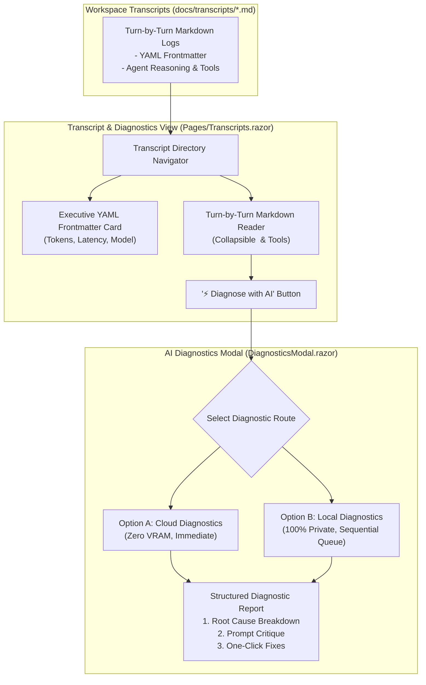

# 📜 Step 5.9: Session Transcripts Viewer & Hybrid AI Diagnostics Modal

> **Phase 5 Implementation Step**  
> *Parent Plan:* [Phase 5 Master Plan](../05_BLAZOR_WEB_UI_AND_TELEMETRY.md) | *Preceding Step:* [Step 5.8: Settings & A/B Testing](STEP_5_8_SETTINGS_HOST_SDKS_AND_AB_TESTING.md) | *Next Phase:* [Phase 6: End-to-End Hardening](../06_END_TO_END_TESTING_AND_HARDENING.md)  
> *Project Target:* `src/NightCodeForge.Web/Components/Transcripts` & `Pages/Transcripts.razor` | *Status:* Ready for Implementation

---

## 1. Executive Objective

Provide an in-depth audit trail browser that parses, renders, and analyzes historical agent reasoning sessions stored under `docs/transcripts/`. It offers hybrid AI diagnostics (Cloud vs. Local) to debug failed stages, runaway tool loops, or unexpected code regressions without cluttering the developer's working tree.

### Core Capabilities:
1. **Markdown Session Transcript Browser:**
   - Discovers and lists turn-by-turn markdown transcript logs under `docs/transcripts/` per issue and stage.
   - Extracts and renders YAML frontmatter metadata into an executive summary card (Tokens consumed, Model, Harness, Stage, Duration, Final Status).
2. **Interactive Conversation Viewer:**
   - Turn-by-turn dialogue rendering with syntax highlighting for code blocks and bash outputs.
   - Expandable/collapsible `<think>` reasoning traces.
   - Tool execution callout cards displaying tool name, arguments, duration, and status.
3. **Hybrid "Diagnose with AI" Modal:**
   - Action dialog offering developer choice between:
     - **Option A: Cloud Diagnostics:** Fast, zero local VRAM consumption via OllamaRouter cloud overflow or direct API.
     - **Option B: Local Diagnostics:** 100% offline and private, enqueued sequentially via `WorkerCount = 1`.
   - Generates a structured **Diagnostic Report**:
     - **Root Cause Breakdown:** Categorizes failures (syntax error, tool hallucination, runaway loop, context rot).
     - **Prompt & Skill Critique:** Evaluates prompt clarity, missing tools, or ambiguity in issue scope.
     - **One-Click Remediation Actions:** Offers direct adjustments to the issue description or agent profile optimization flags.

---

## 2. Architecture & Data Flow



---

## 3. Data Contracts & Models

### 3.1 Transcript Metadata & Models (`Services/TranscriptModels.cs`)

```csharp
namespace NightCodeForge.Web.Services;

public record TranscriptSummary(
    string FileName,
    string FilePath,
    int IssueId,
    string StageId,
    string ModelName,
    DateTime Timestamp,
    int PromptTokens,
    int CompletionTokens,
    int DurationMs,
    string Status);

public record DiagnosticReport(
    string RootCause,
    string FailureCategory,
    IReadOnlyList<string> CritiquePoints,
    IReadOnlyList<RemediationSuggestion> SuggestedActions);

public record RemediationSuggestion(
    string Title,
    string Description,
    string ActionType, // e.g., "ToggleOptimizationFlag", "UpdatePrompt"
    string? TargetKey,
    object? TargetValue);
```

---

## 4. Component Implementation Specifications

### 4.1 Page Layout: `Pages/Transcripts.razor`

```razor
@page "/transcripts"
@page "/transcripts/{FileName}"
@using NightCodeForge.Web.Services
@inject WorkspaceStateService WorkspaceState
@inject ToastService ToastService

<div class="transcripts-container">
    <div class="transcripts-grid">
        <!-- 1. Sidebar Transcript List -->
        <div class="transcript-sidebar card-surface">
            <h4>Session Transcripts</h4>
            <ul class="transcript-file-list">
                @foreach (var item in _transcripts)
                {
                    <li class="file-item @(_selectedTranscript?.FileName == item.FileName ? "active" : "")"
                        @onclick="() => SelectTranscript(item)">
                        <span class="badge-status @item.Status.ToLower()">@item.Status</span>
                        <div class="file-info">
                            <strong>Issue #@item.IssueId: @item.StageId</strong>
                            <small class="text-muted">@item.ModelName - @(item.DurationMs / 1000)s</small>
                        </div>
                    </li>
                }
            </ul>
        </div>

        <!-- 2. Main Transcript Viewer Canvas -->
        <div class="transcript-main">
            @if (_selectedTranscript != null)
            {
                <!-- Executive Metadata Card -->
                <div class="metadata-card card-surface mb-3">
                    <div class="d-flex justify-content-between align-items-center">
                        <div>
                            <h3>@_selectedTranscript.FileName</h3>
                            <span class="badge-tag">Stage: @_selectedTranscript.StageId</span>
                            <span class="badge-tag">Model: @_selectedTranscript.ModelName</span>
                            <span class="badge-tag">Tokens: @((_selectedTranscript.PromptTokens + _selectedTranscript.CompletionTokens).ToString("N0"))</span>
                        </div>
                        <button class="btn btn-primary" @onclick="OpenDiagnosticsModal">
                            🧠 Diagnose with AI
                        </button>
                    </div>
                </div>

                <!-- Markdown Content View -->
                <div class="transcript-content card-surface font-sans p-4">
                    @((MarkupString)_renderedHtml)
                </div>
            }
            else
            {
                <div class="card-surface p-5 text-center text-muted">
                    Select a transcript from the sidebar to inspect the agent reasoning log.
                </div>
            }
        </div>
    </div>
</div>

@if (_showDiagnosticsModal && _selectedTranscript != null)
{
    <DiagnosticsModal Transcript="_selectedTranscript" OnClosed="() => _showDiagnosticsModal = false" />
}
```

### 4.2 Diagnostics Modal Component: `Components/Transcripts/DiagnosticsModal.razor`

```razor
@using NightCodeForge.Web.Services
@inject ToastService ToastService

<div class="forge-modal-backdrop">
    <div class="forge-modal card-glass modal-lg">
        <div class="modal-header">
            <h3>🧠 AI Diagnostics: @Transcript.FileName</h3>
            <button class="btn-icon" @onclick="Close">✕</button>
        </div>

        <div class="modal-body">
            @if (_report == null && !_isDiagnosing)
            {
                <div class="diagnostics-choice p-4 text-center">
                    <h4>Select Diagnostic Execution Engine</h4>
                    <p class="text-secondary mb-4">Choose how the diagnostic evaluation should be processed.</p>

                    <div class="row g-4">
                        <div class="col-md-6">
                            <div class="diagnostic-option-card card-surface p-4" @onclick='() => RunDiagnosticsAsync("Cloud")'>
                                <span class="option-icon">☁️</span>
                                <h4>Cloud Diagnostics</h4>
                                <p class="text-muted">Fast, zero local VRAM consumption via OllamaRouter cloud overflow.</p>
                                <button class="btn btn-outline-indigo mt-3">Run via Cloud ➔</button>
                            </div>
                        </div>

                        <div class="col-md-6">
                            <div class="diagnostic-option-card card-surface p-4" @onclick='() => RunDiagnosticsAsync("Local")'>
                                <span class="option-icon">🔒</span>
                                <h4>Local Diagnostics</h4>
                                <p class="text-muted">100% offline and private. Enqueued sequentially on local GPU.</p>
                                <button class="btn btn-outline-teal mt-3">Run Locally ➔</button>
                            </div>
                        </div>
                    </div>
                </div>
            }
            else if (_isDiagnosing)
            {
                <div class="p-5 text-center">
                    <div class="spinner-pulse mb-3"></div>
                    <h4>Analyzing Agent Transcript & Cognitive Deliberation...</h4>
                    <p class="text-muted">Evaluating tool call patterns, prompt instructions, and compiler feedback.</p>
                </div>
            }
            else if (_report != null)
            {
                <!-- Diagnostic Report Display -->
                <div class="diagnostic-report">
                    <div class="alert alert-warning mb-3">
                        <strong>Root Cause:</strong> @_report.RootCause
                    </div>

                    <h4>Prompt & Skill Critique:</h4>
                    <ul>
                        @foreach (var point in _report.CritiquePoints)
                        {
                            <li>@point</li>
                        }
                    </ul>

                    <h4 class="mt-4">Recommended Actions:</h4>
                    <div class="remediation-list">
                        @foreach (var action in _report.SuggestedActions)
                        {
                            <div class="remediation-card card-surface p-3 mb-2 d-flex justify-content-between align-items-center">
                                <div>
                                    <strong>@action.Title</strong>
                                    <p class="text-muted mb-0">@action.Description</p>
                                </div>
                                <button class="btn btn-sm btn-primary">Apply Action</button>
                            </div>
                        }
                    </div>
                </div>
            }
        </div>

        <div class="modal-footer">
            <button class="btn btn-secondary" @onclick="Close">Close</button>
        </div>
    </div>
</div>

@code {
    [Parameter] public TranscriptSummary Transcript { get; set; } = null!;
    [Parameter] public EventCallback OnClosed { get; set; }

    private bool _isDiagnosing;
    private DiagnosticReport? _report;

    private async Task RunDiagnosticsAsync(string mode)
    {
        _isDiagnosing = true;
        try
        {
            // Simulate / Call Diagnostic Service
            await Task.Delay(2000);
            _report = new DiagnosticReport(
                RootCause: "Agent encountered a repeating compiler error and attempted 4 identical edits without reading the full method context.",
                FailureCategory: "Runaway Tool Loop / Incomplete Context",
                CritiquePoints: new[]
                {
                    "The issue description did not specify the target framework (net10.0), causing compiler assumption mismatch.",
                    "LoopCircuitBreaker was disabled for this profile, allowing 4 redundant edit attempts."
                },
                SuggestedActions: new[]
                {
                    new RemediationSuggestion(
                        Title: "Enable Loop Circuit Breaker",
                        Description: "Prevents duplicate tool calls and interrupts runaway loops automatically.",
                        ActionType: "ToggleOptimizationFlag",
                        TargetKey: "LoopCircuitBreaker",
                        TargetValue: true)
                });
        }
        finally
        {
            _isDiagnosing = false;
        }
    }

    private async Task Close()
    {
        await OnClosed.InvokeAsync();
    }
}
```

---

## 5. Verification & Test Plan

1. **Transcript Parsing Tests:**
   - Verify frontmatter extraction from sample `docs/transcripts/transcript-sample.md`.
   - Verify total tokens, model name, and execution duration populate correctly.
2. **Markdown & Code Block Rendering:**
   - Verify code blocks render with syntax styling and `<think>` blocks are styled as distinct callouts.
3. **AI Diagnostics Execution Tests:**
   - Option A (Cloud): verifies instant non-blocking call via OllamaRouter cloud routing.
   - Option B (Local): verifies enqueueing to Hangfire queue sequentially without VRAM collision.
4. **Remediation Action Dispatch:**
   - Clicking "Apply Action" for `LoopCircuitBreaker` updates the active agent profile configuration in SQLite.

---

## 6. Definition of Done (DoD) Checklist

- [ ] `Pages/Transcripts.razor` created with transcript sidebar and main viewer canvas.
- [ ] Frontmatter metadata parser extracts tokens, latency, status, and model name.
- [ ] Turn-by-turn markdown viewer renders thinking traces and tool calls.
- [ ] `DiagnosticsModal.razor` created with Option A (Cloud) vs Option B (Local) execution choice.
- [ ] Diagnostic report renders Root Cause, Prompt Critique, and Remediation Suggestions.
- [ ] One-click remediation actions dispatch to agent profile settings.
- [ ] Component unit tests verify frontmatter parsing and diagnostic flows.
