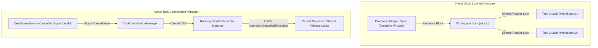

# 🔒 Step 9.14: Workspace Lock Hierarchy & Cancellation Coordination

> **Phase 9 Implementation Step**  
> *Parent Plan:* [Phase 9 Master Plan](../09_CODEBASE_REMEDIATION_AND_ROBUSTNESS.md)  
> *Source Policy:* [AGENTS.md](../../../AGENTS.md)  
> *Status:* Planned | *Target Framework:* .NET 10 (C# 13)

---

## 1. Problem

During the foundation audit, three significant concurrency and lifecycle coordination flaws were identified:
1. **Decoupled Lock Isolation:** [`WorkspaceLockProvider`](file:///c:/Users/Julien/source/repos/jetelain/NightCodeForge/src/NightCodeForge.Core/Concurrency/WorkspaceLockProvider.cs) treats `wks:{id}` and `wks:{id}:task:{id}` as completely independent semaphores. When `TaskOrchestrator` performs canonical squash-merges ([`TaskOrchestrator.cs#L910`](file:///c:/Users/Julien/source/repos/jetelain/NightCodeForge/src/NightCodeForge.Core/Workflow/TaskOrchestrator.cs#L910)), it acquires `wks:{id}`. However, concurrent tasks acquiring `wks:{id}:task:{id}` ([`TaskOrchestrator.cs#L93`](file:///c:/Users/Julien/source/repos/jetelain/NightCodeForge/src/NightCodeForge.Core/Workflow/TaskOrchestrator.cs#L93)) proceed unblocked, exposing canonical Git operations to race conditions.
2. **Uncoordinated Task Cancellation:** When a job is cancelled in [`DevQueueService.CancelJobAsync`](file:///c:/Users/Julien/source/repos/jetelain/NightCodeForge/src/NightCodeForge.Web/Services/DevQueueService.cs#L134-L167), it marks `task.Status = Cancelled` and calls Hangfire `_backgroundJobClient.Delete(jobId)`. However, the actively running `TaskOrchestrator.ProcessTaskAsync` has no active `CancellationTokenSource` linked to that cancellation. The orchestrator continues processing LLM turns in the background and eventually overwrites `TaskOverallStatus.Cancelled` with its stage completion status.
3. **Incomplete Git Lock Purging:** [`DevQueueService.EmergencyReleaseLockAsync`](file:///c:/Users/Julien/source/repos/jetelain/NightCodeForge/src/NightCodeForge.Web/Services/DevQueueService.cs#L221-L226) only looks for `.git/index.lock` directly under `workspace.RepositoryPath`. If the workspace uses worktrees (where `.git` is a file with `gitdir:` pointing elsewhere) or Ext4 WSL mirrors, dangling locks are never cleared.

---

## 2. Findings

| # | Location | Issue | Severity |
| :-- | :--- | :--- | :--- |
| L1 | [`WorkspaceLockProvider.cs`](file:///c:/Users/Julien/source/repos/jetelain/NightCodeForge/src/NightCodeForge.Core/Concurrency/WorkspaceLockProvider.cs#L33-L56) | Workspace-level lock (`AcquireLockAsync`) and task-level lock (`AcquireTaskLockAsync`) do not coordinate. Workspace-exclusive operations (merges, syncs) do not block running task executions on the same workspace. | High |
| L2 | [`DevQueueService.CancelJobAsync`](file:///c:/Users/Julien/source/repos/jetelain/NightCodeForge/src/NightCodeForge.Web/Services/DevQueueService.cs#L134-L167) & [`TaskOrchestrator.cs`](file:///c:/Users/Julien/source/repos/jetelain/NightCodeForge/src/NightCodeForge.Core/Workflow/TaskOrchestrator.cs#L80-L140) | Cancelling a background job does not cancel the executing `TaskOrchestrator` execution. Orchestrator runs unobserved and overwrites `Cancelled` status. | High |
| L3 | [`DevQueueService.EmergencyReleaseLockAsync`](file:///c:/Users/Julien/source/repos/jetelain/NightCodeForge/src/NightCodeForge.Web/Services/DevQueueService.cs#L221-L226) | Flat `File.Exists(Path.Combine(workspace.RepositoryPath, ".git", "index.lock"))` ignores worktrees, linked `.git` files, and Ext4 WSL mirrors. | Medium |
| L4 | [`TaskOrchestrator.cs`](file:///c:/Users/Julien/source/repos/jetelain/NightCodeForge/src/NightCodeForge.Core/Workflow/TaskOrchestrator.cs#L140-L260) | Missing status check before stage commits: Orchestrator never checks if task was cancelled in DB or cancellation token requested prior to stage transition. | High |

---

## 3. Technical Specifications & Architecture

### 3.1 Hierarchical Lock Architecture
- Upgrade [`WorkspaceLockProvider`](file:///c:/Users/Julien/source/repos/jetelain/NightCodeForge/src/NightCodeForge.Core/Concurrency/WorkspaceLockProvider.cs):
  - `AcquireLockAsync(workspaceId)`: Acquires an **exclusive** workspace lock, blocking all new task locks and waiting for active tasks on that workspace to finish or yield.
  - `AcquireTaskLockAsync(workspaceId, taskId)`: Acquires a **shared** lock on the workspace and an **exclusive** lock on the specific task. Multiple tasks on the same workspace can run concurrently, but an exclusive workspace operation halts all task starts.

### 3.2 Active Task Cancellation Manager
- Introduce `ITaskCancellationManager` (registered as Singleton):
  - Exposes `CancellationTokenSource Register(int taskId, CancellationToken parentToken)`.
  - Exposes `bool Cancel(int taskId)`.
  - Exposes `void Unregister(int taskId)`.
- Wire into [`TaskOrchestrator.ProcessTaskAsync`](file:///c:/Users/Julien/source/repos/jetelain/NightCodeForge/src/NightCodeForge.Core/Workflow/TaskOrchestrator.cs):
  - Links incoming token with task CTS: `using var cts = _cancellationManager.Register(task.Id, cancellationToken);`.
  - Pass `cts.Token` down through stage executions.
  - Handle `OperationCanceledException`: clean up resources, mark conversation as Cancelled, ensure `task.Status = TaskOverallStatus.Cancelled`.
- Wire into [`DevQueueService.CancelJobAsync`](file:///c:/Users/Julien/source/repos/jetelain/NightCodeForge/src/NightCodeForge.Web/Services/DevQueueService.cs):
  - Calls `_cancellationManager.Cancel(taskId.Value)` immediately stopping the running agent/stage.

### 3.3 Robust Git Lock Purging
- Extract `GitLockPurgeHelper` into Core:
  - Supports reading `.git` as directory or worktree pointer file (`gitdir:`).
  - Purges all dangling `*.lock` files (`index.lock`, `HEAD.lock`, `refs/heads/*.lock`).
  - Handles WSL path resolution via `IWorkspacePathResolver`.
  - Shared by `StartupRecoveryService` and `DevQueueService`.

---

## 4. Definition of Done (DoD) Checklist

- [ ] Exclusive workspace locks block task locks; task locks block workspace locks.
- [ ] Concurrent tasks on the same workspace can execute simultaneously without deadlocking.
- [ ] Cancelling a job in `DevQueueService` immediately cancels running `TaskOrchestrator` execution.
- [ ] Cancelled tasks do not overwrite status on stage termination.
- [ ] Git lock purging correctly resolves worktrees and WSL mirrors.
- [ ] Concurrency and cancellation unit/integration tests passing.
- [ ] `dotnet test --filter "Category!=Acceptance&Category!=E2E"` passes.
